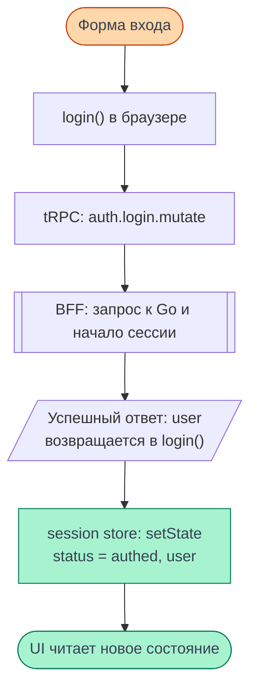

# Архитектура frontend {#frontend-architecture}

Frontend Cellestial — **компонентная SPA с CSR, отдельным BFF и модульной организацией
кода по техническим обязанностям**. Состояние хранится локально в компонентах и в общих
сторах; изменения состояния приводят к обновлению интерфейса.

Срез на 09.11.2026: frontend
[`319e691b79f81e09dcffabc04941831a5f4b5930`](https://github.com/Cringe-Driven-Development-Team/frontend/commit/319e691b79f81e09dcffabc04941831a5f4b5930),
подтверждённый [production CD](https://github.com/Cringe-Driven-Development-Team/frontend/actions/runs/42538007203).
Ниже — объяснение устройства этого кода, не новый прогон пользовательских сценариев.
Размещение серверов и хранилищ описано в [общей архитектуре](/documentation/architecture/).

## Классификация {#classification}

Эти признаки описывают разные стороны приложения и применяются одновременно.

| Что классифицируем | Архитектура проекта |
| --- | --- |
| SPA / MPA | SPA: один клиент, дерево маршрутов и переходы через общий роутер |
| CSR / SSR / SSG | CSR с начальными данными от сервера |
| Организация UI | Компонентная: страницы собираются из компонентов |
| Управление состоянием | Локальный `useState` и общие сторы `@cdd-team/zustand`; однонаправленный поток обновлений |
| Организация кода | Модульная, преимущественно по техническим обязанностям, с элементами слоистости |
| Взаимодействие с сервером | BFF: браузер → tRPC → BFF → HTTP → Go API |
| Организация репозитория | Монорепозиторий: клиент, BFF и общий пакет схем |

Единый [роутер](https://github.com/Cringe-Driven-Development-Team/frontend/blob/319e691b79f81e09dcffabc04941831a5f4b5930/apps/client/src/router.ts#L1-L5)
передаётся в `RouterProvider`. Страницы выбираются внутри запущенного клиента; прямое
открытие URL начинается с HTML от BFF. В репозитории Bun workspaces объединяют
`apps/client`, `apps/bff` и `packages/schemas` —
[конфигурация](https://github.com/Cringe-Driven-Development-Team/frontend/blob/319e691b79f81e09dcffabc04941831a5f4b5930/package.json#L1-L7).
Монорепозиторий описывает организацию исходников, а SPA — устройство клиентского приложения.

## Почему CSR {#csr}

В [HTML-шаблоне](https://github.com/Cringe-Driven-Development-Team/frontend/blob/319e691b79f81e09dcffabc04941831a5f4b5930/apps/client/index.html#L19-L22)
контейнер `root` пустой. BFF вставляет JSON пользователя и, для страницы блокнота,
его начальные данные в `script#bootstrap`. Это делает
[`renderBootstrap`](https://github.com/Cringe-Driven-Development-Team/frontend/blob/319e691b79f81e09dcffabc04941831a5f4b5930/apps/bff/src/html.ts#L21-L45).

Браузер читает bootstrap, заполняет сторы и вызывает
`createRoot(container).render(...)` —
[запуск клиента](https://github.com/Cringe-Driven-Development-Team/frontend/blob/319e691b79f81e09dcffabc04941831a5f4b5930/apps/client/src/main.tsx#L16-L44).
Компоненты строят интерфейс в браузере. Серверная предзагрузка данных сокращает
число начальных запросов, но не является SSR компонентов: сервер не выдаёт их готовую
разметку для последующей гидратации. Название `renderBootstrap` описывает подготовку
HTML с данными и само по себе не определяет способ рендеринга UI.
Подробнее — [запуск приложения](./startup) и [компоненты и рендеринг](./rendering).

## Организация кода {#modules}

Каталоги внутри `apps/client/src` разделяют технические обязанности:

| Каталоги | Ответственность |
| --- | --- |
| `routes`, `layouts` | Маршруты, условия переходов и общий каркас страниц |
| `pages`, `components` | Страницы и составляющие их элементы интерфейса |
| `stores` | Общее состояние и операции над ним |
| `api` | tRPC-клиент, транспорт и обработка результатов запросов |
| `modules`, `utils` | Специализированные модули и вспомогательные функции |

Например, [NotebookPage](https://github.com/Cringe-Driven-Development-Team/frontend/blob/319e691b79f81e09dcffabc04941831a5f4b5930/apps/client/src/pages/NotebookPage/NotebookPage.tsx#L1-L43)
собирает `Cell`, `Header`, `SaveStatus` и другие компоненты, вызывает операции notebook
и runtime-сторов. В `modules` есть специализированный
[просмотр Markdown](https://github.com/Cringe-Driven-Development-Team/frontend/blob/319e691b79f81e09dcffabc04941831a5f4b5930/apps/client/src/modules/markdown/Markdown.tsx#L1-L18).

Зависимости не образуют обязательную цепочку «UI → прикладная логика → API».
[NotebooksPage](https://github.com/Cringe-Driven-Development-Team/frontend/blob/319e691b79f81e09dcffabc04941831a5f4b5930/apps/client/src/pages/NotebooksPage/NotebooksPage.tsx#L25-L82)
сама вызывает `trpc.notebooks.list.query()` и хранит список в локальном состоянии.
Для редактора используется [notebook store](https://github.com/Cringe-Driven-Development-Team/frontend/blob/319e691b79f81e09dcffabc04941831a5f4b5930/apps/client/src/stores/notebook/index.ts#L42-L95):
он хранит подтверждённый снимок и черновики, а рядом с ним организована очередь сохранения.
Поэтому точная характеристика — разделение по обязанностям с элементами слоистости;
названия каталогов сами по себе не устанавливают строгие границы слоёв.

## Состояние и обновление UI {#state-flow}

<DiagramSection>

Локальный `useState` подходит для данных конкретного компонента: например, списка,
загрузки и открытия диалога на `NotebooksPage`. Общий стор нужен, когда состояние
используется несколькими частями приложения. Так,
[`useSessionStore`](https://github.com/Cringe-Driven-Development-Team/frontend/blob/319e691b79f81e09dcffabc04941831a5f4b5930/apps/client/src/stores/session.ts#L6-L31)
содержит пользователя и статус сессии; [ProfileLink](https://github.com/Cringe-Driven-Development-Team/frontend/blob/319e691b79f81e09dcffabc04941831a5f4b5930/apps/client/src/components/ProfileLink/ProfileLink.tsx#L10-L16)
читает пользователя через подписку на стор.

На примере успешного входа:
[форма](https://github.com/Cringe-Driven-Development-Team/frontend/blob/319e691b79f81e09dcffabc04941831a5f4b5930/apps/client/src/pages/AuthPage/AuthForm.tsx#L116-L134)
вызывает `login()`, функция отправляет tRPC-запрос, а
[BFF](https://github.com/Cringe-Driven-Development-Team/frontend/blob/319e691b79f81e09dcffabc04941831a5f4b5930/apps/bff/src/router/auth.ts#L14-L18)
обращается к Go, начинает сессию и возвращает пользователя. После успешного ответа
именно [клиентская функция login](https://github.com/Cringe-Driven-Development-Team/frontend/blob/319e691b79f81e09dcffabc04941831a5f4b5930/apps/client/src/stores/session.ts#L74-L83)
обновляет session store. Компоненты получают новое состояние и отображают его.
Ошибочный ответ не переводит сессию в `authed`; ошибка возвращается форме.

<template #diagram>

</template>

</DiagramSection>

Однонаправленность здесь означает: событие вызывает операцию, операция обновляет
состояние, состояние определяет UI. Такой поток близок к идеям Flux, но в показанной
реализации нет отдельного Flux-dispatcher и обязательных action-объектов:
операции — обычные функции, использующие `setState`.
Подробнее — [управление состоянием](./state), [запросы](./requests) и [сессия](./session).

## Подтверждённые паттерны {#patterns}

**Observer — Наблюдатель.** В notebook store есть явные подписки `onEdit` и `onSaved`.
Они добавляют обработчик в `Set` и возвращают функцию отписки, удаляющую этот обработчик.
Это конкретный пример взаимодействия издателя события и подписчиков —
[реализация](https://github.com/Cringe-Driven-Development-Team/frontend/blob/319e691b79f81e09dcffabc04941831a5f4b5930/apps/client/src/stores/notebook/index.ts#L150-L171).

**Модульные singleton-экземпляры.** Общие
[роутер](https://github.com/Cringe-Driven-Development-Team/frontend/blob/319e691b79f81e09dcffabc04941831a5f4b5930/apps/client/src/router.ts#L1-L5)
и [tRPC-клиент](https://github.com/Cringe-Driven-Development-Team/frontend/blob/319e691b79f81e09dcffabc04941831a5f4b5930/apps/client/src/api/trpc.ts#L125-L150)
создаются при загрузке своих модулей и экспортируются для повторного использования.
Это выполняет роль общего экземпляра без класса Singleton. Область единственности —
данный загруженный модуль: другая вкладка или серверный процесс имеют своё окружение.

**BFF — Backend for Frontend.** Это архитектурный паттерн взаимодействия клиента с
backend. Наш BFF готовит HTML с данными, обслуживает tRPC, управляет сессией и вызывает
Go API. Например, [процедура notebooks.get](https://github.com/Cringe-Driven-Development-Team/frontend/blob/319e691b79f81e09dcffabc04941831a5f4b5930/apps/bff/src/router/notebooks.ts#L8-L12)
использует общий загрузчик данных блокнота. Его устройство описано на [странице BFF](./bff).

## Границы классификации {#limits}

Слово «слои» здесь означает разделение обязанностей. Для утверждения о Clean Architecture
нужны подтверждённые границы и правила зависимостей; наличие `pages`, `stores` и `api`
этого не доказывает. Прямой API-вызов страницы и транспорт внутри стора показывают,
как обязанности распределены в нашем коде фактически.

Аналогично, оснований называть эту организацию FSD или DDD по показанной структуре нет.
Модули выделены преимущественно по технической роли. Сами компоненты и сторы также не
задают классические роли MVC, MVP или MVVM: чтобы использовать такие названия,
нужно показать соответствующее разделение и взаимодействие частей приложения.
Для этого проекта достаточно подтверждённых характеристик из таблицы выше.

## Для конспекта {#summary}

Компонентная SPA с CSR и серверной предзагрузкой данных; модульная организация
по техническим обязанностям с элементами слоистости; локальное и общее реактивное
состояние с однонаправленным обновлением UI; взаимодействие с backend через BFF.
Клиент, BFF и общие схемы находятся в одном монорепозитории.
