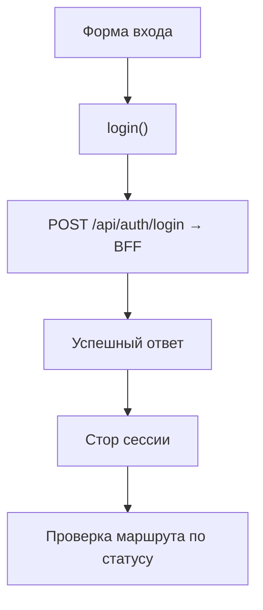

# Архитектура frontend {#frontend-architecture}

Frontend — SPA с клиентским рендерингом. BFF решает, какой HTML-ответ дать при прямом открытии, и вкладывает JSON для первого рендера. Дерево компонентов создаёт `createRoot` в браузере. Описание опирается на исходники выложенной ревизии. [Выдача HTML](https://github.com/Cringe-Driven-Development-Team/frontend/blob/b1baf996fb6753d1a62eab6f874d03dca30faadc/apps/bff/src/html.ts#L87-L142), [точка входа](https://github.com/Cringe-Driven-Development-Team/frontend/blob/b1baf996fb6753d1a62eab6f874d03dca30faadc/apps/client/src/main.tsx#L14-L48).

## Границы приложения {#classification}

| Граница | Ответственность |
| --- | --- |
| BFF → браузер | HTML, DTO пользователя и данные открываемого блокнота. [Шаблон и bootstrap](https://github.com/Cringe-Driven-Development-Team/frontend/blob/b1baf996fb6753d1a62eab6f874d03dca30faadc/apps/bff/src/html.ts#L21-L47) |
| Браузер → BFF | HTTP API; типы маршрутов доступны клиенту через `BffPaths`. [Типы и вызовы](https://github.com/Cringe-Driven-Development-Team/frontend/blob/b1baf996fb6753d1a62eab6f874d03dca30faadc/apps/client/src/api/bff.ts#L1-L46) |
| BFF → Go | Вызовы Go через адаптер BFF. [Адаптер](https://github.com/Cringe-Driven-Development-Team/frontend/blob/b1baf996fb6753d1a62eab6f874d03dca30faadc/apps/bff/src/go/request.ts#L1-L34) |

## Первый рендер {#csr}

В `script#bootstrap` находится JSON. Клиент читает его, инициализирует сессию и вызывает `createRoot`. Порядок действий и ошибки описаны в [запуске приложения](./startup). [Чтение bootstrap](https://github.com/Cringe-Driven-Development-Team/frontend/blob/b1baf996fb6753d1a62eab6f874d03dca30faadc/apps/client/src/bootstrap.ts#L22-L63), [инициализация](https://github.com/Cringe-Driven-Development-Team/frontend/blob/b1baf996fb6753d1a62eab6f874d03dca30faadc/apps/client/src/main.tsx#L21-L30).

## Организация кода {#modules}

Маршруты и проверки доступа находятся в `routes/`, страницы — в `pages/`, общие компоненты — в `components/`, состояние приложения — в `stores/`. Например, маршрут блокнота импортирует `NotebookPage`, а страница передаёт данные и обработчики компонентам ячеек. [Маршрут](https://github.com/Cringe-Driven-Development-Team/frontend/blob/b1baf996fb6753d1a62eab6f874d03dca30faadc/apps/client/src/routes/notebook.ts#L1-L11), [ячейки на странице](https://github.com/Cringe-Driven-Development-Team/frontend/blob/b1baf996fb6753d1a62eab6f874d03dca30faadc/apps/client/src/pages/NotebookPage/NotebookPage.tsx#L579-L620).

## Состояние и обновление UI {#state-flow}

<DiagramSection>

Пример входа. Компоненты читают статус пользователя из стора. Функция `login()` вызывает браузерный API, а результат успешной смены сессии обновляет стор. Подробнее в [сессии](./session), [запросах](./requests), [состоянии](./state) и [рендеринге](./rendering). [Действия сессии](https://github.com/Cringe-Driven-Development-Team/frontend/blob/b1baf996fb6753d1a62eab6f874d03dca30faadc/apps/client/src/stores/session.ts#L19-L34), [вход](https://github.com/Cringe-Driven-Development-Team/frontend/blob/b1baf996fb6753d1a62eab6f874d03dca30faadc/apps/client/src/stores/session.ts#L63-L85), [проверка статуса](https://github.com/Cringe-Driven-Development-Team/frontend/blob/b1baf996fb6753d1a62eab6f874d03dca30faadc/apps/client/src/routes/auth.ts#L5-L12).

<template #diagram>

</template>

</DiagramSection>

## Состояние между компонентами {#patterns}

Модуль стора экспортирует состояние и действия. Подписки на события редактора `onEdit` и `onSaved` возвращают функции удаления слушателя. [Стор редактора](https://github.com/Cringe-Driven-Development-Team/frontend/blob/b1baf996fb6753d1a62eab6f874d03dca30faadc/apps/client/src/stores/notebook/index.ts#L78-L96), [подписки редактора](https://github.com/Cringe-Driven-Development-Team/frontend/blob/b1baf996fb6753d1a62eab6f874d03dca30faadc/apps/client/src/stores/notebook/index.ts#L151-L176).

## Серверные границы {#limits}

За обработчиками HTTP и загрузкой данных из Go обращайтесь к [BFF](./bff). Расположение сервисов и поток запросов показаны в [архитектуре сервиса](/documentation/architecture/).
