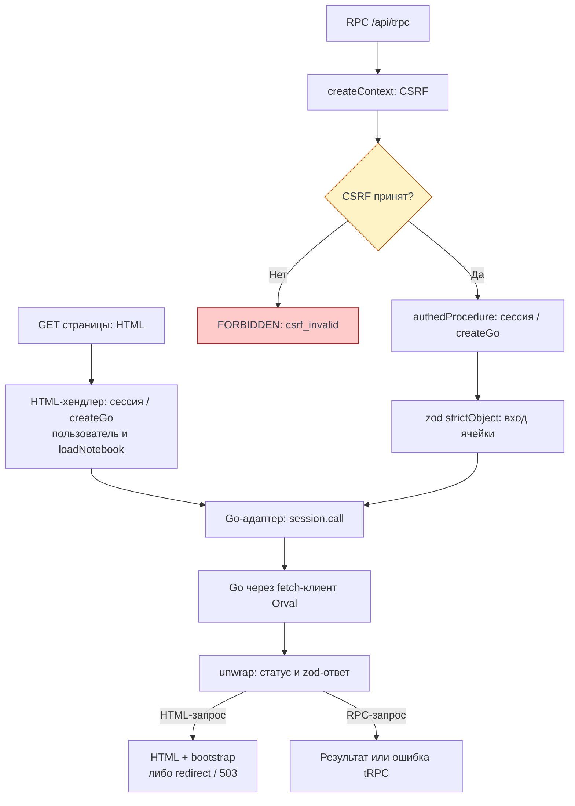

# BFF

BFF — серверная часть фронта: выдаёт HTML с bootstrap, принимает процедуры tRPC,
проверяет сессию и данные, обращается к Go. Клиент вызывает только BFF; прямого
транспорта в Go у него нет. Здесь описана серверная граница, а клиентские
[запросы](./requests), [сессия](./session) и [первый HTML](./startup#первыи-html-от-bff)
разобраны отдельно.

Срез кода на 08.11.2026 — frontend `ea123518d624521f999e884ff32ddec0a5bf6bfa`. Это не новый прогон
продукта на проде. В конце сохранён [отчёт 31.10.2026](#bff-проверенная-часть)
со своими релизами и ограничениями; его источники не подменены текущим SHA.

## HTML и RPC одного приложения

`createBff` собирает Hono-приложение, HTML-хендлер и адаптер `fetchRequestHandler`
с `appRouter` и `createContext`. `/health` проверяет liveness; `/api/trpc` и его
подпути идут в tRPC, остальные `/api/*` возвращают `404` и в Go не проксируются.
Публичные файлы обслуживаются до HTML; оставшиеся GET с `Accept: text/html`
передаются HTML-хендлеру. HEAD обрабатывается как GET, тело отбрасывает Bun.
Источники: [createApp](https://github.com/Cringe-Driven-Development-Team/frontend/blob/ea123518d624521f999e884ff32ddec0a5bf6bfa/apps/bff/src/app.ts#L20-L61) и [createBff](https://github.com/Cringe-Driven-Development-Team/frontend/blob/ea123518d624521f999e884ff32ddec0a5bf6bfa/apps/bff/src/bff.ts#L9-L38).

HTML-хендлер получает пользователя через Go при активной сессии, выбирает redirect
или приложение и при открытии своего блокнота добавляет `notebookPage`. Гостю
недоступные страницы дают `302 /login`, вошедшему неизвестный адрес — `302 /404`.
Сбой Go даёт `503` без запуска приложения; новая cookie после удачного refresh
сохраняется и в таком ответе. HTML имеет `Cache-Control: private, no-store`.
`serialize-javascript` с `isJSON: true` и `HTMLRewriter` вставляют bootstrap,
экранируя опасные HTML-последовательности. Детали безопасной вставки принадлежат
[XSS](/documentation/security/xss). Источник: [HTML-хендлер](https://github.com/Cringe-Driven-Development-Team/frontend/blob/ea123518d624521f999e884ff32ddec0a5bf6bfa/apps/bff/src/html.ts#L21-L134).

## RPC: контекст и валидация {#rpc}

<DiagramSection>

`createContext` сначала проверяет CSRF: каждый RPC требует `X-CSRF: 1`, POST —
ещё совпадающий `Origin` и, если есть, `Sec-Fetch-Site: same-origin`. Отказ
`FORBIDDEN / csrf_invalid` случается до чтения cookie и вызова Go.
Контекст содержит сессию запроса, `resHeaders` и правила Prism только для dev.

`publicProcedure` используется входом и регистрацией, `optionalSessionProcedure`
позволяет выйти и без сессии, `authedProcedure` требует активную сессию и даёт
`ctx.go`. Вход процедуры проверяется zod; ячейки используют `strictObject`,
чтобы лишнее поле не исчезало молча. Базовое middleware записывает итоговое решение
сессии в `Set-Cookie` в `finally`, в том числе при ошибке процедуры.
Источники: [createContext](https://github.com/Cringe-Driven-Development-Team/frontend/blob/ea123518d624521f999e884ff32ddec0a5bf6bfa/apps/bff/src/context.ts#L19-L42), [middleware процедур](https://github.com/Cringe-Driven-Development-Team/frontend/blob/ea123518d624521f999e884ff32ddec0a5bf6bfa/apps/bff/src/trpc.ts#L32-L56) и [валидация ячеек](https://github.com/Cringe-Driven-Development-Team/frontend/blob/ea123518d624521f999e884ff32ddec0a5bf6bfa/apps/bff/src/router/cells.ts#L10-L44).

<template #diagram>

</template>
</DiagramSection>

Схема сопоставляет HTML с чтением Go и защищённую RPC-процедуру ячеек.
HTML-хендлер сам выбирает bootstrap, redirect или ошибку; через RPC-контекст
и CSRF gate он не проходит. Public/optional-процедуры используют
ту же CSRF-проверку и базовый middleware, но имеют другие требования к сессии.
Политика CSRF и её ограничения — у [владельца темы](/documentation/security/csrf).

## Общий загрузчик NotebookPage

`NotebookPage` — общий результат `notebooks.get` и `notebookPage` bootstrap.
`loadNotebook` параллельно читает метаданные, content и активную runtime-сессию.
`hash` и `cells` берутся из одного content-ответа, а не собираются из разных версий.
Очередь runtime читается после active и только для сессии открытого блокнота.
Ошибка любого чтения — ошибка загрузки, а не подстановка пустого массива.
Источники: [NotebookPage и loadNotebook](https://github.com/Cringe-Driven-Development-Team/frontend/blob/ea123518d624521f999e884ff32ddec0a5bf6bfa/apps/bff/src/notebook.ts#L5-L54) и [notebooks.get](https://github.com/Cringe-Driven-Development-Team/frontend/blob/ea123518d624521f999e884ff32ddec0a5bf6bfa/apps/bff/src/router/notebooks.ts#L8-L16); вызов из HTML — [loadNotebook в HTML](https://github.com/Cringe-Driven-Development-Team/frontend/blob/ea123518d624521f999e884ff32ddec0a5bf6bfa/apps/bff/src/html.ts#L98-L113).
Это сохраняет единый контракт при прямом открытии и SPA-переходе, описанных в
[запуске](./startup).

## Go-адаптер и ошибки

`createGo(session)` вызывает сгенерированные операции через `session.call`:
там Bearer, refresh и повтор после `401`. Для изменения ячеек адаптер превращает
проверенный `hash` в сильный `If-Match` с кавычками. Мутатор `bearerFetch`
добавляет `GO_API_URL`, `X-BFF-Key` при заданном ключе и таймаут 5 с;
`Authorization` и `X-Request-ID` передаёт слой сессии.
Источники: [createGo и If-Match](https://github.com/Cringe-Driven-Development-Team/frontend/blob/ea123518d624521f999e884ff32ddec0a5bf6bfa/apps/bff/src/go/api.ts#L80-L88); [операции Go](https://github.com/Cringe-Driven-Development-Team/frontend/blob/ea123518d624521f999e884ff32ddec0a5bf6bfa/apps/bff/src/go/api.ts#L133-L205) и [bearerFetch](https://github.com/Cringe-Driven-Development-Team/frontend/blob/ea123518d624521f999e884ff32ddec0a5bf6bfa/apps/bff/src/go/fetch.ts#L4-L43).

`unwrap` принимает только успешные статусы операции и проверяет тело zod-схемой
ответа из `@cdd/schemas`. Неожиданная форма успешного ответа — `GoError('unexpected')`;
без схемы, как у `204`, тело не требуется. HTTP-ошибки сохраняют машинный `code`
Go. BFF переводит известные `4xx` в категории tRPC; `403 s2s_forbidden`, `5xx`,
сеть, таймаут и неправильный ответ становятся `BAD_GATEWAY`, не запретом пользователю.
`SessionEnded` становится `UNAUTHORIZED`. Форматтер добавляет `appCode` и `zodError`,
убирает stack и скрывает внутренние исключения.
Источники: [unwrap](https://github.com/Cringe-Driven-Development-Team/frontend/blob/ea123518d624521f999e884ff32ddec0a5bf6bfa/apps/bff/src/go/errors.ts#L40-L79), [toTrpcError](https://github.com/Cringe-Driven-Development-Team/frontend/blob/ea123518d624521f999e884ff32ddec0a5bf6bfa/apps/bff/src/errors.ts#L28-L77) и [errorFormatter](https://github.com/Cringe-Driven-Development-Team/frontend/blob/ea123518d624521f999e884ff32ddec0a5bf6bfa/apps/bff/src/trpc.ts#L9-L27).
[Реакция UI](./requests#errors) использует эти машинные поля.

## Apidog, Orval и схемы

Apidog владеет контрактом Go; `spec/openapi.json` — локальная копия. `bun run sync`
включает выгрузку Apidog и Orval. `orval.config.ts` создаёт две цели из одной спеки:
fetch-клиент `apps/bff/src/go/client.ts` с мутатором `bearerFetch` и
`packages/schemas/src/zod.ts` (`@cdd/schemas`). Типы TypeScript описывают вызовы
при сборке, zod проверяет реальные входы и ответы на границе доверия.
Сгенерированные файлы руками не редактируют. Источники: [orval.config.ts](https://github.com/Cringe-Driven-Development-Team/frontend/blob/ea123518d624521f999e884ff32ddec0a5bf6bfa/orval.config.ts#L1-L30) и [порядок Spec First и моков](https://github.com/Cringe-Driven-Development-Team/frontend/blob/ea123518d624521f999e884ff32ddec0a5bf6bfa/docs/api-contract.md#L3-L19).

Это описание существующего конвейера, не новый аудит Apidog и не запуск sync.
Cloud Mock и Prism подтверждают работу по примерам контракта, но не сохранение
в реальном Go. Независимую интеграцию проверяют после готовности обеих сторон.

## Что проверить в понимании

- Где кончается защита маршрута UI и начинается защита RPC?
- Зачем валидировать ответ Go, если клиент уже сгенерирован по контракту?
- Почему content даёт hash вместе с ячейками, а метаданные читаются отдельно?
- Какие данные подтверждает текущий код, а какие — только исторический прогон ниже?

## BFF: проверенная часть {#bff-проверенная-часть}

Проверено 31.10.2026 в 13:11 UTC на [cellestial.ru](https://cellestial.ru) в чистом Chrome:
гостю доступна форма входа, запросы tRPC проходят отдельную проверку CSRF и сессии.
Это свидетельство только гостевого маршрута, а не готовности всего [трека BFF](/modules/2/tracks/bff).

### Что наблюдается на проде {#что-наблюдается-на-проде}

| Сценарий | Результат |
| --- | --- |
| Открыть `/` в чистом браузере | `302` на `/login`, затем `200`, видна форма входа |
| Прочитать bootstrap HTML `/login` | `user: null`, cookie гостю не установлены |
| Из этой страницы вызвать `GET /api/trpc/users.me` без `X-CSRF` | `403`, `appCode: csrf_invalid` |
| Повторить тот же GET с `X-CSRF: 1` | `401`, сообщение «Нет сессии» |
| Вызвать прежний `GET /api/v1/users/me` | `404 Not Found` |

Браузер → BFF: HTML и `/api/trpc/*` — наблюдаемый публичный маршрут. Обычный curl к `/`
без `Accept: text/html` возвращает `404`; это не свидетельство недоступности формы входа.
Результат согласуется с [маршрутизацией BFF](https://github.com/Cringe-Driven-Development-Team/frontend/blob/dd3d11fbeebe5bf1e2b51fdd663a36d1829a4e64/apps/bff/src/app.ts#L34-L55).

Проверки запросов BFF описаны в [CSRF](/documentation/security/csrf), защита bootstrap
и текстового вывода — в [XSS](/documentation/security/xss).

### Релизы и граница доказательства {#релизы-и-граница-доказательства}

На момент проверки GitHub Deployments сообщает `success` для следующих production-выкладок:

| Репозиторий | SHA | Свидетельство выкладки |
| --- | --- | --- |
| frontend | `dd3d11fbeebe5bf1e2b51fdd663a36d1829a4e64` | [Deployment 7389948880](https://api.github.com/repos/Cringe-Driven-Development-Team/frontend/deployments/7389948880/statuses), [CD 28.10](https://github.com/Cringe-Driven-Development-Team/frontend/actions/runs/40717708570) |
| backend | `23d3dd9e955424a7634fb0dc49a38af6eb08792c` | [Deployment 7434158986](https://api.github.com/repos/Cringe-Driven-Development-Team/backend/deployments/7434158986/statuses), [CD 30.10](https://github.com/Cringe-Driven-Development-Team/backend/actions/runs/41027513296) |
| infra | `14653763279dab055e3cea47a84a0c531bccf03f` | [Deployment 7458961353](https://api.github.com/repos/Cringe-Driven-Development-Team/infra/deployments/7458961353/statuses), [CD 31.10](https://github.com/Cringe-Driven-Development-Team/infra/actions/runs/41203603237) |

Это SHA из источника выкладки, не измерение версии работающего процесса. Успех deployment
сам по себе не подтверждает пользовательский сценарий; наблюдения выше проверены отдельно.

### Где искать реализацию {#где-искать-реализацию}

Исторические ссылки ниже относятся к SHA выкладок из отчёта, а не к срезу кода 08.11.2026.
Код маршрута **браузер → BFF → Go** принадлежит двум репозиториям:

- [frontend: сборка обработчиков HTML и tRPC](https://github.com/Cringe-Driven-Development-Team/frontend/blob/dd3d11fbeebe5bf1e2b51fdd663a36d1829a4e64/apps/bff/src/bff.ts#L21-L32).
- [Проверка CSRF перед чтением сессии](https://github.com/Cringe-Driven-Development-Team/frontend/blob/dd3d11fbeebe5bf1e2b51fdd663a36d1829a4e64/apps/bff/src/context.ts#L25-L31).
  Код требует `X-CSRF: 1`; для POST дополнительно проверяет `Origin` и `Sec-Fetch-Site`.
  На проде в этой проверке испытаны только два GET из таблицы, не вся матрица защиты.
- [Вызов Go через сессию BFF](https://github.com/Cringe-Driven-Development-Team/frontend/blob/dd3d11fbeebe5bf1e2b51fdd663a36d1829a4e64/apps/bff/src/go/api.ts#L44-L55)
  и [backend на SHA выкладки](https://github.com/Cringe-Driven-Development-Team/backend/tree/23d3dd9e955424a7634fb0dc49a38af6eb08792c).
  Участок BFF → Go здесь подтверждён исходниками, **не проверен авторизованным сценарием на проде**.
- [Локальная разработка frontend и BFF](https://github.com/Cringe-Driven-Development-Team/frontend/blob/dd3d11fbeebe5bf1e2b51fdd663a36d1829a4e64/docs/local-development.md#L1-L11).

### Что ещё нужно проверить {#что-еще-нужно-проверить}

Нет проверяемого свидетельства входа и регистрации, refresh и параллельных запросов,
выхода, открытия и изменения блокнотов, работы после истечения сессии и POST-защиты от чужого
Origin. Нужен прогон с тестовой учётной записью или свидетельство владельца с датой,
релизом и результатами. В границах проверки 31.10.2026 эти возможности остаются [планом авторизации](/modules/2/tracks/bff/auth)
и других страниц трека, а не доказанными тем прогоном сценариями. Это ограничение исторического свидетельства,
не утверждение об отсутствии реализации на текущем SHA.
