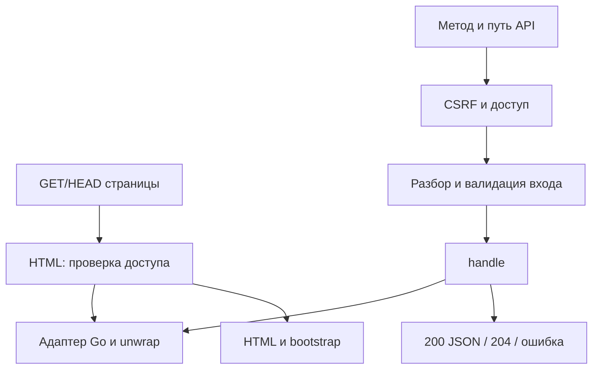

# BFF

Браузер получает HTML и вызывает HTTP API через BFF. Контракт браузера выводится из таблицы маршрутов BFF (code-first), а контракт вызовов BFF в Go задаёт OpenAPI репозитория backend (spec-first). [Таблица маршрутов и `BffPaths`](https://github.com/Cringe-Driven-Development-Team/frontend/blob/b1baf996fb6753d1a62eab6f874d03dca30faadc/apps/bff/src/router/index.ts#L1-L20), [закреплённая спека Go](https://github.com/Cringe-Driven-Development-Team/frontend/blob/b1baf996fb6753d1a62eab6f874d03dca30faadc/spec/contract-source.json#L1-L5).

## HTML и HTTP API {#html-и-rpc-одного-приложения}

`Bun.serve` принимает `routes` и резервный обработчик `fetch`. [Запуск BFF](https://github.com/Cringe-Driven-Development-Team/frontend/blob/b1baf996fb6753d1a62eab6f874d03dca30faadc/apps/bff/src/index.ts#L12-L31), [диспетчеризация](https://github.com/Cringe-Driven-Development-Team/frontend/blob/b1baf996fb6753d1a62eab6f874d03dca30faadc/apps/bff/src/app.ts#L23-L90).

| Запрос | Ответ |
| --- | --- |
| `GET /health` | `200 ok` для проверки процесса. |
| Зарегистрированный метод и путь `/api/*` | Ответ обработчика маршрута. |
| `HEAD` зарегистрированного `GET` | Bun выполняет тот же обработчик и отбрасывает тело ответа. |
| `HEAD` маршрута API только с `POST`, неизвестный путь или метод API | JSON `404` из резервного обработчика. |
| `/robots.txt` и публичные файлы | Ответ по записи в `routes`. |
| Прочий `GET/HEAD` с `Accept: text/html` | Обработчик страниц. |
| Остальные запросы | Текстовый `404`. |

Для HTML BFF определяет страницу и пользователя, затем помещает DTO в `<script id="bootstrap" type="application/json">` через `HTMLRewriter`. Пакет `@cdd-team/serialize-javascript` экранирует JSON для элемента script. Браузер берёт текст элемента и разбирает его через `JSON.parse` до первого рендера. [HTML](https://github.com/Cringe-Driven-Development-Team/frontend/blob/b1baf996fb6753d1a62eab6f874d03dca30faadc/apps/bff/src/html.ts#L21-L46), [чтение bootstrap](https://github.com/Cringe-Driven-Development-Team/frontend/blob/b1baf996fb6753d1a62eab6f874d03dca30faadc/apps/client/src/bootstrap.ts#L18-L40), [запуск клиента](./startup#первыи-html-от-bff).

| Прямой запрос страницы | Ответ BFF |
| --- | --- |
| Гость открывает вход или регистрацию | `200` с гостевым bootstrap. |
| Гость открывает любой другой адрес | `302 /login`. |
| Вошедший открывает неизвестный URL, `/404`, отсутствующий или чужой блокнот либо блокнот с некорректным ID | `302` на `/`. |
| Вошедший открывает свой блокнот | `200` с данными блокнота в bootstrap. |
| Сессия завершилась при проверке в Go | Гостевой сценарий с удалением cookie сессии. |
| Go временно недоступен или подготовка данных страницы завершается другим сбоем Go | HTML `503` без запуска приложения. BFF сохраняет сессию, включая новую cookie после успешного refresh. |

[Правила доступа и обработка сбоев](https://github.com/Cringe-Driven-Development-Team/frontend/blob/b1baf996fb6753d1a62eab6f874d03dca30faadc/apps/bff/src/html.ts#L73-L83), [редиректы и отправка cookie](https://github.com/Cringe-Driven-Development-Team/frontend/blob/b1baf996fb6753d1a62eab6f874d03dca30faadc/apps/bff/src/html.ts#L107-L141).

## Проверка входа и типы BFF {#rpc}

<DiagramSection>

1. Укажи метод, путь, доступ, источник входа и `handle` в `route({...})`. Маршрут принимает query, JSON или multipart и связывает ручной валидатор с входом обработчика. Из результата `handle` выводятся ответ и `BffPaths`, которые клиент импортирует через `import type`. [Объявление и вывод типов](https://github.com/Cringe-Driven-Development-Team/frontend/blob/b1baf996fb6753d1a62eab6f874d03dca30faadc/apps/bff/src/http.ts#L9-L90), [экспорт](https://github.com/Cringe-Driven-Development-Team/frontend/blob/b1baf996fb6753d1a62eab6f874d03dca30faadc/apps/bff/src/types.ts#L1-L13).
2. Используй ручные проверки из `@cdd/schemas/validate` в форме и на HTTP-границе. Сервер проверяет [CSRF](/documentation/security/csrf#проверки-bff), сессию и доступ, затем разбирает вход и передаёт проверенные данные обработчику. Неверный тип тела даёт `415`, неразбираемое тело или неверный вход — `400`. [Проверки маршрута](https://github.com/Cringe-Driven-Development-Team/frontend/blob/b1baf996fb6753d1a62eab6f874d03dca30faadc/apps/bff/src/http.ts#L92-L200), [проверка полей формы](https://github.com/Cringe-Driven-Development-Team/frontend/blob/b1baf996fb6753d1a62eab6f874d03dca30faadc/apps/client/src/utils/credentials.ts#L1-L33).
3. Верни DTO для `200` с JSON или `undefined` для `204`. Ошибки сериализуются как `{ error }`, решение о `Set-Cookie` применяется на обоих путях. [Ответ маршрута](https://github.com/Cringe-Driven-Development-Team/frontend/blob/b1baf996fb6753d1a62eab6f874d03dca30faadc/apps/bff/src/http.ts#L166-L200), [формат ошибки](./requests#errors).

<template #diagram>

</template>

</DiagramSection>

## Общий загрузчик NotebookPage {#общии-загрузчик-notebookpage}

Прямое открытие блокнота и `GET /api/notebooks/get` используют `loadNotebook`. Метаданные, согласованная пара `hash` и ячейки, а также активная сессия запрашиваются параллельно. Очередь читается для активной сессии открытого блокнота. Ошибка любого чтения завершает загрузку. [Загрузчик](https://github.com/Cringe-Driven-Development-Team/frontend/blob/b1baf996fb6753d1a62eab6f874d03dca30faadc/apps/bff/src/notebook.ts#L9-L53), [вызов из HTML](https://github.com/Cringe-Driven-Development-Team/frontend/blob/b1baf996fb6753d1a62eab6f874d03dca30faadc/apps/bff/src/html.ts#L107-L122), [маршрут блокнота](https://github.com/Cringe-Driven-Development-Team/frontend/blob/b1baf996fb6753d1a62eab6f874d03dca30faadc/apps/bff/src/router/notebooks.ts#L22-L28).

## Go-адаптер и ошибки {#go-адаптер-и-ошибки}

В выложенном BFF `go(method, path, options)` использует `GoPaths` и общий HTTP-клиент. `createGoFetch` берёт адрес из `GO_API_URL`, ставит таймаут 5 с и добавляет `X-BFF-Key`, если настроен ключ. Сессия добавляет `Authorization: Bearer`. `unwrap` проверяет ожидаемый статус и результат ручного валидатора из `go/responses.ts`. Успешный HTTP-статус сам по себе не подтверждает форму ответа. Неожиданный ответ Go становится `502 BAD_GATEWAY`. [Клиент Go](https://github.com/Cringe-Driven-Development-Team/frontend/blob/b1baf996fb6753d1a62eab6f874d03dca30faadc/apps/bff/src/go/request.ts#L1-L34), [транспорт](https://github.com/Cringe-Driven-Development-Team/frontend/blob/b1baf996fb6753d1a62eab6f874d03dca30faadc/apps/bff/src/go/fetch.ts#L1-L28), [сессия](https://github.com/Cringe-Driven-Development-Team/frontend/blob/b1baf996fb6753d1a62eab6f874d03dca30faadc/apps/bff/src/session/session.ts#L115-L122), [unwrap](https://github.com/Cringe-Driven-Development-Team/frontend/blob/b1baf996fb6753d1a62eab6f874d03dca30faadc/apps/bff/src/go/errors.ts#L45-L79), [вызов валидатора](https://github.com/Cringe-Driven-Development-Team/frontend/blob/b1baf996fb6753d1a62eab6f874d03dca30faadc/apps/bff/src/go/api.ts#L386-L398), [проверка DTO пакетного запуска](https://github.com/Cringe-Driven-Development-Team/frontend/blob/b1baf996fb6753d1a62eab6f874d03dca30faadc/apps/bff/src/go/responses.ts#L230-L237), [перевод ошибки](https://github.com/Cringe-Driven-Development-Team/frontend/blob/b1baf996fb6753d1a62eab6f874d03dca30faadc/apps/bff/src/errors.ts#L79-L125).

При старте BFF проверяет адрес Go, `APP_ORIGIN`, `SESSION_KEY`, порт и флаги. Ошибка проверки завершает процесс с кодом 1. [Конфигурация выложенного BFF](https://github.com/Cringe-Driven-Development-Team/frontend/blob/b1baf996fb6753d1a62eab6f874d03dca30faadc/apps/bff/src/env.ts#L15-L65).

## Обновление контракта Go {#apidog-orval-и-схемы}

| Ревизия | Файлы OpenAPI в backend | Команда проверки в backend |
| --- | --- | --- |
| Копия выложенного фронтенда, `947a19ccf4319a621007b2900aa8e620ca27762b` | [`spec/openapi.json`](https://github.com/Cringe-Driven-Development-Team/backend/blob/947a19ccf4319a621007b2900aa8e620ca27762b/spec/openapi.json#L1-L15) | [`make contract-lint`](https://github.com/Cringe-Driven-Development-Team/backend/blob/947a19ccf4319a621007b2900aa8e620ca27762b/Makefile#L58-L68) |
| Проверенный `backend/main`, `29e5ef56133c6fc42cd2cce3b5ecb379b457c6b8` | [`spec/identity/openapi.json`](https://github.com/Cringe-Driven-Development-Team/backend/blob/29e5ef56133c6fc42cd2cce3b5ecb379b457c6b8/spec/identity/openapi.json#L1-L15) и [`spec/workspace/openapi.json`](https://github.com/Cringe-Driven-Development-Team/backend/blob/29e5ef56133c6fc42cd2cce3b5ecb379b457c6b8/spec/workspace/openapi.json#L1-L15) | [`make identity-http-check workspace-http-check`](https://github.com/Cringe-Driven-Development-Team/backend/blob/29e5ef56133c6fc42cd2cce3b5ecb379b457c6b8/Makefile#L160-L174). Старый `make contract-lint` в этом Makefile проверяет общий файл. [Цель](https://github.com/Cringe-Driven-Development-Team/backend/blob/29e5ef56133c6fc42cd2cce3b5ecb379b457c6b8/Makefile#L59-L69). |

1. Согласуй правку спеки PR в backend и дождись успешного CI на нужной ветке. Для Identity и Workspace используй профильные Redocly-проверки из таблицы.
2. В checkout актуального фронтенда выполни `bun run contract:fetch` для `main` или `bun run contract:fetch <ветка>` для согласованной ветки. Скрипт разрешает ветку в SHA, скачивает обе спеки и записывает ревизию в `spec/contract-source.json`. В проверенном `frontend/main` закреплён `2971a42e190ee0b15a7af47c6771b538eb06ae67`. [Скрипт](https://github.com/Cringe-Driven-Development-Team/frontend/blob/bfab8a485c78412a814b3765d10ef83a6267deed/scripts/openapi/backend.ts#L9-L59), [манифест main](https://github.com/Cringe-Driven-Development-Team/frontend/blob/bfab8a485c78412a814b3765d10ef83a6267deed/spec/contract-source.json#L1-L5), [манифест выложенной версии](https://github.com/Cringe-Driven-Development-Team/frontend/blob/b1baf996fb6753d1a62eab6f874d03dca30faadc/spec/contract-source.json#L1-L5).
3. По diff спеки вручную обнови DTO и карту операций в `packages/schemas/src/types.ts`, вызовы Go и проверки в `go/responses.ts`, а при изменении ограничений входа также `packages/schemas/src/validate.ts`. Typecheck сверяет код с написанными типами. Соответствие типов и ограничений OpenAPI проверяют по diff. [Правила изменения типов](https://github.com/Cringe-Driven-Development-Team/frontend/blob/bfab8a485c78412a814b3765d10ef83a6267deed/docs/api-contract.md#L10-L33).
4. Выполни `bun run contract:verify` для побайтового сравнения по SHA из манифеста. Проверь изменённый сценарий [на реальном Go](./checks#mock-boundary) с настройками выбранного checkout. На `frontend/main` BFF требует `IDENTITY_API_URL` и `WORKSPACE_API_URL` с префиксом `/api/v1`. [Проверка копии](https://github.com/Cringe-Driven-Development-Team/frontend/blob/bfab8a485c78412a814b3765d10ef83a6267deed/scripts/openapi/backend.ts#L64-L87), [проверка переменных в main](https://github.com/Cringe-Driven-Development-Team/frontend/blob/bfab8a485c78412a814b3765d10ef83a6267deed/apps/bff/src/env.ts#L15-L49), [настройка реального Go](https://github.com/Cringe-Driven-Development-Team/frontend/blob/bfab8a485c78412a814b3765d10ef83a6267deed/docs/api-contract.md#L72-L96).

## BFF: проверенная часть {#bff-проверенная-часть}

### Что наблюдается на проде {#что-наблюдается-на-проде}

27.11.2026 в 23:58:42 MSK (UTC+03:00) гостевой `curl -fsSL -H 'Accept: text/html' https://cellestial.ru/login` получил HTML с `id="bootstrap"` и URL JS и CSS под `/releases/b1baf996fb6753d1a62eab6f874d03dca30faadc/` на CDN.

### Релизы и граница доказательства {#релизы-и-граница-доказательства}

Тот же SHA указан у успешного [production Deployment 8118066244 (rollback)](https://github.com/Cringe-Driven-Development-Team/frontend/actions/runs/46058681997). Манифест фронтенда фиксирует ревизию копии OpenAPI для BFF. [Манифест](https://github.com/Cringe-Driven-Development-Team/frontend/blob/b1baf996fb6753d1a62eab6f874d03dca30faadc/spec/contract-source.json#L1-L5).

### Где искать реализацию {#где-искать-реализацию}

Движение запросов и владение исходниками показаны на [схеме контрактов](/documentation/architecture/#contract). Связь от OpenAPI к копии во frontend обозначает перенос контракта, а HTTP идёт от BFF к Go. [Копирование спеки в выложенной версии](https://github.com/Cringe-Driven-Development-Team/frontend/blob/b1baf996fb6753d1a62eab6f874d03dca30faadc/scripts/openapi/backend.ts#L9-L59), [вызов Go](https://github.com/Cringe-Driven-Development-Team/frontend/blob/b1baf996fb6753d1a62eab6f874d03dca30faadc/apps/bff/src/go/request.ts#L1-L34).

### Что ещё нужно проверить {#что-еще-нужно-проверить}

Авторизованные запросы, запись, запуск ячеек и обновление сессии в этом наблюдении не запускались. Поведение описано по исходникам выложенного SHA. Для интеграционного прогона см. [проверки с реальным Go](./checks#mock-boundary).
