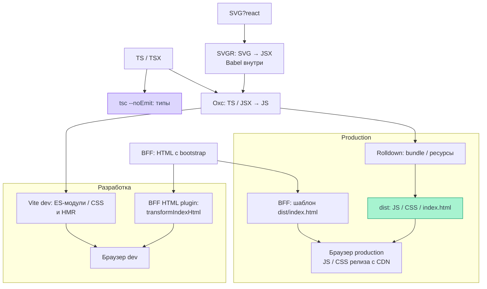

# Сборка и разработка

Bun запускает задачи монорепы, Turborepo связывает их зависимости, Vite готовит
клиентский код для браузера. Проверка типов выполняется отдельной командой.
Срез кода на 08.11.2026 — `ea123518d624521f999e884ff32ddec0a5bf6bfa`.
Это чтение реализации, не новый прогон приложения на проде. Стили разобраны в [обработке CSS](./styles#pipeline),
практические проверки — в [проверке изменений](./checks#tools).

## Bun и Turborepo

Bun — менеджер пакетов workspaces `apps/*` и `packages/*`, исполнитель скриптов и
runtime BFF. Корневой `bun run dev` вызывает `turbo watch dev`, а `bun run build` —
`turbo run build`. Turborepo определяет порядок задач через `dependsOn`, кеширует
результаты сборки в `dist/**` и учитывает `.env` и переменные релиза.
Это видно в [командах монорепы](https://github.com/Cringe-Driven-Development-Team/frontend/blob/ea123518d624521f999e884ff32ddec0a5bf6bfa/package.json#L4-L30) и
[turbo.json](https://github.com/Cringe-Driven-Development-Team/frontend/blob/ea123518d624521f999e884ff32ddec0a5bf6bfa/turbo.json#L4-L35).

Клиентская задача build запускает Vite, серверная — `bun build src/index.ts --target bun --outfile dist/bff.js`. Это две сборки с разными средами исполнения;
BFF не попадает в браузерный bundle. См. [клиент](https://github.com/Cringe-Driven-Development-Team/frontend/blob/ea123518d624521f999e884ff32ddec0a5bf6bfa/apps/client/package.json#L5-L11)
и [BFF](https://github.com/Cringe-Driven-Development-Team/frontend/blob/ea123518d624521f999e884ff32ddec0a5bf6bfa/apps/bff/package.json#L9-L16).

## Преобразования и проверка типов {#transforms}

<DiagramSection>

Из одного TS/TSX-исходника получаются разные результаты: `tsc --noEmit` проверяет
типы без выпуска JS, Oxc преобразует синтаксис для сборки. SVG-компонент приходит
в тот же JS-конвейер через SVGR. Связи заданы
[командами клиента](https://github.com/Cringe-Driven-Development-Team/frontend/blob/ea123518d624521f999e884ff32ddec0a5bf6bfa/apps/client/package.json#L5-L11),
[общим конфигом](https://github.com/Cringe-Driven-Development-Team/frontend/blob/ea123518d624521f999e884ff32ddec0a5bf6bfa/apps/client/vite/shared.ts#L29-L48) и
[обработчиком SVGR 5.2.0](https://github.com/pd4d10/vite-plugin-svgr/blob/8ff69f4a228b86c8f4d141d31f371fa1e105644d/src/index.ts#L31-L58).
Зелёная сборка сама по себе не проверяет типы.

После transform пути расходятся: dev отдаёт ES-модули и HMR, production —
собранные ассеты. HTML в обоих случаях готовит BFF; dev-плагин дополнительно
вызывает `transformIndexHtml`. Пути заданы [dev-конфигом](https://github.com/Cringe-Driven-Development-Team/frontend/blob/ea123518d624521f999e884ff32ddec0a5bf6bfa/apps/client/vite.config.dev.ts#L57-L84) и
[production-конфигом](https://github.com/Cringe-Driven-Development-Team/frontend/blob/ea123518d624521f999e884ff32ddec0a5bf6bfa/apps/client/vite.config.prod.ts#L4-L14);
условия CDN и доставка HTML подробнее разобраны ниже.

<template #diagram>

</template>

</DiagramSection>

В проекте используются ES-модули: `import`/`export`, `type: module`, вход HTML с
`<script type="module">`. В [tsconfig.json](https://github.com/Cringe-Driven-Development-Team/frontend/blob/ea123518d624521f999e884ff32ddec0a5bf6bfa/apps/client/tsconfig.json#L2-L24)
стоят `module: ESNext`, `moduleResolution: bundler`, `noEmit: true`,
`jsx: react-jsx` и `jsxImportSource: @cdd-team/react`. Последний выбирает
автоматический JSX runtime командного React: JSX превращается в вызовы функций
runtime, а не становится HTML-строкой. Вход — [index.html](https://github.com/Cringe-Driven-Development-Team/frontend/blob/ea123518d624521f999e884ff32ddec0a5bf6bfa/apps/client/index.html#L19-L22).

| Этап | Что действительно делает |
| --- | --- |
| TypeScript (`tsc --noEmit`) | Проверяет типы исходников и тестов; JS не выпускает |
| Oxc в Vite 8.3.5 | Убирает TS-синтаксис и преобразует JSX с настройками tsconfig; это transform, без проверки совместимости типов |
| Rolldown | Собирает граф импортов в JS-чанки; Vite обрабатывает HTML и ресурсы |
| SVGR для `.svg?react` | Генерирует JSX-компонент, затем передаёт его в Oxc с явно заданным `importSource: @cdd-team/react` |

Версии подтверждает [lockfile](https://github.com/Cringe-Driven-Development-Team/frontend/blob/ea123518d624521f999e884ff32ddec0a5bf6bfa/bun.lock#L1536-L1542); TS 7.0.2 закреплён
[там же](https://github.com/Cringe-Driven-Development-Team/frontend/blob/ea123518d624521f999e884ff32ddec0a5bf6bfa/bun.lock#L1490).
В Vite обработчик [Oxc](https://github.com/vitejs/vite/blob/981f07fa4580fb88b333c4450431e4715d2a0b82/packages/vite/src/node/plugins/oxc.ts#L120-L168) читает TS-настройки,
а сборка вызывает [Rolldown](https://github.com/vitejs/vite/blob/981f07fa4580fb88b333c4450431e4715d2a0b82/packages/vite/src/node/build.ts#L923-L934).
Для JS production по умолчанию включён Oxc minify;
`build.sourcemap: false`, и проект этот дефолт не переопределяет.
Это подтверждают [дефолты Vite](https://github.com/vitejs/vite/blob/981f07fa4580fb88b333c4450431e4715d2a0b82/packages/vite/src/node/build.ts#L394-L410),
[выбор минификатора](https://github.com/vitejs/vite/blob/981f07fa4580fb88b333c4450431e4715d2a0b82/packages/vite/src/node/build.ts#L451-L464) и
[production-конфиг](https://github.com/Cringe-Driven-Development-Team/frontend/blob/ea123518d624521f999e884ff32ddec0a5bf6bfa/apps/client/vite.config.prod.ts#L4-L14).

Babel действительно присутствует в цепочке SVG: `@svgr/plugin-jsx` 8.1.0
строит Babel AST и применяет `@svgr/babel-preset`, получая код компонента.
Затем `vite-plugin-svgr` 5.2.0 при Rolldown вызывает Oxc; ветка esbuild в его коде
предназначена для другой среды. См. [Babel внутри SVGR](https://github.com/gregberge/svgr/blob/772592e042be5063e782bfb8711d024b2fefc6b8/packages/plugin-jsx/src/index.ts#L38-L80) и
[выбор transform](https://github.com/pd4d10/vite-plugin-svgr/blob/8ff69f4a228b86c8f4d141d31f371fa1e105644d/src/index.ts#L37-L64). Это не означает, что всё приложение собирается
через Babel. При разборе пункта РК о Babel следует назвать эту реальную роль;
наличие зависимости не доказывает соответствие формальному требованию РК.

## Разработка и production {#dev-prod}

В dev браузер открывает HTTPS Vite на `localhost:5173`. Vite обслуживает модули и
HMR, проксирует `/api/trpc` в BFF, а HTML получает от BFF через
`@cdd-team/vite-plugin-bff-html` **0.2.1**. Плагин переносит cookie/статус,
пропускает HTML через `transformIndexHtml` для HMR, сохраняет редиректы;
пути `server.proxy` оставляет прокси. См. [dev-конфиг](https://github.com/Cringe-Driven-Development-Team/frontend/blob/ea123518d624521f999e884ff32ddec0a5bf6bfa/apps/client/vite.config.dev.ts#L57-L84)
и [исходник плагина](https://github.com/Cringe-Driven-Development-Team/frontend-packages/blob/5be3456bc9df61efebef6902ac5ebe157a307c60/packages/vite-plugin-bff-html/src/index.ts#L45-L89).
Первый HTML с bootstrap разобран в [запуске приложения](./startup).

Изменения клиента обрабатывает HMR; изменения BFF и импортируемых workspace-схем
перезапускают BFF через `turbo watch`. Это не обещание сохранения любого локального
состояния при каждой правке. Механизм перезапуска задан в
[turbo.json](https://github.com/Cringe-Driven-Development-Team/frontend/blob/ea123518d624521f999e884ff32ddec0a5bf6bfa/turbo.json#L21-L35), отличие от HMR — в
[локальной разработке](https://github.com/Cringe-Driven-Development-Team/frontend/blob/ea123518d624521f999e884ff32ddec0a5bf6bfa/docs/local-development.md#L150-L161).

Production-задача пишет клиент в `apps/client/dist/`. При `RELEASE_SHA` и `CDN_URL`
`base` равен `<CDN_URL>/releases/<SHA>/`; если хотя бы одна переменная не задана — `/`.
Получившийся `index.html` служит шаблоном BFF, а JS/CSS релиза загружаются с CDN;
это путь обычных ассетов, не адрес RPC. См. [base](https://github.com/Cringe-Driven-Development-Team/frontend/blob/ea123518d624521f999e884ff32ddec0a5bf6bfa/apps/client/vite.config.prod.ts#L4-L14)
и [HTML BFF](https://github.com/Cringe-Driven-Development-Team/frontend/blob/ea123518d624521f999e884ff32ddec0a5bf6bfa/apps/bff/src/html.ts#L83-L134).
`bun run dev:pwa` запускает production-сборку и BFF для проверки без HMR;
поведение service worker имеет [отдельного владельца](/documentation/offline/).

## Алиасы, env и ресурсы

Импорты из другой папки `src` используют алиасы (`@components`, `@stores` и другие)
из `paths` в [tsconfig](https://github.com/Cringe-Driven-Development-Team/frontend/blob/ea123518d624521f999e884ff32ddec0a5bf6bfa/apps/client/tsconfig.json#L23-L35).
Vite читает их через `resolve.tsconfigPaths: true`; внутри папки сохраняются
относительные импорты. Настройки общие для dev и prod.

По умолчанию dev использует mode `development`, build — `production`; от mode
зависит выбор `.env`, `.env.local`, `.env.[mode]` и `.env.[mode].local`.
Это видно в [загрузчике env Vite](https://github.com/vitejs/vite/blob/981f07fa4580fb88b333c4450431e4715d2a0b82/packages/vite/src/node/env.ts#L13-L26),
[dev-дефолте](https://github.com/vitejs/vite/blob/981f07fa4580fb88b333c4450431e4715d2a0b82/packages/vite/src/node/config.ts#L1455-L1481) и
[режиме build](https://github.com/vitejs/vite/blob/981f07fa4580fb88b333c4450431e4715d2a0b82/packages/vite/src/node/build.ts#L584-L596).

`loadEnv(mode, '../..', '')` читает корневой `.env` и окружение для конфига.
Это не делает все переменные публичными: клиентские значения Vite имеют префикс
`VITE_`; `BFF_URL`, `CDN_URL` и `RELEASE_SHA` используются конфигурацией.
`VITE_STATIC_URL` публичен и нормализуется общим конфигом.
Правило публичного префикса — [env Vite 8.3.5](https://github.com/vitejs/vite/blob/981f07fa4580fb88b333c4450431e4715d2a0b82/packages/vite/src/node/env.ts#L83-L115).
См. [загрузку и нормализацию](https://github.com/Cringe-Driven-Development-Team/frontend/blob/ea123518d624521f999e884ff32ddec0a5bf6bfa/apps/client/vite/shared.ts#L5-L38).

| Ресурс | Как определяется путь |
| --- | --- |
| Иконка `.svg?react` | SVGR создаёт компонент, пример импортов — [Icon.tsx](https://github.com/Cringe-Driven-Development-Team/frontend/blob/ea123518d624521f999e884ff32ddec0a5bf6bfa/apps/client/src/components/Icon/Icon.tsx#L1-L25) |
| Обычный импорт SVG | Остаётся URL ресурса; это отдельно отмечено в [настройке SVGR](https://github.com/Cringe-Driven-Development-Team/frontend/blob/ea123518d624521f999e884ff32ddec0a5bf6bfa/apps/client/vite/shared.ts#L43-L48) |
| Картинки и шрифты static | `%VITE_STATIC_URL%` в HTML подставляет Vite, в CSS — собственный `static-url` до CSS-конвейера |
| Манифест, SW и офлайн-комплект | Обслуживаются со своего origin BFF; PWA-плагин задаёт `base: '/'` независимо от CDN |

Подстановка видна в [HTML](https://github.com/Cringe-Driven-Development-Team/frontend/blob/ea123518d624521f999e884ff32ddec0a5bf6bfa/apps/client/index.html#L10-L15),
[плагине CSS](https://github.com/Cringe-Driven-Development-Team/frontend/blob/ea123518d624521f999e884ff32ddec0a5bf6bfa/apps/client/vite/plugins.ts#L4-L17) и
[PWA-настройках](https://github.com/Cringe-Driven-Development-Team/frontend/blob/ea123518d624521f999e884ff32ddec0a5bf6bfa/apps/client/vite/plugins.ts#L36-L50).
Правила cookie, CSRF и CSP находятся в [безопасности](/documentation/security/).

## Что проверить в понимании

- Почему `bun run build` не заменяет `bun run check`? Transform выпускает JS без проверки типов.
- Куда попадает JSX? В вызовы runtime `@cdd-team/react`; SVG-компоненты проходят дополнительный этап SVGR.
- Чем отличаются HTML и JS в dev? HTML приходит из BFF, Vite добавляет HMR и обслуживает клиентский код.
- Какие адреса меняет `base`? Пути ассетов сборки; адрес RPC и публичный static имеют свои настройки.
