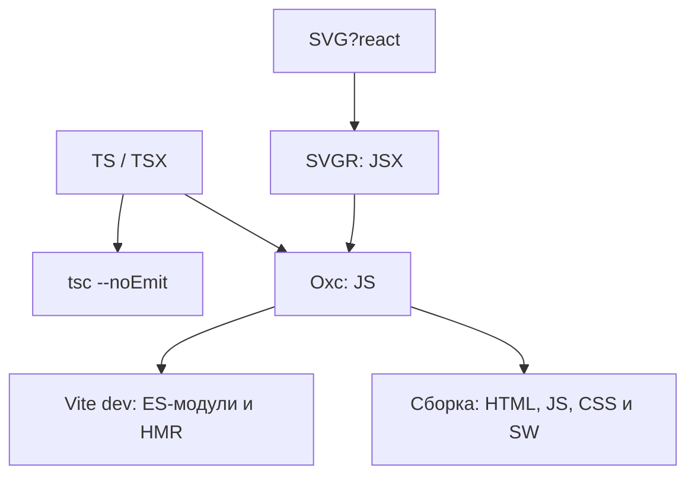

# Сборка и разработка

Запускайте команды из корня frontend. Нужны Bun ≥ 1.4.0 и Node.js ≥ 22.19.0. Для HMR выберите `bun run dev`, для локальной проверки production-сборки и PWA — `bun run preview`. Команды сверены с main. [Команды и требования](https://github.com/Cringe-Driven-Development-Team/frontend/blob/bfab8a485c78412a814b3765d10ef83a6267deed/package.json#L9-L41), [локальная разработка](https://github.com/Cringe-Driven-Development-Team/frontend/blob/bfab8a485c78412a814b3765d10ef83a6267deed/docs/local-development.md#L1-L24).

## Bun и Turborepo

Установите зависимости через `bun install`. `bun run dev` запускает `turbo watch dev`. `bun run build` запускает `turbo run build`: Vite пишет в `apps/client/dist/`, BFF собирается в `apps/bff/dist/bff.js`. [Задачи корня](https://github.com/Cringe-Driven-Development-Team/frontend/blob/bfab8a485c78412a814b3765d10ef83a6267deed/package.json#L4-L26), [клиент](https://github.com/Cringe-Driven-Development-Team/frontend/blob/bfab8a485c78412a814b3765d10ef83a6267deed/apps/client/package.json#L5-L11), [BFF](https://github.com/Cringe-Driven-Development-Team/frontend/blob/bfab8a485c78412a814b3765d10ef83a6267deed/apps/bff/package.json#L9-L14).

## Преобразования и проверка типов {#transforms}

<DiagramSection>

`tsc --noEmit` проверяет типы отдельно. Vite преобразует TypeScript и JSX через Oxc; `jsxImportSource` выбирает runtime `@cdd-team/react`. SVG с `?react` преобразуется в компонент через SVGR с Babel внутри этапа JSX. В production Rolldown собирает модули в чанки. [Скрипты клиента](https://github.com/Cringe-Driven-Development-Team/frontend/blob/bfab8a485c78412a814b3765d10ef83a6267deed/apps/client/package.json#L5-L11), [tsconfig](https://github.com/Cringe-Driven-Development-Team/frontend/blob/bfab8a485c78412a814b3765d10ef83a6267deed/apps/client/tsconfig.json#L3-L24), [SVGR в конфиге](https://github.com/Cringe-Driven-Development-Team/frontend/blob/bfab8a485c78412a814b3765d10ef83a6267deed/apps/client/vite/shared.ts#L36-L47), [Babel в SVGR](https://github.com/gregberge/svgr/blob/772592e042be5063e782bfb8711d024b2fefc6b8/packages/plugin-jsx/src/index.ts#L38-L80), [версии Vite и SVGR](https://github.com/Cringe-Driven-Development-Team/frontend/blob/bfab8a485c78412a814b3765d10ef83a6267deed/bun.lock#L467-L469), [сборка Vite](https://github.com/vitejs/vite/blob/981f07fa4580fb88b333c4450431e4715d2a0b82/packages/vite/src/node/build.ts#L923-L934).

<template #diagram>

</template>

</DiagramSection>

Проверку типов и форматирования запускайте через [bun run check](./checks#tools).

## Разработка и production {#dev-prod}

| Команда | Где открыть | Что обслуживает запросы |
| --- | --- | --- |
| `bun run dev` | `https://localhost:5173` | Vite отдаёт модули с HMR и проксирует `/api` в BFF. HTML приходит от BFF и дополняется HMR через `transformIndexHtml`. |
| `bun run preview` | `http://localhost:4173` | Скрипт собирает клиент и запускает BFF, который отдаёт HTML и собранные файлы с одного origin. Подходит для SW и PWA. После изменения клиента запустите команду снова. |
| `bun run dev:tunnel` | `https://localhost:5173` | Скрипт поднимает SSH-туннель к production Go, проверяет `/health` Identity и Workspace и запускает dev с адресами туннеля поверх `.env`. |

[Dev-конфиг](https://github.com/Cringe-Driven-Development-Team/frontend/blob/bfab8a485c78412a814b3765d10ef83a6267deed/apps/client/vite.config.dev.ts#L6-L36), [локальный запуск](https://github.com/Cringe-Driven-Development-Team/frontend/blob/bfab8a485c78412a814b3765d10ef83a6267deed/docs/local-development.md#L176-L201), [preview](https://github.com/Cringe-Driven-Development-Team/frontend/blob/bfab8a485c78412a814b3765d10ef83a6267deed/scripts/dev/preview.ts#L1-L30), [туннель](https://github.com/Cringe-Driven-Development-Team/frontend/blob/bfab8a485c78412a814b3765d10ef83a6267deed/scripts/dev/tunnel.ts#L78-L110).

Для WSL с Chrome в Windows после первого запуска dev выполните `bun run dev:trust-windows`. На проде ассеты с `RELEASE_SHA` и `CDN_URL` выходят под префиксом релиза, а BFF отдаёт service worker и публичные файлы с origin приложения. [CA в Windows](https://github.com/Cringe-Driven-Development-Team/frontend/blob/bfab8a485c78412a814b3765d10ef83a6267deed/docs/local-development.md#L210-L224), [размещение ассетов и SW](https://github.com/Cringe-Driven-Development-Team/frontend/blob/b1baf996fb6753d1a62eab6f874d03dca30faadc/apps/client/vite.config.prod.ts#L4-L39), [выдача файлов](https://github.com/Cringe-Driven-Development-Team/frontend/blob/b1baf996fb6753d1a62eab6f874d03dca30faadc/apps/bff/src/public.ts#L1-L18). Процедура описана в [релизах фронтенда](./releases/).

## Алиасы, env и ресурсы

1. Возьмите за основу корневой `.env.example`. Для обычного dev и preview задайте `IDENTITY_API_URL` и `WORKSPACE_API_URL` с `/api/v1`. Если Go требует S2S-ключ, задайте `BFF_KEY`. Для HTTPS укажите комплект `GO_API_TLS_CA_FILE`, `GO_API_TLS_CERT_FILE`, `GO_API_TLS_KEY_FILE`. [Шаблон](https://github.com/Cringe-Driven-Development-Team/frontend/blob/bfab8a485c78412a814b3765d10ef83a6267deed/.env.example#L1-L12), [конфигурация BFF](https://github.com/Cringe-Driven-Development-Team/frontend/blob/bfab8a485c78412a814b3765d10ef83a6267deed/apps/bff/src/env.ts#L15-L63), [TLS](https://github.com/Cringe-Driven-Development-Team/frontend/blob/bfab8a485c78412a814b3765d10ef83a6267deed/apps/bff/src/go/tls.ts#L5-L63), [запуск с Go](https://github.com/Cringe-Driven-Development-Team/frontend/blob/bfab8a485c78412a814b3765d10ef83a6267deed/docs/local-development.md#L125-L130)
2. Для `dev:tunnel` в корневом `.env` задайте `DEV_TUNNEL_SSH_HOST`, `DEV_TUNNEL_BACKEND_HOST`, `BFF_KEY` и тот же набор TLS-файлов. Подготовка SSH и сертификата описана в [руководстве команды](https://github.com/Cringe-Driven-Development-Team/frontend/blob/bfab8a485c78412a814b3765d10ef83a6267deed/docs/local-development.md#L230-L294).
3. При самостоятельном запуске BFF задайте `APP_ORIGIN` без пути и `SESSION_KEY` в base64 для 32 байт. У dev есть локальные значения по умолчанию. Preview задаёт собственный `APP_ORIGIN` и запускает dev-обёртку. [Проверка env](https://github.com/Cringe-Driven-Development-Team/frontend/blob/bfab8a485c78412a814b3765d10ef83a6267deed/apps/bff/src/env.ts#L15-L40), [dev-обёртка](https://github.com/Cringe-Driven-Development-Team/frontend/blob/bfab8a485c78412a814b3765d10ef83a6267deed/apps/bff/src/dev.ts#L1-L9), [preview](https://github.com/Cringe-Driven-Development-Team/frontend/blob/bfab8a485c78412a814b3765d10ef83a6267deed/scripts/dev/preview.ts#L17-L27)

Алиасы `@components/…` и соседние алиасы задаются в `paths` клиентского tsconfig. `VITE_STATIC_URL` задаёт публичный адрес картинок и шрифтов для HTML и CSS. [Алиасы](https://github.com/Cringe-Driven-Development-Team/frontend/blob/bfab8a485c78412a814b3765d10ef83a6267deed/apps/client/tsconfig.json#L20-L34), [общий конфиг](https://github.com/Cringe-Driven-Development-Team/frontend/blob/bfab8a485c78412a814b3765d10ef83a6267deed/apps/client/vite/shared.ts#L24-L43), [обработка CSS](./styles#pipeline).
