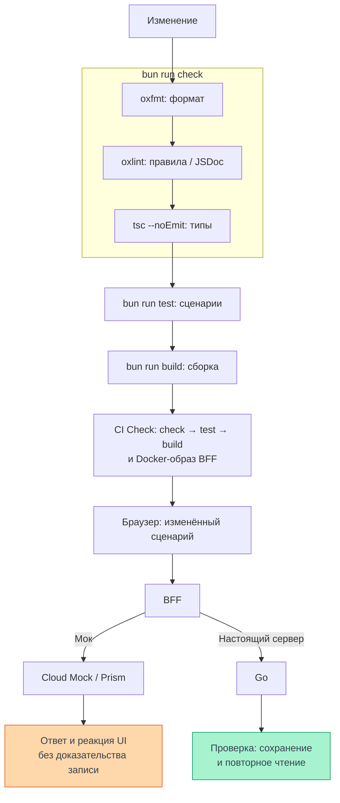

# Проверка изменений

Изменение проходит форматирование, lint, проверку типов, тесты и сборку.
Эти проверки отвечают на разные вопросы; успешный ответ мока отдельно ограничен
сценариями контракта. Срез кода на 08.11.2026 — `ea123518d624521f999e884ff32ddec0a5bf6bfa`.
Это чтение реализации, не новый прогон приложения на проде.
Команды ниже описывают существующий процесс разработчика; эта документация
не является отчётом об их выполнении над приложением.

## Что проверяют инструменты {#tools}

<DiagramSection>

Из корня frontend до коммита должны проходить `bun run check` и `bun run build`;
для изменённого поведения запускают и `bun run test`. `check` включает
`oxfmt --check`, oxlint и typecheck, но не тесты и не production build.
Точные команды — [package.json](https://github.com/Cringe-Driven-Development-Team/frontend/blob/ea123518d624521f999e884ff32ddec0a5bf6bfa/package.json#L15-L26).

Схема ведёт изменение через отдельные команды и CI к проверке сценария.
Только форматирование, lint и typecheck входят в локальный `check`;
тесты и build запускаются отдельно. Зелёный CI не заменяет браузерную проверку,
а её результат с моками не подтверждает запись в Go.
Граница CI задана [workflow Check](https://github.com/Cringe-Driven-Development-Team/frontend/blob/ea123518d624521f999e884ff32ddec0a5bf6bfa/.github/workflows/ci.yml#L1-L55),
граница мока — [правилами контракта](https://github.com/Cringe-Driven-Development-Team/frontend/blob/ea123518d624521f999e884ff32ddec0a5bf6bfa/docs/api-contract.md#L58-L88).

<template #diagram>

</template>

</DiagramSection>

| Инструмент / команда | Что обнаруживает | Чего не доказывает |
| --- | --- | --- |
| oxfmt (`bun run fmt:check`) | Несовпадение с форматом | Правильность логики |
| oxlint (`bun run lint`) | Настроенные правила TS/JSX, accessibility и JSDoc экспортов | Реальную доступность всего пользовательского сценария |
| `bun run typecheck` | Ошибки типов через `tsc --noEmit`, включая тестовый tsconfig клиента | Правильность ответов сети во время исполнения |
| `bun run test` | Регрессии в проверяемых сценариях | Полноту покрытия и работу прода |
| `bun run build` | Возможность собрать клиент и BFF, разрешить импорты и ресурсы | Проверку типов и успешную запись в Go |
| Браузер через BFF → мок | Отображение ответов и ошибок выбранного контракта | Сохранение данных сервером |

Правила JSDoc требуют комментария экспортам, описания параметров без повторения
TS-типов: [настройка oxlint](https://github.com/Cringe-Driven-Development-Team/frontend/blob/ea123518d624521f999e884ff32ddec0a5bf6bfa/oxlint.config.ts#L1-L26) и
[документация кода](https://github.com/Cringe-Driven-Development-Team/frontend/blob/ea123518d624521f999e884ff32ddec0a5bf6bfa/docs/local-development.md#L189-L208).
Typecheck и build раздельны в [задачах клиента](https://github.com/Cringe-Driven-Development-Team/frontend/blob/ea123518d624521f999e884ff32ddec0a5bf6bfa/apps/client/package.json#L5-L11).

## Сценарии редактора и сессии

Существующие тесты дают конкретные опоры для изменения, а не универсальное
обещание сохранности. Их входные данные и ответы управляются тестами.

| Где читать | Какие регрессии проверяются |
| --- | --- |
| [notebookConflict.test.ts](https://github.com/Cringe-Driven-Development-Team/frontend/blob/ea123518d624521f999e884ff32ddec0a5bf6bfa/apps/client/test/notebookConflict.test.ts#L64-L169) | 409 останавливает очередь, черновики остаются; загрузка снимка повторяется после сбоя; серверная/своя версия, удалённая ячейка в orphans и повторный конфликт |
| [flush в том же файле](https://github.com/Cringe-Driven-Development-Team/frontend/blob/ea123518d624521f999e884ff32ddec0a5bf6bfa/apps/client/test/notebookConflict.test.ts#L172-L259) | Ожидание сохранения, новый ввод, конфликт и лимит; большой черновик не выдаётся за успех |
| [session.test.ts](https://github.com/Cringe-Driven-Development-Team/frontend/blob/ea123518d624521f999e884ff32ddec0a5bf6bfa/apps/client/test/session.test.ts#L18-L92) | Смена сессии ждёт отправленные запросы; потеря сессии при неудачном выходе; удачный выход после 401 |
| [смена пароля и logoutAll](https://github.com/Cringe-Driven-Development-Team/frontend/blob/ea123518d624521f999e884ff32ddec0a5bf6bfa/apps/client/test/session.test.ts#L161-L259) | Во время смены новые защищённые запросы не стартуют; отказ не считается успехом |
| [аватар и logout](https://github.com/Cringe-Driven-Development-Team/frontend/blob/ea123518d624521f999e884ff32ddec0a5bf6bfa/apps/client/test/session.test.ts#L261-L324) | Multipart без батча, сохранение прежнего аватара после отказа, статусы отзыва и CSRF-отказ |

Алгоритм [сохранения и конфликтов](./state#saving) и
[смена сессии](./session#switching) объясняют причины этих проверок.
Для правки редактора важно воспроизвести новый ввод до ответа, конфликт и
неопределённый результат записи; для транспорта — поздний ответ прежней сессии.
Набор тестов дополняют проверкой изменённого сценария в браузере.

## Индекс, хуки и CI

`bun install` устанавливает lefthook через `prepare`.
Перед коммитом `format-staged.ts` форматирует **индекс**, затем `check-staged.ts`
проверяет то, что будет закоммичено. Для этого он временно убирает
неиндексированные изменения и новые файлы в `.git/check-staged/` и возвращает
их в `finally`; общий `git stash` не используется.
См. [prepare](https://github.com/Cringe-Driven-Development-Team/frontend/blob/ea123518d624521f999e884ff32ddec0a5bf6bfa/package.json#L9-L10), [lefthook.yml](https://github.com/Cringe-Driven-Development-Team/frontend/blob/ea123518d624521f999e884ff32ddec0a5bf6bfa/lefthook.yml#L1-L16),
[форматирование индекса](https://github.com/Cringe-Driven-Development-Team/frontend/blob/ea123518d624521f999e884ff32ddec0a5bf6bfa/scripts/hooks/format-staged.ts#L7-L31) и
[сохранение/возврат рабочей копии](https://github.com/Cringe-Driven-Development-Team/frontend/blob/ea123518d624521f999e884ff32ddec0a5bf6bfa/scripts/hooks/check-staged.ts#L17-L65).

После коммита `sync-formatted.ts` приводит рабочий файл к закоммиченному виду
только при отличии одним форматированием. Файл с содержательными
неиндексированными правками сохраняется. Ошибка pre-commit прерывает коммит;
исправляют причину и повторяют обычный коммит, обход хука не входит в процесс.
Источник — [post-commit](https://github.com/Cringe-Driven-Development-Team/frontend/blob/ea123518d624521f999e884ff32ddec0a5bf6bfa/scripts/hooks/sync-formatted.ts#L24-L34).

CI job **Check** устанавливает зависимости по lockfile и последовательно запускает
`check`, `test`, `build`, затем сборку Docker-образа BFF. CI проверяет PR,
кандидаты merge queue и main; публикация релиза — отдельная job после Check.
Зелёный Check не доказывает выкладку или успешный пользовательский сценарий.
См. [CI](https://github.com/Cringe-Driven-Development-Team/frontend/blob/ea123518d624521f999e884ff32ddec0a5bf6bfa/.github/workflows/ci.yml#L1-L55).

## Моки и настоящая запись в Go {#mock-boundary}

Один интерфейс можно проверить с разными ответчиками за BFF.
Cloud Mock Apidog и локальный Prism показывают контрактные ответы; этот путь
не доказывает сохранение данных в Go. Проверка перезагрузки и фактической записи
требует Go, который действительно хранит изменения.
Это ограничение прямо задано [владельцем контракта](https://github.com/Cringe-Driven-Development-Team/frontend/blob/ea123518d624521f999e884ff32ddec0a5bf6bfa/docs/api-contract.md#L58-L88),
а запуск Prism описан [существующим скриптом](https://github.com/Cringe-Driven-Development-Team/frontend/blob/ea123518d624521f999e884ff32ddec0a5bf6bfa/scripts/dev/prism.ts#L1-L27).
Браузерные пути — альтернативные проверки, не одновременная отправка в два сервера.

Spec First начинается с контракта в Apidog, затем UI проверяют через BFF → Cloud
Mock выбранной ветки. Если мок расходится с контрактом или не покрывает сценарий,
его дорабатывают отдельным MR в Apidog. Локальную копию и генерацию обновляет
`bun run sync` по этому процессу; вручную сгенерированные файлы не редактируют.
Это порядок работы, а не команда запускать sync для чтения страницы.
Источник — [Spec First](https://github.com/Cringe-Driven-Development-Team/frontend/blob/ea123518d624521f999e884ff32ddec0a5bf6bfa/docs/api-contract.md#L29-L66).

`bun run dev:prism` уже существует: скрипт запускает Prism по `spec/openapi.json`
и обычный dev с `GO_API_URL`, направленным на локальный мок,
`MOCK_PREFER=1` для BFF и `VITE_MOCK_PREFER=1` для клиента.
Причина режима — ответы 412 HTML-прокси Cloud Mock на мутации с `If-Match`;
это не ответ Go о конфликте блокнота.
См. [ограничение и режим](https://github.com/Cringe-Driven-Development-Team/frontend/blob/ea123518d624521f999e884ff32ddec0a5bf6bfa/docs/api-contract.md#L69-L88)
и [скрипт запуска](https://github.com/Cringe-Driven-Development-Team/frontend/blob/ea123518d624521f999e884ff32ddec0a5bf6bfa/scripts/dev/prism.ts#L9-L27).

Prism в статическом режиме возвращает примеры; только создание ячейки запрашивает
`Prefer: dynamic=true` для разных ID. В консоли браузера
`mock('cells.update', 409)` назначает статус следующему вызову этой процедуры:
клиент снимает одноразовое правило в `X-Mock-Prefer`, BFF при включённом режиме
передаёт `Prefer: code=409`. Это работает для процедур с сессией.
См. [правило клиента](https://github.com/Cringe-Driven-Development-Team/frontend/blob/ea123518d624521f999e884ff32ddec0a5bf6bfa/apps/client/src/api/mockPrefer.ts#L6-L38),
[включение команды](https://github.com/Cringe-Driven-Development-Team/frontend/blob/ea123518d624521f999e884ff32ddec0a5bf6bfa/apps/client/src/main.tsx#L39-L44),
[ограничение контекста BFF](https://github.com/Cringe-Driven-Development-Team/frontend/blob/ea123518d624521f999e884ff32ddec0a5bf6bfa/apps/bff/src/context.ts#L39-L41) и
[Prefer BFF](https://github.com/Cringe-Driven-Development-Team/frontend/blob/ea123518d624521f999e884ff32ddec0a5bf6bfa/apps/bff/src/mockPrefer.ts#L16-L28).

Prism ничего не хранит: после reload приходит пример, а «серверная версия»
конфликта также является примером. Автотесты с управляемыми ответами проверяют
логику при заданной последовательности; ни они, ни успешный mock-ответ не
заменяют проверку записи и повторного чтения настоящего Go.
Для SW нужен [production-режим разработки](./build#dev-prod) и
[офлайн-раздел](/documentation/offline/); HMR не проверяет жизненный цикл SW.
Граница защиты запроса — в [безопасности](/documentation/security/).

## Что проверить в понимании

- Почему Check может пройти при ошибке пользовательского сценария? Он выполняет ограниченные автоматические проверки.
- Что остаётся в рабочем каталоге после staged-форматирования? Содержательные неиндексированные правки сохраняются.
- Почему reload в Prism не подтверждает запись? Мок возвращает пример, без хранилища изменений.
- Какой сервер и какой контракт проверялись? В отчёте нужно различать Cloud Mock, Prism и настоящий Go.
