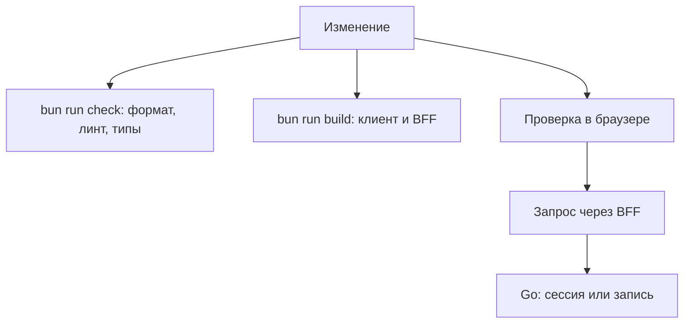

# Проверка изменений

Из корня frontend запустите `bun run check` и `bun run build`. Для изменений сессии или записи дополнительно выполните сценарий через BFF с реальным Go. Команды и CI сверены с main. [Перед PR](https://github.com/Cringe-Driven-Development-Team/frontend/blob/bfab8a485c78412a814b3765d10ef83a6267deed/docs/local-development.md#L14-L24), [локальная проверка с Go](https://github.com/Cringe-Driven-Development-Team/frontend/blob/bfab8a485c78412a814b3765d10ef83a6267deed/docs/local-development.md#L119-L130).

## Что проверяют инструменты {#tools}

<DiagramSection>

| Команда | Что она проверяет |
| --- | --- |
| `bun run check` | Форматирование через `oxfmt --check`, линт через `oxlint`, типы через `tsc --noEmit`. |
| `bun test scripts/release/test apps/bff/test` | Тесты релиза и BFF из CI. |
| `bun run build` | Сборку клиента и BFF через Turborepo. |
| `bun run contract:verify` | Совпадение закреплённой копии OpenAPI с исходником backend. |

[Скрипты](https://github.com/Cringe-Driven-Development-Team/frontend/blob/bfab8a485c78412a814b3765d10ef83a6267deed/package.json#L9-L26), [CI](https://github.com/Cringe-Driven-Development-Team/frontend/blob/bfab8a485c78412a814b3765d10ef83a6267deed/.github/workflows/ci.yml#L22-L40), [сверка OpenAPI](https://github.com/Cringe-Driven-Development-Team/frontend/blob/bfab8a485c78412a814b3765d10ef83a6267deed/scripts/openapi/backend.ts#L60-L87).

<template #diagram>

</template>

</DiagramSection>

## Проверить изменение формы {#сценарии-редактора-и-сессии}

1. Выберите `bun run dev`, а для проверок service worker и офлайн-страницы — `bun run preview`. Настройте Go в корневом `.env` по [локальному запуску](./build#dev-prod) и [переменным окружения](./build#алиасы-env-и-ресурсы).
2. Проверьте ввод, ошибку поля, успешную отправку и повторное действие. В Network сопоставьте запрос с маршрутом BFF. Для формы входа проверьте прямое открытие защищённого URL гостем, успешный вход, обновление страницы и выход. [Решение BFF при прямом входе](https://github.com/Cringe-Driven-Development-Team/frontend/blob/b1baf996fb6753d1a62eab6f874d03dca30faadc/apps/bff/src/html.ts#L87-L142), [вход на клиенте](https://github.com/Cringe-Driven-Development-Team/frontend/blob/b1baf996fb6753d1a62eab6f874d03dca30faadc/apps/client/src/stores/session.ts#L63-L85), [условия смены сессии](./session#switching)
3. Для изменения записи блокнота дождитесь ответа на запрос с `If-Match`, затем повторно откройте блокнот и сверьте сохранённый текст. Для изменений обработки конфликтов используйте сценарии из [редактирования](/documentation/notebooks/editing) и проверьте, что [черновик остаётся в сторе](./state#saving). [Отправка и подтверждение](https://github.com/Cringe-Driven-Development-Team/frontend/blob/b1baf996fb6753d1a62eab6f874d03dca30faadc/apps/client/src/stores/notebook/index.ts#L429-L517)

## Индекс, хуки и CI

`bun install` подключает lefthook. Pre-commit форматирует индекс и запускает `check` для содержимого коммита; post-commit применяет формат к рабочему файлу, если у него нет других отличий. CI `Check` устанавливает зависимости по lockfile, запускает `contract:verify`, тесты, `check`, `build` и сборку Docker-образа BFF. [Установка](https://github.com/Cringe-Driven-Development-Team/frontend/blob/bfab8a485c78412a814b3765d10ef83a6267deed/package.json#L9-L14), [хуки](https://github.com/Cringe-Driven-Development-Team/frontend/blob/bfab8a485c78412a814b3765d10ef83a6267deed/lefthook.yml#L1-L16), [проверка в CI](https://github.com/Cringe-Driven-Development-Team/frontend/blob/bfab8a485c78412a814b3765d10ef83a6267deed/.github/workflows/ci.yml#L22-L40).

## Проверка с реальным Go {#mock-boundary}

Для проверки сессии, условной записи или перезагрузки сохранённых данных нужен BFF с настоящими Identity и Workspace. Используйте локальный Go или разрешённый стенд. Ответ по схеме может подтвердить отображение формы или ошибки, а изменение сессии и сохранение текста подтверждайте действиями через настоящий API. [Локальная проверка](https://github.com/Cringe-Driven-Development-Team/frontend/blob/bfab8a485c78412a814b3765d10ef83a6267deed/docs/local-development.md#L119-L130), [адаптер Go](https://github.com/Cringe-Driven-Development-Team/frontend/blob/b1baf996fb6753d1a62eab6f874d03dca30faadc/apps/bff/src/go/request.ts#L1-L34).
