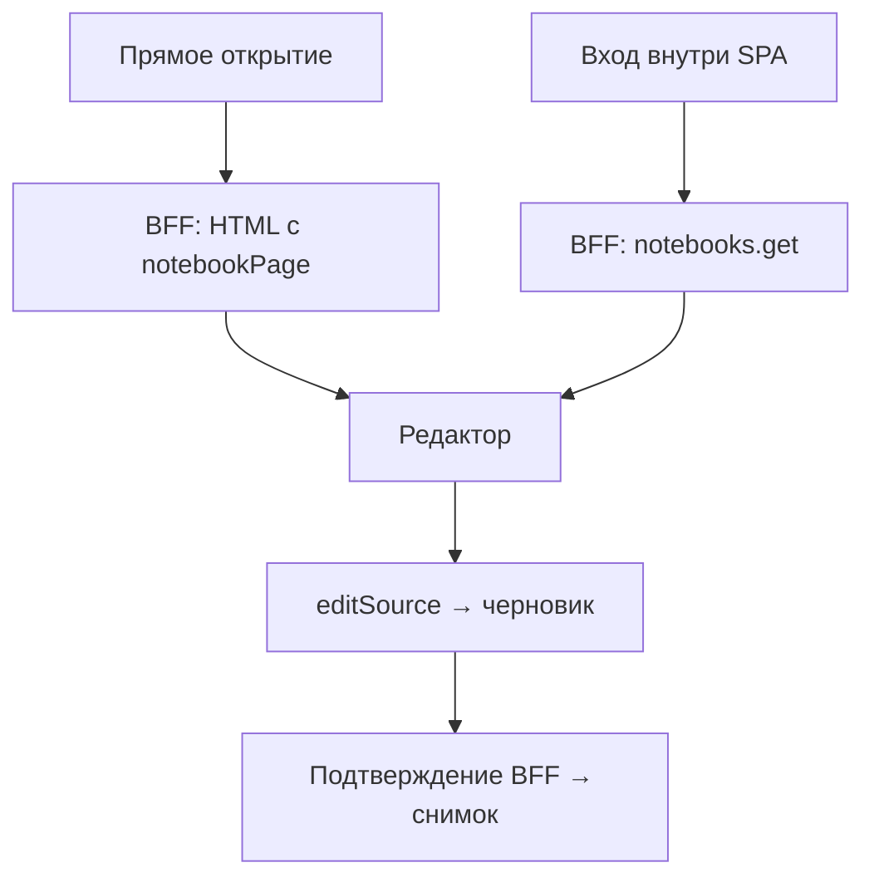

# Frontend

Клиент Cellestial рендерит страницы в браузере. BFF отдаёт первый HTML с данными сессии, принимает запросы браузера и обращается к Go. При переходах внутри приложения клиент использует своё дерево маршрутов. [Запуск клиента](https://github.com/Cringe-Driven-Development-Team/frontend/blob/b1baf996fb6753d1a62eab6f874d03dca30faadc/apps/client/src/main.tsx#L14-L48), [выдача HTML](https://github.com/Cringe-Driven-Development-Team/frontend/blob/b1baf996fb6753d1a62eab6f874d03dca30faadc/apps/bff/src/html.ts#L87-L142).

## Карта тем

| Задача | Где смотреть |
| --- | --- |
| Добавить страницу | [Добавить страницу](./routing#pages-и-дерево-маршрутов), [переходы и история](./routing#navigation), [архитектура](./architecture) |
| Настроить локальный запуск и проверить изменение формы | [Сборка и разработка](./build#transforms), [проверка формы](./checks#сценарии-редактора-и-сессии), [команды проверки](./checks#tools) |
| Найти источник данных первого рендера | [Запуск приложения](./startup) |
| Изменить компонент | [Компоненты и рендеринг](./rendering#cell), [стили](./styles#modules), [состояние](./state) |
| Изменить вызов сервера | [Запросы и ошибки](./requests), [сессия и авторизация](./session), [BFF](./bff), [наблюдения на проде](/documentation/frontend/bff#bff-проверенная-часть) |
| Найти владельца зависимости | [Командные пакеты](./packages) |

## Монорепа

| Путь | Назначение |
| --- | --- |
| `apps/client` | Код браузера и сборка Vite. [Манифест клиента](https://github.com/Cringe-Driven-Development-Team/frontend/blob/b1baf996fb6753d1a62eab6f874d03dca30faadc/apps/client/package.json#L1-L26) |
| `apps/bff` | Шаблон HTML, браузерный HTTP API, адаптер Go. [Сервер](https://github.com/Cringe-Driven-Development-Team/frontend/blob/b1baf996fb6753d1a62eab6f874d03dca30faadc/apps/bff/src/index.ts#L1-L49) |
| `packages/schemas` | Типы и ручная проверка входных данных. [Экспорты пакета](https://github.com/Cringe-Driven-Development-Team/frontend/blob/b1baf996fb6753d1a62eab6f874d03dca30faadc/packages/schemas/package.json#L1-L13) |

## Редактирование блокнота {#notebook-flow}

<DiagramSection>

При прямом открытии своего блокнота BFF вкладывает данные в bootstrap. В редакторе ввод сначала меняет черновик, подтверждение записи меняет снимок сервера. За условиями записи, сверкой результата и восстановлением после конфликта обращайтесь к [редактированию блокнота](/documentation/notebooks/editing). [Загрузка HTML](https://github.com/Cringe-Driven-Development-Team/frontend/blob/b1baf996fb6753d1a62eab6f874d03dca30faadc/apps/bff/src/html.ts#L94-L140), [черновик и подтверждение](https://github.com/Cringe-Driven-Development-Team/frontend/blob/b1baf996fb6753d1a62eab6f874d03dca30faadc/apps/client/src/stores/notebook/index.ts#L308-L347), [применение подтверждения](https://github.com/Cringe-Driven-Development-Team/frontend/blob/b1baf996fb6753d1a62eab6f874d03dca30faadc/apps/client/src/stores/notebook/index.ts#L402-L413).

<template #diagram>

</template>

</DiagramSection>

## Ревизия исходников {#статус-сведении}

Устройство клиента описано по исходникам [выложенного frontend](https://github.com/Cringe-Driven-Development-Team/frontend/actions/runs/46058681997). Локальные команды и CI сверены с main в [сборке и разработке](./build).
