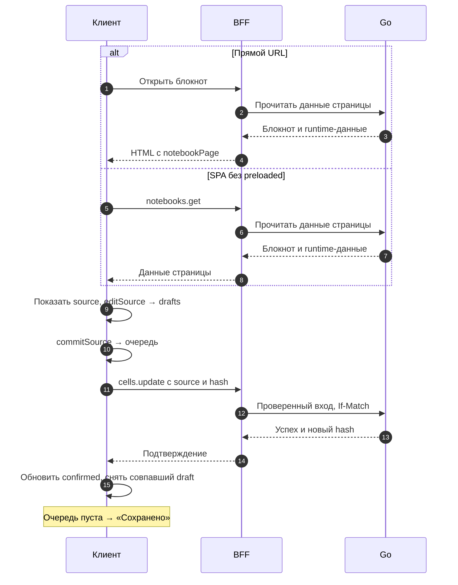

# Frontend

Frontend Cellestial загружает блокнот, показывает редактор ячеек и сохраняет исходник
через BFF. Ниже — карта приложения и один путь от открытия страницы до подтверждения
правки сервером. Карта тем помогает выбрать подробности, а сквозной сценарий
связывает их на одном примере сохранения исходника.

## Статус сведений

Эта обзорная страница описывает код удалённого `frontend/main` на 08.11.2026:
[`ea123518d624521f999e884ff32ddec0a5bf6bfa`](https://github.com/Cringe-Driven-Development-Team/frontend/tree/ea123518d624521f999e884ff32ddec0a5bf6bfa).
[Архитектура](./architecture) и раздел выкаток указывают собственные версии исходников.
Это чтение реализации, а не новый прогон сценария на проде. Исторические наблюдения
сохраняют собственные дату и релиз на [странице BFF](/documentation/frontend/bff#bff-проверенная-часть).

## Карта тем

| Тема | На какой вопрос отвечает |
| --- | --- |
| [Архитектура](./architecture) | Какие архитектурные подходы используются и чем это подтверждается в коде? |
| [Роутинг](./routing#navigation) | Как URL выбирает страницу и что делает история браузера? |
| [Сборка и разработка](./build#transforms) | Как TS/JSX, SVG и CSS становятся ресурсами приложения? |
| [Стили](./styles#modules) | Как локальные классы, токены и состояния задают оформление? |
| [Запуск приложения](./startup) | Как HTML с bootstrap превращается в первый экран? |
| [Компоненты и рендеринг](./rendering#cell) | Как событие ввода меняет props и DOM? |
| [Управление состоянием](./state#saving) | Как очередь сохраняет черновики и разрешает конфликт? |
| [Запросы и ошибки](./requests) | Как клиент вызывает BFF и различает результаты? |
| [Сессия и авторизация](./session) | Где хранятся токены и что происходит при входе и выходе? |
| [BFF](./bff) | Как серверная часть фронта готовит HTML и обращается к Go? |
| [Командные пакеты](./packages) | Какие версии используются и как выпускается обновление? |
| [Проверка изменений](./checks#tools) | Что подтверждают инструменты, тесты и сборка? |
| [Выкатки](./releases/) | Как CI публикует выпуск, как запустить CD, откатить и проверить результат |

## Монорепа

В одном репозитории находятся три части. Клиент получает данные страницы и вызывает
процедуры BFF; BFF обращается к Go. Схемы проверяют данные на серверной границе.

| Каталог | Ответственность | Точка кода |
| --- | --- | --- |
| `apps/client` | Интерфейс в браузере, страницы, компоненты и состояние редактора | [NotebookPage.tsx](https://github.com/Cringe-Driven-Development-Team/frontend/blob/ea123518d624521f999e884ff32ddec0a5bf6bfa/apps/client/src/pages/NotebookPage/NotebookPage.tsx#L199-L254) |
| `apps/bff` | HTML с начальными данными и процедуры между клиентом и Go | [html.ts](https://github.com/Cringe-Driven-Development-Team/frontend/blob/ea123518d624521f999e884ff32ddec0a5bf6bfa/apps/bff/src/html.ts#L83-L134), [cells.ts](https://github.com/Cringe-Driven-Development-Team/frontend/blob/ea123518d624521f999e884ff32ddec0a5bf6bfa/apps/bff/src/router/cells.ts#L21-L44) |
| `packages/schemas` | Workspace-пакет `@cdd/schemas`: схемы, которые использует BFF для проверки входа | [импорт и применение схем](https://github.com/Cringe-Driven-Development-Team/frontend/blob/ea123518d624521f999e884ff32ddec0a5bf6bfa/apps/bff/src/router/cells.ts#L1-L32) |

Корневой [package.json](https://github.com/Cringe-Driven-Development-Team/frontend/blob/ea123518d624521f999e884ff32ddec0a5bf6bfa/package.json#L4-L30)
объединяет `apps/*` и `packages/*` через Bun workspaces; `dev` и `build` запускают
задачи через Turbo. Границы остальных репозиториев описаны в
[контексте проекта](/documentation/project-context), общая схема — в
[архитектуре](/documentation/architecture/).

## Карта файлов

Пути клиента ниже начинаются с `apps/client/src/`, пути BFF — с `apps/bff/src/`.

| Где читать | Что искать |
| --- | --- |
| [main.tsx](https://github.com/Cringe-Driven-Development-Team/frontend/blob/ea123518d624521f999e884ff32ddec0a5bf6bfa/apps/client/src/main.tsx#L16-L44), [bootstrap.ts](https://github.com/Cringe-Driven-Development-Team/frontend/blob/ea123518d624521f999e884ff32ddec0a5bf6bfa/apps/client/src/bootstrap.ts#L23-L65) | Чтение первого HTML, заполнение session/preloaded, запуск роутера и рендера |
| [stores/preloaded.ts](https://github.com/Cringe-Driven-Development-Team/frontend/blob/ea123518d624521f999e884ff32ddec0a5bf6bfa/apps/client/src/stores/preloaded.ts#L3-L34) | Однократная передача блокнота из HTML странице |
| [pages/NotebookPage/NotebookPage.tsx](https://github.com/Cringe-Driven-Development-Team/frontend/blob/ea123518d624521f999e884ff32ddec0a5bf6bfa/apps/client/src/pages/NotebookPage/NotebookPage.tsx#L199-L268) | Загрузка страницы и открытие notebook/runtime-сторов |
| [components/Cell/Cell.tsx](https://github.com/Cringe-Driven-Development-Team/frontend/blob/ea123518d624521f999e884ff32ddec0a5bf6bfa/apps/client/src/components/Cell/Cell.tsx#L137-L177) | Поле исходника, просмотр Markdown и режим чтения |
| [stores/notebook/index.ts](https://github.com/Cringe-Driven-Development-Team/frontend/blob/ea123518d624521f999e884ff32ddec0a5bf6bfa/apps/client/src/stores/notebook/index.ts#L34-L94) | Подтверждённый снимок `confirmed`, `drafts`, очередь и статусы сохранения |
| [notebook.ts](https://github.com/Cringe-Driven-Development-Team/frontend/blob/ea123518d624521f999e884ff32ddec0a5bf6bfa/apps/bff/src/notebook.ts#L4-L54), [router/notebooks.ts](https://github.com/Cringe-Driven-Development-Team/frontend/blob/ea123518d624521f999e884ff32ddec0a5bf6bfa/apps/bff/src/router/notebooks.ts#L8-L12) | Общий загрузчик для HTML и `notebooks.get`; `active_session` и `runtime_queue` — сведения исполнения, отдельные от очереди сохранения |
| [router/cells.ts](https://github.com/Cringe-Driven-Development-Team/frontend/blob/ea123518d624521f999e884ff32ddec0a5bf6bfa/apps/bff/src/router/cells.ts#L11-L44), [go/api.ts](https://github.com/Cringe-Driven-Development-Team/frontend/blob/ea123518d624521f999e884ff32ddec0a5bf6bfa/apps/bff/src/go/api.ts#L179-L184) | Проверка мутации и вызов Go |

## Сквозной сценарий {#notebook-flow}

Предусловие: пользователь вошёл и открывает свой блокнот на устройстве с доступным
редактором. При `(pointer: coarse)` приложение включает просмотр: `useTouchDevice`
следит за media query, а страница передаёт `readOnly={touch}` через `CodeOrText` в `Cell`.
Это проверяется по [media.ts](https://github.com/Cringe-Driven-Development-Team/frontend/blob/ea123518d624521f999e884ff32ddec0a5bf6bfa/apps/client/src/utils/media.ts#L3-L15)
и [пропсам Cell](https://github.com/Cringe-Driven-Development-Team/frontend/blob/ea123518d624521f999e884ff32ddec0a5bf6bfa/apps/client/src/pages/NotebookPage/NotebookPage.tsx#L549-L562).

<DiagramSection>

Схема показывает успешную правку без нового ввода во время запроса. Два пути
открытия сходятся на данных страницы: прямой URL получает их из HTML, последующий
SPA-переход без preloaded — через RPC. Затем видимый черновик проходит очередь
и становится подтверждённым текстом. Точки этой цепочки —
[загрузка страницы](https://github.com/Cringe-Driven-Development-Team/frontend/blob/ea123518d624521f999e884ff32ddec0a5bf6bfa/apps/client/src/pages/NotebookPage/NotebookPage.tsx#L199-L254)
и [очередь записи](https://github.com/Cringe-Driven-Development-Team/frontend/blob/ea123518d624521f999e884ff32ddec0a5bf6bfa/apps/client/src/stores/notebook/index.ts#L403-L478).
Условия ввода и подтверждения разобраны в шагах ниже.

<template #diagram>

</template>

</DiagramSection>

1. **Открытие.** При прямом URL BFF выдаёт HTML с `user` и `notebookPage`.
   Общий загрузчик соединяет метаданные, согласованные `hash` и ячейки из одного
   ответа content, активную runtime-сессию и её очередь, если она относится к этому
   блокноту. См. [загрузчик BFF](https://github.com/Cringe-Driven-Development-Team/frontend/blob/ea123518d624521f999e884ff32ddec0a5bf6bfa/apps/bff/src/notebook.ts#L22-L54).
2. **Первый экран.** Клиент проверяет bootstrap, заполняет session/preloaded и запускает
   рендер. Страница забирает подходящий preloaded без повторного `notebooks.get`;
   при SPA-переходе без этих данных запрашивает блокнот через эту процедуру.
   См. [main.tsx](https://github.com/Cringe-Driven-Development-Team/frontend/blob/ea123518d624521f999e884ff32ddec0a5bf6bfa/apps/client/src/main.tsx#L19-L44)
   и [открытие страницы](https://github.com/Cringe-Driven-Development-Team/frontend/blob/ea123518d624521f999e884ff32ddec0a5bf6bfa/apps/client/src/pages/NotebookPage/NotebookPage.tsx#L199-L254).
3. **Ввод.** `Cell` получает текст из `drafts`, если он есть, иначе — подтверждённый
   `source`. `onInput` вызывает `editSource`: меняется черновик стора, подписанная
   страница передаёт новый текст и показывает статус сохранения. Для Markdown Enter
   или двойной клик открывают исходник. См. [связь страницы с Cell](https://github.com/Cringe-Driven-Development-Team/frontend/blob/ea123518d624521f999e884ff32ddec0a5bf6bfa/apps/client/src/pages/NotebookPage/NotebookPage.tsx#L549-L562),
   [редактор](https://github.com/Cringe-Driven-Development-Team/frontend/blob/ea123518d624521f999e884ff32ddec0a5bf6bfa/apps/client/src/components/Cell/Cell.tsx#L244-L278)
   и [просмотр](https://github.com/Cringe-Driven-Development-Team/frontend/blob/ea123518d624521f999e884ff32ddec0a5bf6bfa/apps/client/src/components/Cell/Cell.tsx#L357-L391).
4. **Постановка в очередь.** После 500 мс без ввода вызывается `commitSource`;
   уход фокуса из поля и конец IME вызывают его явно. Во время IME-композиции
   autosave откладывается. Исходник больше 65 536 байт UTF-8 остаётся видимым
   черновиком и не отправляется, пока его не сократят. См. [лимит и задержку](https://github.com/Cringe-Driven-Development-Team/frontend/blob/ea123518d624521f999e884ff32ddec0a5bf6bfa/apps/client/src/stores/notebook/index.ts#L5-L13),
   [editSource/commitSource](https://github.com/Cringe-Driven-Development-Team/frontend/blob/ea123518d624521f999e884ff32ddec0a5bf6bfa/apps/client/src/stores/notebook/index.ts#L270-L318)
   и [события Cell](https://github.com/Cringe-Driven-Development-Team/frontend/blob/ea123518d624521f999e884ff32ddec0a5bf6bfa/apps/client/src/components/Cell/Cell.tsx#L233-L253).
5. **Запись.** Очередь отправляет операции последовательно: `cells.update` получает
   `notebookId`, `cellId`, `source` и текущий `hash`. BFF проверяет вход, оборачивает
   hash в кавычки заголовка `If-Match` и вызывает Go. Каждая следующая запись
   использует hash предыдущего ответа. См. [очередь и запрос](https://github.com/Cringe-Driven-Development-Team/frontend/blob/ea123518d624521f999e884ff32ddec0a5bf6bfa/apps/client/src/stores/notebook/index.ts#L403-L478),
   [валидацию](https://github.com/Cringe-Driven-Development-Team/frontend/blob/ea123518d624521f999e884ff32ddec0a5bf6bfa/apps/bff/src/router/cells.ts#L11-L33)
   и [If-Match](https://github.com/Cringe-Driven-Development-Team/frontend/blob/ea123518d624521f999e884ff32ddec0a5bf6bfa/apps/bff/src/go/api.ts#L86-L88).
6. **Подтверждение.** Успешный ответ обновляет `confirmed` и hash. Черновик снимается
   только при совпадении с отправленным текстом: новый ввод во время запроса остаётся.
   Ответ прежнего открытого блокнота не применяется после смены поколения стора.
   «Сохранено» появляется, когда больше нечего сохранять. См. [commit](https://github.com/Cringe-Driven-Development-Team/frontend/blob/ea123518d624521f999e884ff32ddec0a5bf6bfa/apps/client/src/stores/notebook/index.ts#L374-L386),
   [проверку поколения](https://github.com/Cringe-Driven-Development-Team/frontend/blob/ea123518d624521f999e884ff32ddec0a5bf6bfa/apps/client/src/stores/notebook/index.ts#L444-L478)
   и [статус](https://github.com/Cringe-Driven-Development-Team/frontend/blob/ea123518d624521f999e884ff32ddec0a5bf6bfa/apps/client/src/stores/notebook/index.ts#L237-L252).

Если Go сообщает `notebook_conflict`, очередь останавливается, черновики сохраняются
и загружается свежий снимок для выбора версии. После сетевого сбоя или 5xx результат
записи может быть неизвестен: стор перечитывает блокнот и сверяет его с ожидаемым
результатом перед повтором. Это две разные причины восстановления;
[обработка ошибок и сверка](https://github.com/Cringe-Driven-Development-Team/frontend/blob/ea123518d624521f999e884ff32ddec0a5bf6bfa/apps/client/src/stores/notebook/index.ts#L481-L610)
не объявляют каждый неуспешный ответ несостоявшейся записью. Запуск Python не входит
в этот сценарий: runtime-данные отмечены в карте отдельно.

## Что проверить в понимании

- Почему ввод виден до ответа Go? `Cell` показывает черновик; `confirmed` меняется
  только после подтверждения или сверки.
- Почему старая отправка не стирает новое слово? При подтверждении стор сравнивает
  текущий черновик с отправленным исходником.
- Когда нужен `notebooks.get` при открытии? Когда нет подходящих одноразовых данных
  из HTML; подробности — в [запуске приложения](./startup).

Офлайн-поведение имеет [собственный раздел](/documentation/offline/), а граница
защиты запросов — [раздел безопасности](/documentation/security/).
