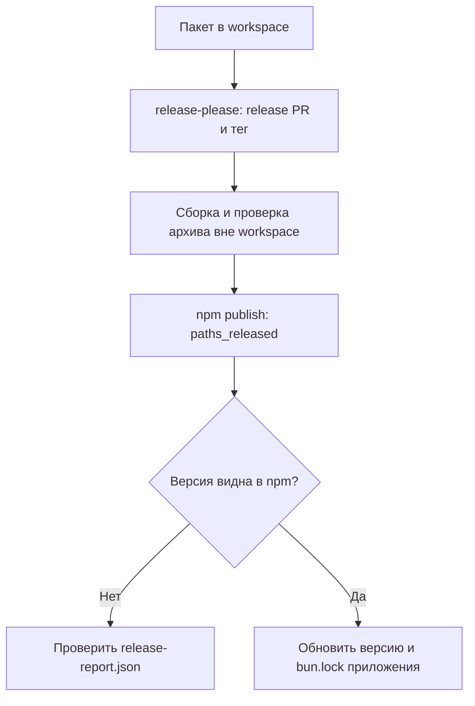

# Командные пакеты

Установленные версии `@cdd-team/*` смотри в `bun.lock` приложения. Исходники и выпуск пакетов принадлежат [frontend-packages](https://github.com/Cringe-Driven-Development-Team/frontend-packages). Таблица ниже сверена с кодом [выложенной версии фронтенда](./bff#bff-проверенная-часть). [Lockfile выложенного фронтенда](https://github.com/Cringe-Driven-Development-Team/frontend/blob/b1baf996fb6753d1a62eab6f874d03dca30faadc/bun.lock#L79-L97).

## Что установлено в приложении {#что-установлено-в-приложении}

| Пакет | Версия | Где используется |
| --- | --- | --- |
| `@cdd-team/react` | `1.7.1` | Рендеринг и JSX. [Манифест версии](https://github.com/Cringe-Driven-Development-Team/frontend-packages/blob/f4d2bd02fcc127e5603bbe09874242b071def7ba/packages/react/package.json#L14-L43). |
| `@cdd-team/router` | `0.1.0` | SPA-маршруты. Peer React `^1.7.0`, зависимость clsx `^0.1.0`. [Манифест версии](https://github.com/Cringe-Driven-Development-Team/frontend-packages/blob/bda991c58d01a88b119d910787a87966e31bfe0a/packages/router/package.json#L20-L48). |
| `@cdd-team/zustand` | `1.0.1` | Сторы. Peer React `^1.2.1` помечен `optional` для входа `/vanilla`. [Манифест версии](https://github.com/Cringe-Driven-Development-Team/frontend-packages/blob/4652b210db7bf9fcdbbdf96539b412201a1bec85/packages/zustand/package.json#L16-L48). |
| `@cdd-team/clsx` | `0.1.0` | Собирает строку классов. [Манифест версии](https://github.com/Cringe-Driven-Development-Team/frontend-packages/blob/bda991c58d01a88b119d910787a87966e31bfe0a/packages/clsx/package.json#L16-L42), [CSS Modules](./styles#modules). |
| `@cdd-team/http-client` | `0.1.1` | Браузер → BFF и BFF → Go. [Манифест версии](https://github.com/Cringe-Driven-Development-Team/frontend-packages/blob/872ffb6e01c13473867adfa6247e4e2d192f1c1b/packages/http-client/package.json#L1-L28), [клиент BFF](https://github.com/Cringe-Driven-Development-Team/frontend/blob/b1baf996fb6753d1a62eab6f874d03dca30faadc/apps/client/src/api/bff.ts#L153-L189), [клиент Go](https://github.com/Cringe-Driven-Development-Team/frontend/blob/b1baf996fb6753d1a62eab6f874d03dca30faadc/apps/bff/src/go/request.ts#L1-L10). |
| `@cdd-team/serialize-javascript` | `0.1.1` | BFF сериализует JSON bootstrap через `serializeJsonForHtml`. [Манифест версии](https://github.com/Cringe-Driven-Development-Team/frontend-packages/blob/872ffb6e01c13473867adfa6247e4e2d192f1c1b/packages/serialize-javascript/package.json#L1-L28), [вызов](https://github.com/Cringe-Driven-Development-Team/frontend/blob/b1baf996fb6753d1a62eab6f874d03dca30faadc/apps/bff/src/html.ts#L21-L46). |
| `@cdd-team/vite-plugin-bff-html` | `0.2.1` | Инструменты сборки, peer Vite `^8.3.3`. [Манифест версии](https://github.com/Cringe-Driven-Development-Team/frontend-packages/blob/5be3456bc9df61efebef6902ac5ebe157a307c60/packages/vite-plugin-bff-html/package.json#L18-L47). |
| `@cdd-team/vite-plugin-mkcert` | `0.1.1` | Локальный HTTPS. [Манифест версии](https://github.com/Cringe-Driven-Development-Team/frontend-packages/blob/872ffb6e01c13473867adfa6247e4e2d192f1c1b/packages/vite-plugin-mkcert/package.json#L1-L23). |
| `@cdd-team/oxlint-plugin-jsdoc` | `0.1.2` | Проверка JSDoc. [Зависимость](https://github.com/Cringe-Driven-Development-Team/frontend/blob/b1baf996fb6753d1a62eab6f874d03dca30faadc/package.json#L28-L36), [подключение](https://github.com/Cringe-Driven-Development-Team/frontend/blob/b1baf996fb6753d1a62eab6f874d03dca30faadc/oxlint.config.ts#L1-L10). |

Диапазоны зависимостей заданы в манифестах, например `^0.1.1` для общего клиента. Фактическая версия и integrity архива закреплены в `bun.lock`. [Манифест клиента](https://github.com/Cringe-Driven-Development-Team/frontend/blob/b1baf996fb6753d1a62eab6f874d03dca30faadc/apps/client/package.json#L12-L26), [манифест BFF](https://github.com/Cringe-Driven-Development-Team/frontend/blob/b1baf996fb6753d1a62eab6f874d03dca30faadc/apps/bff/package.json#L16-L21), [lockfile](https://github.com/Cringe-Driven-Development-Team/frontend/blob/b1baf996fb6753d1a62eab6f874d03dca30faadc/bun.lock#L79-L97).

## Импорт и совместимость {#импорт-и-совместимость}

Публичные точки импорта задаёт `exports`. Например, TypeScript берёт типы общего HTTP-клиента из `dist/index.d.mts`, а сборщик берёт реализацию из `dist/index.mjs`. Для JSX предусмотрены `/jsx-runtime` и `/jsx-dev-runtime`. Перед обновлением пакета проверь `peerDependencies` по манифестам версий из таблицы. [Экспорт HTTP-клиента](https://github.com/Cringe-Driven-Development-Team/frontend-packages/blob/872ffb6e01c13473867adfa6247e4e2d192f1c1b/packages/http-client/package.json#L14-L25), [экспорты React](https://github.com/Cringe-Driven-Development-Team/frontend-packages/blob/f4d2bd02fcc127e5603bbe09874242b071def7ba/packages/react/package.json#L14-L43), [настройка JSX](https://github.com/Cringe-Driven-Development-Team/frontend/blob/b1baf996fb6753d1a62eab6f874d03dca30faadc/apps/client/tsconfig.json#L5-L10), [преобразования при сборке](./build#transforms).

## npm и workspace {#npm-и-workspace}

`@cdd-team/*` устанавливаются из npm. Приватные `@cdd/client`, `@cdd/bff` и `@cdd/schemas` живут в workspace приложения. Клиент подключает `@cdd/bff` через `workspace:*` и берёт оттуда контракт маршрутов. Клиент и BFF используют общие ручные проверки из `@cdd/schemas`. [Список workspace](https://github.com/Cringe-Driven-Development-Team/frontend/blob/b1baf996fb6753d1a62eab6f874d03dca30faadc/package.json#L1-L8), [зависимости клиента](https://github.com/Cringe-Driven-Development-Team/frontend/blob/b1baf996fb6753d1a62eab6f874d03dca30faadc/apps/client/package.json#L12-L26), [экспорт BFF](https://github.com/Cringe-Driven-Development-Team/frontend/blob/b1baf996fb6753d1a62eab6f874d03dca30faadc/apps/bff/package.json#L1-L8), [экспорт общих проверок](https://github.com/Cringe-Driven-Development-Team/frontend/blob/b1baf996fb6753d1a62eab6f874d03dca30faadc/packages/schemas/package.json#L1-L13).

## Выпуск и обновление приложения {#release}

<DiagramSection>

1. Измени пакет в workspace владельца. `release-please` готовит release PR, после его слияния создаёт теги и GitHub Releases. [Порядок выпуска](https://github.com/Cringe-Driven-Development-Team/frontend-packages/blob/872ffb6e01c13473867adfa6247e4e2d192f1c1b/README.md#L76-L83).
2. Publish job собирает пакеты и проверяет тот же SHA, на котором запускает публикацию. `verify:packages` переносит npm-архивы в отдельное окружение и устанавливает их вне workspace. Затем workflow прогоняет интеграционные тесты. [Шаги workflow](https://github.com/Cringe-Driven-Development-Team/frontend-packages/blob/872ffb6e01c13473867adfa6247e4e2d192f1c1b/.github/workflows/release.yml#L33-L61), [проверка переноса архивов](https://github.com/Cringe-Driven-Development-Team/frontend-packages/blob/872ffb6e01c13473867adfa6247e4e2d192f1c1b/scripts/verify-packages.ts#L163-L225).
3. Publish job передаёт `paths_released` скрипту, который публикует эти пакеты в npm. Проверь точную версию через `npm view`; если её нет, проверь `release-report.json` соответствующей попытки. Тег фиксирует состояние исходников. [Публикация и отчёт](https://github.com/Cringe-Driven-Development-Team/frontend-packages/blob/872ffb6e01c13473867adfa6247e4e2d192f1c1b/.github/workflows/release.yml#L62-L89), [проверка registry](https://github.com/Cringe-Driven-Development-Team/frontend-packages/blob/872ffb6e01c13473867adfa6247e4e2d192f1c1b/scripts/publish-released.ts#L78-L109), [команда npm view](https://github.com/Cringe-Driven-Development-Team/frontend-packages/blob/872ffb6e01c13473867adfa6247e4e2d192f1c1b/scripts/publish-released.ts#L128-L144).
4. Обнови зависимость в приложении и выполни `bun install`. Проверь diff манифеста и `bun.lock`, затем запусти [проверки приложения](./checks#tools) и затронутый сценарий. [Команды фронтенда](https://github.com/Cringe-Driven-Development-Team/frontend/blob/bfab8a485c78412a814b3765d10ef83a6267deed/package.json#L11-L26).

<template #diagram>

</template>

</DiagramSection>

28.11.2026 в 00:02:59 MSK (UTC+03:00) `npm view @cdd-team/http-client@0.1.1 gitHead` и `npm view @cdd-team/serialize-javascript@0.1.1 gitHead` вернули одну ревизию, `872ffb6e01c13473867adfa6247e4e2d192f1c1b`. [Манифест HTTP-клиента](https://github.com/Cringe-Driven-Development-Team/frontend-packages/blob/872ffb6e01c13473867adfa6247e4e2d192f1c1b/packages/http-client/package.json#L1-L10), [манифест сериализации](https://github.com/Cringe-Driven-Development-Team/frontend-packages/blob/872ffb6e01c13473867adfa6247e4e2d192f1c1b/packages/serialize-javascript/package.json#L1-L10).

### Переход HTTP-клиента и сериализатора на npm

Оба пакета работали как `workspace:*` на frontend `2e27346f12034a086b41abcf3a140d4ce94274e1`. Из этого SHA исходники перенесли в frontend-packages. Там проверили npm-архивы в отдельном checkout приложения с отключёнными локальными копиями. [Манифест BFF на исходном SHA](https://github.com/Cringe-Driven-Development-Team/frontend/blob/2e27346f12034a086b41abcf3a140d4ce94274e1/apps/bff/package.json#L16-L20), [локальная проверка frontend#284](https://github.com/Cringe-Driven-Development-Team/frontend/pull/284), [перенос и проверка архивов](https://github.com/Cringe-Driven-Development-Team/frontend-packages/pull/71).

После публикации `0.1.1` коммит `c164cae793455704719825ab56e2ca365f708c23` переключил приложение на npm и удалил локальные копии. `@cdd/schemas` остался во frontend. [Подключение npm-пакетов](https://github.com/Cringe-Driven-Development-Team/frontend/blob/c164cae793455704719825ab56e2ca365f708c23/apps/bff/package.json#L16-L20), [проверка установки и удаления локальных копий](https://github.com/Cringe-Driven-Development-Team/frontend/pull/285).
