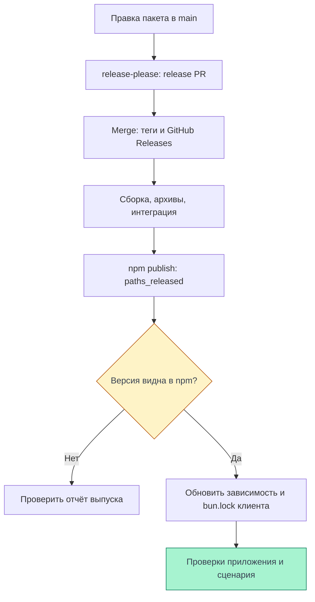

# Командные пакеты

Клиент использует учебные библиотеки команды из npm; их исходники живут в
`frontend-packages`. Ниже — версии приложения, публичные точки импорта и путь от
правки библиотеки до обновления клиента. Внутренние механизмы разобраны в
[рендеринге](./rendering), [роутинге](./routing) и [состоянии](./state).

Срез приложения — 08.11.2026, `frontend`
[`ea123518d624521f999e884ff32ddec0a5bf6bfa`](https://github.com/Cringe-Driven-Development-Team/frontend/blob/ea123518d624521f999e884ff32ddec0a5bf6bfa/apps/client/package.json#L13-L30).
Это чтение кода, не новый прогон продукта на проде. Процесс выпуска отдельно сверен
с `frontend-packages/main` на ту же дату:
[`f4d2bd02fcc127e5603bbe09874242b071def7ba`](https://github.com/Cringe-Driven-Development-Team/frontend-packages/blob/f4d2bd02fcc127e5603bbe09874242b071def7ba/README.md#L53-L79).
Этот SHA не заменяет исходники старых версий из таблицы.

## Что установлено в приложении

В `package.json` записаны допустимые диапазоны, например `^1.7.1`, а
[bun.lock](https://github.com/Cringe-Driven-Development-Team/frontend/blob/ea123518d624521f999e884ff32ddec0a5bf6bfa/bun.lock#L282-L298)
фиксирует конкретное разрешение и integrity архива. Ниже каждая версия сопоставлена
с одноимённым тегом и `version` в манифесте на SHA этого тега. Ссылка в последнем
столбце ведёт на полный SHA, а не на изменяемую ветку.
Имя тега составляется из имени пакета без scope и версии: `react-v1.7.1`,
`router-v0.1.0`, `zustand-v1.0.1`, `clsx-v0.1.0`,
`vite-plugin-bff-html-v0.2.1` соответственно.

| Пакет | Версия в lockfile | SHA |
| --- | --- | --- |
| `@cdd-team/react` | `1.7.1` | [f4d2bd0](https://github.com/Cringe-Driven-Development-Team/frontend-packages/blob/f4d2bd02fcc127e5603bbe09874242b071def7ba/packages/react/package.json#L1-L30) |
| `@cdd-team/router` | `0.1.0` | [bda991c](https://github.com/Cringe-Driven-Development-Team/frontend-packages/blob/bda991c58d01a88b119d910787a87966e31bfe0a/packages/router/package.json#L1-L44) |
| `@cdd-team/zustand` | `1.0.1` | [4652b21](https://github.com/Cringe-Driven-Development-Team/frontend-packages/blob/4652b210db7bf9fcdbbdf96539b412201a1bec85/packages/zustand/package.json#L1-L45) |
| `@cdd-team/clsx` | `0.1.0` | [bda991c](https://github.com/Cringe-Driven-Development-Team/frontend-packages/blob/bda991c58d01a88b119d910787a87966e31bfe0a/packages/clsx/package.json#L1-L25) |
| `@cdd-team/vite-plugin-bff-html` | `0.2.1` | [5be3456](https://github.com/Cringe-Driven-Development-Team/frontend-packages/blob/5be3456bc9df61efebef6902ac5ebe157a307c60/packages/vite-plugin-bff-html/package.json#L1-L47) |

Отдельно корневой тулинг устанавливает `@cdd-team/oxlint-plugin-jsdoc` `0.1.2`:
[зависимость](https://github.com/Cringe-Driven-Development-Team/frontend/blob/ea123518d624521f999e884ff32ddec0a5bf6bfa/package.json#L34-L43),
[lockfile](https://github.com/Cringe-Driven-Development-Team/frontend/blob/ea123518d624521f999e884ff32ddec0a5bf6bfa/bun.lock#L282-L286),
тег `oxlint-plugin-jsdoc-v0.1.2` →
[манифест ecd57a1](https://github.com/Cringe-Driven-Development-Team/frontend-packages/blob/ecd57a1f6e5a10c6b2a253a9d635136d14b81b18/packages/oxlint-plugin-jsdoc/package.json#L1-L47).
Его загружает [oxlint](https://github.com/Cringe-Driven-Development-Team/frontend/blob/ea123518d624521f999e884ff32ddec0a5bf6bfa/oxlint.config.ts#L1-L6),
а не браузер. Плагин HTML тоже работает в инструментах разработки; подробности — в
[сборке](./build#transforms). Каталог владельца шире фактических зависимостей
приложения: наличие `@cdd-team/openapi` у владельца не делает его частью клиента.

Тег и манифест подтверждают срез исходников. Тег сам по себе не подтверждает
публикацию в npm; таблица фиксирует разрешение зависимостей приложения, а не
результат нового аудита registry или каждого release workflow.

## Импорт и совместимость

`exports` задаёт публичные точки входа. У этих пакетов `import` ведёт в
`dist/*.mjs`, а `types` — в `dist/*.d.mts`; импортировать внутренний `src` из
репозитория владельца вместо установленного пакета не нужно.

| Пакет | Публичный импорт и применение | Условия установленной версии |
| --- | --- | --- |
| React | `@cdd-team/react`: `createRoot`, hooks и типы; `/jsx-runtime` и `/jsx-dev-runtime` для automatic JSX | `peerDependencies` не объявлены; [exports](https://github.com/Cringe-Driven-Development-Team/frontend-packages/blob/f4d2bd02fcc127e5603bbe09874242b071def7ba/packages/react/package.json#L14-L43) |
| Router | `@cdd-team/router`: `createRouter`, `RouterProvider`, `Link`, `Outlet` | Обязательный peer React `^1.7.0`; обычная зависимость clsx `^0.1.0`; [манифест](https://github.com/Cringe-Driven-Development-Team/frontend-packages/blob/bda991c58d01a88b119d910787a87966e31bfe0a/packages/router/package.json#L20-L48) |
| Zustand | `@cdd-team/zustand`: `create`, `useStore`, `useShallow`; `/vanilla`: `createStore` без React | Peer React `^1.2.1` помечен `optional`: vanilla работает без него, React-вход использует React приложения; [exports и peer](https://github.com/Cringe-Driven-Development-Team/frontend-packages/blob/4652b210db7bf9fcdbbdf96539b412201a1bec85/packages/zustand/package.json#L16-L48), [README vanilla](https://github.com/Cringe-Driven-Development-Team/frontend-packages/blob/4652b210db7bf9fcdbbdf96539b412201a1bec85/packages/zustand/README.md#L46-L64) |
| clsx | `@cdd-team/clsx`: `clsx` собирает строку из классов, массивов и условий | Нет зависимостей и peers; [манифест](https://github.com/Cringe-Driven-Development-Team/frontend-packages/blob/bda991c58d01a88b119d910787a87966e31bfe0a/packages/clsx/package.json#L16-L42), [пример](https://github.com/Cringe-Driven-Development-Team/frontend-packages/blob/bda991c58d01a88b119d910787a87966e31bfe0a/packages/clsx/README.md#L10-L24) |
| BFF HTML plugin | `@cdd-team/vite-plugin-bff-html`: `bffHtml`; также экспортирует `/package.json` | Peer Vite `^8.3.3`; [манифест](https://github.com/Cringe-Driven-Development-Team/frontend-packages/blob/5be3456bc9df61efebef6902ac5ebe157a307c60/packages/vite-plugin-bff-html/package.json#L18-L47) |
| JSDoc plugin | `@cdd-team/oxlint-plugin-jsdoc`, также `/package.json` | Peer oxlint `>=1.86.0`; [exports и peer](https://github.com/Cringe-Driven-Development-Team/frontend-packages/blob/ecd57a1f6e5a10c6b2a253a9d635136d14b81b18/packages/oxlint-plugin-jsdoc/package.json#L18-L47) |

Peer — условие к окружению потребителя: Router и React-вход Zustand должны работать
с подходящим React приложения. В выбранном lockfile React `1.7.1` удовлетворяет
обоим диапазонам. Похожее имя и API учебной библиотеки не переносят на неё все
гарантии оригинальных React, TanStack Router или Zustand.

Реальные места использования —
[createRoot и RouterProvider](https://github.com/Cringe-Driven-Development-Team/frontend/blob/ea123518d624521f999e884ff32ddec0a5bf6bfa/apps/client/src/main.tsx#L1-L14),
[createRouter и Register](https://github.com/Cringe-Driven-Development-Team/frontend/blob/ea123518d624521f999e884ff32ddec0a5bf6bfa/apps/client/src/router.ts#L1-L11),
[стор тоста](https://github.com/Cringe-Driven-Development-Team/frontend/blob/ea123518d624521f999e884ff32ddec0a5bf6bfa/apps/client/src/stores/toast.ts#L1-L10),
[clsx в кнопке](https://github.com/Cringe-Driven-Development-Team/frontend/blob/ea123518d624521f999e884ff32ddec0a5bf6bfa/apps/client/src/components/Button/Button.tsx#L39-L46)
и [bffHtml в dev-конфиге](https://github.com/Cringe-Driven-Development-Team/frontend/blob/ea123518d624521f999e884ff32ddec0a5bf6bfa/apps/client/vite.config.dev.ts#L63-L80).
JSX runtime выбирается через
[tsconfig](https://github.com/Cringe-Driven-Development-Team/frontend/blob/ea123518d624521f999e884ff32ddec0a5bf6bfa/apps/client/tsconfig.json#L5-L10);
классы и `className` объясняют [стили](./styles#modules).

## npm и workspace

`@cdd-team/*` в таблице — внешние для монорепы приложения версии npm.
Внутренние `@cdd/client`, `@cdd/bff`, `@cdd/schemas` связываются локально через
Bun workspaces: [объявление каталогов](https://github.com/Cringe-Driven-Development-Team/frontend/blob/ea123518d624521f999e884ff32ddec0a5bf6bfa/package.json#L1-L8)
и [разрешения workspace в lockfile](https://github.com/Cringe-Driven-Development-Team/frontend/blob/ea123518d624521f999e884ff32ddec0a5bf6bfa/bun.lock#L294-L298).

Клиент ссылается на `@cdd/bff` как `workspace:*`; BFF так же зависит от
`@cdd/schemas`. Эти приватные пакеты экспортируют локальный TypeScript:
[типы BFF и список страниц](https://github.com/Cringe-Driven-Development-Team/frontend/blob/ea123518d624521f999e884ff32ddec0a5bf6bfa/apps/bff/package.json#L1-L23),
[схемы](https://github.com/Cringe-Driven-Development-Team/frontend/blob/ea123518d624521f999e884ff32ddec0a5bf6bfa/packages/schemas/package.json#L1-L14).
Изменение workspace-кода доступно внутри этого checkout; выпуск библиотеки в
`frontend-packages` сам по себе не обновляет приложение и его `bun.lock`.

## Выпуск и обновление приложения {#release}

<DiagramSection>

У владельца каждый пакет имеет свою версию и changelog. `release-please` ведёт
общий release PR, затем создаёт теги и GitHub Releases; отдельный publish job
работает только с `paths_released`. Это подтверждают
[конфигурация manifest-режима](https://github.com/Cringe-Driven-Development-Team/frontend-packages/blob/f4d2bd02fcc127e5603bbe09874242b071def7ba/release-please-config.json#L1-L19)
и [release workflow](https://github.com/Cringe-Driven-Development-Team/frontend-packages/blob/f4d2bd02fcc127e5603bbe09874242b071def7ba/.github/workflows/release.yml#L15-L82).
Схема отделяет появление тега от доступности npm-версии, а обновление клиента —
от выпуска библиотеки. При ошибке или неподтверждённой публикации сначала
разбирают результат выпуска у владельца.

<template #diagram>

</template>

</DiagramSection>

1. Правку библиотеки с `feat:`/`fix:` вливают в `main` владельца. CI проверяет release
   PR; после его слияния `release-please` создаёт теги. Правила версий и коммитов —
   в [README владельца](https://github.com/Cringe-Driven-Development-Team/frontend-packages/blob/f4d2bd02fcc127e5603bbe09874242b071def7ba/README.md#L59-L79).
   Плагин `node-workspace` обновляет зависимые диапазоны peers; текущий
   [release manifest](https://github.com/Cringe-Driven-Development-Team/frontend-packages/blob/f4d2bd02fcc127e5603bbe09874242b071def7ba/.release-please-manifest.json#L1-L9)
   уже содержит Zustand `1.0.7`, Router `0.2.0` и clsx `0.1.1`. Они не описывают
   установленный клиент из первой таблицы.
2. Publish job собирает пакеты, проверяет npm-архивы установкой вне workspace и
   выполняет интеграционные тесты. Для публикации по OIDC он ставит Node и npm;
   сборка и проверки работают через Bun —
   [шаги job](https://github.com/Cringe-Driven-Development-Team/frontend-packages/blob/f4d2bd02fcc127e5603bbe09874242b071def7ba/.github/workflows/release.yml#L33-L89).
3. Скрипт публикует только выпущенные пути в порядке зависимостей: React, clsx,
   Zustand, Router, затем остальные выпущенные пакеты. Уже видимую точную версию
   пропускает, ошибка `npm publish` останавливает следующие публикации. После
   успешной команды ждёт видимость точной версии через `npm view` и пишет
   `release-report.json`; неподтверждённая версия завершает CLI с ошибкой —
   [порядок](https://github.com/Cringe-Driven-Development-Team/frontend-packages/blob/f4d2bd02fcc127e5603bbe09874242b071def7ba/scripts/publish-released.ts#L4-L22),
   [публикация и статусы](https://github.com/Cringe-Driven-Development-Team/frontend-packages/blob/f4d2bd02fcc127e5603bbe09874242b071def7ba/scripts/publish-released.ts#L82-L111),
   [registry-проверка и код выхода](https://github.com/Cringe-Driven-Development-Team/frontend-packages/blob/f4d2bd02fcc127e5603bbe09874242b071def7ba/scripts/publish-released.ts#L133-L169).
4. В приложении обновляют нужную зависимость, проверяют peers, changelog и миграцию,
   выполняют `bun install`, проверяют diff `package.json` и `bun.lock`. Затем
   запускают `bun run check`, `bun run test` и `bun run build`, проверяют затронутый
   пользовательский сценарий. Границы автоматических проверок — в
   [проверке изменений](./checks#tools). Одна зелёная сборка библиотеки не проверяет
   её интеграцию с текущим клиентом.

## Что проверить в понимании

- Почему `^1.7.1` в manifest и `1.7.1` в lockfile отвечают на разные вопросы?
  Диапазон допускает версии, lockfile фиксирует выбранный архив.
- Где искать реализацию Router этого приложения? На SHA тега `router-v0.1.0`,
  а не в сегодняшнем `main` владельца.
- Почему Release в GitHub недостаточно? Теги появляются до publish job; нужны
  результат публикации и видимость точной версии в npm.
- Обновится ли клиент после merge release PR библиотеки? Нет: приложение отдельно
  обновляет зависимость и lockfile, проверяет peers и своё поведение.
