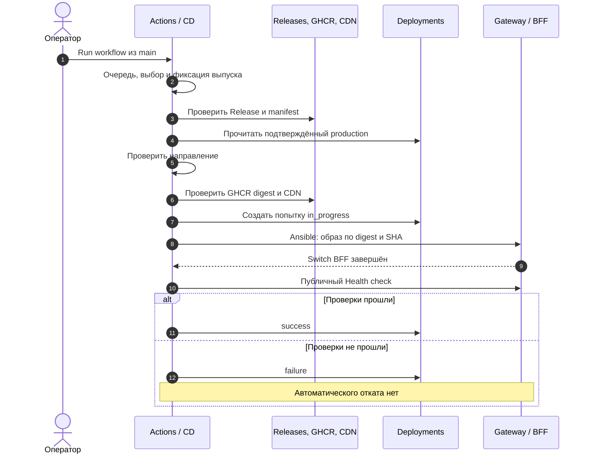

# Выкатка {#release-deployment}

CD вручную переключает production на уже собранный выпуск. Он не собирает приложение заново.
Перед запуском проверьте наличие опубликованного Release и доступ к Actions командного
репозитория. Для возврата к предку используйте [Rollback](./rollback), а не CD старого тега.
[Основание описания](./#основание-описания).

## Какой выпуск будет выбран {#selection}

Поле `release` необязательно. Пустое поле означает ближайший к вершине основной цепочки
`main` опубликованный Release, исключая draft и prerelease. `Ready release` обновляет
`origin/main` после ожидания очереди и просматривает first-parent историю. Учитываются все
страницы каталога Releases; время публикации, порядок ответа API и метка Latest не задают выбор.

Для `A → B` будет выбран B, даже если A допубликовали позже. B содержит изменения A;
отдельно выкатывать промежуточный выпуск не нужно. Если новый выпуск появился, пока CD
ждал очередь, он может стать целью. Выбор фиксируется один раз; затем шаги используют его SHA,
ID и digest. Если нужно выкатить именно просмотренный выпуск, укажите его полный тег.

Непустое поле после удаления внешних пробелов выбирает точный `release-<полный SHA>`.
Если выбранный выпуск повреждён, CD завершится ошибкой; исправный старый не подбирается.
Реализация: [выбор Release](https://github.com/Cringe-Driven-Development-Team/frontend/blob/319e691b79f81e09dcffabc04941831a5f4b5930/scripts/release/releases.ts#L382-L425) и
[обновление main](https://github.com/Cringe-Driven-Development-Team/frontend/blob/319e691b79f81e09dcffabc04941831a5f4b5930/.github/workflows/cd.yml#L50-L57).

## Запуск CD

::: tabs
== Через GitHub

1. Откройте [Actions → CD](https://github.com/Cringe-Driven-Development-Team/frontend/actions/workflows/cd.yml).
2. Нажмите **Run workflow**, выберите ветку `main`.
3. Оставьте `release` пустым для выбора по истории main либо вставьте полный тег из Releases.
4. Нажмите **Run workflow** и откройте созданный запуск.
5. После очереди прочитайте `Ready release`: в логе должны быть выбранные тег и ссылка на Release.

== Через CLI

Запустить с автоматическим выбором:

```bash [Запуск CD]
gh workflow run cd.yml --repo Cringe-Driven-Development-Team/frontend --ref main
```

Выбрать конкретный выпуск:

```bash [CD конкретного выпуска]
release_tag='release-ВСТАВЬТЕ_ПОЛНЫЙ_SHA'
gh workflow run cd.yml --repo Cringe-Driven-Development-Team/frontend --ref main \
  -f release="$release_tag"
```

Затем найдите свою попытку в Actions → CD по времени и инициатору. Успех команды dispatch
означает постановку workflow на запуск, а не завершение выкатки.

:::

Workflow исполняет скрипты из checkout своего запуска; целевой SHA выпуска может отличаться
от SHA workflow. Ansible берётся из актуального `infra/main`, а образ всегда выбирается по digest.
[Checkout и запуск Ansible](https://github.com/Cringe-Driven-Development-Team/frontend/blob/319e691b79f81e09dcffabc04941831a5f4b5930/.github/workflows/cd.yml#L43-L132).

<DiagramSection>

## Проверки и переключение

До доступа к VPS проверяются immutable Release, тег, состав, суммы и источник CI,
затем направление относительно последнего подтверждённого production, публичность точного
GHCR digest и CDN-файлы. Тот же SHA допускается, обычный deploy должен идти к потомку;
возврат к предку выполняет Rollback.

<template #diagram>



</template>

Схема показывает путь, на котором Switch BFF завершился. Ошибка в самом Ansible или отмена
после создания записи дают `error`; при этом часть действий на сервере уже могла выполниться.
Ошибка до Production record вообще не создаёт production Deployment для этой попытки.
[Создание и итог записи](https://github.com/Cringe-Driven-Development-Team/frontend/blob/319e691b79f81e09dcffabc04941831a5f4b5930/.github/workflows/cd.yml#L110-L147).

Ansible заранее скачивает и проверяет образ, переключает BFF, проверяет фактический digest,
внутренний `/health` и доступ через Caddy. Go и БД этим playbook не откатываются.
[deploy-bff.yml](https://github.com/Cringe-Driven-Development-Team/infra/blob/a59f8584386810b0b94f5fb23cb72c7ff906f6d7/ansible/deploy-bff.yml#L1-L43).

</DiagramSection>

## Что проверяет Health check

| Проверка | Ожидаемый результат |
| --- | --- |
| Гостевой `/login` | Один bootstrap с `user: null`, метка целевого SHA, `Cache-Control: private, no-store` |
| JS/CSS из HTML | Каталог выбранного SHA, корректные MIME; JS доступен с нужным CORS |
| `users.me` без сессии | HTTP 401 и tRPC `UNAUTHORIZED` |
| Неизвестный `/api` | HTTP 404, ответ не HTML |
| `auth.login` со случайными данными | HTTP 400, `BAD_REQUEST`, `appCode=invalid_credentials` |

Последняя проба подтверждает путь BFF → Go и обработчик входа; пользователь и сессия не создаются.
Она не проверяет успешный вход настоящего пользователя или все функции приложения.
[Проверки](https://github.com/Cringe-Driven-Development-Team/frontend/blob/319e691b79f81e09dcffabc04941831a5f4b5930/scripts/release/checks.ts#L98-L181).

## Как подтвердить результат

1. В своём Actions run проверьте `Ready release`, `Switch BFF`, `Health check` и `Production result`.
2. Откройте [Deployments](https://github.com/Cringe-Driven-Development-Team/frontend/deployments),
   окружение `production`: найдите попытку с нужным SHA и ссылкой на этот run.
3. Для успешной выкатки итог Deployment — `success`. Проверьте сайт и нужный пользовательский
   сценарий отдельно: автоматическая проба ограничена таблицей выше.
4. Если итог `failure`/`error`, выясните стадию по [инструкции ошибок](./troubleshooting#diagnosis).
   Повторный запуск — отдельная попытка с новой записью, даже если выпуск тот же.

Payload production связывает `image_ref`, `assets`, `action`, `run`, `release_id` и сведения
отчёта. `release_id` — числовой ID API, а в поле CD вводится тег Release, не этот ID.
[Запись Deployment](https://github.com/Cringe-Driven-Development-Team/frontend/blob/319e691b79f81e09dcffabc04941831a5f4b5930/scripts/release/deployments.ts#L144-L190).

После подтверждённого результата обновляются задачи и запускается retention. Их ошибка может
сделать workflow красным, не отменив успешную выкатку: всегда смотрите конкретный упавший шаг
и production-статус. [Порядок завершающих шагов](https://github.com/Cringe-Driven-Development-Team/frontend/blob/319e691b79f81e09dcffabc04941831a5f4b5930/.github/workflows/cd.yml#L137-L158).
