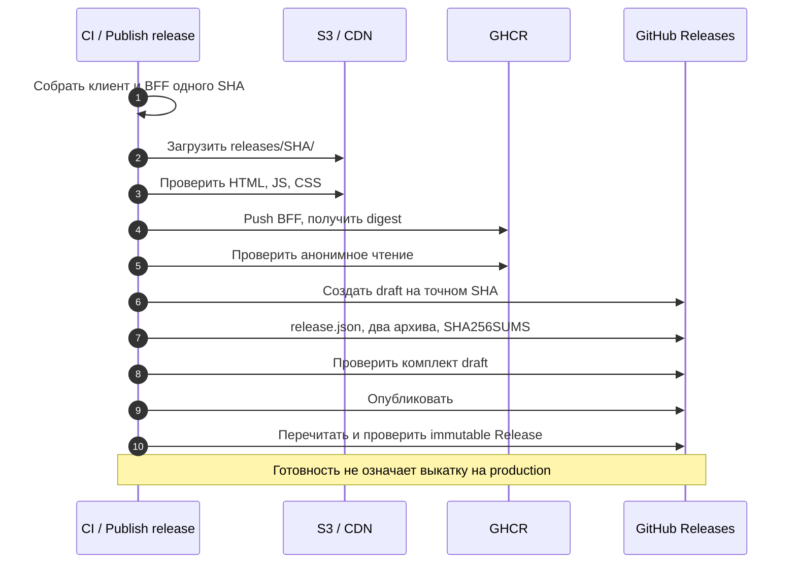
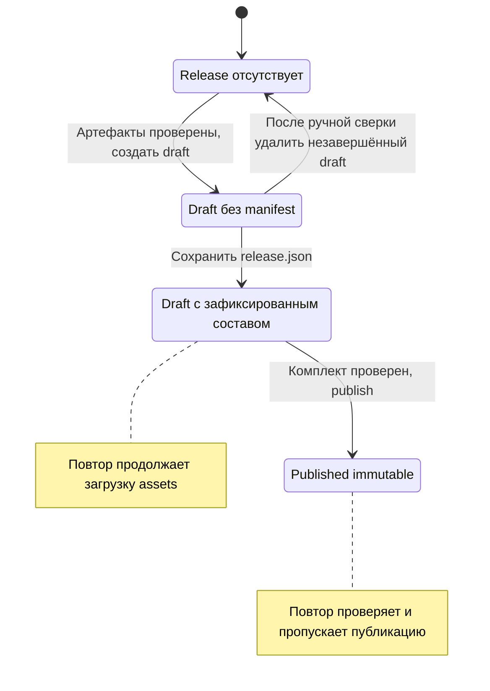

# CI и публикация {#release-publication}

CI проверяет изменения и подготавливает выпуск. Публикация делает доступными файлы и образ,
но не переключает BFF на сайте. Чтобы запустить готовый выпуск, нужен отдельный [CD](./deployment).
Срез реализации и границы проверки — в [обзоре](./#основание-описания).

## Какие события запускают CI

| Событие | Check | Publish release |
| --- | --- | --- |
| Pull request | Линтер, типы, тесты, сборка, локальная сборка BFF-образа | Не запускается |
| Кандидат merge queue | Те же проверки кандидата | Не запускается |
| Push в `main` командного frontend | Те же проверки | После успешного Check |

[ci.yml](https://github.com/Cringe-Driven-Development-Team/frontend/blob/319e691b79f81e09dcffabc04941831a5f4b5930/.github/workflows/ci.yml#L1-L65) задаёт эти условия. Образ в Check остаётся
на runner; релизный образ публикуется в отдельном job. Учебный репозиторий получает копию
`main` через course-sync после Check, независимо от результата Publish release.
Синхронизация репозитория сама по себе не выкатывает сайт.

## Подготовка файлов и образа

1. `Published already` ищет выпуск SHA: уже опубликованный проверяет, у draft читает
   зафиксированный состав, а для отсутствующего разрешает сборку.
2. `Build release` задаёт `RELEASE_SHA` и `CDN_URL`, собирает клиент и BFF. В HTML попадают
   метка выпуска и ссылки на JS/CSS его CDN-каталога.
3. `Upload assets` записывает dist в `releases/<SHA>/` в S3. Сначала ресурсы, последним
   `index.html`. При повторе завершённого каталога байты сверяются: другой сборкой тот же SHA
   не заменяется. Подробности — [upload.ts](https://github.com/Cringe-Driven-Development-Team/frontend/blob/319e691b79f81e09dcffabc04941831a5f4b5930/scripts/release/upload.ts#L32-L78).
4. `Release check` читает HTML и связанные JS/CSS с CDN, проверяет адреса, MIME и CORS.
5. `Publish BFF image` собирает образ с серверным бандлом, HTML и публичными PWA-файлами,
   публикует `ghcr.io/cringe-driven-development-team/bff:sha-<SHA>` и получает digest.
6. `Anonymous image check` проверяет чтение точного образа без credentials и метку коммита.
   VPS также скачивает его анонимно, поэтому package должен быть публичным.
7. `Register release` создаёт полный комплект GitHub Release, проверяет и публикует его.

Порядок задан [шагами CI](https://github.com/Cringe-Driven-Development-Team/frontend/blob/319e691b79f81e09dcffabc04941831a5f4b5930/.github/workflows/ci.yml#L75-L147), состав контейнера —
[Dockerfile](https://github.com/Cringe-Driven-Development-Team/frontend/blob/319e691b79f81e09dcffabc04941831a5f4b5930/apps/bff/Dockerfile#L1-L19). Релизная сборка не повторяется в CD.

<DiagramSection>

## Публикация готового комплекта

До публикации архива CI уже проверил рабочие источники доставки: S3/CDN и GHCR.
Затем он оформляет скачиваемый комплект на странице Release. Черновик не является
доступным для CD выпуском.

<template #diagram>

</template>

Сначала загружается `release.json`: после него состав draft зафиксирован.
Архив клиента проверяется против dist, архив BFF — через config digest и `docker load`.
Каждый asset должен быть строго меньше 2 GiB. После publish повторно читается Release
и проверяются неизменяемость, тег, четыре asset, суммы и происхождение сборки.
[Проверка и публикация](https://github.com/Cringe-Driven-Development-Team/frontend/blob/319e691b79f81e09dcffabc04941831a5f4b5930/scripts/release/releases.ts#L508-L616).

</DiagramSection>

## Что делает immutable

Публикация должна происходить при включённых immutable releases репозитория.
Проверка CD отвергает Release без `immutable: true`. GitHub защищает asset и связанный тег
от изменения; название и описание остаются редактируемыми. Поэтому состав проверяется
по manifest и данным API, а не по тексту release notes.
[Проверка Release](https://github.com/Cringe-Driven-Development-Team/frontend/blob/319e691b79f81e09dcffabc04941831a5f4b5930/scripts/release/releases.ts#L321-L347),
[правила GitHub](https://docs.github.com/en/code-security/concepts/supply-chain-security/immutable-releases).

<DiagramSection>

## Повтор и незавершённый draft {#retry}

Повтор успешной публикации проверяет существующий выпуск и пропускает её без создания
новой версии. У draft с manifest недостающий комплект восстанавливается из сохранённых
S3-файлов и точного GHCR digest; исходные `ci_run` и `ci_run_attempt` сохраняются,
`publication_run` и сведения попытки публикации обновляются.

<template #diagram>

</template>

Проверки состояний — [published](https://github.com/Cringe-Driven-Development-Team/frontend/blob/319e691b79f81e09dcffabc04941831a5f4b5930/scripts/release/releases.ts#L429-L453) и
[draftManifest](https://github.com/Cringe-Driven-Development-Team/frontend/blob/319e691b79f81e09dcffabc04941831a5f4b5930/scripts/release/releases.ts#L350-L364). После ошибки job:

1. Откройте `Publish release`, найдите первый упавший шаг и страницу draft/Release.
2. Если draft имеет `release.json`, после устранения причины используйте **Re-run jobs**:
   сохранённый состав позволяет продолжить без новой релизной сборки.
3. Если draft не имеет `release.json`, сначала ответственный за выпуск сверяет S3 и GHCR.
   Только для этого незавершённого draft допустимо ручное удаление через страницу Release
   или `gh release delete "$release_tag" --repo Cringe-Driven-Development-Team/frontend`,
   затем повтор CI. Не применяйте эту команду к опубликованному выпуску.
4. Если publish выполнился, но ответ потерялся, сначала перечитайте Release: повторная
   проверка может подтвердить готовность. Красный job не заменяет проверку опубликованного объекта.

</DiagramSection>

## Очередь и несколько коммитов подряд

Publish release, CD, Rollback и обработчик закрытия задач используют общую job concurrency
`release-board`, `cancel-in-progress: false`, `queue: max`. Check работает независимо.
Очередь сериализует операции; её порядок не является порядком версий.

У самого CI есть ещё concurrency по ref: идущий main CI не отменяется, но более новый
ожидающий main CI может вытеснить предыдущий. Поэтому не каждый промежуточный коммит
обязательно получит Release. Поздний коммит содержит предыдущие изменения;
[выбор CD](./deployment#selection) опирается на историю кода, а не на очередность загрузок.
[Две concurrency-группы](https://github.com/Cringe-Driven-Development-Team/frontend/blob/319e691b79f81e09dcffabc04941831a5f4b5930/.github/workflows/ci.yml#L13-L65).

После публикации обновляются карточки задач. Уведомление о готовом выпуске отправляет
webhook-сервис по `release.published`; отдельный `on: release` workflow не требуется.
Если карточка или уведомление не появились, переходите к [диагностике](./troubleshooting#diagnosis).
