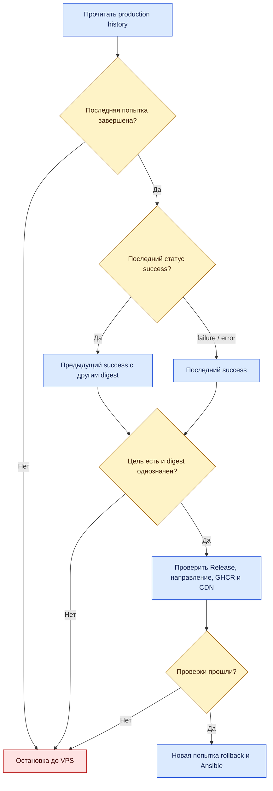

# Откат {#release-rollback}

Rollback повторно выкладывает сохранённый выпуск из истории `production` без пересборки.
Цель выбирает скрипт, а не оператор через тег. Перед запуском найдите последнюю попытку
в [Deployments](https://github.com/Cringe-Driven-Development-Team/frontend/deployments)
и её результат. [Основание описания](./#основание-описания).

<DiagramSection>

## Как выбирается цель {#target}

Если последняя завершённая попытка успешна, откат выбирает предыдущую успешную с **другим
image digest**. Если последняя попытка завершилась `failure` или `error`, выбирается последний
успешный выпуск. Так откат восстанавливает подтверждённый результат после неудачной попытки.

<template #diagram>



</template>

Незавершённая последняя попытка, отсутствие цели или разные digest одного целевого SHA
останавливают откат до VPS. Выбранная запись сверяется с GitHub Release и его manifest.
Затем проверяются направление к предку (тот же SHA допустим), публичный образ и CDN.
[Выбор и проверки](https://github.com/Cringe-Driven-Development-Team/frontend/blob/319e691b79f81e09dcffabc04941831a5f4b5930/scripts/release/deployments.ts#L52-L143),
[workflow Rollback](https://github.com/Cringe-Driven-Development-Team/frontend/blob/319e691b79f81e09dcffabc04941831a5f4b5930/.github/workflows/rollback.yml#L40-L59).

</DiagramSection>

## Запуск Rollback

Предусловие: понимаете состояние последней попытки и ожидаемую цель по правилу выше.
Нужны права запуска Actions; история должна содержать подходящий успешный выпуск,
а его Release, CDN и образ — оставаться доступными.

::: tabs
== Через GitHub

1. Откройте [Actions → Rollback](https://github.com/Cringe-Driven-Development-Team/frontend/actions/workflows/rollback.yml).
2. Нажмите **Run workflow**, выберите `main`. Поля выбора тега здесь нет.
3. Запустите workflow и откройте созданную попытку.
4. В `Rollback target` проверьте выбранный SHA/digest и причину выбора.
5. Дождитесь `Switch BFF`, `Health check` и `Production result`; проверьте новый Deployment и сайт.

== Через CLI

```bash [Запуск отката]
gh workflow run rollback.yml --repo Cringe-Driven-Development-Team/frontend --ref main
```

Откройте свой запуск в Actions → Rollback. Отправленная команда не означает успешного отката:
сначала workflow должен пройти очередь и определить цель.

:::

Перед переключением создаётся отдельный production Deployment с `action=rollback` и SHA
целевого образа. Ошибка выбора или проверки цели до этого шага записи не создаёт. Если проверки результата прошли, он получает `success`; критерии те же,
что у [обычной выкатки](./deployment#что-проверяет-health-check).
[Шаги Rollback](https://github.com/Cringe-Driven-Development-Team/frontend/blob/319e691b79f81e09dcffabc04941831a5f4b5930/.github/workflows/rollback.yml#L98-L143).

## Границы отката

Откат BFF возвращает его HTML и ссылки на клиентские ассеты выбранного SHA. Он не откатывает
Go, базу данных и миграции. Ключ сессии берётся из Vault, одинаковый ключ сохраняет возможность
чтения действительных cookie; это не гарантия совместимости всех сценариев с другой версией Go.
[Границы playbook](https://github.com/Cringe-Driven-Development-Team/infra/blob/a59f8584386810b0b94f5fb23cb72c7ff906f6d7/ansible/deploy-bff.yml#L1-L43),
[справочник отката](https://github.com/Cringe-Driven-Development-Team/frontend/blob/319e691b79f81e09dcffabc04941831a5f4b5930/docs/release.md#L164-L184).

Последний success в GitHub — последний подтверждённый результат проверки, не датчик текущего
состояния контейнера. Если контейнер позже упал, запись остаётся историей, а Ansible после
запуска проверяет фактический образ и здоровье. Если нужные CDN-файлы уже удалены, архив Release
сам по себе не делает откат возможным: [правила хранения](./artifacts#retention).

## Если откат не прошёл

Не выбирайте произвольный старый тег в CD, обходя направление. Прочитайте первый упавший шаг:
ошибка `Rollback target` означает остановку до VPS, ошибка в Switch BFF или Health check требует
проверки фактического состояния. Дальнейшие действия — [таблица диагностики](./troubleshooting#diagnosis).
