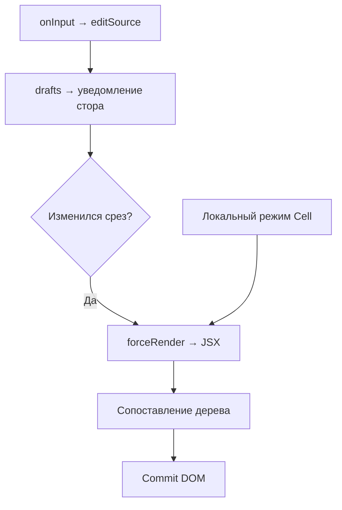

# Компоненты и рендеринг

Страница передаёт компонентам данные и обработчики через props. Изменение props, локального состояния или выбранного среза стора может запланировать рендер. DOM меняется на этапе commit командного React. [Ячейки страницы](https://github.com/Cringe-Driven-Development-Team/frontend/blob/b1baf996fb6753d1a62eab6f874d03dca30faadc/apps/client/src/pages/NotebookPage/NotebookPage.tsx#L579-L620), [commit React](https://github.com/Cringe-Driven-Development-Team/frontend-packages/blob/f4d2bd02fcc127e5603bbe09874242b071def7ba/packages/react/src/commit.ts#L77-L121).

## Cell: props и события {#cell}

`NotebookPage` передаёт в `CodeOrText` текст из `drafts` или подтверждённого снимка. Обёртка ячейки получает `key={row.cell.id}`, поэтому при перестановке дерево сопоставляет её по ID. Сам `Cell` содержит локальный режим просмотра или редактирования Markdown. Меняйте общий компонент через props и [CSS Modules](./styles#modules). [Разметка и события страницы](https://github.com/Cringe-Driven-Development-Team/frontend/blob/b1baf996fb6753d1a62eab6f874d03dca30faadc/apps/client/src/pages/NotebookPage/NotebookPage.tsx#L579-L620), [локальный режим](https://github.com/Cringe-Driven-Development-Team/frontend/blob/b1baf996fb6753d1a62eab6f874d03dca30faadc/apps/client/src/components/Cell/Cell.tsx#L146-L188), [сопоставление ключей](https://github.com/Cringe-Driven-Development-Team/frontend-packages/blob/f4d2bd02fcc127e5603bbe09874242b071def7ba/packages/react/src/reconcile.ts#L105-L154).

## Внешний стор и обновление DOM {#subscriptions}

<DiagramSection>

`editSource` меняет `drafts` и стор уведомляет подписчиков. Hook Zustand 1.0.1 подписывается в `useLayoutEffect`, сравнивает состояние и выбранный срез через `Object.is` и при изменении вызывает `forceRender`. React пересчитывает props и применяет изменения DOM, сохраняя идентичность элементов при совпадающих типе и ключе. [Обновление черновика](https://github.com/Cringe-Driven-Development-Team/frontend/blob/b1baf996fb6753d1a62eab6f874d03dca30faadc/apps/client/src/stores/notebook/index.ts#L308-L327), [подписка Zustand](https://github.com/Cringe-Driven-Development-Team/frontend-packages/blob/4652b210db7bf9fcdbbdf96539b412201a1bec85/packages/zustand/src/react/use-store.ts#L8-L37), [commit React](https://github.com/Cringe-Driven-Development-Team/frontend-packages/blob/f4d2bd02fcc127e5603bbe09874242b071def7ba/packages/react/src/commit.ts#L77-L121).

<template #diagram>

</template>

</DiagramSection>

## Эффекты и cleanup

Hook стора возвращает отписку из эффекта. `Cell` измеряет редактор после обновления DOM, ставит курсор в конец при возврате фокуса и вызывает `ResizeObserver.disconnect()` в cleanup. При уходе со страницы cleanup загрузки сбрасывает флаг `alive`. Отдельный cleanup вызывает `leaveNotebook` и прекращает опрос runtime для этой страницы. [Hook стора](https://github.com/Cringe-Driven-Development-Team/frontend-packages/blob/4652b210db7bf9fcdbbdf96539b412201a1bec85/packages/zustand/src/react/use-store.ts#L15-L36), [эффекты Cell](https://github.com/Cringe-Driven-Development-Team/frontend/blob/b1baf996fb6753d1a62eab6f874d03dca30faadc/apps/client/src/components/Cell/Cell.tsx#L189-L218), [эффект страницы](https://github.com/Cringe-Driven-Development-Team/frontend/blob/b1baf996fb6753d1a62eab6f874d03dca30faadc/apps/client/src/pages/NotebookPage/NotebookPage.tsx#L242-L293).

## Клавиатура и touch

Режим touch определяется через `(pointer: coarse)`. Hook следит за изменением media query и снимает слушателя в cleanup. При `readOnly={touch}` ячейка доступна для просмотра. Клавиши, композиция IME и сохранение описаны в [редактировании блокнота](/documentation/notebooks/editing). [Media hook](https://github.com/Cringe-Driven-Development-Team/frontend/blob/b1baf996fb6753d1a62eab6f874d03dca30faadc/apps/client/src/utils/media.ts#L1-L15), [props ячейки](https://github.com/Cringe-Driven-Development-Team/frontend/blob/b1baf996fb6753d1a62eab6f874d03dca30faadc/apps/client/src/pages/NotebookPage/NotebookPage.tsx#L586-L612), [режимы Cell](https://github.com/Cringe-Driven-Development-Team/frontend/blob/b1baf996fb6753d1a62eab6f874d03dca30faadc/apps/client/src/components/Cell/Cell.tsx#L319-L403).
