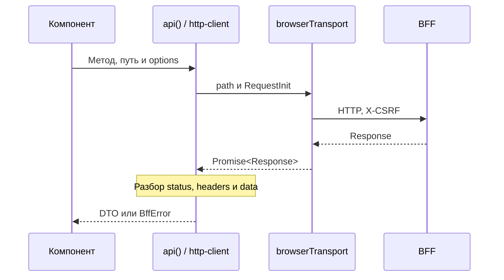

# Запросы и ошибки

Вызывай `api(method, path, options)` для одного HTTP-запроса браузера к BFF. Метод, путь, вход и успешный DTO задаёт `BffPaths`. [Клиентский API](https://github.com/Cringe-Driven-Development-Team/frontend/blob/b1baf996fb6753d1a62eab6f874d03dca30faadc/apps/client/src/api/bff.ts#L1-L26), [обработка вызова](https://github.com/Cringe-Driven-Development-Team/frontend/blob/b1baf996fb6753d1a62eab6f874d03dca30faadc/apps/client/src/api/bff.ts#L153-L189).

## Один клиент и транспорт {#transport}

<DiagramSection>

`browserTransport` возвращает `Promise<Response>`, добавляет `X-CSRF: 1`, сохраняет `signal` и передаёт `credentials: 'same-origin'`. Общий `@cdd-team/http-client` собирает запрос и возвращает `{ status, headers, data }`. Обёртка `api()` возвращает успешный DTO или бросает `BffError`. [Транспорт](https://github.com/Cringe-Driven-Development-Team/frontend/blob/b1baf996fb6753d1a62eab6f874d03dca30faadc/apps/client/src/api/transport.ts#L1-L16), [HTTP-клиент](https://github.com/Cringe-Driven-Development-Team/frontend-packages/blob/872ffb6e01c13473867adfa6247e4e2d192f1c1b/packages/http-client/src/index.ts#L67-L82), [разбор результата](https://github.com/Cringe-Driven-Development-Team/frontend/blob/b1baf996fb6753d1a62eab6f874d03dca30faadc/apps/client/src/api/bff.ts#L153-L189).

<template #diagram>



</template>

</DiagramSection>

`POST /api/users/avatar` принимает `multipart/form-data` с полем `avatar`. Передай `File` в `body`: общий клиент соберёт `FormData`, границу multipart подставит браузер. BFF проверяет поле через `avatarInput` и передаёт файл в Go как `PUT /api/v1/users/me/avatar`. [Маршрут BFF](https://github.com/Cringe-Driven-Development-Team/frontend/blob/b1baf996fb6753d1a62eab6f874d03dca30faadc/apps/bff/src/router/users.ts#L32-L39), [сборка тела](https://github.com/Cringe-Driven-Development-Team/frontend-packages/blob/872ffb6e01c13473867adfa6247e4e2d192f1c1b/packages/http-client/src/index.ts#L106-L174), [вызов Go](https://github.com/Cringe-Driven-Development-Team/frontend/blob/b1baf996fb6753d1a62eab6f874d03dca30faadc/apps/bff/src/go/api.ts#L153-L163).

```ts
const user = await api(
    'POST',
    '/api/users/avatar',
    {
        contentType: 'multipart/form-data',
        body: { avatar: file },
    },
);
```

## Загрузка данных {#загрузка-данных}

- `GET /api/notebooks/get` загружает страницу блокнота тем же загрузчиком, что и [прямой запрос HTML](./bff#общии-загрузчик-notebookpage). [Маршрут](https://github.com/Cringe-Driven-Development-Team/frontend/blob/b1baf996fb6753d1a62eab6f874d03dca30faadc/apps/bff/src/router/notebooks.ts#L22-L28).
- `POST /api/runtime/execute-all` передаёт одно пакетное исполнение в Go (`POST /api/v1/runtime-sessions/{id}/executions/batch`, ожидает `202`). [Маршрут](https://github.com/Cringe-Driven-Development-Team/frontend/blob/b1baf996fb6753d1a62eab6f874d03dca30faadc/apps/bff/src/router/runtime.ts#L35-L42), [адаптер Go](https://github.com/Cringe-Driven-Development-Team/frontend/blob/b1baf996fb6753d1a62eab6f874d03dca30faadc/apps/bff/src/go/api.ts#L386-L398).
- `POST /api/runtime/updates` читает состояние сессии, очередь и страницу событий параллельно, затем снимки исполнений из событий и `executionIds`. POST позволяет передать список ID в теле. Сбой чтения даёт ошибку всего шага. [Агрегатор](https://github.com/Cringe-Driven-Development-Team/frontend/blob/b1baf996fb6753d1a62eab6f874d03dca30faadc/apps/bff/src/router/runtime.ts#L80-L116).

## Запись ячейки {#cells-update-и-подтверждение-записи}

`POST /api/cells/update` принимает `notebookId`, `cellId`, `source` и `hash`. BFF передаёт версию как `If-Match` в `PATCH /api/v1/notebooks/{id}/content/cells/{cell_id}`. Обработка подтверждения, конфликтов и неизвестного исхода записи описана в [сохранении редактора](./state#saving). [Вход и обработчик](https://github.com/Cringe-Driven-Development-Team/frontend/blob/b1baf996fb6753d1a62eab6f874d03dca30faadc/apps/bff/src/router/cells.ts#L10-L29), [вызов Go](https://github.com/Cringe-Driven-Development-Team/frontend/blob/b1baf996fb6753d1a62eab6f874d03dca30faadc/apps/bff/src/go/api.ts#L208-L220).

## Ошибки и реакция интерфейса {#errors}

В HTTP-ошибке BFF возвращает JSON `{ error: { code, message, appCode?, validationErrors?, activeRuntimeSession? } }`. Клиент проверяет конверт и даёт программный доступ к `code`, `appCode` и ошибкам полей. `message` предназначен для отображения. [Конверт](https://github.com/Cringe-Driven-Development-Team/frontend/blob/b1baf996fb6753d1a62eab6f874d03dca30faadc/apps/bff/src/errors.ts#L127-L155), [проверка и преобразование в BffError](https://github.com/Cringe-Driven-Development-Team/frontend/blob/b1baf996fb6753d1a62eab6f874d03dca30faadc/apps/client/src/api/bff.ts#L120-L189).

| Исход | Как обработать |
| --- | --- |
| `400` с `validationErrors` | Покажи ошибки полей из `fieldErrors` и общие ошибки из `formErrors`. [Формат](https://github.com/Cringe-Driven-Development-Team/frontend/blob/b1baf996fb6753d1a62eab6f874d03dca30faadc/apps/bff/src/errors.ts#L127-L155). |
| `UNAUTHORIZED` защищённого запроса | Вне смены сессии обработчик потери сессии переводит приложение в гостя. Во время ожидания смены отказ возвращается вызывающему коду, а переход в гостевой режим зависит от исхода смены. [Обработка](https://github.com/Cringe-Driven-Development-Team/frontend/blob/b1baf996fb6753d1a62eab6f874d03dca30faadc/apps/client/src/api/bff.ts#L248-L293), [сессия](./session#switching). |
| `FORBIDDEN` | Ошибка операции. Сессия сохраняется. [Реакция на ошибку](https://github.com/Cringe-Driven-Development-Team/frontend/blob/b1baf996fb6753d1a62eab6f874d03dca30faadc/apps/client/src/api/bff.ts#L268-L284). |
| `kind: 'abort'` | Запрос отменён вызывающим кодом. [Разбор отказа](https://github.com/Cringe-Driven-Development-Team/frontend/blob/b1baf996fb6753d1a62eab6f874d03dca30faadc/apps/client/src/api/bff.ts#L164-L177). |
| `BAD_GATEWAY`, `kind: 'network'` или `kind: 'protocol'` | Различай отказ Go, сетевой сбой и ответ вне протокола. Для сбоя записи проверь [состояние блокнота](./state#saving). [Ошибки Go](https://github.com/Cringe-Driven-Development-Team/frontend/blob/b1baf996fb6753d1a62eab6f874d03dca30faadc/apps/bff/src/errors.ts#L79-L125), [ошибки клиента](https://github.com/Cringe-Driven-Development-Team/frontend/blob/b1baf996fb6753d1a62eab6f874d03dca30faadc/apps/client/src/api/bff.ts#L153-L189). |

## Проверка запросов {#проверка-через-существующие-моки}

В DevTools сопоставь метод и путь, статус и JSON ошибки. Для записи или отзыва сессии проверь изменившееся состояние [на реальном Go](./checks#mock-boundary). Этот справочник описывает код выложенного фронтенда. Наблюдение гостевого HTML приведено в [проверенной части BFF](./bff#bff-проверенная-часть).
