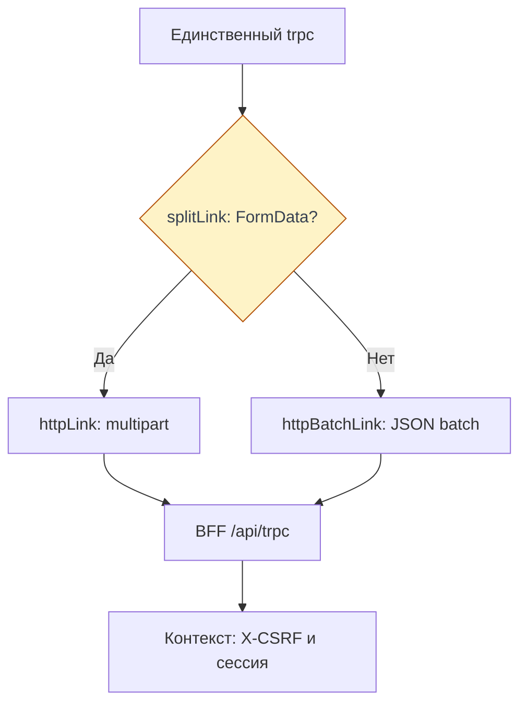

# Запросы и ошибки

Клиент обращается к процедурам BFF через один `trpc`. Здесь разобраны транспорт,
подтверждение записи и классификация ошибок. Очередь и сохранность черновиков —
в [управлении состоянием](./state#saving), серверная обработка — в [BFF](./bff).

Срез реализации на 08.11.2026: frontend `ea123518d624521f999e884ff32ddec0a5bf6bfa`. Это не новый прогон
продукта на проде; [исторические наблюдения BFF](./bff#bff-проверенная-часть)
сохраняют свою дату и релизы.

## Один клиент и два транспорта {#transport}

<DiagramSection>

`@api/trpc` создаёт единственный `createTRPCClient<AppRouter>`: типы
`RouterInputs` / `RouterOutputs` импортируются из `@cdd/bff` через `import type`.
Это проверка на этапе TypeScript; входящие данные BFF отдельно валидирует в runtime.
[Импорты типов](https://github.com/Cringe-Driven-Development-Team/frontend/blob/ea123518d624521f999e884ff32ddec0a5bf6bfa/apps/client/src/api/trpc.ts#L1-L33).
Запросы одного тика идут через `httpBatchLink`; `maxURLLength: 2000` делит длинные
GET-батчи. Query читает данные, mutation меняет их; объединение запросов транспортом
не делает их одной бизнес-транзакцией.

`splitLink` направляет не-JSON-вход, в том числе `FormData` аватара, в `httpLink`:
один multipart-запрос без JSON и батча. Обе ветки используют `/api/trpc`,
`X-CSRF: 1` и `credentials: 'same-origin'`. Браузер прикладывает cookie, клиент
не читает её. `fetchTracked` учитывает соединение и ошибки сети.
Источник: [api/trpc.ts](https://github.com/Cringe-Driven-Development-Team/frontend/blob/ea123518d624521f999e884ff32ddec0a5bf6bfa/apps/client/src/api/trpc.ts#L118-L158) и [uploadAvatar](https://github.com/Cringe-Driven-Development-Team/frontend/blob/ea123518d624521f999e884ff32ddec0a5bf6bfa/apps/client/src/stores/session.ts#L164-L184).

<template #diagram>

</template>
</DiagramSection>

## Загрузка данных

Первый HTML может уже содержать `notebookPage`. При SPA-переходе страница вызывает
`trpc.notebooks.get.query({ id })`; и HTML, и RPC используют один серверный
`loadNotebook`. Это не два разных формата блокнота. Как клиент однократно забирает
preloaded и отбрасывает поздний ответ загрузки, объясняет [запуск приложения](./startup).
Источники: [loadNotebook](https://github.com/Cringe-Driven-Development-Team/frontend/blob/ea123518d624521f999e884ff32ddec0a5bf6bfa/apps/bff/src/notebook.ts#L22-L54) и [notebooks.get](https://github.com/Cringe-Driven-Development-Team/frontend/blob/ea123518d624521f999e884ff32ddec0a5bf6bfa/apps/bff/src/router/notebooks.ts#L8-L16).

## cells.update и подтверждение записи

Очередь вызывает `trpc.cells.update.mutate` с `notebookId`, `cellId`, `source`
и текущим `hash`. Входной `hash` — непрозрачная строка без HTTP-кавычек. BFF проверяет
поля и передаёт Go `If-Match: "hash"` для условной записи. Успешный ответ содержит
новый hash и подтверждённое изменение; стор применяет его к `confirmed`, сохраняя
более новый draft. Ответ сервера и показанный текст поэтому могут относиться
к разным версиям ввода. [Применение подтверждения](https://github.com/Cringe-Driven-Development-Team/frontend/blob/ea123518d624521f999e884ff32ddec0a5bf6bfa/apps/client/src/stores/notebook/index.ts#L374-L386). Источники: [отправка очереди](https://github.com/Cringe-Driven-Development-Team/frontend/blob/ea123518d624521f999e884ff32ddec0a5bf6bfa/apps/client/src/stores/notebook/index.ts#L401-L435), [cells.update](https://github.com/Cringe-Driven-Development-Team/frontend/blob/ea123518d624521f999e884ff32ddec0a5bf6bfa/apps/bff/src/router/cells.ts#L10-L37) и [If-Match и editCell](https://github.com/Cringe-Driven-Development-Team/frontend/blob/ea123518d624521f999e884ff32ddec0a5bf6bfa/apps/bff/src/go/api.ts#L80-L88); [проверка ответа](https://github.com/Cringe-Driven-Development-Team/frontend/blob/ea123518d624521f999e884ff32ddec0a5bf6bfa/apps/bff/src/go/api.ts#L173-L191).

`409` с `appCode: notebook_conflict` означает несовпадение версии. Сбой сети,
таймаут или `BAD_GATEWAY` после отправки означает, что результат записи неизвестен:
Go мог успеть сохранить её. Стор перечитывает `notebooks.get` и сверяет результат,
а не объявляет текст сохранённым и не повторяет запись вслепую. Пауза очереди,
один автоматический повтор и выбор версии разобраны в [сохранении и конфликтах](./state#saving).
Источник классификации и сверки: [обработка отказа и сверка](https://github.com/Cringe-Driven-Development-Team/frontend/blob/ea123518d624521f999e884ff32ddec0a5bf6bfa/apps/client/src/stores/notebook/index.ts#L490-L578).

## Ошибки и реакция интерфейса {#errors}

`isRpcError` распознаёт `TRPCClientError` с данными BFF. Поведение выбирается
по машинным полям, а не по `message`: сообщение годится для показа, но не для
ветвления. [isRpcError](https://github.com/Cringe-Driven-Development-Team/frontend/blob/ea123518d624521f999e884ff32ddec0a5bf6bfa/apps/client/src/api/trpc.ts#L152-L158), [перевод ошибок Go](https://github.com/Cringe-Driven-Development-Team/frontend/blob/ea123518d624521f999e884ff32ddec0a5bf6bfa/apps/bff/src/errors.ts#L28-L77) и [ошибки формы](https://github.com/Cringe-Driven-Development-Team/frontend/blob/ea123518d624521f999e884ff32ddec0a5bf6bfa/apps/client/src/stores/session.ts#L51-L66).

| Поле или исход | Смысл и реакция |
| --- | --- |
| `data.code` | Категория tRPC: `BAD_REQUEST`, `UNAUTHORIZED`, `FORBIDDEN`, `NOT_FOUND`, `CONFLICT`, `BAD_GATEWAY` и другие |
| `data.appCode` | Причина: например, `notebook_conflict` требует сверки и выбора версии, а другой `CONFLICT` не обязан означать конфликт блокнота |
| `data.zodError` | Ошибки валидации BFF; формы входа/регистрации берут первые ошибки полей `login` и `password` |
| `UNAUTHORIZED` защищённой процедуры | Транспорт сообщает о потере сессии; клиент переводит пользователя в гостя и ведёт на `/login` |
| `FORBIDDEN`, `BAD_GATEWAY`, сеть | Сами по себе сессию не завершают; UI показывает ошибку соответствующей операции |
| `SESSION_CHANGED` | Запрос не начат при смене сессии либо его ответ относится к прежней сессии и не попадает в UI |

Последовательность входа/выхода и поздних ответов — в [смене сессии](./session#switching).
Неожиданное внутреннее исключение BFF скрывается за `Internal Server Error`,
`stack` клиенту не передаётся: [errorFormatter](https://github.com/Cringe-Driven-Development-Team/frontend/blob/ea123518d624521f999e884ff32ddec0a5bf6bfa/apps/bff/src/trpc.ts#L9-L27).

## Проверка через существующие моки

`bun run dev` использует BFF → Cloud Mock Apidog. Для мутаций ячеек с `If-Match`
в текущей локальной разработке предусмотрен `bun run dev:prism`: Prism отвечает
примерами из `spec/openapi.json`. `mock('cells.update', 409)` задаёт одноразовый
статус через `X-Mock-Prefer`; в обычном dev и production этот режим выключен.
Prism ничего не сохраняет, а его ответ не доказывает запись в Go. Условия режима
и ограничение Cloud Mock описаны в [правилах API и Prism](https://github.com/Cringe-Driven-Development-Team/frontend/blob/ea123518d624521f999e884ff32ddec0a5bf6bfa/docs/api-contract.md#L69-L90).

## Что проверить в понимании

- Почему `FormData` идёт без батча, но с той же cookie и CSRF-проверкой?
- Чем `code: CONFLICT` отличается от `appCode: notebook_conflict`?
- Почему после таймаута нельзя сразу повторить mutation или показать «Сохранено»?
