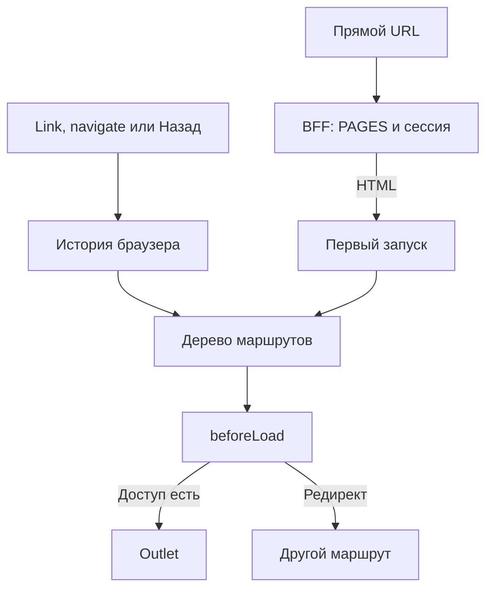

# Роутинг

У страницы два входа. Прямой запрос HTML обрабатывает BFF по `PAGES`. Переход внутри SPA обрабатывает `@cdd-team/router` по клиентскому дереву. Добавляйте путь в обе точки. Правила ниже подтверждены исходниками выложенной ревизии. [Таблица страниц](https://github.com/Cringe-Driven-Development-Team/frontend/blob/b1baf996fb6753d1a62eab6f874d03dca30faadc/apps/bff/src/pages.ts#L1-L18), [дерево клиента](https://github.com/Cringe-Driven-Development-Team/frontend/blob/b1baf996fb6753d1a62eab6f874d03dca30faadc/apps/client/src/routes/routeTree.ts#L1-L14).

## Добавить страницу {#pages-и-дерево-маршрутов}

1. Добавьте путь в `PAGES` в `apps/bff/src/pages.ts`. Указывайте сегмент без начального слеша, как `profile`. [Таблица страниц](https://github.com/Cringe-Driven-Development-Team/frontend/blob/b1baf996fb6753d1a62eab6f874d03dca30faadc/apps/bff/src/pages.ts#L3-L15)
2. Создайте компонент в `apps/client/src/pages` и маршрут в `apps/client/src/routes`. Для защищённой страницы возьмите за образец `profileRoute`: укажите `path: PAGES.…`, компонент и родителя `authRoute`. Добавьте маршрут в `routeTree.ts` к его родителю. Типы роутера зарегистрированы в `router.ts`. [Маршрут профиля](https://github.com/Cringe-Driven-Development-Team/frontend/blob/b1baf996fb6753d1a62eab6f874d03dca30faadc/apps/client/src/routes/profile.ts#L1-L11), [дерево](https://github.com/Cringe-Driven-Development-Team/frontend/blob/b1baf996fb6753d1a62eab6f874d03dca30faadc/apps/client/src/routes/routeTree.ts#L9-L14), [регистрация типов](https://github.com/Cringe-Driven-Development-Team/frontend/blob/b1baf996fb6753d1a62eab6f874d03dca30faadc/apps/client/src/router.ts#L1-L11)
3. Для гостевого URL согласуйте правило BFF в `GUEST_PAGES` и ветку `_guest` клиента. Сейчас `_guest` рендерит общий `AuthPage` для входа и регистрации. [Список BFF](https://github.com/Cringe-Driven-Development-Team/frontend/blob/b1baf996fb6753d1a62eab6f874d03dca30faadc/apps/bff/src/html.ts#L49-L56), [ветка гостя](https://github.com/Cringe-Driven-Development-Team/frontend/blob/b1baf996fb6753d1a62eab6f874d03dca30faadc/apps/client/src/routes/guest.ts#L7-L30)
4. Запустите локальную разработку и проверьте адрес прямым открытием, ссылкой из приложения и кнопкой «Назад». Для защищённого маршрута повторите проверку с гостевой и действующей сессией. [Локальный запуск и проверки](./checks)

## Переход и история {#navigation}

<DiagramSection>

Внутри SPA используйте `Link` или `navigate`. Роутер обновляет историю через `pushState` или `replaceState`, реагирует на `popstate` и вычисляет совпавшую ветку. Корневой макет показывает маршрут через `Outlet`. [История роутера](https://github.com/Cringe-Driven-Development-Team/frontend-packages/blob/bda991c58d01a88b119d910787a87966e31bfe0a/packages/router/src/history.ts#L25-L48), [макет](https://github.com/Cringe-Driven-Development-Team/frontend/blob/b1baf996fb6753d1a62eab6f874d03dca30faadc/apps/client/src/layouts/RootLayout.tsx#L1-L23), [проверка ветки](https://github.com/Cringe-Driven-Development-Team/frontend/blob/b1baf996fb6753d1a62eab6f874d03dca30faadc/apps/client/src/routes/auth.ts#L5-L12).

<template #diagram>

</template>

</DiagramSection>

## Параметры и 404

`$notebookId` сопоставляется с сегментом пути. При прямом запросе собственный блокнот загружается перед выдачей HTML. Для вошедшего пользователя неизвестный адрес, `/404`, некорректный ID, чужой или отсутствующий блокнот ведут на `/`. В SPA неизвестный адрес обрабатывает корневой маршрут, а ошибку загрузки блокнота — его страница. [Сопоставление](https://github.com/Cringe-Driven-Development-Team/frontend/blob/b1baf996fb6753d1a62eab6f874d03dca30faadc/apps/bff/src/pages.ts#L20-L51), [решения BFF](https://github.com/Cringe-Driven-Development-Team/frontend/blob/b1baf996fb6753d1a62eab6f874d03dca30faadc/apps/bff/src/html.ts#L68-L140), [корневой маршрут](https://github.com/Cringe-Driven-Development-Team/frontend/blob/b1baf996fb6753d1a62eab6f874d03dca30faadc/apps/client/src/routes/root.tsx#L1-L23), [загрузка блокнота](https://github.com/Cringe-Driven-Development-Team/frontend/blob/b1baf996fb6753d1a62eab6f874d03dca30faadc/apps/client/src/pages/NotebookPage/NotebookPage.tsx#L242-L279).

## Доступ к защищённым страницам {#beforeload-и-защита-запросов}

| Вход | Что проверяется |
| --- | --- |
| Прямой запрос защищённой страницы | BFF проверяет сессию. Гость получает 302 на `/login`. |
| Переход по защищённому маршруту SPA | Гостя `_auth` перенаправляет в `/login` через `beforeLoad`. |
| Переход вошедшего пользователя на экран входа внутри SPA | `_guest` перенаправляет на `/`. |

BFF проверяет допуск к защищённым HTTP-запросам независимо от навигации. [HTML и сессия](https://github.com/Cringe-Driven-Development-Team/frontend/blob/b1baf996fb6753d1a62eab6f874d03dca30faadc/apps/bff/src/html.ts#L87-L140), [защищённая ветка](https://github.com/Cringe-Driven-Development-Team/frontend/blob/b1baf996fb6753d1a62eab6f874d03dca30faadc/apps/client/src/routes/auth.ts#L5-L12), [гостевая ветка](https://github.com/Cringe-Driven-Development-Team/frontend/blob/b1baf996fb6753d1a62eab6f874d03dca30faadc/apps/client/src/routes/guest.ts#L7-L18), [смена сессии](./session#switching), [проверка HTTP-запроса](https://github.com/Cringe-Driven-Development-Team/frontend/blob/b1baf996fb6753d1a62eab6f874d03dca30faadc/apps/bff/src/http.ts#L166-L200).
