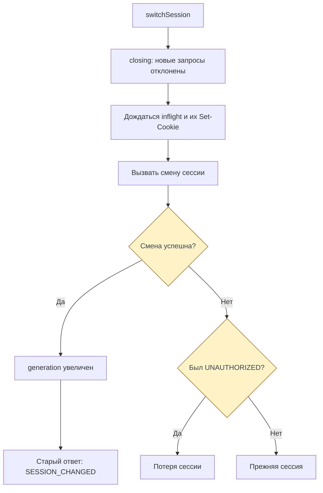

# Сессия и авторизация

Браузер хранит HttpOnly-cookie BFF, а access/refresh-токены Go остаются в серверном
слое сессии. Страница объясняет её жизненный цикл и порядок запросов при входе и
выходе. Транспорт — в [запросах](./requests), проверки границы — в [CSRF](/documentation/security/csrf).

Срез реализации на 08.11.2026: frontend `ea123518d624521f999e884ff32ddec0a5bf6bfa`. Это не новый прогон
продукта на проде; [исторические наблюдения BFF](./bff#bff-проверенная-часть)
сохраняют свою дату и релизы.

## Cookie и начальный статус

Cookie `__Host-Http-session` содержит зашифрованные AES-256-GCM токены и сроки.
Атрибуты — `Path=/`, `HttpOnly`, `Secure`, `SameSite=Lax`, без `Domain`;
`Max-Age` рассчитан по сроку refresh. Клиент не читает cookie и не пишет токены
в `localStorage`. Источники: [атрибуты cookie](https://github.com/Cringe-Driven-Development-Team/frontend/blob/ea123518d624521f999e884ff32ddec0a5bf6bfa/apps/bff/src/session/cookies.ts#L1-L35) и [шифрование и проверка](https://github.com/Cringe-Driven-Development-Team/frontend/blob/ea123518d624521f999e884ff32ddec0a5bf6bfa/apps/bff/src/session/crypto.ts#L1-L70).

До первого рендера `initSession(user)` устанавливает `guest` или `authed` из
проверенного bootstrap: стартового запроса `users.me` в браузере нет.
Повреждённый bootstrap останавливает запуск, а не маскируется гостевым статусом.
Подробности — в [инициализации сторов](./startup#сторы-до-первого-рендера).
`beforeLoad` защищает переходы UI, а BFF независимо проверяет сессию каждой
защищённой процедуры через `authedProcedure`. Источники: [initSession](https://github.com/Cringe-Driven-Development-Team/frontend/blob/ea123518d624521f999e884ff32ddec0a5bf6bfa/apps/client/src/stores/session.ts#L25-L37) и [authedProcedure](https://github.com/Cringe-Driven-Development-Team/frontend/blob/ea123518d624521f999e884ff32ddec0a5bf6bfa/apps/bff/src/trpc.ts#L51-L56).

## Refresh и потеря сессии

В BFF `session.call` добавляет Bearer-токен и `X-Request-ID`. Когда до истечения
access меньше 30 с, сначала делает refresh. Если Go отвечает `401`, BFF обновляет
токены и повторяет вызов один раз; повторный `401` завершает сессию. `401` самого
refresh тоже завершает сессию. Сетевой сбой, `5xx` или неправильный ответ Go
не превращаются в гостя. Повреждённая cookie или истёкший refresh удаляются без
обращения к Go. Источник: [порог обновления](https://github.com/Cringe-Driven-Development-Team/frontend/blob/ea123518d624521f999e884ff32ddec0a5bf6bfa/apps/bff/src/session/session.ts#L13-L37) и [session.call и чтение cookie](https://github.com/Cringe-Driven-Development-Team/frontend/blob/ea123518d624521f999e884ff32ddec0a5bf6bfa/apps/bff/src/session/session.ts#L78-L147).

Одновременные refresh одного токена объединяются через `inflight` в одном процессе
BFF; успешный результат кешируется ещё 10 с, неудачный сразу удаляется. Это не
распределённая блокировка между процессами. Источник: [refreshTokens](https://github.com/Cringe-Driven-Development-Team/frontend/blob/ea123518d624521f999e884ff32ddec0a5bf6bfa/apps/bff/src/session/refresh.ts#L15-L68).

Транспорт клиента обрабатывает `UNAUTHORIZED` защищённого запроса через
`onSessionLost`: `loseSession` и переход на `/login`. `FORBIDDEN`, `BAD_GATEWAY`
и сбой сети сессию не завершают. `UNAUTHORIZED` входа не означает потерю уже
существующей сессии; окончания `users.changePassword` и `auth.logoutAll`
учитываются отдельно во время смены. Источники: [sessionLink](https://github.com/Cringe-Driven-Development-Team/frontend/blob/ea123518d624521f999e884ff32ddec0a5bf6bfa/apps/client/src/api/trpc.ts#L35-L133) и [реакция приложения](https://github.com/Cringe-Driven-Development-Team/frontend/blob/ea123518d624521f999e884ff32ddec0a5bf6bfa/apps/client/src/main.tsx#L18-L44).

## Смена сессии и поздние ответы {#switching}

<DiagramSection>

`login`, `register`, `logout`, `logoutAll` и `changePassword` вызывают
`switchSession`. Он ставит `closing`: новые защищённые запросы получают
`SESSION_CHANGED`. Уже отправленные запросы `inflight` должны закончиться до
запроса смены, чтобы их поздний `Set-Cookie` не перезаписал cookie новой сессии.
После успеха увеличивается `generation`; ответ прежнего поколения не передаётся
в интерфейс. Несколько смен выполняются по очереди.

Если запрос во время ожидания получил `UNAUTHORIZED`, а смена затем не удалась,
`lostWhileClosing` всё равно вызывает потерю сессии. Без такого отказа неуспешная
смена оставляет прежнюю сессию. Источники: [switchSession](https://github.com/Cringe-Driven-Development-Team/frontend/blob/ea123518d624521f999e884ff32ddec0a5bf6bfa/apps/client/src/api/trpc.ts#L169-L208) и [тесты последовательностей на клиенте tRPC](https://github.com/Cringe-Driven-Development-Team/frontend/blob/ea123518d624521f999e884ff32ddec0a5bf6bfa/apps/client/test/session.test.ts#L54-L158).

<template #diagram>

</template>
</DiagramSection>

## Выход в браузере

`auth.logout` проходит CSRF, но не требует активной сессии. Вызов Go идёт мимо
`session.call`: без refresh и повтора. При действующем access выполняется один
`POST /auth/logout`; при истёкшем access Go не вызывается. BFF удаляет cookie
при любом итоге Go и отвечает `{ browserSession: 'ended', serverRevocation }`.
Это разделяет выход в браузере и подтверждение отзыва на сервере.
Источники: [auth.logout](https://github.com/Cringe-Driven-Development-Team/frontend/blob/ea123518d624521f999e884ff32ddec0a5bf6bfa/apps/bff/src/router/auth.ts#L19-L33) и [отзыв без refresh](https://github.com/Cringe-Driven-Development-Team/frontend/blob/ea123518d624521f999e884ff32ddec0a5bf6bfa/apps/bff/src/go/api.ts#L206-L222).

| `serverRevocation` | Основание и сообщение клиенту |
| --- | --- |
| `confirmed` | Go ответил `204` |
| `unconfirmed` | Access истёк или Go ответил `4xx`; клиент показывает предупреждение |
| `unknown` | Сеть, таймаут, Go `5xx` или неожиданный статус; клиент показывает предупреждение |
| `not_requested` | Сессии не было, Go не вызывался |

Любой успешный ответ `auth.logout` переводит стор в гостя. Сбой сети до ответа BFF
или CSRF-отказ — не подтверждённый выход: клиент оставляет прежний статус и
показывает ошибку. Исключение — потеря сессии во время ожидания, разобранная выше.
Источник: [клиентский logout](https://github.com/Cringe-Driven-Development-Team/frontend/blob/ea123518d624521f999e884ff32ddec0a5bf6bfa/apps/client/src/stores/session.ts#L114-L138).

## Выход со всех устройств и смена пароля

`logoutAll` и `changePassword` используют защищённую процедуру и обычный слой
сессии с refresh. Локальный переход в гостя при успехе следует за подтверждением
Go. Для `logoutAll` `UNAUTHORIZED` означает потерю текущей сессии, но не подтверждает
общий отзыв; сеть, `5xx` и S2S-сбой оставляют исход неизвестным.
Источники: [клиентский logoutAll](https://github.com/Cringe-Driven-Development-Team/frontend/blob/ea123518d624521f999e884ff32ddec0a5bf6bfa/apps/client/src/stores/session.ts#L140-L157) и [смена пароля](https://github.com/Cringe-Driven-Development-Team/frontend/blob/ea123518d624521f999e884ff32ddec0a5bf6bfa/apps/client/src/stores/session.ts#L98-L109).

Ожидание `inflight` защищает последовательность внутри одной вкладки. Гонки выхода
с другими вкладками и параллельными HTML/RPC-запросами остаются ограничением
[frontend#142](https://github.com/Cringe-Driven-Development-Team/frontend/issues/142).
Кеш refresh сам по себе эту гонку не закрывает.

## Что проверить в понимании

- Почему браузер может знать пользователя, не имея доступа к токенам?
- Когда `401` повторяется в BFF, а когда приводит к гостевому состоянию клиента?
- Зачем до выхода дождаться `Set-Cookie` уже отправленных запросов?
- Почему выход в браузере ещё не гарантирует отзыв сессии в Go?
