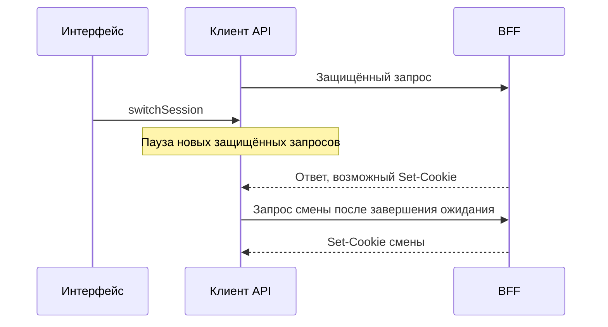

# Сессия и авторизация

BFF хранит пару токенов Go в зашифрованной HttpOnly-cookie, обновляет её и выполняет защищённые вызовы Go. Браузер определяет начальный статус по bootstrap первого HTML. [Cookie](https://github.com/Cringe-Driven-Development-Team/frontend/blob/b1baf996fb6753d1a62eab6f874d03dca30faadc/apps/bff/src/session/cookies.ts#L1-L34), [шифрование](https://github.com/Cringe-Driven-Development-Team/frontend/blob/b1baf996fb6753d1a62eab6f874d03dca30faadc/apps/bff/src/session/crypto.ts#L20-L65), [запуск клиента](https://github.com/Cringe-Driven-Development-Team/frontend/blob/b1baf996fb6753d1a62eab6f874d03dca30faadc/apps/client/src/main.tsx#L18-L38).

## Cookie и начальный статус {#cookie-и-начальныи-статус}

`__Host-Http-session` имеет атрибуты `Path=/; HttpOnly; Secure; SameSite=Lax`. BFF выставляет срок cookie по сроку refresh-токена. При просроченном refresh или ошибке расшифровки BFF считает запрос гостевым и удаляет cookie. По `user` из bootstrap клиент устанавливает `guest` или `authed` перед рендером. [Атрибуты](https://github.com/Cringe-Driven-Development-Team/frontend/blob/b1baf996fb6753d1a62eab6f874d03dca30faadc/apps/bff/src/session/cookies.ts#L1-L34), [срок и чтение](https://github.com/Cringe-Driven-Development-Team/frontend/blob/b1baf996fb6753d1a62eab6f874d03dca30faadc/apps/bff/src/session/session.ts#L99-L108), [разбор cookie](https://github.com/Cringe-Driven-Development-Team/frontend/blob/b1baf996fb6753d1a62eab6f874d03dca30faadc/apps/bff/src/session/session.ts#L141-L154), [инициализация стора](https://github.com/Cringe-Driven-Development-Team/frontend/blob/b1baf996fb6753d1a62eab6f874d03dca30faadc/apps/client/src/stores/session.ts#L19-L34), [сторы до рендера](./startup#сторы-до-первого-рендера).

## Refresh и потеря сессии {#refresh-и-потеря-сессии}

1. Перед вызовом Go `session.call` обновляет access, если до истечения менее 30 с. Вызовы refresh с одним токеном разделяют одну операцию в процессе BFF. Успех кешируется на 10 с, неудача сразу исключается из кеша. [Вызовы сессии](https://github.com/Cringe-Driven-Development-Team/frontend/blob/b1baf996fb6753d1a62eab6f874d03dca30faadc/apps/bff/src/session/session.ts#L13-L16), [условия обновления](https://github.com/Cringe-Driven-Development-Team/frontend/blob/b1baf996fb6753d1a62eab6f874d03dca30faadc/apps/bff/src/session/session.ts#L82-L97), [refresh](https://github.com/Cringe-Driven-Development-Team/frontend/blob/b1baf996fb6753d1a62eab6f874d03dca30faadc/apps/bff/src/session/refresh.ts#L16-L20), [кеш refresh](https://github.com/Cringe-Driven-Development-Team/frontend/blob/b1baf996fb6753d1a62eab6f874d03dca30faadc/apps/bff/src/session/refresh.ts#L40-L68).
2. При отказе Go `401` по access BFF обновляет токены и повторяет операцию один раз. Для прикладного `401`, распознанного обработчиком, исход передаётся без refresh. Повторный отказ по access или `401` при refresh завершает сессию. [Повтор и обработка refresh](https://github.com/Cringe-Driven-Development-Team/frontend/blob/b1baf996fb6753d1a62eab6f874d03dca30faadc/apps/bff/src/session/session.ts#L82-L97), [сброс cookie](https://github.com/Cringe-Driven-Development-Team/frontend/blob/b1baf996fb6753d1a62eab6f874d03dca30faadc/apps/bff/src/session/session.ts#L124-L138), [запрос refresh](https://github.com/Cringe-Driven-Development-Team/frontend/blob/b1baf996fb6753d1a62eab6f874d03dca30faadc/apps/bff/src/session/refresh.ts#L40-L68).
3. Когда защищённый запрос BFF получает `UNAUTHORIZED`, клиентский `onSessionLost` переводит приложение в гостя и направляет на `/login`. Для сетевого сбоя, `BAD_GATEWAY` и `FORBIDDEN` эта реакция не запускается. [Решение клиента](https://github.com/Cringe-Driven-Development-Team/frontend/blob/b1baf996fb6753d1a62eab6f874d03dca30faadc/apps/client/src/api/bff.ts#L235-L293), [переход ко входу](https://github.com/Cringe-Driven-Development-Team/frontend/blob/b1baf996fb6753d1a62eab6f874d03dca30faadc/apps/client/src/main.tsx#L33-L38).

## Смена сессии и поздние ответы {#switching}

<DiagramSection>

`switchSession` ставит вход, регистрацию, выход, выход со всех устройств и смену пароля в очередь. На время смены новые защищённые запросы получают `BffError` с `kind: 'session_changed'` (`SESSION_CHANGED` в коде). Клиент ждёт уже отправленные запросы и только затем выполняет смену. Поэтому браузер применяет их `Set-Cookie` до установки или удаления cookie самой сменой. [Учет запросов](https://github.com/Cringe-Driven-Development-Team/frontend/blob/b1baf996fb6753d1a62eab6f874d03dca30faadc/apps/client/src/api/bff.ts#L197-L235), [очередь смен](https://github.com/Cringe-Driven-Development-Team/frontend/blob/b1baf996fb6753d1a62eab6f874d03dca30faadc/apps/client/src/api/bff.ts#L248-L340).

<template #diagram>

</template>

</DiagramSection>

| Исход | Что происходит |
| --- | --- |
| Смена успешна | `generation` увеличивается. При несовпадении поколения результат запроса прежней сессии заменяется `session_changed`. |
| Смена завершилась ошибкой | Ошибка возвращается вызывающему коду, прежняя сессия сохраняется при отсутствии отказа `UNAUTHORIZED`. |
| Смена завершилась ошибкой после `UNAUTHORIZED` во время ожидания или при смене пароля либо выходе со всех устройств | Вызывается `onSessionLost`, ошибка смены возвращается вызывающему коду. |

Очередь действует в экземпляре приложения. Гонки с параллельным HTML-запросом и другими вкладками отслеживает [frontend#142](https://github.com/Cringe-Driven-Development-Team/frontend/issues/142). [Проверка поколения](https://github.com/Cringe-Driven-Development-Team/frontend/blob/b1baf996fb6753d1a62eab6f874d03dca30faadc/apps/client/src/api/bff.ts#L248-L284), [решение при смене](https://github.com/Cringe-Driven-Development-Team/frontend/blob/b1baf996fb6753d1a62eab6f874d03dca30faadc/apps/client/src/api/bff.ts#L295-L340).

## Выход в браузере {#выход-в-браузере}

`POST /api/auth/logout` удаляет cookie при любом итоге обработчика и отвечает `{ browserSession: 'ended', serverRevocation }`. При действующем access BFF вызывает Go один раз без refresh и повторов. [Маршрут](https://github.com/Cringe-Driven-Development-Team/frontend/blob/b1baf996fb6753d1a62eab6f874d03dca30faadc/apps/bff/src/router/auth.ts#L41-L52), [отзыв в Go](https://github.com/Cringe-Driven-Development-Team/frontend/blob/b1baf996fb6753d1a62eab6f874d03dca30faadc/apps/bff/src/go/api.ts#L267-L283).

| `serverRevocation` | Условие |
| --- | --- |
| `confirmed` | Go подтвердил отзыв ответом `204`. |
| `unconfirmed` | Access истёк, вызова Go не было, либо Go ответил `4xx`. |
| `unknown` | Сеть, таймаут, `5xx` или неожиданный статус Go. |
| `not_requested` | Сессии не было. |

При `unconfirmed` или `unknown` клиент показывает предупреждение. Сетевой сбой браузерного запроса или отказ CSRF оставляет выход неподтверждённым в интерфейсе. [Обработка результата](https://github.com/Cringe-Driven-Development-Team/frontend/blob/b1baf996fb6753d1a62eab6f874d03dca30faadc/apps/client/src/stores/session.ts#L116-L144).

## Выход со всех устройств и смена пароля {#выход-со-всех-устроиств-и-смена-пароля}

`POST /api/auth/logout-all` и `POST /api/users/change-password` удаляют cookie после успешного вызова Go. После получения успеха клиент устанавливает гостевой статус. Если Go отказал в операции, общая очередь применяет те же правила потери сессии, что и при других сменах. [Выход со всех устройств](https://github.com/Cringe-Driven-Development-Team/frontend/blob/b1baf996fb6753d1a62eab6f874d03dca30faadc/apps/bff/src/router/auth.ts#L53-L63), [смена пароля](https://github.com/Cringe-Driven-Development-Team/frontend/blob/b1baf996fb6753d1a62eab6f874d03dca30faadc/apps/bff/src/router/users.ts#L20-L31), [клиент](https://github.com/Cringe-Driven-Development-Team/frontend/blob/b1baf996fb6753d1a62eab6f874d03dca30faadc/apps/client/src/stores/session.ts#L102-L114), [обработка logoutAll](https://github.com/Cringe-Driven-Development-Team/frontend/blob/b1baf996fb6753d1a62eab6f874d03dca30faadc/apps/client/src/stores/session.ts#L150-L169).

Выход и refresh описаны по коду выложенного SHA. Результат гостевого запроса доступен в [проверенной части BFF](./bff#bff-проверенная-часть).
