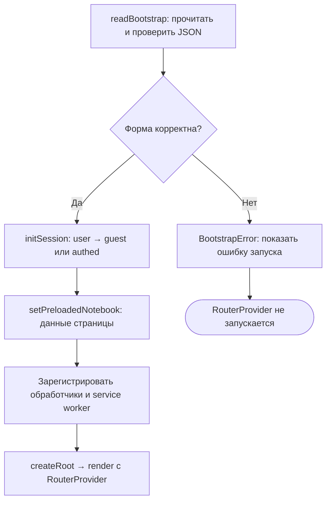

# Запуск приложения

BFF сначала готовит HTML с данными пользователя и открытого блокнота. Браузер
проверяет эти данные и заполняет сторы до запуска роутера и рендера. Поэтому первый
экран уже знает статус сессии, а прямое открытие своего блокнота обходится без
повторного чтения его данных. Связь с сохранением текста — в [обзоре Frontend](./).

Описан код на 08.11.2026, frontend
[`ea123518d624521f999e884ff32ddec0a5bf6bfa`](https://github.com/Cringe-Driven-Development-Team/frontend/tree/ea123518d624521f999e884ff32ddec0a5bf6bfa).
Это проверка реализации по исходникам, а не свидетельство нового прогона на проде.

## Первый HTML от BFF

При прямом запросе страницы `createHtmlHandler` определяет страницу и пользователя.
Для своего блокнота он вызывает общий `loadNotebook` до выдачи HTML. Гостя с
защищённого адреса направляет на `/login`, вошедшего с неизвестного адреса или
недоступного блокнота — на `/404`. При сбое Go возвращает HTML 503 без скриптов
приложения. См. [html.ts](https://github.com/Cringe-Driven-Development-Team/frontend/blob/ea123518d624521f999e884ff32ddec0a5bf6bfa/apps/bff/src/html.ts#L69-L134).

`renderBootstrap` сериализует данные через `serialize-javascript` с `isJSON: true`
и вставляет JSON в `<script id="bootstrap" type="application/json">` через новый
`HTMLRewriter` для ответа. Строки вроде закрывающего script-тега экранируются.
Шаблон остаётся общим; персональные ответы получают `Cache-Control: private, no-store`.
См. [сериализацию и заголовки](https://github.com/Cringe-Driven-Development-Team/frontend/blob/ea123518d624521f999e884ff32ddec0a5bf6bfa/apps/bff/src/html.ts#L11-L46).

| Данные bootstrap | Содержание |
| --- | --- |
| `user` | Объект пользователя или `null` для гостя; поле обязательно |
| `notebookPage` | Необязательные данные страницы своего блокнота при прямом открытии |
| `notebookPage.notebook` | Метаданные и согласованные `hash`/`cells` из ответа content |
| `notebookPage.active_session` | Активная runtime-сессия пользователя в любом блокноте либо `null` |
| `notebookPage.runtime_queue` | Очередь исполнения, если активная сессия относится к открытому блокноту, иначе `null` |

Форма начальных данных задана в [types.ts](https://github.com/Cringe-Driven-Development-Team/frontend/blob/ea123518d624521f999e884ff32ddec0a5bf6bfa/apps/bff/src/types.ts#L14-L24),
состав страницы и порядок чтений — в [notebook.ts](https://github.com/Cringe-Driven-Development-Team/frontend/blob/ea123518d624521f999e884ff32ddec0a5bf6bfa/apps/bff/src/notebook.ts#L4-L54).
Метаданные, content и активная сессия читаются параллельно; очередь — после получения
активной сессии. Ошибка чтения не подменяется пустым блокнотом.

## Проверка bootstrap в браузере

`readBootstrap` считает HTML внешним входом и проверяет его перед использованием.
Нужен ровно один элемент с ID `bootstrap`, именно `script` с типом
`application/json`, и разбираемый JSON-объект с полем `user`.
Ненулевой пользователь должен иметь числовой `id` и строковый `login`.

Если передан `notebookPage`, проверяются форма блокнота (`id`, `name`, `hash`,
массив `cells`), `active_session` и `runtime_queue`: они должны быть `null`
либо объектами с ожидаемыми опорными полями. Это проверка начальной формы,
а не полная валидация каждого поля каждой ячейки.
Источник — [bootstrap.ts](https://github.com/Cringe-Driven-Development-Team/frontend/blob/ea123518d624521f999e884ff32ddec0a5bf6bfa/apps/client/src/bootstrap.ts#L13-L65).

## Сторы до первого рендера

<DiagramSection>

Последовательность в [main.tsx](https://github.com/Cringe-Driven-Development-Team/frontend/blob/ea123518d624521f999e884ff32ddec0a5bf6bfa/apps/client/src/main.tsx#L16-L44)
делает проверенные данные доступными до первого показа компонентов:

1. Найти контейнер `#root`; отсутствие контейнера — ошибка.
2. Вызвать `readBootstrap()` и получить `user` и `notebookPage`.
3. Передать пользователя в `initSession(user)`, данные страницы — в
   `setPreloadedNotebook(notebookPage)`.
4. Установить обработчик потери сессии, зарегистрировать service worker и наблюдение
   за соединением; в соответствующем dev-режиме установить команду мока.
5. Только при успешном чтении создать корень через `createRoot(container)` и вызвать
   `render` с `RouterProvider`, которому передан экземпляр `router`.

Так компоненты получают исходную сессию из HTML без запасного запроса пользователя.
Здесь описана граница регистрации service worker; его кеширование объясняется
в [офлайн-разделе](/documentation/offline/).

<template #diagram>

</template>

</DiagramSection>

## Прямой URL и SPA-переход

Прямое открытие и переход внутри приложения сходятся на одной форме данных
`NotebookPageData`, но получают её разными путями.

| Открытие | Как приходят данные блокнота | Что делает страница |
| --- | --- | --- |
| Прямой URL своего блокнота | BFF кладёт `notebookPage` в HTML | Проверяет ID через `peekPreloadedNotebook`, затем забирает данные через `takePreloadedNotebook` и открывает сторы |
| SPA-переход без подходящего preloaded | Клиент вызывает `notebooks.get` | Показывает загрузку, затем передаёт ответ в `openNotebook` и `openRuntime` |

`peekPreloadedNotebook(id)` позволяет сразу выбрать состояние `ready`, а
`takePreloadedNotebook(id)` отдаёт данные один раз и очищает временное хранилище.
Только совпадающий ID даёт блокнот; при отсутствии подходящих данных страница
вызывает процедуру. Поэтому подходящий bootstrap не дублируется RPC-чтением,
а следующее открытие не использует его как постоянный кеш.
См. [preloaded.ts](https://github.com/Cringe-Driven-Development-Team/frontend/blob/ea123518d624521f999e884ff32ddec0a5bf6bfa/apps/client/src/stores/preloaded.ts#L14-L34)
и [эффект страницы](https://github.com/Cringe-Driven-Development-Team/frontend/blob/ea123518d624521f999e884ff32ddec0a5bf6bfa/apps/client/src/pages/NotebookPage/NotebookPage.tsx#L199-L254).

На стороне BFF процедура `notebooks.get` вызывает тот же `loadNotebook`, что и
HTML-обработчик. При SPA-загрузке недоступный блокнот ведёт на `/404`, другая ошибка
показывает сообщение с действием «Повторить». Флаг `alive` не позволяет ответу
покинутой страницы обновить её состояние.
См. [процедуру](https://github.com/Cringe-Driven-Development-Team/frontend/blob/ea123518d624521f999e884ff32ddec0a5bf6bfa/apps/bff/src/router/notebooks.ts#L8-L12)
и [обработку ответа страницы](https://github.com/Cringe-Driven-Development-Team/frontend/blob/ea123518d624521f999e884ff32ddec0a5bf6bfa/apps/client/src/pages/NotebookPage/NotebookPage.tsx#L219-L254).

## Повреждённые данные останавливают запуск

Нарушение формата вызывает `BootstrapError`: отсутствующий или повторный блок,
неверный тег/тип, неразбираемый JSON, неверная форма пользователя или блокнота.
`main.tsx` пишет ошибку в консоль и показывает «Не удалось запустить приложение.
Обновите страницу.». Флаг `started` остаётся ложным и `RouterProvider` не рендерится.
Ошибка не превращается в гостевую сессию и не скрывается запросом `users.me`.
См. [BootstrapError и проверки](https://github.com/Cringe-Driven-Development-Team/frontend/blob/ea123518d624521f999e884ff32ddec0a5bf6bfa/apps/client/src/bootstrap.ts#L5-L65)
и [ветвление запуска](https://github.com/Cringe-Driven-Development-Team/frontend/blob/ea123518d624521f999e884ff32ddec0a5bf6bfa/apps/client/src/main.tsx#L19-L44).

## Что проверить в понимании

- Кто решает, отдавать ли первый HTML блокнота? BFF; он проверяет сессию и загружает
  блокнот до ответа браузеру.
- Почему клиент не читает тот же блокнот повторно? Подходящий preloaded уже содержит
  ответ общего загрузчика и однократно передаётся странице.
- Почему неверный bootstrap не означает «гость»? `user: null` — корректное состояние,
  а повреждённые данные нарушают условия запуска и вызывают `BootstrapError`.

Путь `notebooks.get` через единый клиент разобран в [транспорте запросов](./requests#transport).
