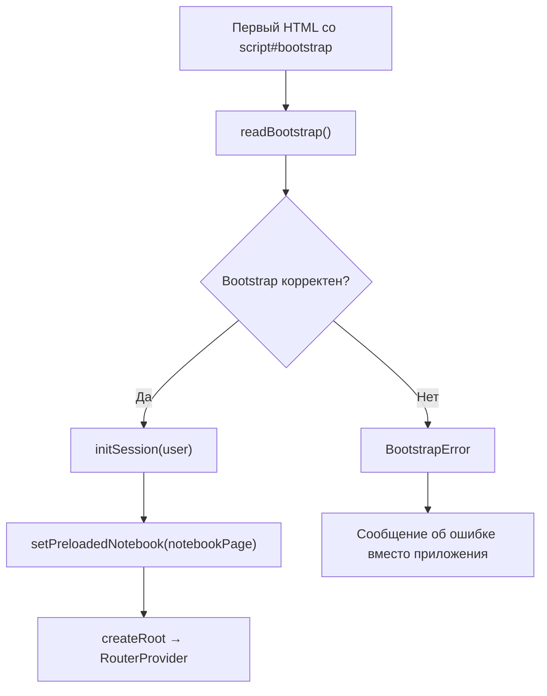

# Запуск приложения

При прямом открытии страницы BFF готовит HTML. Браузер читает bootstrap из этого ответа, инициализирует сессию и запускает роутер. Поведение подтверждено чтением исходников выложенной ревизии. [Обработчик HTML](https://github.com/Cringe-Driven-Development-Team/frontend/blob/b1baf996fb6753d1a62eab6f874d03dca30faadc/apps/bff/src/html.ts#L87-L142), [точка входа](https://github.com/Cringe-Driven-Development-Team/frontend/blob/b1baf996fb6753d1a62eab6f874d03dca30faadc/apps/client/src/main.tsx#L14-L48).

## Первый HTML от BFF

Для активной сессии BFF запрашивает пользователя через Go. В HTML попадает `user` или `null`, а при прямом открытии своего блокнота ещё и `notebookPage`. Данные сериализуются в `script#bootstrap` типа `application/json`. Если Go недоступен при загрузке, BFF отвечает 503 со страницей без приложения. [Выдача HTML](https://github.com/Cringe-Driven-Development-Team/frontend/blob/b1baf996fb6753d1a62eab6f874d03dca30faadc/apps/bff/src/html.ts#L21-L47), [обработка сессии и блокнота](https://github.com/Cringe-Driven-Development-Team/frontend/blob/b1baf996fb6753d1a62eab6f874d03dca30faadc/apps/bff/src/html.ts#L94-L141).

## Проверка bootstrap в браузере

`readBootstrap()` требует ровно один скрипт с нужным типом и разбирает JSON. У пользователя проверяются `id` и `login`. Если присутствует `notebookPage`, проверяются основные поля блокнота, окружения и очереди. [Входные проверки](https://github.com/Cringe-Driven-Development-Team/frontend/blob/b1baf996fb6753d1a62eab6f874d03dca30faadc/apps/client/src/bootstrap.ts#L22-L63).

## Сторы до первого рендера

<DiagramSection>

После чтения bootstrap `initSession(user)` записывает статус, а `setPreloadedNotebook(notebookPage)` сохраняет данные блокнота для страницы. Затем `createRoot` рендерит `RouterProvider`, и проверки маршрутов уже видят статус пользователя. [Последовательность запуска](https://github.com/Cringe-Driven-Development-Team/frontend/blob/b1baf996fb6753d1a62eab6f874d03dca30faadc/apps/client/src/main.tsx#L21-L48), [инициализация сессии](https://github.com/Cringe-Driven-Development-Team/frontend/blob/b1baf996fb6753d1a62eab6f874d03dca30faadc/apps/client/src/stores/session.ts#L19-L34).

<template #diagram>

</template>

</DiagramSection>

## Прямой URL и SPA-переход

| Вход | Данные страницы |
| --- | --- |
| Прямое открытие своего блокнота | `peekPreloadedNotebook(id)` проверяет начальную готовность. `takePreloadedNotebook(id)` изымает данные один раз и возвращает их при совпадении ID. |
| Открытие блокнота внутри SPA без подходящих данных | Страница вызывает `notebooks.get`. После ухода со страницы флаг `alive` блокирует применение ответа завершившейся загрузки. |

[Буфер preload](https://github.com/Cringe-Driven-Development-Team/frontend/blob/b1baf996fb6753d1a62eab6f874d03dca30faadc/apps/client/src/stores/preloaded.ts#L3-L29), [загрузка страницы](https://github.com/Cringe-Driven-Development-Team/frontend/blob/b1baf996fb6753d1a62eab6f874d03dca30faadc/apps/client/src/pages/NotebookPage/NotebookPage.tsx#L218-L279), [HTTP-вызов](https://github.com/Cringe-Driven-Development-Team/frontend/blob/b1baf996fb6753d1a62eab6f874d03dca30faadc/apps/client/src/pages/NotebookPage/NotebookPage.tsx#L65-L77).

Перед последующими запросами проверьте [настройки общего транспорта](./requests#transport).

## Повреждённые данные останавливают запуск

При `BootstrapError` в `#root` появляется «Не удалось запустить приложение. Обновите страницу.». Первый рендер и запасной вызов `users.me` пропускаются. Причина доступна в консоли браузера. [Обработка ошибки](https://github.com/Cringe-Driven-Development-Team/frontend/blob/b1baf996fb6753d1a62eab6f874d03dca30faadc/apps/client/src/main.tsx#L14-L30), [условие рендера](https://github.com/Cringe-Driven-Development-Team/frontend/blob/b1baf996fb6753d1a62eab6f874d03dca30faadc/apps/client/src/main.tsx#L39-L48).
