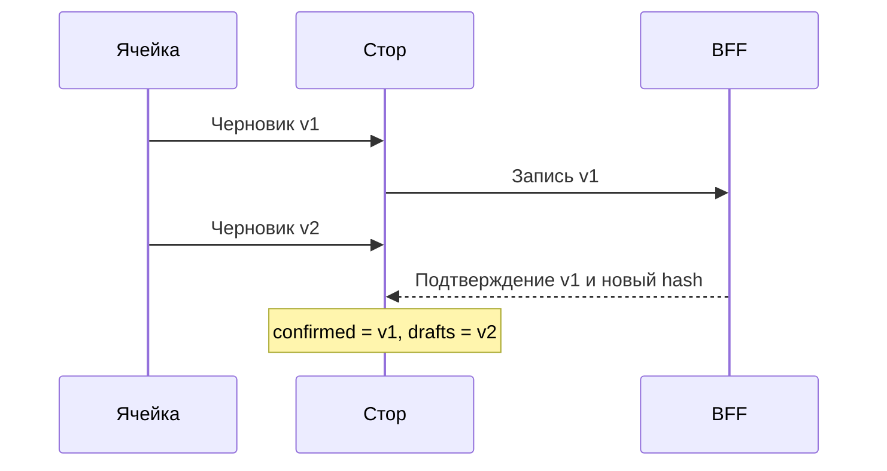
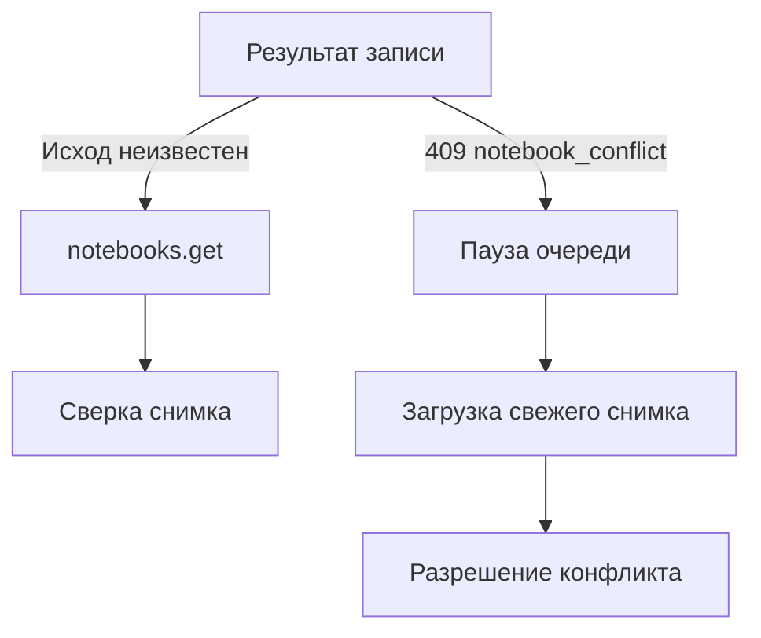

# Управление состоянием

Стор сессии хранит статус пользователя, стор блокнота — подтверждённый снимок и черновики, стор runtime — состояние окружения и запусков. Для поведения при записи используйте [редактирование блокнота](/documentation/notebooks/editing). Описание основано на исходниках выложенной ревизии. [Сессия](https://github.com/Cringe-Driven-Development-Team/frontend/blob/b1baf996fb6753d1a62eab6f874d03dca30faadc/apps/client/src/stores/session.ts#L7-L34), [блокнот](https://github.com/Cringe-Driven-Development-Team/frontend/blob/b1baf996fb6753d1a62eab6f874d03dca30faadc/apps/client/src/stores/notebook/index.ts#L46-L87), [runtime](https://github.com/Cringe-Driven-Development-Team/frontend/blob/b1baf996fb6753d1a62eab6f874d03dca30faadc/apps/client/src/stores/runtime.ts#L44-L115).

## Кто владеет состоянием

| Данные | Владелец |
| --- | --- |
| Вход, пользователь и выход | `stores/session.ts`. [Статус и данные](https://github.com/Cringe-Driven-Development-Team/frontend/blob/b1baf996fb6753d1a62eab6f874d03dca30faadc/apps/client/src/stores/session.ts#L7-L34) |
| Подтверждённый блокнот, ввод и конфликт | `stores/notebook/index.ts`. [Состояние](https://github.com/Cringe-Driven-Development-Team/frontend/blob/b1baf996fb6753d1a62eab6f874d03dca30faadc/apps/client/src/stores/notebook/index.ts#L46-L78) |
| Окружение, запуск, очередь исполнения | `stores/runtime.ts`. [Состояние runtime](https://github.com/Cringe-Driven-Development-Team/frontend/blob/b1baf996fb6753d1a62eab6f874d03dca30faadc/apps/client/src/stores/runtime.ts#L50-L115) |
| Режим редактирования или просмотра ячейки | Локальный hook `Cell`. [Режим](https://github.com/Cringe-Driven-Development-Team/frontend/blob/b1baf996fb6753d1a62eab6f874d03dca30faadc/apps/client/src/components/Cell/Cell.tsx#L146-L188) |

[Подписка и обновление DOM](./rendering#subscriptions) описывают, как эти данные доходят до компонента.

## Подтверждённый снимок и черновики

`confirmed` содержит состояние последнего подтверждённого снимка и его `hash`. `drafts` хранит исходный текст по ID ячейки. Страница показывает черновик, если он есть. [Модель состояния](https://github.com/Cringe-Driven-Development-Team/frontend/blob/b1baf996fb6753d1a62eab6f874d03dca30faadc/apps/client/src/stores/notebook/index.ts#L46-L63), [текст на экране](https://github.com/Cringe-Driven-Development-Team/frontend/blob/b1baf996fb6753d1a62eab6f874d03dca30faadc/apps/client/src/pages/NotebookPage/NotebookPage.tsx#L586-L612). Подробнее о [ревизии и результатах](/documentation/notebooks/editing#revision).

## Ввод и IME

Ввод записывает черновик через `editSource`. Обычный ввод планирует автосохранение через 500 мс. IME откладывает отправку до завершения композиции. Черновик длиннее 65 536 байт UTF-8 остаётся в редакторе, а отправка ждёт сокращения текста. [Задержка](https://github.com/Cringe-Driven-Development-Team/frontend/blob/b1baf996fb6753d1a62eab6f874d03dca30faadc/apps/client/src/stores/notebook/index.ts#L15-L18), [ввод и постановка в очередь](https://github.com/Cringe-Driven-Development-Team/frontend/blob/b1baf996fb6753d1a62eab6f874d03dca30faadc/apps/client/src/stores/notebook/index.ts#L293-L347). Полные условия отправки описаны в [очереди сохранения](/documentation/notebooks/editing#save-queue).

## Новый ввод во время запроса

<DiagramSection>

Успешный ответ обновляет `confirmed` и `hash`. Стор удаляет черновик, только если он совпадает с отправленным текстом. Более свежий ввод остаётся в `drafts` для следующей записи. [Применение подтверждения](https://github.com/Cringe-Driven-Development-Team/frontend/blob/b1baf996fb6753d1a62eab6f874d03dca30faadc/apps/client/src/stores/notebook/index.ts#L402-L427), [отправка очереди](https://github.com/Cringe-Driven-Development-Team/frontend/blob/b1baf996fb6753d1a62eab6f874d03dca30faadc/apps/client/src/stores/notebook/index.ts#L485-L517).

<template #diagram>

</template>

</DiagramSection>

## Смена блокнота и поздний ответ

Стор проверяет `generation` перед применением результата, чтобы ответ другого блокнота не изменил открытый. Несохранённые данные хранятся в `Map` в памяти вкладки. При возврате стор сравнивает `hash` и использует свежий снимок для разрешения конфликта. Закрытие вкладки уничтожает данные в памяти. [Сброс поколения](https://github.com/Cringe-Driven-Development-Team/frontend/blob/b1baf996fb6753d1a62eab6f874d03dca30faadc/apps/client/src/stores/notebook/index.ts#L87-L118), [возврат в блокнот](https://github.com/Cringe-Driven-Development-Team/frontend/blob/b1baf996fb6753d1a62eab6f874d03dca30faadc/apps/client/src/stores/notebook/index.ts#L184-L246), [проверка ответа](https://github.com/Cringe-Driven-Development-Team/frontend/blob/b1baf996fb6753d1a62eab6f874d03dca30faadc/apps/client/src/stores/notebook/index.ts#L485-L517).

## Сохранение и конфликты {#saving}

<DiagramSection>

При `409 notebook_conflict` очередь ставится на паузу, черновики остаются, стор загружает свежий снимок. Неоднозначный результат запроса ведёт к сверке снимка. Подробности восстановления и повторов находятся в [очереди сохранения](/documentation/notebooks/editing#save-queue), а действия с потерявшим ячейку черновиком — в [тексте удалённой ячейки](/documentation/notebooks/editing#orphans). Формат ошибок описан в [запросах](./requests#errors). [Обработка результата](https://github.com/Cringe-Driven-Development-Team/frontend/blob/b1baf996fb6753d1a62eab6f874d03dca30faadc/apps/client/src/stores/notebook/index.ts#L521-L552), [сверка и конфликт](https://github.com/Cringe-Driven-Development-Team/frontend/blob/b1baf996fb6753d1a62eab6f874d03dca30faadc/apps/client/src/stores/notebook/index.ts#L580-L655).

<template #diagram>

</template>

</DiagramSection>

## Граница runtime

`stores/runtime.ts` обновляет окружение и очередь исполнения через `/api/runtime/updates`. Результат ячейки привязан к исходному коду. Перед его применением runtime сверяет `source_hash`, а стор блокнота проверяет, что подтверждённый source всё ещё совпадает. [Опрос](https://github.com/Cringe-Driven-Development-Team/frontend/blob/b1baf996fb6753d1a62eab6f874d03dca30faadc/apps/client/src/stores/runtime.ts#L286-L327), [проверка результата](https://github.com/Cringe-Driven-Development-Team/frontend/blob/b1baf996fb6753d1a62eab6f874d03dca30faadc/apps/client/src/stores/runtime.ts#L396-L428), [обновление ячейки](https://github.com/Cringe-Driven-Development-Team/frontend/blob/b1baf996fb6753d1a62eab6f874d03dca30faadc/apps/client/src/stores/notebook/index.ts#L748-L769).
