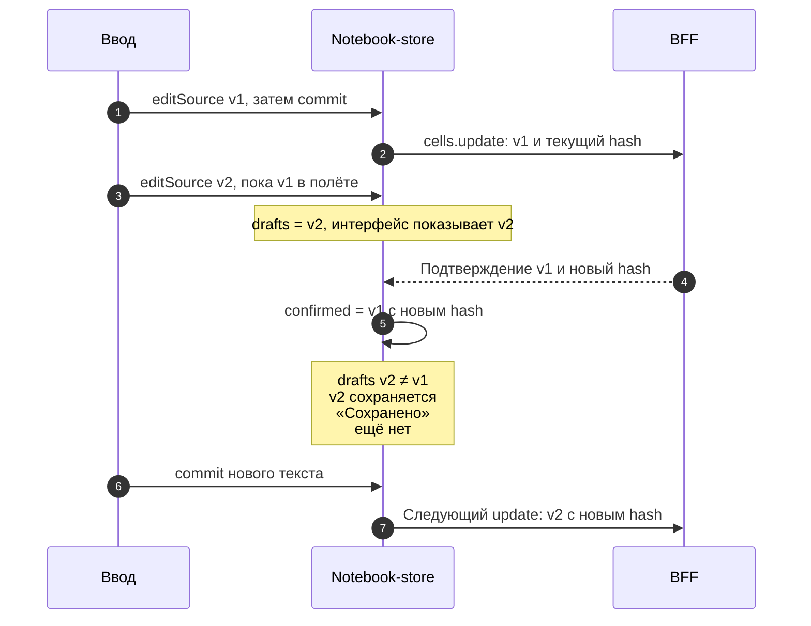
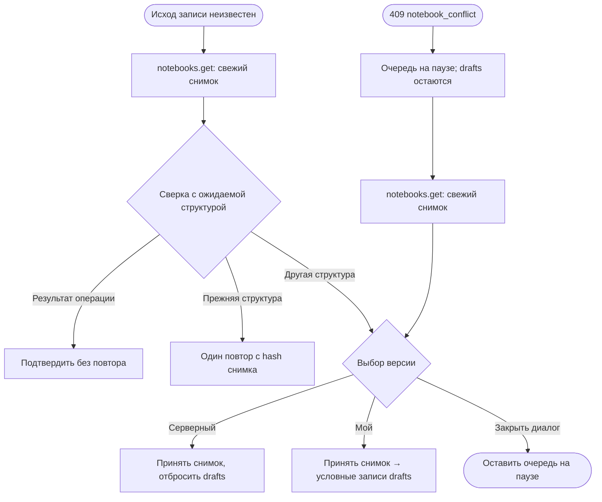

# Управление состоянием

Текст редактора становится видимым сразу, а сохранённым — после подтверждения
или сверки с сервером. Здесь разобрано, как frontend разделяет эти состояния
и сохраняет черновик при сбоях. Срез кода на 08.11.2026 —
`0606aa6cb83b78a76f1e69816b2a6abd82dc20ee`; это не новый прогон на проде.
Пользовательские правила редактирования описаны в
[блокнотах](/documentation/notebooks/editing), здесь — устройство клиента.

## Кто владеет состоянием

| Владелец | Какие данные хранит | Кто читает |
| --- | --- | --- |
| Локальные hooks страницы и `Cell` | Выделенная ячейка, цель фокуса, загрузка; режим Markdown `edit/view` | Компонент и его дети |
| `preloaded` | Одноразовый блокнот из bootstrap; это переменная модуля, не Zustand-store | Страница нужного блокнота |
| `session` | `guest/authed` и пользователь из bootstrap, затем результаты смены сессии | Маршруты, страницы, транспорт |
| `connection` | `lost`: получен ли полный ответ BFF | Общий макет |
| `toast`, `snackbar` | Один текущий тост с таймером; один снекбар с действием/ID | Общий макет |
| `notebook` | Подтверждённые ячейки, черновики, лимит, конфликт и статус сохранения | Страница, очередь и runtime |
| `runtime` | Сессия исполнения, очередь запусков, прогресс и результаты опроса | Страница и элементы запуска |

Источники: [локальные hooks](https://github.com/Cringe-Driven-Development-Team/frontend/blob/0606aa6cb83b78a76f1e69816b2a6abd82dc20ee/apps/client/src/pages/NotebookPage/NotebookPage.tsx#L185-L201),
[preloaded](https://github.com/Cringe-Driven-Development-Team/frontend/blob/0606aa6cb83b78a76f1e69816b2a6abd82dc20ee/apps/client/src/stores/preloaded.ts#L3-L34),
[session](https://github.com/Cringe-Driven-Development-Team/frontend/blob/0606aa6cb83b78a76f1e69816b2a6abd82dc20ee/apps/client/src/stores/session.ts#L6-L34),
[connection](https://github.com/Cringe-Driven-Development-Team/frontend/blob/0606aa6cb83b78a76f1e69816b2a6abd82dc20ee/apps/client/src/stores/connection.ts#L4-L44),
[toast](https://github.com/Cringe-Driven-Development-Team/frontend/blob/0606aa6cb83b78a76f1e69816b2a6abd82dc20ee/apps/client/src/stores/toast.ts#L4-L26),
[snackbar](https://github.com/Cringe-Driven-Development-Team/frontend/blob/0606aa6cb83b78a76f1e69816b2a6abd82dc20ee/apps/client/src/stores/snackbar.ts#L4-L41)
и [runtime](https://github.com/Cringe-Driven-Development-Team/frontend/blob/0606aa6cb83b78a76f1e69816b2a6abd82dc20ee/apps/client/src/stores/runtime.ts#L58-L109).

Zustand 1.0.1 соединяет vanilla-store с hook: `create` возвращает вызываемый
hook и методы `getState`, `setState`, `subscribe`. Частичное обновление
объединяется с прежним состоянием; подписчики получают новое и предыдущее.
Hook сравнивает выбранный срез через `Object.is` и инициирует рендер при
изменении. Мутация вложенного объекта на месте не заменяет эту цепочку.
См. [create](https://github.com/Cringe-Driven-Development-Team/frontend-packages/blob/4652b210db7bf9fcdbbdf96539b412201a1bec85/packages/zustand/src/react/create.ts#L15-L23)
и [vanilla-store](https://github.com/Cringe-Driven-Development-Team/frontend-packages/blob/4652b210db7bf9fcdbbdf96539b412201a1bec85/packages/zustand/src/vanilla/create-store.ts#L10-L48);
как это доходит до DOM — в [рендеринге](./rendering#subscriptions).

## Подтверждённый снимок и черновики

`confirmed` содержит `Snapshot = { hash, cells }`: последнее подтверждённое
состояние документа. `drafts` — полный локальный source по ID ячейки;
`tooLarge` отмечает превышение лимита. Страница показывает
`drafts[cellId] ?? cell.source`, поэтому ввод не ждёт сети. Метаданные
блокнота и статусы стоят рядом, но не подменяют source.
См. [NotebookState](https://github.com/Cringe-Driven-Development-Team/frontend/blob/0606aa6cb83b78a76f1e69816b2a6abd82dc20ee/apps/client/src/stores/notebook/index.ts#L34-L69)
и [Snapshot](https://github.com/Cringe-Driven-Development-Team/frontend/blob/0606aa6cb83b78a76f1e69816b2a6abd82dc20ee/apps/client/src/stores/notebook/snapshot.ts#L3-L12).

Очередь jobs, текущая операция, таймеры и `generation` — внутренние переменные
модуля, а не поля, которые компонент должен менять. Очередь общая для
update/create/move/delete текущего блокнота: операции идут по одной, каждый
запрос получает актуальный `confirmed.hash`. Следующая запись использует
hash предыдущего подтверждения. Ожидающий update той же ячейки заменяется
актуальным source; уже отправленный запрос продолжает выполняться.
См. [внутреннее состояние](https://github.com/Cringe-Driven-Development-Team/frontend/blob/0606aa6cb83b78a76f1e69816b2a6abd82dc20ee/apps/client/src/stores/notebook/index.ts#L74-L95),
[enqueueSource](https://github.com/Cringe-Driven-Development-Team/frontend/blob/0606aa6cb83b78a76f1e69816b2a6abd82dc20ee/apps/client/src/stores/notebook/index.ts#L309-L318)
и [run](https://github.com/Cringe-Driven-Development-Team/frontend/blob/0606aa6cb83b78a76f1e69816b2a6abd82dc20ee/apps/client/src/stores/notebook/index.ts#L444-L478).

Структура меняется после подтверждения; удаление снимает черновик только
после успеха. Структурные действия блокируются другой такой операцией,
конфликтом или ошибкой сохранения. Подтверждённое изменение code source
сбрасывает его прежние outputs/count/truncated, перемещение сохраняет результаты.
См. [структурные операции](https://github.com/Cringe-Driven-Development-Team/frontend/blob/0606aa6cb83b78a76f1e69816b2a6abd82dc20ee/apps/client/src/stores/notebook/index.ts#L328-L386)
и [применение source](https://github.com/Cringe-Driven-Development-Team/frontend/blob/0606aa6cb83b78a76f1e69816b2a6abd82dc20ee/apps/client/src/stores/notebook/snapshot.ts#L39-L65).

## Ввод и IME

`editSource` обновляет локальный draft и перезапускает таймер 500 мс для ячейки.
После паузы `commitSource` ставит текст в очередь. Blur поля вызывает его
сразу. Во время IME `onInput` передаёт `isComposing`: draft меняется,
но autosave-таймер не назначается. На `compositionend` Cell снова передаёт
полный текст с `false`, затем вызывает commit; клавиатурные преобразования
при активной композиции также пропускаются. Это откладывание autosave,
а не универсальная блокировка явного `commitSource` на уровне стора.
См. [editSource](https://github.com/Cringe-Driven-Development-Team/frontend/blob/0606aa6cb83b78a76f1e69816b2a6abd82dc20ee/apps/client/src/stores/notebook/index.ts#L270-L318)
и [события Cell](https://github.com/Cringe-Driven-Development-Team/frontend/blob/0606aa6cb83b78a76f1e69816b2a6abd82dc20ee/apps/client/src/components/Cell/Cell.tsx#L228-L251).

Предел source — 65 536 байт UTF-8, не символов: например, 32 768 букв «я»
занимают весь предел. `tooLarge` оставляет весь черновик видимым, а постановка
update в очередь прекращается до сокращения. При paste вставляемое начало
подбирается по свободным байтам с учётом заменяемого выделения и без разрезания
Unicode-символа. Серверный 413 — отдельный отказ записи, не тихое обрезание.
См. [pastedPart](https://github.com/Cringe-Driven-Development-Team/frontend/blob/0606aa6cb83b78a76f1e69816b2a6abd82dc20ee/apps/client/src/stores/notebook/index.ts#L254-L267),
[расчёт UTF-8](https://github.com/Cringe-Driven-Development-Team/frontend/blob/0606aa6cb83b78a76f1e69816b2a6abd82dc20ee/apps/client/src/stores/notebook/snapshot.ts#L14-L36)
и [тест предела](https://github.com/Cringe-Driven-Development-Team/frontend/blob/0606aa6cb83b78a76f1e69816b2a6abd82dc20ee/apps/client/test/notebook.test.ts#L120-L136).

## Новый ввод во время запроса

<DiagramSection>

Пусть отправлен `v1`, а пользователь уже набрал `v2`. Ответ подтверждает
`v1` и новый hash в `confirmed`, но `drafts` снимается только если текущий
текст равен отправленному. `v2` остаётся видимым и уходит следующим update
после commit с новым hash. Пока есть draft, успешный ответ первой записи
не даёт ложное «Сохранено».
См. [commit](https://github.com/Cringe-Driven-Development-Team/frontend/blob/0606aa6cb83b78a76f1e69816b2a6abd82dc20ee/apps/client/src/stores/notebook/index.ts#L374-L386)
и [тест нового ввода](https://github.com/Cringe-Driven-Development-Team/frontend/blob/0606aa6cb83b78a76f1e69816b2a6abd82dc20ee/apps/client/test/notebook.test.ts#L78-L94).

<template #diagram>

</template>

</DiagramSection>

Даже возврат к исходному тексту остаётся draft, пока предыдущая правка ещё
не подтверждена: сервер может уже заменить исходный source. Стор учитывает
inflight/pending/queued update и отправляет возврат отдельной операцией.
Поэтому сравнения только с нынешним `confirmed` недостаточно.
См. [updateUnconfirmed](https://github.com/Cringe-Driven-Development-Team/frontend/blob/0606aa6cb83b78a76f1e69816b2a6abd82dc20ee/apps/client/src/stores/notebook/index.ts#L434-L440)
и [тест возврата](https://github.com/Cringe-Driven-Development-Team/frontend/blob/0606aa6cb83b78a76f1e69816b2a6abd82dc20ee/apps/client/test/notebookReview.test.ts#L40-L57).

## Смена блокнота и поздний ответ

`leaveNotebook` пытается отправить ожидающие drafts; при обычном уходе
страницы очередь дорабатывает в фоне. `openNotebook` запоминает оставшееся
несохранённое в `Map` памяти этой вкладки, сбрасывает очередь и увеличивает
`generation`. Ответ прежнего поколения не применяется к новому блокноту,
а висящий старый запрос не задерживает его новую очередь.
См. [reset](https://github.com/Cringe-Driven-Development-Team/frontend/blob/0606aa6cb83b78a76f1e69816b2a6abd82dc20ee/apps/client/src/stores/notebook/index.ts#L103-L121),
[open/leave](https://github.com/Cringe-Driven-Development-Team/frontend/blob/0606aa6cb83b78a76f1e69816b2a6abd82dc20ee/apps/client/src/stores/notebook/index.ts#L175-L227)
и [тест позднего ответа](https://github.com/Cringe-Driven-Development-Team/frontend/blob/0606aa6cb83b78a76f1e69816b2a6abd82dc20ee/apps/client/test/notebook.test.ts#L193-L223).

При возврате сохранённые drafts, tooLarge и orphans восстанавливаются.
Если серверный hash прежний, допустимые drafts снова отправляются; если
hash изменился, требуется выбор версии. Это память процесса: закрытие вкладки
теряет её, localStorage здесь нет. Явный `closeNotebook` очищает Map.
`beforeunload` предупреждает по статусу сохранения, но имеет ограничение
для orphans, указанное ниже.
[Тесты возврата](https://github.com/Cringe-Driven-Development-Team/frontend/blob/0606aa6cb83b78a76f1e69816b2a6abd82dc20ee/apps/client/test/notebookReview.test.ts#L173-L226).

## Сохранение и конфликты {#saving}

<DiagramSection>

Схема ограничена успешным чтением свежего снимка и показывает, почему нельзя
вслепую повторить запись. Ошибки чтения, NOT_FOUND, определённые отказы и судьба
удалённых ячеек разобраны ниже; выбор «Мой» допускает новый конфликт.

После сетевого сбоя, timeout или серверной ошибки исход записи неизвестен:
сервер мог применить её до потери ответа. Стор хранит pending-операцию,
перечитывает блокнот через `notebooks.get` и сверяет порядок, ID, вид и source
ячеек с ожидаемой структурой. `sameStructure` не сравнивает hash и результаты
исполнения; новый hash берётся из прочитанного снимка.
См. [reconcile](https://github.com/Cringe-Driven-Development-Team/frontend/blob/0606aa6cb83b78a76f1e69816b2a6abd82dc20ee/apps/client/src/stores/notebook/index.ts#L481-L578)
и [sameStructure](https://github.com/Cringe-Driven-Development-Team/frontend/blob/0606aa6cb83b78a76f1e69816b2a6abd82dc20ee/apps/client/src/stores/notebook/snapshot.ts#L139-L159).

<template #diagram>

</template>

</DiagramSection>

| Результат сверки | Действие |
| --- | --- |
| Ровно ожидаемый результат операции | Подтвердить её снимком сервера без повтора |
| Прежняя структура | Один автоматический повтор неопределённой записи с hash снимка; после повторной ошибки нужен ручной retry |
| Другая структура | Перейти к выбору версии |
| Снимок не загрузился | Оставить экран и drafts, показать ошибку; retry снова начинает со сверки |

Для create ожидается ровно одна новая пустая ячейка нужного вида и позиции;
неоднозначный снимок не разрешает слепой повтор создания. Определённый отказ
вроде 413 не получает автоматического повтора: прежний снимок оставляет ошибку
и черновик до ручного действия.
[Тесты неизвестного исхода и отказов](https://github.com/Cringe-Driven-Development-Team/frontend/blob/0606aa6cb83b78a76f1e69816b2a6abd82dc20ee/apps/client/test/notebookFailures.test.ts#L46-L196).

`409 notebook_conflict` и `NOT_FOUND` мутации останавливают очередь, снимают
старые структурные jobs и начинают загрузку свежего снимка; drafts остаются.
Если чтение тоже возвращает `NOT_FOUND`, ставится `notebook_gone`; при ошибке
чтения конфликта доступен повтор, выбирать версию ещё нельзя. `too_many_cells`
имеет другую причину: это ошибка добавления, очередь продолжает работу.
[Разбор причин](https://github.com/Cringe-Driven-Development-Team/frontend/blob/0606aa6cb83b78a76f1e69816b2a6abd82dc20ee/apps/client/src/stores/notebook/index.ts#L489-L507).

Выбор возможен только с загруженным снимком:

- **«Серверный»** принимает новый `confirmed` и отбрасывает локальные drafts,
  tooLarge и orphans.
- **«Мой»** принимает новый снимок и последовательно сохраняет drafts
  сохранившихся ячеек с его hash. Это обычные условные записи: возможен
  повторный конфликт, force-записи нет. Большой черновик не отправляется
  и не позволяет объявить весь текст сохранённым.

Закрытие диалога без выбора оставляет очередь на паузе. Если ячейка удалена
на сервере, её текст переходит в `orphans` для копирования и автоматически
не воссоздаётся. **Ограничение #165:** общий статус, результат разрешения
конфликта и beforeunload не учитывают оставшиеся orphans; успешное уведомление
не гарантирует сохранения такого текста. Условия и открытая ошибка — в
[тексте удалённой ячейки](/documentation/notebooks/editing#orphans).
См. [resolveConflict](https://github.com/Cringe-Driven-Development-Team/frontend/blob/0606aa6cb83b78a76f1e69816b2a6abd82dc20ee/apps/client/src/stores/notebook/index.ts#L638-L695)
и [тесты выбора](https://github.com/Cringe-Driven-Development-Team/frontend/blob/0606aa6cb83b78a76f1e69816b2a6abd82dc20ee/apps/client/test/notebookConflict.test.ts#L64-L170).

Протокол BFF/Go и диаграмма — в
[очереди сохранения](/documentation/notebooks/editing#save-queue).
Разрыв реализации backend и контракта, при котором запись результатов меняет
revision, описан в [hash и результатах](/documentation/notebooks/editing#revision):
он может вызвать 409 следующего source-save без чужой правки source.
Здесь этот разрыв не объявляется исправленным.

## Граница runtime

Очередь сохранения документа и очередь исполнения — разные механизмы.
Runtime-store хранит состояние окружения и запуска, опрашивает обновления;
перед запуском вызывает `flush`, чтобы дождаться сохранения выбранного кода.
Конфликт, ошибка, лимит или новый ввод во время ожидания отказывают запуску.
После выбора версии запуск нужно нажать заново; уже принятые исполнения
конфликт редактирования не отменяет.
См. [flush](https://github.com/Cringe-Driven-Development-Team/frontend/blob/0606aa6cb83b78a76f1e69816b2a6abd82dc20ee/apps/client/src/stores/notebook/index.ts#L752-L797)
и [передачу из runtime](https://github.com/Cringe-Driven-Development-Team/frontend/blob/0606aa6cb83b78a76f1e69816b2a6abd82dc20ee/apps/client/src/stores/runtime.ts#L531-L550).
Полный сценарий — в [исполнении Python](/documentation/notebooks/execution).

## Что проверить в понимании

- Почему ответ `v1` не снимает `v2`? Удаление draft проверяет равенство
  отправленному source.
- Почему после timeout сначала читают? У записи мог потеряться только ответ;
  повтор без сверки способен продублировать структурную операцию.
- Где проходит граница сохранности? Map помогает при возврате внутри вкладки,
  но не переживает её закрытие; orphans требуют отдельного внимания.

Начало пути данных — в [запуске приложения](./startup), общая цепочка — в
[обзоре](./).
