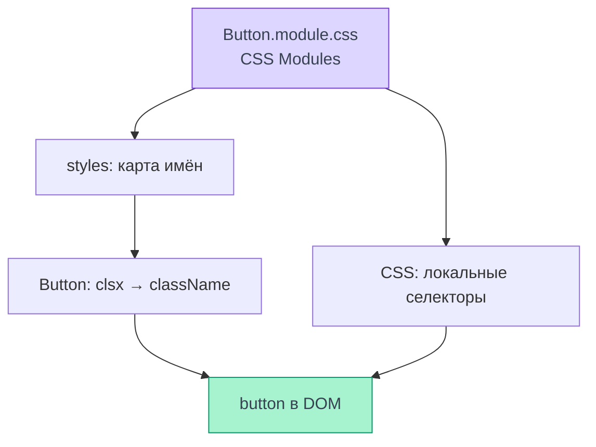

# Стили

Стили страниц и компонентов оформлены CSS Modules, общие значения заданы токенами,
а глобальные правила подключаются один раз при запуске.
Срез кода на 08.11.2026 — `ea123518d624521f999e884ff32ddec0a5bf6bfa`.
Это чтение реализации, не новый прогон приложения на проде. Ниже — путь от класса в CSS до кнопки в DOM;
обработка TS/JSX описана в [сборке](./build#transforms).

## CSS Modules и область классов {#modules}

<DiagramSection>

`Button.module.css` содержит локальные имена, а импорт `styles` даёт соответствие
этим именам и сгенерированным классам. Компонент назначает класс DOM-элементу,
CSS использует то же сгенерированное имя. Поэтому `.button` соседнего модуля
не становится стилем этой кнопки. Это область имён классов, а не изоляция всего
CSS-каскада: наследование и глобальные селекторы продолжают действовать.
См. [импорт и выбор классов Button](https://github.com/Cringe-Driven-Development-Team/frontend/blob/ea123518d624521f999e884ff32ddec0a5bf6bfa/apps/client/src/components/Button/Button.tsx#L1-L4)
и [применение к button](https://github.com/Cringe-Driven-Development-Team/frontend/blob/ea123518d624521f999e884ff32ddec0a5bf6bfa/apps/client/src/components/Button/Button.tsx#L68-L85).

<template #diagram>

</template>

</DiagramSection>

Файл имеет суффикс `.module.css`, в TSX — `import styles from './Button.module.css'`
и `className={styles.button}`. Короткие имена camelCase уже локальны, БЭМ-префикс
для уникальности не требуется. Несколько классов объединяет `clsx` из
`@cdd-team/clsx`; компонент принимает внешний `className` и сам добавляет его к
своему корню. Родителю не нужно обращаться к внутреннему классу чужого модуля.
Этот интерфейс виден в [ButtonProps и buttonClassName](https://github.com/Cringe-Driven-Development-Team/frontend/blob/ea123518d624521f999e884ff32ddec0a5bf6bfa/apps/client/src/components/Button/Button.tsx#L13-L47).

## Кнопка: классы и состояния

`buttonClassName(variant, block)` соединяет базовый `.button`, вариант
(`primary`, `secondary`, `danger`, `inverse`) и необязательный `.block`.
Сам `Button` добавляет `.loading` и внешний `className`.
Загрузка выставляет `aria-busy`/`aria-disabled` и прерывает `onClick`,
`disabled` передаётся нативной кнопке. Это разные условия:
[поведение Button](https://github.com/Cringe-Driven-Development-Team/frontend/blob/ea123518d624521f999e884ff32ddec0a5bf6bfa/apps/client/src/components/Button/Button.tsx#L45-L85).

В [Button.module.css](https://github.com/Cringe-Driven-Development-Team/frontend/blob/ea123518d624521f999e884ff32ddec0a5bf6bfa/apps/client/src/components/Button/Button.module.css#L1-L42)
основа задаёт геометрию и типографику, вариант — цвет и состояния.
Вложенные `&:hover`, `&:active` относятся к своему селектору.
Правила `.primary.loading:hover` возвращают цвет загрузки, а поздние
`.button:disabled`/`.button:disabled:hover` перекрывают обычные состояния.
При изменении порядка и специфичности можно нечаянно вернуть hover неактивной
кнопке, даже если карта CSS Modules осталась правильной.
См. [loading и disabled](https://github.com/Cringe-Driven-Development-Team/frontend/blob/ea123518d624521f999e884ff32ddec0a5bf6bfa/apps/client/src/components/Button/Button.module.css#L80-L111).

## Токены и глобальные стили

`main.tsx` единожды импортирует `styles/tokens.css` и `styles/global.css`.
В `tokens.css` лежат CSS custom properties: имя `color/bg` из макета соответствует
`--color-bg`, кнопка берёт `var(--font-body-accent)` и `var(--color-primary)`.
Это значения, доступные через каскад, а не локальные классы CSS Modules.
См. [подключение](https://github.com/Cringe-Driven-Development-Team/frontend/blob/ea123518d624521f999e884ff32ddec0a5bf6bfa/apps/client/src/main.tsx#L1-L14),
[токены](https://github.com/Cringe-Driven-Development-Team/frontend/blob/ea123518d624521f999e884ff32ddec0a5bf6bfa/apps/client/src/styles/tokens.css#L1-L33) и
[типографику](https://github.com/Cringe-Driven-Development-Team/frontend/blob/ea123518d624521f999e884ff32ddec0a5bf6bfa/apps/client/src/styles/tokens.css#L59-L67).

`global.css` владеет шрифтом, `box-sizing`, базовыми правилами body и
`:focus-visible`. В текущем коде есть также media query для указателя и
`prefers-reduced-motion`; уменьшение движения гасит переходы, сохраняя спиннер.
Компонентные правила остаются в своих модулях.
Источники — [global.css](https://github.com/Cringe-Driven-Development-Team/frontend/blob/ea123518d624521f999e884ff32ddec0a5bf6bfa/apps/client/src/styles/global.css#L1-L58) и
[media queries](https://github.com/Cringe-Driven-Development-Team/frontend/blob/ea123518d624521f999e884ff32ddec0a5bf6bfa/apps/client/src/styles/global.css#L60-L105).

## Обработка CSS сборщиком {#pipeline}

CSS Modules отвечает за имена, препроцессор — за другой входной синтаксис,
постобработка — за преобразования уже читаемого CSS. Эти роли не взаимозаменяемы.
В текущем клиенте используются `.css` и нативная вложенность CSS; отдельный Sass
или Less и авторский конфиг PostCSS не подключены. Вложенность `&` в исходнике
сама по себе не доказывает использование Sass.
См. [зависимости клиента](https://github.com/Cringe-Driven-Development-Team/frontend/blob/ea123518d624521f999e884ff32ddec0a5bf6bfa/apps/client/package.json#L22-L29),
[общий конфиг](https://github.com/Cringe-Driven-Development-Team/frontend/blob/ea123518d624521f999e884ff32ddec0a5bf6bfa/apps/client/vite/shared.ts#L29-L50) и
[пример вложенности](https://github.com/Cringe-Driven-Development-Team/frontend/blob/ea123518d624521f999e884ff32ddec0a5bf6bfa/apps/client/src/components/Button/Button.module.css#L28-L42).

| Шаг | Что происходит в выбранной версии |
| --- | --- |
| `static-url`, `enforce: pre` | Подставляет публичный адрес static в `%VITE_STATIC_URL%` внутри CSS |
| CSS transformer Vite 8.3.5 | Дефолт — **PostCSS**; для `.module.css` Vite подключает `postcss-modules`, получая карту классов |
| Dev | Vite доставляет CSS для страницы и обновляет стили при HMR |
| Production | CSS извлекается в ассеты; включён CSS code splitting, минификацию выполняет **Lightning CSS** с целью сборки |

Собственная подстановка — [plugins.ts](https://github.com/Cringe-Driven-Development-Team/frontend/blob/ea123518d624521f999e884ff32ddec0a5bf6bfa/apps/client/vite/plugins.ts#L4-L17).
Дефолт PostCSS — [cssConfigDefaults](https://github.com/vitejs/vite/blob/981f07fa4580fb88b333c4450431e4715d2a0b82/packages/vite/src/node/plugins/css.ts#L212-L224),
доставка стилей в dev — [CSS HMR](https://github.com/vitejs/vite/blob/981f07fa4580fb88b333c4450431e4715d2a0b82/packages/vite/src/node/plugins/css.ts#L620-L645),
обработка модулей — [compilePostCSS](https://github.com/vitejs/vite/blob/981f07fa4580fb88b333c4450431e4715d2a0b82/packages/vite/src/node/plugins/css.ts#L1690-L1735).
Vite отдельно выбирает [CSS splitting и минификацию](https://github.com/vitejs/vite/blob/981f07fa4580fb88b333c4450431e4715d2a0b82/packages/vite/src/node/build.ts#L451-L515),
а [minifyCSS](https://github.com/vitejs/vite/blob/981f07fa4580fb88b333c4450431e4715d2a0b82/packages/vite/src/node/plugins/css.ts#L2289-L2342) вызывает Lightning CSS, если не выбран
esbuild. Поэтому «PostCSS по умолчанию» не означает отсутствие Lightning CSS
в production-конвейере. CSS Modules не является препроцессором Sass и не
добавляет сам по себе Autoprefixer или произвольные PostCSS-плагины.

Пути шрифтов/картинок зависят от static, пути JS/CSS релиза — от `base`; это
разобрано в [сборке и разработке](./build). Самостоятельные стили офлайн-страницы
имеют [отдельный жизненный цикл](/documentation/offline/).

## Что проверить в понимании

- Почему два `.button` в разных модулях не конфликтуют по имени? У них разные сгенерированные классы.
- Зачем принимать `className`? Чтобы родитель мог передать свой локальный класс без знания внутренних селекторов.
- Почему `var(--color-primary)` не локален модулю? CSS custom property наследуется через каскад.
- Где искать ошибку hover у disabled? В порядке и специфичности правил состояний, а не только в TSX.
