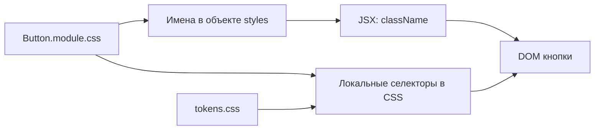

# Стили

Храните стили компонента в соседнем `.module.css`. Импортируйте классы как объект `styles`, сочетайте их через `clsx`, общие значения берите из `tokens.css`. Глобальные правила подключаются точкой входа. [Компонент Button](https://github.com/Cringe-Driven-Development-Team/frontend/blob/b1baf996fb6753d1a62eab6f874d03dca30faadc/apps/client/src/components/Button/Button.tsx#L1-L80), [подключение общих стилей](https://github.com/Cringe-Driven-Development-Team/frontend/blob/b1baf996fb6753d1a62eab6f874d03dca30faadc/apps/client/src/main.tsx#L9-L15).

## CSS Modules и область классов {#modules}

<DiagramSection>

Модуль CSS отдаёт соответствие локальных имён и классов сборки. В JSX используйте `className={styles.button}`, для композиции — `clsx`. Внешний класс передавайте компоненту через prop `className`. [Классы Button](https://github.com/Cringe-Driven-Development-Team/frontend/blob/b1baf996fb6753d1a62eab6f874d03dca30faadc/apps/client/src/components/Button/Button.tsx#L25-L80), [стили Button](https://github.com/Cringe-Driven-Development-Team/frontend/blob/b1baf996fb6753d1a62eab6f874d03dca30faadc/apps/client/src/components/Button/Button.module.css#L1-L38).

<template #diagram>

</template>

</DiagramSection>

## Кнопка: классы и состояния

`buttonClassName` соединяет базовый класс, вариант и ширину. `Button` добавляет классы состояния и блокирует нажатие при загрузке. При изменении порядка CSS сохраните приоритет `disabled` и `loading` над обычными состояниями. [Props Button](https://github.com/Cringe-Driven-Development-Team/frontend/blob/b1baf996fb6753d1a62eab6f874d03dca30faadc/apps/client/src/components/Button/Button.tsx#L31-L80), [каскад состояний](https://github.com/Cringe-Driven-Development-Team/frontend/blob/b1baf996fb6753d1a62eab6f874d03dca30faadc/apps/client/src/components/Button/Button.module.css#L81-L110).

## Токены и глобальные стили

`tokens.css` задаёт custom properties в `:root`, а модули используют их через `var()`. Правила базовых элементов и шрифтов находятся в `global.css`. [Токены](https://github.com/Cringe-Driven-Development-Team/frontend/blob/b1baf996fb6753d1a62eab6f874d03dca30faadc/apps/client/src/styles/tokens.css#L1-L45), [глобальные стили](https://github.com/Cringe-Driven-Development-Team/frontend/blob/b1baf996fb6753d1a62eab6f874d03dca30faadc/apps/client/src/styles/global.css#L1-L39).

## Обработка CSS сборщиком {#pipeline}

Общий конфиг Vite подключает обработку URL статического хранилища и CSS вместе с клиентским кодом. Для статики используйте `url('%VITE_STATIC_URL%/…')`. Подробнее о [преобразованиях](./build#transforms). [Плагин URL](https://github.com/Cringe-Driven-Development-Team/frontend/blob/b1baf996fb6753d1a62eab6f874d03dca30faadc/apps/client/vite/plugins.ts#L1-L24), [подключение](https://github.com/Cringe-Driven-Development-Team/frontend/blob/b1baf996fb6753d1a62eab6f874d03dca30faadc/apps/client/vite/shared.ts#L24-L47).
