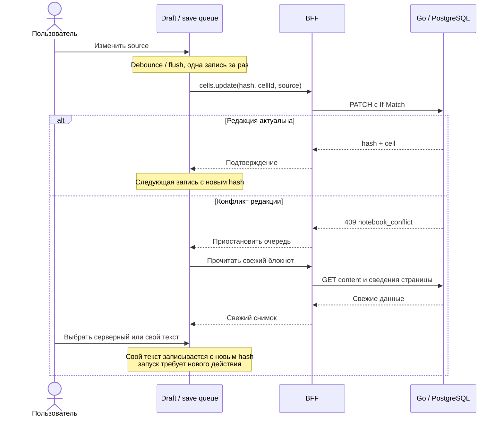

# Открытие, редактирование и сохранение

Редактор держит подтверждённый сервером снимок отдельно от локального текста. Записи идут последовательно с проверкой hash: подтверждение одной операции задаёт редакцию для следующей.

::: info Проверено по коду
Срез 08.11.2026, frontend/BFF `0606aa6`, backend `a46aa8e`. [Полные SHA и границы проверки](./). Продовый сценарий не проверялся.
:::

## Загрузка блокнота

`loadNotebook` параллельно читает metadata, content и active session. Очередь загружается затем, только если сессия принадлежит открытому блокноту. Сессия другого блокнота возвращается без её очереди. Любая ошибка чтения отклоняет весь агрегат; пустые успешные данные вместо ошибки не подставляются. Metadata и runtime не образуют одну транзакцию с content, но hash и cells поступают из одного снимка content. [BFF loader](https://github.com/Cringe-Driven-Development-Team/frontend/blob/0606aa6cb83b78a76f1e69816b2a6abd82dc20ee/apps/bff/src/notebook.ts#L9), [чтение PostgreSQL](https://github.com/Cringe-Driven-Development-Team/backend/blob/a46aa8e1ec4e169af194be6c6eb05f92af85656a/internal/notebook/adapters/postgres/notebook.go#L145).

Первое открытие использует однократный HTML bootstrap, переход внутри SPA — тот же loader через `notebooks.get`, если подходящего bootstrap нет. При 404/BAD_REQUEST открывается страница 404; при иной ошибке доступно повторение загрузки. [HTML](https://github.com/Cringe-Driven-Development-Team/frontend/blob/0606aa6cb83b78a76f1e69816b2a6abd82dc20ee/apps/bff/src/html.ts#L91), [страница](https://github.com/Cringe-Driven-Development-Team/frontend/blob/0606aa6cb83b78a76f1e69816b2a6abd82dc20ee/apps/client/src/pages/NotebookPage/NotebookPage.tsx#L188).

## Ячейки и ввод

У ячейки стабильный `id`; положение задаётся индексом с нуля. Можно создать code/markdown в конце или между ячейками, сдвинуть вверх/вниз, удалить в том числе последнюю. Созданная ячейка появляется и получает фокус после ответа сервера. Удаление снимает её черновик только после успеха. Структурные действия блокируются при другой структурной операции, конфликте или ошибке сохранения. [Store](https://github.com/Cringe-Driven-Development-Team/frontend/blob/0606aa6cb83b78a76f1e69816b2a6abd82dc20ee/apps/client/src/stores/notebook/index.ts#L334), [серверные позиции](https://github.com/Cringe-Driven-Development-Team/backend/blob/a46aa8e1ec4e169af194be6c6eb05f92af85656a/internal/notebook/adapters/postgres/editing.go#L68).

На desktop source редактируется в `textarea`, высота растёт по содержимому. Страница прокручивается вертикально, длинная строка code — горизонтально внутри редактора. Исполнение не блокирует ввод. При основном указателе `(pointer: coarse)` текст доступен для чтения/выделения, Markdown показывается как preview, изменение структуры и source недоступно, запуск остаётся доступен. Это проверка типа указателя, а не ширины экрана. При переходе в coarse уже набранное отправляется в общую очередь сохранения. [Cell](https://github.com/Cringe-Driven-Development-Team/frontend/blob/0606aa6cb83b78a76f1e69816b2a6abd82dc20ee/apps/client/src/components/Cell/Cell.tsx#L162), [touch](https://github.com/Cringe-Driven-Development-Team/frontend/blob/0606aa6cb83b78a76f1e69816b2a6abd82dc20ee/apps/client/src/utils/touch.ts#L3).

### Python

Это собственный текстовый редактор с tokenizer, а не Monaco или языковой сервер. Под прозрачным textarea расположен декоративный слой подсветки. Он различает keywords, strings, numbers, comments и имя после `def`; не исполняет ввод и не проверяет его корректность. F-string подсвечивается целиком как строка, soft keywords отдельно не выделяются. В forced-colors декоративный слой скрывается, текст textarea становится видимым. [Tokenizer](https://github.com/Cringe-Driven-Development-Team/frontend/blob/0606aa6cb83b78a76f1e69816b2a6abd82dc20ee/apps/client/src/modules/python/tokenize.ts#L19), [CSS](https://github.com/Cringe-Driven-Development-Team/frontend/blob/0606aa6cb83b78a76f1e69816b2a6abd82dc20ee/apps/client/src/components/Cell/Cell.module.css#L103).

| Клавиша | Действие |
| --- | --- |
| Tab | Пробелы до следующей позиции, кратной четырём; для выделения — отступ строк |
| Shift+Tab | Снять до четырёх пробелов или табуляцию |
| Enter | Повторить отступ, углубить после Python-двоеточия вне строки/комментария |
| Backspace в ведущих пробелах | Вернуться к предыдущей позиции отступа |
| Esc, затем Tab / Shift+Tab | Перевести фокус за пределы редактора |

Операции используют штатную историю отмены через `execCommand`, с fallback для изменения выделения. Автокомплита и инспектора переменных в этом UI нет. [Обработчики](https://github.com/Cringe-Driven-Development-Team/frontend/blob/0606aa6cb83b78a76f1e69816b2a6abd82dc20ee/apps/client/src/components/Cell/Cell.tsx#L42), [отступы](https://github.com/Cringe-Driven-Development-Team/frontend/blob/0606aa6cb83b78a76f1e69816b2a6abd82dc20ee/apps/client/src/components/Cell/indentation.ts#L75), [панель страницы](https://github.com/Cringe-Driven-Development-Team/frontend/blob/0606aa6cb83b78a76f1e69816b2a6abd82dc20ee/apps/client/src/pages/NotebookPage/NotebookPage.tsx#L346).

### Markdown

Существующая ячейка открывается в preview, новая — во вводе. Double-click/Enter включают редактирование; Shift+Enter, Esc или уход фокуса за пределы ячейки возвращают preview и инициируют flush. Переход в другое окно или диалог не закрывает режим. Preview строится из локального текста; oversized source остаётся во вводе. [Режимы Cell](https://github.com/Cringe-Driven-Development-Team/frontend/blob/0606aa6cb83b78a76f1e69816b2a6abd82dc20ee/apps/client/src/components/Cell/Cell.tsx#L157).

Собственный parser поддерживает заголовки, абзацы, списки, цитаты, fenced code, выделение, inline code и ссылки. Raw HTML остаётся текстом, дерево JSX состоит из разрешённых тегов. Ссылки допускают http/https и относительные адреса/якоря; опасные схемы и `//host` отвергаются. Внешние ссылки имеют `noopener noreferrer`. Fenced blocks `python`, `py`, `python3` получают ту же подсветку Python; углубление после двоеточия в Markdown действует только внутри такого блока. Это реализовано в интегрированном PR170, несмотря на более узкий старый scope #166. [Parser](https://github.com/Cringe-Driven-Development-Team/frontend/blob/0606aa6cb83b78a76f1e69816b2a6abd82dc20ee/apps/client/src/modules/markdown/parse.ts#L4), [рендер](https://github.com/Cringe-Driven-Development-Team/frontend/blob/0606aa6cb83b78a76f1e69816b2a6abd82dc20ee/apps/client/src/modules/markdown/Markdown.tsx#L19), [PR170](https://github.com/Cringe-Driven-Development-Team/frontend/pull/170). Наличие этих мер не подтверждает завершение [XSS-регресса #35](https://github.com/Cringe-Driven-Development-Team/frontend/issues/35).

## Лимит source

Для code и markdown предел — **65536 байт UTF-8**, не символов. Clipboard paste берёт только `text/plain`: из лимита вычитается незаменённый остаток, вставляемый фрагмент сокращается по границе Unicode. Если не помещается ничего, текст и выделение не меняются. Уведомление показывает количество вставленных Unicode code points, поэтому его числа не равны байтам. [Подготовка paste](https://github.com/Cringe-Driven-Development-Team/frontend/blob/0606aa6cb83b78a76f1e69816b2a6abd82dc20ee/apps/client/src/stores/notebook/snapshot.ts#L22), [вставка](https://github.com/Cringe-Driven-Development-Team/frontend/blob/0606aa6cb83b78a76f1e69816b2a6abd82dc20ee/apps/client/src/pages/NotebookPage/NotebookPage.tsx#L86).

Другой путь ввода может превысить предел: весь draft остаётся локально с `tooLarge`, PATCH не отправляется до сокращения. Серверный 413 означает отказ, а не обрезание; он переводится в ошибку сохранения и проверку серверного снимка. Это отдельный случай от локального tooLarge. [Store](https://github.com/Cringe-Driven-Development-Team/frontend/blob/0606aa6cb83b78a76f1e69816b2a6abd82dc20ee/apps/client/src/stores/notebook/index.ts#L277), [HTTP ошибки](https://github.com/Cringe-Driven-Development-Team/frontend/blob/0606aa6cb83b78a76f1e69816b2a6abd82dc20ee/apps/bff/src/errors.ts#L26), [backend limit](https://github.com/Cringe-Driven-Development-Team/backend/blob/a46aa8e1ec4e169af194be6c6eb05f92af85656a/internal/notebook/usecase/editing.go#L11).

<DiagramSection>

## Очередь сохранения {#save-queue}

Store держит `confirmed {hash,cells}` и `drafts`. После ввода ждёт 500 мс; blur, завершение IME и подготовка запуска вызывают flush. Во время composition сохранение не запускается. Операции выполняются по одной, ожидающие update схлопываются к актуальному тексту. Поздний ответ удаляет draft только если он всё ещё равен отправленному; новое редактирование остаётся локальным. Поколение открытого блокнота защищает от ответов прежней страницы. [Очередь и ack](https://github.com/Cringe-Driven-Development-Team/frontend/blob/0606aa6cb83b78a76f1e69816b2a6abd82dc20ee/apps/client/src/stores/notebook/index.ts#L374), [ввод](https://github.com/Cringe-Driven-Development-Team/frontend/blob/0606aa6cb83b78a76f1e69816b2a6abd82dc20ee/apps/client/src/stores/notebook/index.ts#L277).

<template #diagram>

</template>

Эта очередь сохраняет документ. Серверная очередь исполнения независима: конфликт редактирования не отменяет уже принятые исполнения.

</DiagramSection>

### Запросы BFF и Go

Каждая процедура принимает `notebookId` и `hash` без HTTP-кавычек. BFF добавляет ровно один сильный `If-Match`, переносит идентификаторы в URL и удаляет их из body. [Router](https://github.com/Cringe-Driven-Development-Team/frontend/blob/0606aa6cb83b78a76f1e69816b2a6abd82dc20ee/apps/bff/src/router/cells.ts#L11), [HTTP adapter](https://github.com/Cringe-Driven-Development-Team/frontend/blob/0606aa6cb83b78a76f1e69816b2a6abd82dc20ee/apps/bff/src/go/api.ts#L86).

| Процедура | Дополнительный ввод | Go `/notebooks/{id}/content/cells` | Подтверждение |
| --- | --- | --- | --- |
| `cells.create` | `kind, source, index?` | POST | 201 `{hash,cell}` |
| `cells.update` | `cellId, source` | PATCH `/{cell_id}` | 200 `{hash,cell}` |
| `cells.move` | `cellId, index` | POST `/{cell_id}/move` | 200 `{hash}` |
| `cells.delete` | `cellId` | DELETE `/{cell_id}` | 200 `{hash}` |

Backend проверяет владельца и revision под блокировкой строки. Одинаковые конкурентные редакции дают один успех и один 409. Даже no-op сначала проверяет hash; актуальный повтор того же source или move на своё место редакцию не меняет. Реальное изменение code source сбрасывает только его outputs/count/truncated; move и соседние результаты сохраняются. [Транзакции](https://github.com/Cringe-Driven-Development-Team/backend/blob/a46aa8e1ec4e169af194be6c6eb05f92af85656a/internal/notebook/adapters/postgres/editing.go#L38), [source](https://github.com/Cringe-Driven-Development-Team/backend/blob/a46aa8e1ec4e169af194be6c6eb05f92af85656a/internal/notebook/adapters/postgres/editing.go#L107).

## Hash и результаты {#revision}

`hash` блокнота — непрозрачная UUID revision. ETag содержит её в кавычках. SHA-256 source для запуска — другой идентификатор, вычисляемый по UTF-8 коду конкретной ячейки.

::: warning Разрыв реализации и контракта
[Apidog main](https://vb78fyael1.apidog.io/) (GET content, endpoint `45814238`, прочитан 08.11.2026) и [OpenAPI frontend](https://github.com/Cringe-Driven-Development-Team/frontend/blob/0606aa6cb83b78a76f1e69816b2a6abd82dc20ee/spec/openapi.json#L1225) требуют не менять hash при изменении только outputs/count/truncated. Однако backend при новом результате вызывает [publish](https://github.com/Cringe-Driven-Development-Team/backend/blob/a46aa8e1ec4e169af194be6c6eb05f92af85656a/internal/notebook/adapters/postgres/editing.go#L194) и генерирует новую revision; [публикация результата](https://github.com/Cringe-Driven-Development-Team/backend/blob/a46aa8e1ec4e169af194be6c6eb05f92af85656a/internal/notebook/adapters/postgres/results.go#L79). Frontend [applyResult](https://github.com/Cringe-Driven-Development-Team/frontend/blob/0606aa6cb83b78a76f1e69816b2a6abd82dc20ee/apps/client/src/stores/notebook/index.ts#L712) обновляет вывод без hash. Поэтому следующий source-save может получить 409 даже без чужой правки текста. Клиентский обход этого разрыва не реализован.
:::

## Ошибки записи и конфликт

При сети, timeout, 5xx или неожиданном ответе неизвестно, применена ли запись. Store перечитывает snapshot: совпадение с ожидаемым результатом означает успех; прежняя структура допускает один автоматический повтор неопределённой записи; иной снимок означает конфликт. После повторной ошибки нужен ручной retry. Для create проверяется единственная новая ячейка, чтобы не создавать дубль вслепую. Определённый отказ вроде 413 не получает такой автоматический повтор. [Reconciliation](https://github.com/Cringe-Driven-Development-Team/frontend/blob/0606aa6cb83b78a76f1e69816b2a6abd82dc20ee/apps/client/src/stores/notebook/index.ts#L481).

При 409/NOT_FOUND очередь останавливается, старые структурные jobs снимаются, drafts сохраняются. Сначала загружается свежий блокнот; при ошибке чтения доступен повтор, выбор версии до успешного чтения закрыт. Вариант «Серверный» принимает snapshot и снимает локальные drafts/orphans. «Мой» последовательно сохраняет текст сохранившихся cell IDs с новым hash; force нет, возможен повторный конфликт. Закрытие диалога оставляет очередь на паузе. Run открывает диалог и не продолжается автоматически после выбора. [Конфликт](https://github.com/Cringe-Driven-Development-Team/frontend/blob/0606aa6cb83b78a76f1e69816b2a6abd82dc20ee/apps/client/src/stores/notebook/index.ts#L595), [выбор](https://github.com/Cringe-Driven-Development-Team/frontend/blob/0606aa6cb83b78a76f1e69816b2a6abd82dc20ee/apps/client/src/stores/notebook/index.ts#L632), [run](https://github.com/Cringe-Driven-Development-Team/frontend/blob/0606aa6cb83b78a76f1e69816b2a6abd82dc20ee/apps/client/src/stores/runtime.ts#L476).

### Текст удалённой ячейки {#orphans}

Если другая вкладка удалила ячейку, локальный source становится orphan, доступным для копирования; ячейка автоматически не воссоздаётся. **Оставшаяся ошибка #165:** общий статус и beforeunload не учитывают orphans. После сохранения остальных drafts возможен ложный успех «Ваш текст сохранён» при оставшемся orphan. Это воспроизводимое поведение кода, а не гарантия сохранности. [Store](https://github.com/Cringe-Driven-Development-Team/frontend/blob/0606aa6cb83b78a76f1e69816b2a6abd82dc20ee/apps/client/src/stores/notebook/index.ts#L617), [тост](https://github.com/Cringe-Driven-Development-Team/frontend/blob/0606aa6cb83b78a76f1e69816b2a6abd82dc20ee/apps/client/src/pages/NotebookPage/Conflict.tsx#L92), [задача #165](https://github.com/Cringe-Driven-Development-Team/frontend/issues/165).

Уход внутри SPA инициирует сохранение; несохранённый текст и orphans можно восстановить из Map памяти этой вкладки при возврате. Это не localStorage: закрытие вкладки теряет локальную память. При изменившемся серверном hash восстановление вызывает конфликт. [Память страницы](https://github.com/Cringe-Driven-Development-Team/frontend/blob/0606aa6cb83b78a76f1e69816b2a6abd82dc20ee/apps/client/src/stores/notebook/index.ts#L175), [beforeunload](https://github.com/Cringe-Driven-Development-Team/frontend/blob/0606aa6cb83b78a76f1e69816b2a6abd82dc20ee/apps/client/src/pages/NotebookPage/NotebookPage.tsx#L241).

Текущий dirty выделяется как ошибка, saving сразу показывает spinner, saved живёт четыре секунды. Нейтральное «Автосохранение…», задержки 700/200 мс и секунда тишины перед «Сохранено» — открытое [требование #172](https://github.com/Cringe-Driven-Development-Team/frontend/issues/172), а не текущий UX. [Статусы](https://github.com/Cringe-Driven-Development-Team/frontend/blob/0606aa6cb83b78a76f1e69816b2a6abd82dc20ee/apps/client/src/pages/NotebookPage/status.ts#L54).
