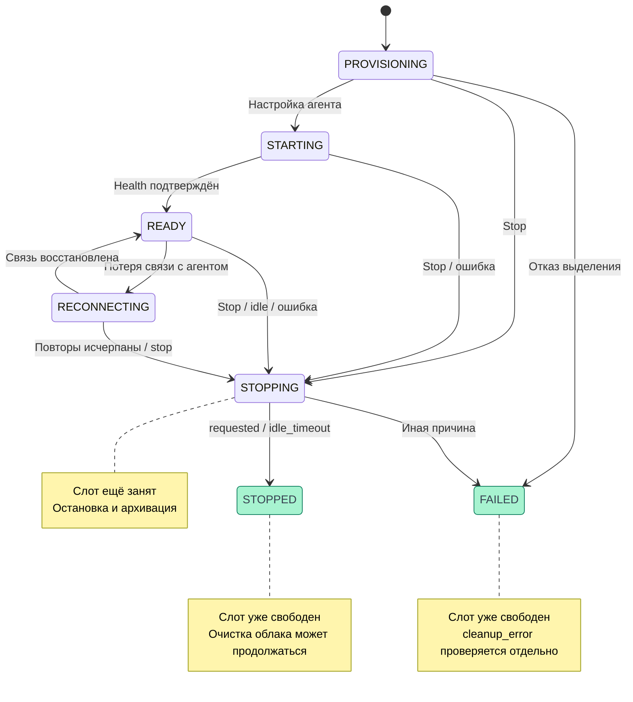
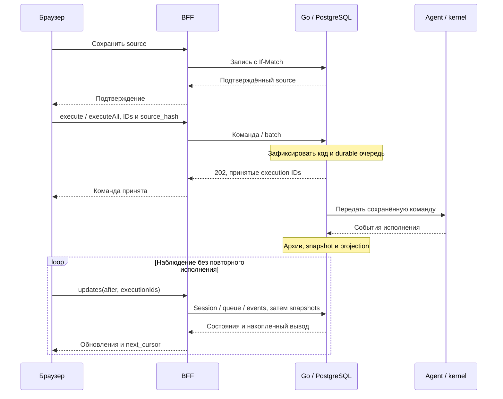

# Окружение и исполнение

Окружение запускается отдельно от кода. Команда исполнения сначала сохраняется в backend, затем передаётся агенту; браузер наблюдает её через BFF. Готовность окружения, исход Python и сохранение результата — разные состояния.

::: info Проверено по коду
Срез 08.11.2026: frontend/BFF `0606aa6`, backend/agent `a46aa8e`. [Полные версии](./). Сквозной сценарий на проде не проверялся.
:::

## Запуск и пользовательский слот

`runtime.start({notebookId,requestId})` отправляет в Go `{request_id,language:"python"}`. API и агент знают также R, но BFF выбирает Python: выбора языка в этом интерфейсе нет. Session сохраняется до provisioning. Повтор request_id с теми же notebook/language возвращает ту же сессию, в том числе завершённую; новый запуск требует нового ID. Другие параметры при прежнем ID дают 409. [BFF](https://github.com/Cringe-Driven-Development-Team/frontend/blob/0606aa6cb83b78a76f1e69816b2a6abd82dc20ee/apps/bff/src/router/runtime.ts#L23), [приём Start](https://github.com/Cringe-Driven-Development-Team/backend/blob/a46aa8e1ec4e169af194be6c6eb05f92af85656a/internal/runtimesession/adapters/postgres/store.go#L106).

У пользователя один активный слот. Конкуренцию Start защищают блокировка строки пользователя и уникальный индекс. `active_session_exists` возвращает публичную activeSession: браузер предлагает перейти к её notebook_id, без имени чужого блокнота и без автоматической остановки. `RUNTIME_ENABLED=false` запрещает новые Start с 503, но оставляет чтение истории и stop. [Ограничение](https://github.com/Cringe-Driven-Development-Team/backend/blob/a46aa8e1ec4e169af194be6c6eb05f92af85656a/internal/runtimesession/adapters/postgres/store.go#L106), [UI](https://github.com/Cringe-Driven-Development-Team/frontend/blob/0606aa6cb83b78a76f1e69816b2a6abd82dc20ee/apps/client/src/pages/NotebookPage/Runtime.tsx#L105), [флаг](https://github.com/Cringe-Driven-Development-Team/backend/blob/a46aa8e1ec4e169af194be6c6eb05f92af85656a/internal/runtimesession/usecase/session.go#L39).

<DiagramSection>

## Жизненный цикл сессии {#session}

`state` задаёт общий этап, `stage` — деталь подготовки, `reason` — безопасный код причины. PROVISIONING/STARTING/READY/RECONNECTING/STOPPING удерживают слот. В READY готовность проверяется по UUID, языку и health агента. Основной путь показан на схеме; остановка допустима и во время подготовки, а отказ выделения ресурса может завершить сессию сразу как FAILED. [Worker](https://github.com/Cringe-Driven-Development-Team/backend/blob/a46aa8e1ec4e169af194be6c6eb05f92af85656a/internal/runtimesession/usecase/worker.go#L100), [Stop](https://github.com/Cringe-Driven-Development-Team/backend/blob/a46aa8e1ec4e169af194be6c6eb05f92af85656a/internal/runtimesession/usecase/session.go#L102).

<template #diagram>

</template>

Схема не делает cleanup новым состоянием RuntimeSession: после терминального checkpoint worker отдельно запрашивает удаление окружения и продолжает наблюдать облако. [Очистка](https://github.com/Cringe-Driven-Development-Team/backend/blob/a46aa8e1ec4e169af194be6c6eb05f92af85656a/internal/runtimesession/usecase/worker.go#L407).

</DiagramSection>

В подготовке встречаются stages `queued`, `creating_vps`, `configuring_agent`, `verifying_agent`; далее `ready`, `reconnecting`, `stopping`, `deleting_environment`, `stopped`, `failed`. Перечень в сгенерированном контракте шире присваиваний worker. Причины ограничены allow-list: `requested`, `idle_timeout`, `kernel_died`, `agent_unreachable`, `protocol_error`, `environment_failed`, `environment_lost`, `capacity_exceeded`, `startup_timeout`. Неизвестная причина агента публично превращается в `kernel_died`. [Stage и reason](https://github.com/Cringe-Driven-Development-Team/backend/blob/a46aa8e1ec4e169af194be6c6eb05f92af85656a/internal/runtimesession/usecase/worker.go#L90).

### Очистка и расхождение с требованиями {#cleanup}

::: warning Терминальное состояние не доказывает удаление VPS
Backend переводит сессию в STOPPED/FAILED **до** подтверждения удаления облачных ресурсов. Слот уже свободен; `cleanup_error` может содержать `cleanup_pending`. Это не присваивание `stage=cleanup_pending`: HTTP stage остаётся stopped/failed. После reload `/active` может вернуть null, хотя очистка продолжается. [Checkpoint](https://github.com/Cringe-Driven-Development-Team/backend/blob/a46aa8e1ec4e169af194be6c6eb05f92af85656a/internal/runtimesession/usecase/worker.go#L479), [публичные поля](https://github.com/Cringe-Driven-Development-Team/backend/blob/a46aa8e1ec4e169af194be6c6eb05f92af85656a/internal/runtimesession/delivery/http/runtime.go#L59), [проверка освобождения слота в исходниках](https://github.com/Cringe-Driven-Development-Team/backend/blob/a46aa8e1ec4e169af194be6c6eb05f92af85656a/internal/runtimesession/adapters/postgres/cleanup_review_test.go#L57).

[Макеты](https://www.figma.com/design/7iaVDGiwzQk2vZIB5ogVlq/?node-id=581-16814) и описание stage в [Apidog main](https://vb78fyael1.apidog.io/) требуют удерживать слот до очистки. Это разрыв с реализацией, а не принятое здесь изменение требования. UI-ветка cleanup не доказывает, что backend удерживает слот.
:::

## Подготовка запуска

Перед ▶ store ждёт записи нужного source и уже поставленных структурных операций. В execute передаётся SHA-256 **подтверждённого** UTF-8 source, без самого текста и общего hash блокнота. Если target изменился во время ожидания, команда не отправляется: нужно новое нажатие. Run all фиксирует code IDs, порядок и локальный текст при нажатии, ждёт сохранения и перепроверяет их; Markdown исключён, поздние новые ячейки в batch не добавляются. Известный конфликт открывает диалог; разрешение не возобновляет прежний run intent. [Frontend](https://github.com/Cringe-Driven-Development-Team/frontend/blob/0606aa6cb83b78a76f1e69816b2a6abd82dc20ee/apps/client/src/stores/runtime.ts#L476), [flush](https://github.com/Cringe-Driven-Development-Team/frontend/blob/0606aa6cb83b78a76f1e69816b2a6abd82dc20ee/apps/client/src/stores/notebook/index.ts#L759).

<DiagramSection>

## Путь команды {#command}

Backend принимает новый execute только в READY. Под блокировкой блокнота проверяет source_hash и захватывает source_version и код. Весь batch принимается одной транзакцией в присланном порядке; поздняя правка source не меняет уже принятую программу. [Admission](https://github.com/Cringe-Driven-Development-Team/backend/blob/a46aa8e1ec4e169af194be6c6eb05f92af85656a/internal/runtimesession/adapters/postgres/executions.go#L113), [batch](https://github.com/Cringe-Driven-Development-Team/backend/blob/a46aa8e1ec4e169af194be6c6eb05f92af85656a/internal/runtimesession/adapters/postgres/batch.go#L46).

<template #diagram>

</template>

Ошибка сети после отправки оставляет исход неопределённым. Клиент повторяет ту же команду с тем же ID и параметрами; новый ID мог бы исполнить код повторно. `awaitingRetry` блокирует новый run до разрешения неопределённой команды. [Retry](https://github.com/Cringe-Driven-Development-Team/frontend/blob/0606aa6cb83b78a76f1e69816b2a6abd82dc20ee/apps/client/src/stores/runtime.ts#L408).

</DiagramSection>

### Команды и ответы

| tRPC | Ввод | Go и результат |
| --- | --- | --- |
| `runtime.start` | `notebookId, requestId` | POST `/notebooks/{id}/runtime-sessions` → 202 session |
| `runtime.execute` | `sessionId, execution_id, cell_id, source_hash, timeout_seconds?` | POST `/runtime-sessions/{id}/executions` → 202 execution |
| `runtime.executeAll` | `sessionId, request_id, cells:[{cell_id,source_hash}], timeout_seconds?` | POST `/runtime-sessions/{id}/executions/batch` → 202 `{request_id,session_id,execution_ids}` |
| `runtime.stop` | `sessionId` | POST `/runtime-sessions/{id}/stop` → 202 `{accepted:true}` |
| `runtime.activity` | `sessionId` | POST `/runtime-sessions/{id}/activity` → 200 `{accepted:true}` |

BFF делает один batch-запрос; `execution_ids` — принятый набор, не текущая очередь. Timeout по умолчанию 300 секунд, допустимо 1–86400; UI выбора timeout нет. [BFF router](https://github.com/Cringe-Driven-Development-Team/frontend/blob/0606aa6cb83b78a76f1e69816b2a6abd82dc20ee/apps/bff/src/router/runtime.ts#L36), [HTTP](https://github.com/Cringe-Driven-Development-Team/backend/blob/a46aa8e1ec4e169af194be6c6eb05f92af85656a/internal/runtimesession/delivery/http/runtime.go#L171).

Повтор execute с тем же ID/cell/hash/timeout возвращает существующее исполнение, даже если сессия уже не READY. Повтор batch с прежним request_id и тем же упорядоченным списком возвращает исходные IDs, включая завершённые. Другие параметры дают 409. Batch допускает 1–1000 уникальных code IDs в возрастающем текущем порядке; полный набор «всех» выбирает клиент. [Execute](https://github.com/Cringe-Driven-Development-Team/backend/blob/a46aa8e1ec4e169af194be6c6eb05f92af85656a/internal/runtimesession/adapters/postgres/executions.go#L113), [batch validation](https://github.com/Cringe-Driven-Development-Team/backend/blob/a46aa8e1ec4e169af194be6c6eb05f92af85656a/internal/runtimesession/domain/batch.go#L55).

Ошибки: 400 — некорректный ввод; 404 — объект недоступен владельцу; 409 — состояние, source mismatch или несовместимый повтор ID; 429 `queue_full` — лимит очереди; 503 `runtime_unavailable` — окружение недоступно. Принятая команда не объявляется failed лишь из-за потери HTTP-ответа. [Ошибки Go](https://github.com/Cringe-Driven-Development-Team/backend/blob/a46aa8e1ec4e169af194be6c6eb05f92af85656a/internal/runtimesession/delivery/http/runtime.go#L107).

## Очередь и результат Python

Durable FIFO backend вмещает 1000 незавершённых команд вместе с inspections. Агент допускает 100 ожидающих; его 429 оставляет backend-команду pending для повторной доставки. Worker передаёт по одной pending-команде в admission_order. Публичная queue содержит только RUNNING/QUEUED code-команды, inspections исключены. Пустая queue не означает остановленную сессию; исчезновение execution не подтверждает успех. [Очередь](https://github.com/Cringe-Driven-Development-Team/backend/blob/a46aa8e1ec4e169af194be6c6eb05f92af85656a/internal/runtimesession/adapters/postgres/batch.go#L16), [dispatch](https://github.com/Cringe-Driven-Development-Team/backend/blob/a46aa8e1ec4e169af194be6c6eb05f92af85656a/internal/runtimesession/usecase/worker.go#L345).

| Execution state | Значение |
| --- | --- |
| QUEUED / RUNNING | Принят, ожидает / выполняется |
| SUCCEEDED / FAILED | Достоверный ответ Python: успех / ошибка |
| INTERRUPTED / TIMED_OUT | Подтверждённое прерывание / timeout |
| CANCELLED | Отменён до завершения исполнения |
| UNKNOWN | Конечный исход недостоверен; нового автоматического запуска нет |
| REJECTED | Агент отверг доставку команды |

Агент ждёт и `execute_reply`, и соответствующий IOPub `idle`. Timeout вызывает interrupt с ожиданием подтверждения до пяти секунд; недостоверный результат ведёт к UNKNOWN и остановке сессии. Обычная ошибка Python или подтверждённый timeout/interrupt сами по себе не отменяют оставшуюся очередь. Interactive stdin отключён. [Agent loop](https://github.com/Cringe-Driven-Development-Team/backend/blob/a46aa8e1ec4e169af194be6c6eb05f92af85656a/runtime-agent/src/runtime_agent/runtime.py#L249).

## Polling, reload и вкладки {#updates}

`runtime.updates({sessionId,after,executionIds})` принимает до 100 явных IDs. BFF параллельно читает session, queue и одну страницу events, затем по одному snapshot для объединения явных IDs и `body.execution_id` событий. Сбой любого чтения отклоняет ответ целиком. Возвращаются `session`, `runtime_queue`, `events`, `executions`, `next_cursor`, `has_more`. [Aggregation](https://github.com/Cringe-Driven-Development-Team/frontend/blob/0606aa6cb83b78a76f1e69816b2a6abd82dc20ee/apps/bff/src/router/runtime.ts#L53).

Браузер делает одну последовательную цепочку: обычно новый шаг через 2000 мс после предыдущего, при has_more и следующей порции IDs — сразу. Cursor продвигается после применения данных. При ошибке экран, cursor и offset остаются, появляется linkLost и повторяется тот же шаг. Это не признак отсутствия окружения. Full content ради каждого output не загружается. [Polling](https://github.com/Cringe-Driven-Development-Team/frontend/blob/0606aa6cb83b78a76f1e69816b2a6abd82dc20ee/apps/client/src/stores/runtime.ts#L214).

При reload начальные индикаторы берутся из queue, cursor начинается с нуля, watermark — из `active_session.public_seq`. Старые terminal/applied события до watermark не должны подменять сохранённые outputs; более новые могут обновить экран. После terminal session ещё дочитываются pending-проекции; недочитанный исход становится unknown. [Replay](https://github.com/Cringe-Driven-Development-Team/frontend/blob/0606aa6cb83b78a76f1e69816b2a6abd82dc20ee/apps/client/src/stores/runtime.ts#L126), [apply](https://github.com/Cringe-Driven-Development-Team/frontend/blob/0606aa6cb83b78a76f1e69816b2a6abd82dc20ee/apps/client/src/stores/runtime.ts#L322).

::: warning Оставшаяся ошибка latest между вкладками
`track` выбирает latest по первому обнаружению ID, а не по глобальному порядку попыток. Если одна порция содержит новую RUNNING-команду в queue и впервые увиденный старый snapshot, обработка queue делает latest новым, а старый snapshot затем перезаписывает latest. Повторно встреченный новый ID уже пропускается. Возможен старый вывод для неизменённого source. Это воспроизведено локальным unit-сценарием на `0606aa6`, не в проде. [track](https://github.com/Cringe-Driven-Development-Team/frontend/blob/0606aa6cb83b78a76f1e69816b2a6abd82dc20ee/apps/client/src/stores/runtime.ts#L202), [порядок apply](https://github.com/Cringe-Driven-Development-Team/frontend/blob/0606aa6cb83b78a76f1e69816b2a6abd82dc20ee/apps/client/src/stores/runtime.ts#L322), [порядок IDs BFF](https://github.com/Cringe-Driven-Development-Team/frontend/blob/0606aa6cb83b78a76f1e69816b2a6abd82dc20ee/apps/bff/src/router/runtime.ts#L75).
:::

## Остановка, idle и интерфейс

Уход со страницы прекращает polling, но не останавливает окружение. Activity посылается при реальном editSource своей READY/RECONNECTING-сессии не чаще 30 секунд; чтение и polling не продлевают жизнь. Backend Activity не содержит собственного 30-секундного throttling. Idle агента по умолчанию 900 секунд, но активное выполнение, pending/queue и control-lock исключают idle stop. [Frontend activity](https://github.com/Cringe-Driven-Development-Team/frontend/blob/0606aa6cb83b78a76f1e69816b2a6abd82dc20ee/apps/client/src/stores/runtime.ts#L623), [backend activity](https://github.com/Cringe-Driven-Development-Team/backend/blob/a46aa8e1ec4e169af194be6c6eb05f92af85656a/internal/runtimesession/usecase/session.go#L89), [idle](https://github.com/Cringe-Driven-Development-Team/backend/blob/a46aa8e1ec4e169af194be6c6eb05f92af85656a/runtime-agent/src/runtime_agent/runtime.py#L611).

Stop подтверждает намерение: UI ставит STOPPING и начинает polling. Worker делает drain, stop, дочитывает журнал и архивирует в PostgreSQL; ошибка БД не считается успешным архивированием. После шести сетевых неудач возможен `journal_incomplete`, незавершённые исполнения становятся UNKNOWN. Затем выполняется отдельная очистка облака. [Cleanup](https://github.com/Cringe-Driven-Development-Team/backend/blob/a46aa8e1ec4e169af194be6c6eb05f92af85656a/internal/runtimesession/usecase/worker.go#L407).

В шапке подготовки/восстановления/остановки — соответствующий статус, при непустой queue — «Выполняется». У queued-ячейки `[ ]`, у running `[*]` и локальный секундомер с первого наблюдения RUNNING; reload обнуляет его. Это не серверная длительность. Старый вывод queued-ячейки скрыт. «В очереди» в шапке и «Перейти к ячейке» из старых макетов в текущем UI отсутствуют. [Статусы](https://github.com/Cringe-Driven-Development-Team/frontend/blob/0606aa6cb83b78a76f1e69816b2a6abd82dc20ee/apps/client/src/pages/NotebookPage/status.ts#L24), [ячейка](https://github.com/Cringe-Driven-Development-Team/frontend/blob/0606aa6cb83b78a76f1e69816b2a6abd82dc20ee/apps/client/src/pages/NotebookPage/Runtime.tsx#L203).

Backend имеет interrupt, restart и variables API, но BFF runtime-router и NotebookPage не публикуют их как пользовательские функции. Restart меняет generation и память kernel; inspector использует общую очередь, но не пишет outputs ячеек. [Backend controls](https://github.com/Cringe-Driven-Development-Team/backend/blob/a46aa8e1ec4e169af194be6c6eb05f92af85656a/internal/runtimesession/delivery/http/commands.go#L23), [BFF interface](https://github.com/Cringe-Driven-Development-Team/frontend/blob/0606aa6cb83b78a76f1e69816b2a6abd82dc20ee/apps/bff/src/router/runtime.ts#L21). Дальше: [результаты](./results) и [устройство окружения](./storage-and-infrastructure).
