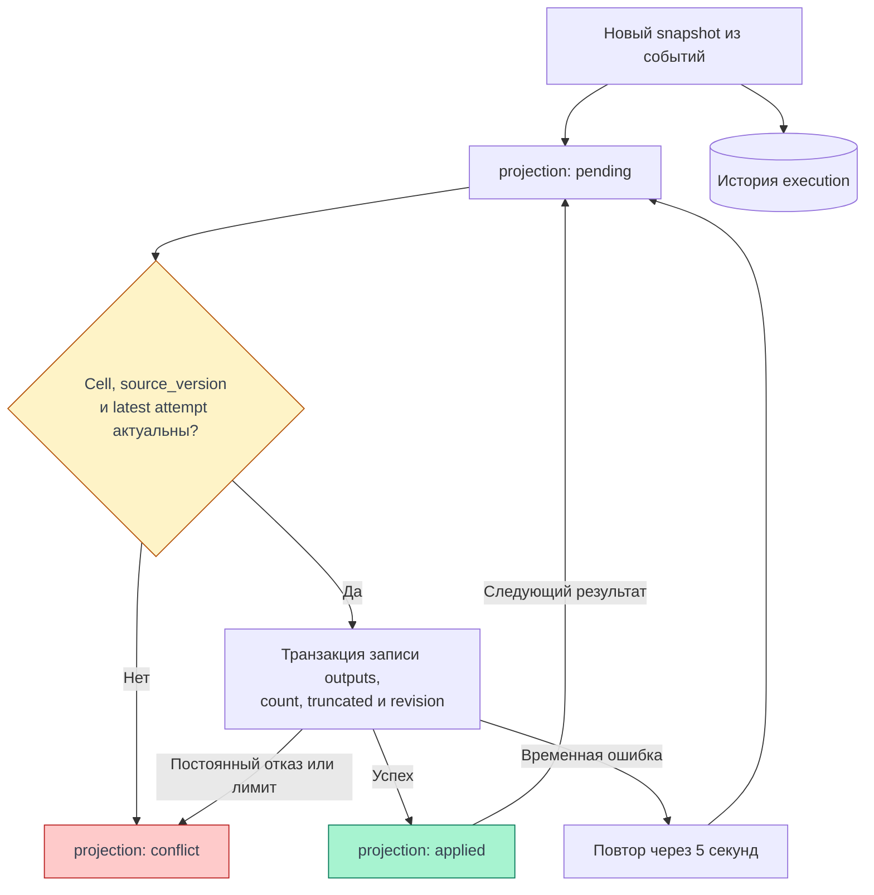

# Результаты исполнения

Execution хранит исход попытки и накопленный вывод. Projection показывает, удалось ли применить этот вывод к текущей ячейке блокнота. `SUCCEEDED` не гарантирует `applied`, а `applied` не означает успешный Python.

::: info Проверено по коду
08.11.2026: backend/agent `a46aa8e`, frontend `0606aa6`. [Полные SHA](./); продовый сценарий не проверялся.
:::

## От события к сохранённому выводу

Agent отдаёт события со своим seq. Backend одной транзакцией обновляет архив, execution snapshot и agent cursor; повтор seq пропускается. Публичный seq/cursor — отдельная последовательность. Reducer понимает stream, execute_result, display_data, error, clear_output(wait), update_display_data и execution_count. Display IDs учитывают generation; transient не сохраняется в nbformat. Сообщение без известного parent остаётся unattributed и не назначается произвольной ячейке. [Архив событий](https://github.com/Cringe-Driven-Development-Team/backend/blob/a46aa8e1ec4e169af194be6c6eb05f92af85656a/internal/runtimesession/adapters/postgres/events.go#L16), [reducer](https://github.com/Cringe-Driven-Development-Team/backend/blob/a46aa8e1ec4e169af194be6c6eb05f92af85656a/internal/runtimesession/domain/output.go#L7), [display](https://github.com/Cringe-Driven-Development-Team/backend/blob/a46aa8e1ec4e169af194be6c6eb05f92af85656a/internal/runtimesession/adapters/postgres/display.go#L48).

<DiagramSection>

## Применение к ячейке {#projection}

При принятии команды backend запоминает стабильный cell ID и внутренний UUID source_version. Перед записью результата проверяет, что это всё ещё code-ячейка той же версии и нет более новой принятой попытки для этой ячейки среди всех сессий. Перестановка или правка соседней ячейки допустима; изменение source и возврат прежнего текста всё равно меняют source_version, поэтому старый вывод не применяется. [SaveResultTx](https://github.com/Cringe-Driven-Development-Team/backend/blob/a46aa8e1ec4e169af194be6c6eb05f92af85656a/internal/notebook/adapters/postgres/results.go#L61), [MAX(attempt)](https://github.com/Cringe-Driven-Development-Team/backend/blob/a46aa8e1ec4e169af194be6c6eb05f92af85656a/internal/runtimesession/adapters/postgres/events.go#L164).

<template #diagram>

</template>

Проекция запускается и для промежуточных RUNNING snapshots. `applied` относится к текущему накопленному выводу: следующее событие снова может дать pending. Временная ошибка хранения оставляет повтор; stale source, newer attempt, недопустимый документ или превышение лимита дают conflict. История execution сохраняется независимо от projection. [Project](https://github.com/Cringe-Driven-Development-Team/backend/blob/a46aa8e1ec4e169af194be6c6eb05f92af85656a/internal/runtimesession/adapters/postgres/events.go#L134), [постановка job](https://github.com/Cringe-Driven-Development-Team/backend/blob/a46aa8e1ec4e169af194be6c6eb05f92af85656a/internal/runtimesession/adapters/postgres/display.go#L31).

</DiagramSection>

REJECTED при отказе доставки агенту не получает terminal projection job в `SaveExecution`; нельзя обещать, что всякое terminal execution обязательно пройдёт applied/conflict. Архив допускает NUL в сериализованных byte slices, а JSONB блокнота — нет: такой результат может оставаться доступным в execution с projection conflict. [Dispatch](https://github.com/Cringe-Driven-Development-Team/backend/blob/a46aa8e1ec4e169af194be6c6eb05f92af85656a/internal/runtimesession/usecase/worker.go#L363), [archive encoding](https://github.com/Cringe-Driven-Development-Team/backend/blob/a46aa8e1ec4e169af194be6c6eb05f92af85656a/internal/runtimesession/adapters/postgres/executions.go#L38).

При записи действительно изменившегося результата backend меняет notebook revision. Это расходится с Apidog и hash, который frontend оставляет прежним при applyResult; [последствия для редактирования](./editing#revision).

## Применение в браузере

Snapshot применяется только для latest execution ячейки, при совпадении source_hash с SHA-256 текущего confirmed.source и отсутствии projection conflict. После асинхронного вычисления hash повторно проверяются generation и latest. Notebook hash при этом не меняется; полного перечитывания content нет. Source draft и confirmed различны: отображение результата не является подтверждением несохранённой правки. Известное ограничение выбора latest описано в [получении обновлений](./execution#updates). [Frontend apply](https://github.com/Cringe-Driven-Development-Team/frontend/blob/0606aa6cb83b78a76f1e69816b2a6abd82dc20ee/apps/client/src/stores/runtime.ts#L354).

## Представления вывода

Порядок массива outputs сохраняется. Ошибка после частичного вывода не уничтожает уже полученное. Один stderr сам по себе не доказывает FAILED: исход приходит из execution snapshot. [Output component](https://github.com/Cringe-Driven-Development-Team/frontend/blob/0606aa6cb83b78a76f1e69816b2a6abd82dc20ee/apps/client/src/pages/NotebookPage/Output.tsx#L79), [исход исполнения](https://github.com/Cringe-Driven-Development-Team/frontend/blob/0606aa6cb83b78a76f1e69816b2a6abd82dc20ee/apps/client/src/stores/runtime.ts#L369).

| Данные | Отображение и ограничения |
| --- | --- |
| stream stdout/stderr | Обычные текстовые узлы, без исполнения HTML |
| error | Traceback текстом; ANSI SGR убирается у traceback, но не у всех stdout |
| image/png | Base64 data image |
| image/svg+xml | SVG как изображение через data URI |
| text/html | iframe `sandbox=""`, затем srcdoc; без allow-scripts/same-origin/forms |
| text/plain | Текст, длинные строки прокручиваются локально |
| Неподдерживаемые MIME | Список типов вместо молчаливого исчезновения |
| `output_truncated=true` | Сообщение «Вывод сокращён» |

Если bundle содержит несколько поддерживаемых MIME, выбирается **PNG → SVG → HTML → text/plain**. Массивы строк склеиваются без добавленного перевода строки. Пустой массив outputs не требует фиктивного результата. Изображения ограничены шириной, HTML iframe имеет фиксированную высоту 240 px. [MIME renderer](https://github.com/Cringe-Driven-Development-Team/frontend/blob/0606aa6cb83b78a76f1e69816b2a6abd82dc20ee/apps/client/src/pages/NotebookPage/Output.tsx#L16), [CSS](https://github.com/Cringe-Driven-Development-Team/frontend/blob/0606aa6cb83b78a76f1e69816b2a6abd82dc20ee/apps/client/src/pages/NotebookPage/Output.module.css#L52).

Sandbox и текстовые узлы — механизмы текущего кода, не свидетельство завершённого XSS-аудита. CSP задаётся инфраструктурой и может влиять на HTML output; живой рендер под текущими заголовками не проверялся. [Caddy headers](https://github.com/Cringe-Driven-Development-Team/infra/blob/724252190e6758636626c70216391266f6ec5f31/ansible/roles/caddy/templates/Caddyfile.j2#L7), [задача #35](https://github.com/Cringe-Driven-Development-Team/frontend/issues/35).

## Лимиты и группировка

Agent budget по умолчанию — 10 MiB сериализованного UTF-8 JSON на execution. Это не объём видимого текста: учитывается сериализация, превышение отмечает truncation. Projection отдельно ограничена полным компактным документом 128 MiB и допустимостью JSONB. Ограничения source и очереди относятся к другим данным; [таблица уровней](./storage-and-infrastructure#limits). [Agent config](https://github.com/Cringe-Driven-Development-Team/backend/blob/a46aa8e1ec4e169af194be6c6eb05f92af85656a/runtime-agent/src/runtime_agent/config.py#L38), [notebook limit](https://github.com/Cringe-Driven-Development-Team/backend/blob/a46aa8e1ec4e169af194be6c6eb05f92af85656a/internal/notebook/usecase/contract.go#L17).

Сейчас каждый stream fragment получает собственный блок с padding/background, между outputs — 8 px. [#173](https://github.com/Cringe-Driven-Development-Team/frontend/issues/173) требует общую подложку и непрерывное склеивание соседних fragments одного stream без добавленного newline; через HTML/image/error объединять нельзя. Это открытое требование, текущий компонент так не группирует. [Текущий CSS](https://github.com/Cringe-Driven-Development-Team/frontend/blob/0606aa6cb83b78a76f1e69816b2a6abd82dc20ee/apps/client/src/pages/NotebookPage/Output.module.css#L1).
