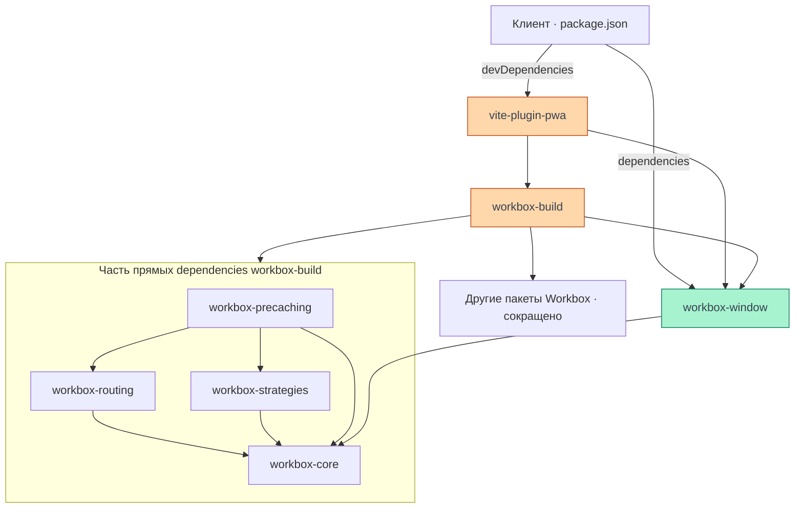
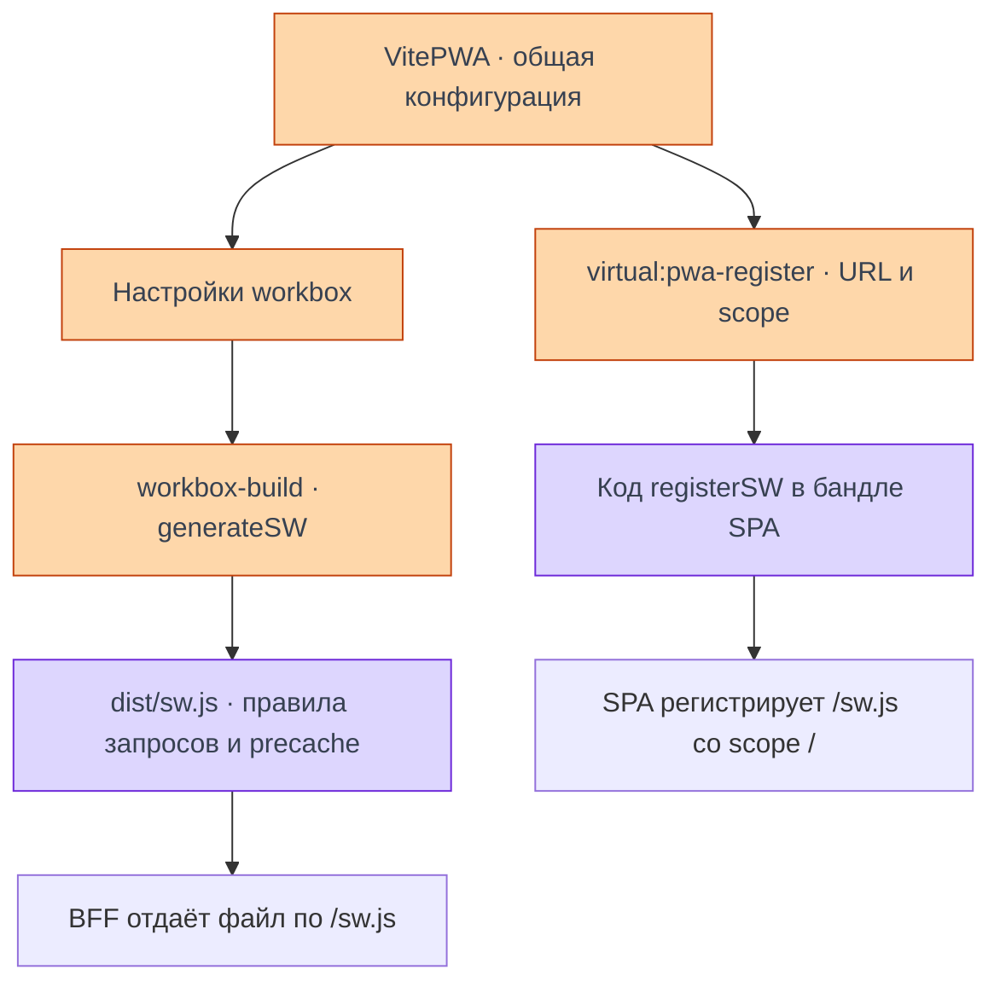
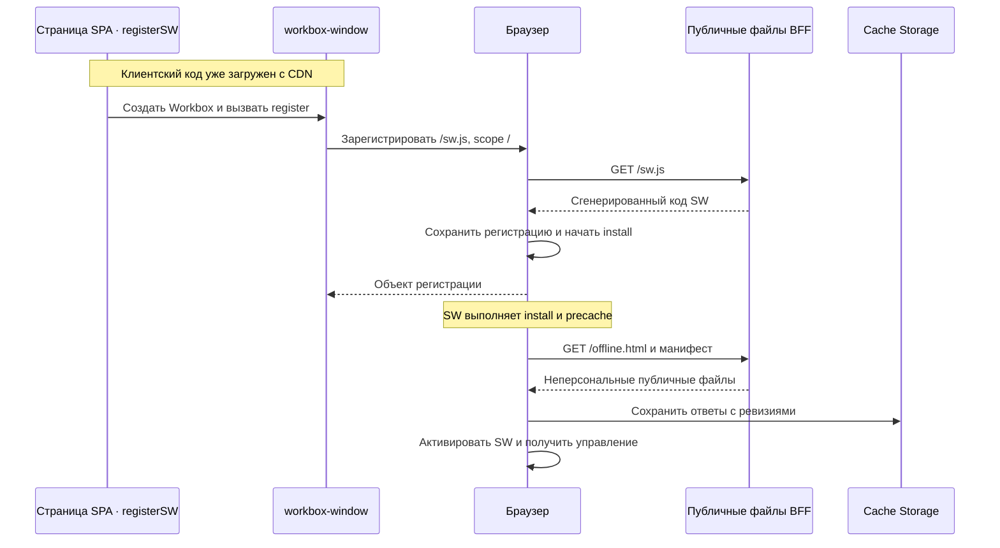

# Сборка и регистрация SW

Настройки сборки создают код Service Worker, а код страницы сообщает браузеру, где этот SW взять.
В Cellestial обе части связывает адрес `/sw.js`. Ниже — пакеты и путь от настройки до выполнения
по frontend `e3b327f58f8ef929afe0403ed7c7487abba2c48d`; наблюдения на проде и границы режима —
в [обзоре офлайн-режима](/documentation/offline/).

## Семейство Workbox

**Workbox — семейство npm-пакетов**, а не один скрипт, который целиком выполняется в браузере.
Сборщик использует одни пакеты, страница — другие, сгенерированный SW — нужные части третьих.

| Пакет | Где работает | Назначение в нашем устройстве |
| --- | --- | --- |
| `workbox-build` | При сборке | По настройкам создаёт SW и список предварительно сохраняемых файлов |
| `workbox-window` | На странице | Помогает регистратору подключить SW и отслеживать его жизненный цикл |
| `workbox-core` | На странице и в SW | Общие вспомогательные механизмы для других пакетов Workbox |
| `workbox-routing` | В SW | Выбирает обработчик для подходящего запроса |
| `workbox-strategies` | В SW | Даёт стратегию `NetworkOnly` для навигации |
| `workbox-precaching` | В SW | Управляет сохранением офлайн-страницы и манифеста с их ревизиями |

Другие пакеты решают дополнительные задачи: `workbox-expiration` ограничивает срок и число
записей, `workbox-background-sync` помогает с повтором запросов. Их наличие среди установленных
зависимостей не означает, что эти возможности включены в Cellestial.
[Модули Workbox](https://developer.chrome.com/docs/workbox/modules/).

## Прямые и транзитивные зависимости

В [package.json клиента](https://github.com/Cringe-Driven-Development-Team/frontend/blob/e3b327f58f8ef929afe0403ed7c7487abba2c48d/apps/client/package.json#L13-L30)
напрямую объявлены `workbox-window` в **dependencies** и `vite-plugin-pwa` в **devDependencies**.
Первый нужен клиентскому коду регистрации, второй подключается как инструмент Vite.

`workbox-build` объявлен в зависимостях самого `vite-plugin-pwa`. Bun устанавливает его
транзитивно: свой `package.json` есть у каждого пакета. `bun.lock` фиксирует версии и связи
всего получившегося дерева, а не только непосредственные зависимости проекта.

Ниже **упрощённый граф npm-зависимостей** для `vite-plugin-pwa@2.0.0` и Workbox `7.4.1`.
Стрелка означает «зависит от пакета или указанной группы пакетов»; это не порядок выполнения.
Пакеты без префикса Workbox и часть внутренних связей опущены.



Связи подтверждены [bun.lock выпуска](https://github.com/Cringe-Driven-Development-Team/frontend/blob/e3b327f58f8ef929afe0403ed7c7487abba2c48d/bun.lock#L1184-L1226)
и метаданными опубликованных пакетов:
[vite-plugin-pwa](https://registry.npmjs.org/vite-plugin-pwa/2.0.0),
[workbox-build](https://registry.npmjs.org/workbox-build/7.4.1),
[workbox-window](https://registry.npmjs.org/workbox-window/7.4.1).

**Установленный пакет не означает загруженный в браузер код.** В бандл попадают зависимости,
достижимые из импортов соответствующей точки входа, с учётом работы сборщика. Поле
`devDependencies` само по себе не является запретом на включение импортированного кода в бандл.
`workbox-build` выполняет сборочную работу; нужные модули Workbox включаются в полученный SW,
а `workbox-window` — в клиентский JS. Прямая зависимость клиента явно обеспечивает импорт из
виртуального модуля, не полагаясь на доступность чужих транзитивных пакетов.

## Что делает vite-plugin-pwa

`vite-plugin-pwa` связывает Vite с генерацией манифеста, SW и регистратора страницы. В режиме
**generateSW**, выбранном в этом выпуске по умолчанию, `workbox-build` создаёт `dist/sw.js`
по объекту `workbox`. Стратегии, условия обработки запросов, precache и его ревизии превращаются
в исполняемый JavaScript.

Плагин поддерживает и **injectManifest**: разработчик пишет SW, а инструменты внедряют список
precache в предусмотренную точку. Это другой способ подготовки файла, а не отдельная стратегия
ответа на сетевые запросы. Здесь используется generateSW.
[Режимы плагина](https://vite-pwa-org.netlify.app/guide/service-worker-strategies-and-behaviors),
[генерация SW](https://vite-pwa-org.netlify.app/workbox/generate-sw).

## Виртуальный модуль регистрации

В [src/serviceWorker.ts](https://github.com/Cringe-Driven-Development-Team/frontend/blob/e3b327f58f8ef929afe0403ed7c7487abba2c48d/apps/client/src/serviceWorker.ts#L1-L15)
используется импорт:

```ts [apps/client/src/serviceWorker.ts · импорт]
import { registerSW } from 'virtual:pwa-register';
```

`virtual:pwa-register` — модуль, который предоставляет Vite-плагин. Физического файла проекта
с таким именем нет: плагин перехватывает импорт и подставляет реализацию регистратора.
При сборке в неё попадают URL SW, scope и настройки поведения страницы.
Браузер не запрашивает `virtual:pwa-register` по сети — он получает уже собранный клиентский код.
[Виртуальные модули Vite](https://vite.dev/guide/api-plugin#virtual-modules-convention).

Внутри реализация загружает `workbox-window`, создаёт `Workbox` с подготовленным URL и вызывает
его регистрацию. Поэтому отдельный чанк `workbox-window.prod.es5-….js` в Network — ожидаемая
часть клиентской загрузки с CDN.
[Регистратор плагина](https://github.com/vite-pwa/vite-plugin-pwa/blob/35bfa7df1eeda2f906084833a7ff0f95689f77b3/src/client/build/register.ts#L37-L48),
[подстановка параметров](https://github.com/vite-pwa/vite-plugin-pwa/blob/35bfa7df1eeda2f906084833a7ff0f95689f77b3/src/modules.ts#L30-L41).

## Как связаны сборка и регистрация

Один экземпляр плагина подготавливает два результата: скрипт воркера и клиентский регистратор.
Они знают один публичный адрес `/sw.js`, но выполняются в разных контекстах.



Объект `workbox` при вызове `registerSW` **не передаётся** в браузер. Правила уже находятся
в коде `/sw.js`. Регистрация только связывает браузер с этим скриптом и его scope.

## Где настроен SW в Cellestial

В текущем описываемом выпуске конфигурация вынесена из основного Vite-файла в функцию:

| Файл | Обязанность |
| --- | --- |
| [vite.config.prod.ts](https://github.com/Cringe-Driven-Development-Team/frontend/blob/e3b327f58f8ef929afe0403ed7c7487abba2c48d/apps/client/vite.config.prod.ts#L1-L15) | Подключает общий конфиг и задаёт CDN base выпуска |
| [vite/shared.ts](https://github.com/Cringe-Driven-Development-Team/frontend/blob/e3b327f58f8ef929afe0403ed7c7487abba2c48d/apps/client/vite/shared.ts#L29-L40) | Включает `vitepwaPlugin` вместе с остальными плагинами |
| [vite/plugins.ts](https://github.com/Cringe-Driven-Development-Team/frontend/blob/e3b327f58f8ef929afe0403ed7c7487abba2c48d/apps/client/vite/plugins.ts#L31-L84) | Создаёт `VitePWA` с настройками Workbox и манифеста |
| [src/serviceWorker.ts](https://github.com/Cringe-Driven-Development-Team/frontend/blob/e3b327f58f8ef929afe0403ed7c7487abba2c48d/apps/client/src/serviceWorker.ts#L1-L15) | Вызывает `registerSW` из кода страницы |

| Настройка | Где используется | Какую задачу решает |
| --- | --- | --- |
| `workbox.globPatterns` | Сборка SW | Выбирает офлайн-страницу для precache; плагин также добавляет публичный манифест |
| `workbox.runtimeCaching` | Генерирует правила SW | Навигация — `NetworkOnly`, при сетевом отказе — сохранённая офлайн-страница |
| `workbox.inlineWorkboxRuntime` | Сборка SW | Включает используемый runtime Workbox в сам `sw.js`; это не отменяет отдельную библиотеку страницы |
| `workbox.skipWaiting` и `workbox.clientsClaim` | Установка и активация SW | Новая версия не остаётся ждать закрытия всех вкладок и получает управление страницами |
| `injectRegister` | Подготовка HTML/клиента | У нас автоматическая вставка отключена: используется явный вызов из `src/serviceWorker.ts` |
| `registerSW`: `immediate` | Страница | Начинает регистрацию, не ожидая события загрузки окна; не заменяет активацию SW |
| `registerSW`: `onNeedReload` | Страница | Пустой обработчик предотвращает стандартную перезагрузку плагина и сохраняет ввод |
| `registerSW`: `onRegisterError` | Страница | Сообщает об ошибке регистрации, не блокируя запуск SPA |

Немедленная активация SW и перезагрузка SPA — разные решения. В выбранном режиме SW не кеширует
JS/CSS SPA, поэтому смена его версии не требует перезагрузить редактор. Это описание реализации,
а не готовый конфиг для копирования в другую архитектуру.

## Что выполняется в браузере

Код SPA и `workbox-window` приходят с CDN и исполняются в контексте страницы Cellestial.
Браузер получает **сам SW с origin приложения**, от BFF: `https://cellestial.ru/sw.js`.
Scope равен `/`; CDN-префикс основного бандла этот адрес не меняет.



Объект регистрации ещё не доказывает успешного precache и управления текущей страницей.
Эти факты проверяются отдельно. BFF отдаёт файлы, а регистрацию выполняют код страницы и браузер.

Для обычной разработки `bun run dev` использует виртуальный модуль-заглушку без регистрации SW.
Для локальной проверки готовой сборки есть `bun run dev:pwa`; устройство команды описано в
[инструкции frontend](https://github.com/Cringe-Driven-Development-Team/frontend/blob/e3b327f58f8ef929afe0403ed7c7487abba2c48d/docs/local-development.md#L93-L116).
Реализованный офлайн-сценарий, проверенные наблюдения и ограничения — в
[обзоре](/documentation/offline/); исходная учебная задача — в [модуле 2](/modules/2/tracks/offline).
