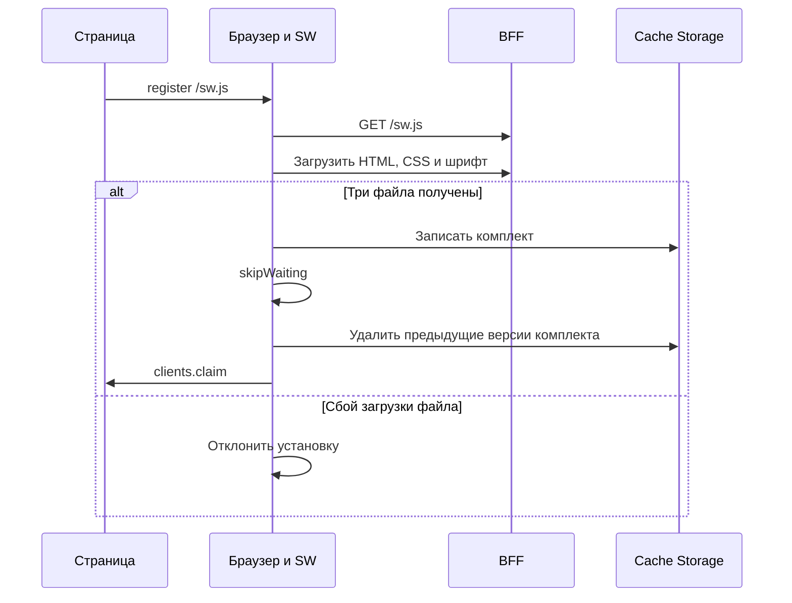

# Сборка и регистрация SW

Vite собирает `sw/sw.ts` в `dist/sw.js`. Клиент регистрирует `/sw.js` на origin приложения с областью действия (scope) `/`. Установка завершается после загрузки офлайн-комплекта. [Конфигурация сборки](https://github.com/Cringe-Driven-Development-Team/frontend/blob/b1baf996fb6753d1a62eab6f874d03dca30faadc/apps/client/vite.config.prod.ts#L18-L27), [регистрация](https://github.com/Cringe-Driven-Development-Team/frontend/blob/b1baf996fb6753d1a62eab6f874d03dca30faadc/apps/client/src/main.tsx#L39-L45), [обработчик установки](https://github.com/Cringe-Driven-Development-Team/frontend/blob/b1baf996fb6753d1a62eab6f874d03dca30faadc/apps/client/sw/sw.ts#L8-L19).

## Точка входа Service Worker {#где-настроен-sw-в-cellestial}

`vite.config.prod.ts` передаёт Vite две точки входа. Из `index.html` собирается приложение с хешированными JS-чанками в `assets/`. Имя второго входа `sw` задаёт постоянный путь `dist/sw.js`. Офлайн-страница, CSS и шрифт лежат в `apps/client/public/` и попадают в образ BFF вместе со скриптом SW. [Точки входа](https://github.com/Cringe-Driven-Development-Team/frontend/blob/b1baf996fb6753d1a62eab6f874d03dca30faadc/apps/client/vite.config.prod.ts#L19-L27), [файлы образа BFF](https://github.com/Cringe-Driven-Development-Team/frontend/blob/b1baf996fb6753d1a62eab6f874d03dca30faadc/apps/bff/Dockerfile#L8-L13).

## Зависимости {#прямые-и-транзитивные-зависимости}

SW использует браузерные API `fetch`, Cache Storage и `clients.claim()`. Сборку выполняет Vite из `devDependencies` клиента. [Код SW](https://github.com/Cringe-Driven-Development-Team/frontend/blob/b1baf996fb6753d1a62eab6f874d03dca30faadc/apps/client/sw/sw.ts#L1-L52), [скрипты и зависимости](https://github.com/Cringe-Driven-Development-Team/frontend/blob/b1baf996fb6753d1a62eab6f874d03dca30faadc/apps/client/package.json#L5-L27).

### Workbox в учебной документации {#семеиство-workbox}

[Описание пакетов Workbox](/modules/2/tracks/offline/theory#workbox) хранится в учебном треке. В выложенной версии точка входа SW использует браузерные API напрямую. [Обработчики SW](https://github.com/Cringe-Driven-Development-Team/frontend/blob/b1baf996fb6753d1a62eab6f874d03dca30faadc/apps/client/sw/sw.ts#L1-L52).

### Настройка вместо плагина PWA {#что-делает-vite-plugin-pwa}

В выложенной сборке файл SW создаёт обычный entrypoint Vite, а манифест подключён тегом `link` из HTML. Варианты генерации через плагин описаны в [учебном разделе](/modules/2/tracks/offline/theory#vite-plugin-pwa). [Конфигурация Vite](https://github.com/Cringe-Driven-Development-Team/frontend/blob/b1baf996fb6753d1a62eab6f874d03dca30faadc/apps/client/vite.config.prod.ts#L19-L28), [ссылка на манифест](https://github.com/Cringe-Driven-Development-Team/frontend/blob/b1baf996fb6753d1a62eab6f874d03dca30faadc/apps/client/index.html#L8-L10).

## Регистрация в клиенте {#виртуальныи-модуль-регистрации}

`src/main.tsx` вызывает `navigator.serviceWorker.register` напрямую, если `import.meta.env.DEV` выключен и браузер предоставляет `navigator.serviceWorker`. Запрос регистрации использует `/sw.js` и scope `/`. Обработка ошибки пишет сообщение в консоль, а старт приложения не ждёт ответа регистрации. [Код регистрации и рендера](https://github.com/Cringe-Driven-Development-Team/frontend/blob/b1baf996fb6753d1a62eab6f874d03dca30faadc/apps/client/src/main.tsx#L39-L48).

## Установка и активация {#как-связаны-сборка-и-регистрация}

<DiagramSection>

1. Браузер получает `/sw.js` и запускает `install`. `cache.addAll` загружает `/offline.html`, `/offline.css` и `/onest-variable.woff2`. Ошибка загрузки отклоняет установку. После успешной загрузки SW вызывает `skipWaiting()`. [Установка](https://github.com/Cringe-Driven-Development-Team/frontend/blob/b1baf996fb6753d1a62eab6f874d03dca30faadc/apps/client/sw/sw.ts#L3-L19).
2. При `activate` SW удаляет кэши с префиксом `cellestial-offline-`, кроме текущего `CACHE_NAME`, и вызывает `clients.claim()` для вкладок своего scope. [Активация](https://github.com/Cringe-Driven-Development-Team/frontend/blob/b1baf996fb6753d1a62eab6f874d03dca30faadc/apps/client/sw/sw.ts#L21-L35).
3. Для новой версии офлайн-комплекта поднимите версию `CACHE_NAME` при изменении HTML, CSS или шрифта. Это меняет байты SW и отделяет новую копию комплекта от действующей до активации. Браузер применит новый SW после успешной установки при своей проверке на обновление. [Версия кэша и жизненный цикл](https://github.com/Cringe-Driven-Development-Team/frontend/blob/b1baf996fb6753d1a62eab6f874d03dca30faadc/apps/client/sw/sw.ts#L3-L35).

<template #diagram>

</template>

</DiagramSection>

## Проверка в браузере {#что-выполняется-в-браузере}

1. В корне frontend выполните `bun run preview` и откройте `http://localhost:4173/login`. Команда собирает production-клиент и запускает BFF на том же origin, где отдаёт и клиентские ассеты. В `bun run dev` регистрация отключена. [Команда preview в main](https://github.com/Cringe-Driven-Development-Team/frontend/blob/68ffe99600f8ea66765972c6bf963c47aafad626/scripts/dev/preview.ts#L1-L29), [условие регистрации](https://github.com/Cringe-Driven-Development-Team/frontend/blob/b1baf996fb6753d1a62eab6f874d03dca30faadc/apps/client/src/main.tsx#L39-L45).
2. В DevTools → Application → Service Workers проверьте активный `/sw.js` и scope `/`. У открытой страницы проверьте `navigator.serviceWorker.controller`.
3. В Application → Cache Storage проверьте три файла комплекта. Для проверки ответа после отключения сети используйте [гостевой сценарий](/documentation/offline/). Маршруты файлов перечислены в [инфраструктуре PWA](/documentation/offline/infrastructure).
