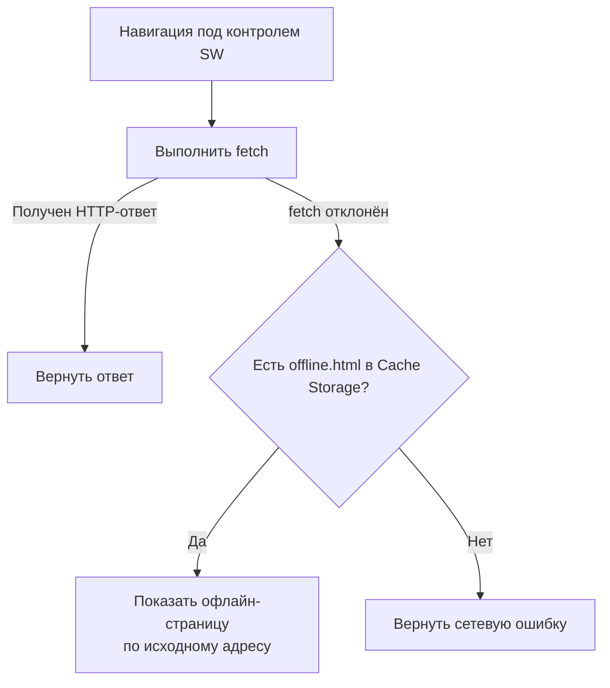

# Офлайн-режим

При сетевом отказе во время открытия или перезагрузки страницы Cellestial показывает «Нет подключения к интернету» по исходному адресу, если браузер успел активировать Service Worker (SW) и сохранить офлайн-комплект. Для уже открытой страницы потеря сети сама по себе не запускает навигацию. [Обработка навигации](https://github.com/Cringe-Driven-Development-Team/frontend/blob/b1baf996fb6753d1a62eab6f874d03dca30faadc/apps/client/sw/sw.ts#L37-L52), [обработка потери сети в приложении](https://github.com/Cringe-Driven-Development-Team/frontend/blob/b1baf996fb6753d1a62eab6f874d03dca30faadc/apps/client/src/stores/connection.ts#L34-L57).

## Как работает Cellestial

<DiagramSection>

| Ситуация | Что произойдёт |
| --- | --- |
| Первый визит без сети | Браузер ещё не установил SW и показывает собственную ошибку сети |
| Открытие или перезагрузка после установки, получен сетевой ответ | SW возвращает этот ответ, включая HTTP 404 или 503 |
| Открытие или перезагрузка после установки, сетевой отказ | SW возвращает сохранённый `/offline.html`. При отсутствии записи возвращает `Response.error()` |
| Сеть пропала в уже открытой вкладке | Уже отрисованный экран может оставаться видимым. Сохранение через BFF требует сетевого ответа с подтверждением. Офлайн-комплект не хранит данные блокнота |

Запись ячейки идёт через BFF. Пока результат сохранения не подтверждён, оставьте вкладку открытой. Черновики хранятся в памяти вкладки, и перезагрузка их сбрасывает. [Запрос на запись](https://github.com/Cringe-Driven-Development-Team/frontend/blob/b1baf996fb6753d1a62eab6f874d03dca30faadc/apps/client/src/stores/notebook/index.ts#L433-L447), [применение ответа](https://github.com/Cringe-Driven-Development-Team/frontend/blob/b1baf996fb6753d1a62eab6f874d03dca30faadc/apps/client/src/stores/notebook/index.ts#L492-L503), [хранение черновиков](https://github.com/Cringe-Driven-Development-Team/frontend/blob/b1baf996fb6753d1a62eab6f874d03dca30faadc/apps/client/src/stores/notebook/index.ts#L184-L194).

В открытой SPA потеря сети показывает предупреждение. Сигнал `online` запускает запрос к BFF, а предупреждение снимается после полного HTTP-ответа. Тогда появляется тост «Соединение восстановлено». [Предупреждение в макете](https://github.com/Cringe-Driven-Development-Team/frontend/blob/b1baf996fb6753d1a62eab6f874d03dca30faadc/apps/client/src/layouts/RootLayout.tsx#L8-L21), [проверка соединения](https://github.com/Cringe-Driven-Development-Team/frontend/blob/b1baf996fb6753d1a62eab6f874d03dca30faadc/apps/client/src/stores/connection.ts#L16-L20), [запрос и обработка ответа](https://github.com/Cringe-Driven-Development-Team/frontend/blob/b1baf996fb6753d1a62eab6f874d03dca30faadc/apps/client/src/stores/connection.ts#L30-L56).

«Повторить» на офлайн-странице заново открывает текущий адрес. Страница загружает отдельный CSS, который использует локальную копию Onest. [HTML офлайн-страницы](https://github.com/Cringe-Driven-Development-Team/frontend/blob/b1baf996fb6753d1a62eab6f874d03dca30faadc/apps/client/public/offline.html#L5-L8), [ссылка «Повторить»](https://github.com/Cringe-Driven-Development-Team/frontend/blob/b1baf996fb6753d1a62eab6f874d03dca30faadc/apps/client/public/offline.html#L81-L86), [шрифт](https://github.com/Cringe-Driven-Development-Team/frontend/blob/b1baf996fb6753d1a62eab6f874d03dca30faadc/apps/client/public/offline.css#L3-L8).

| Ресурс | Сохраняется в Cache Storage SW |
| --- | --- |
| `/offline.html` | Да |
| `/offline.css` | Да |
| `/onest-variable.woff2` | Да |
| Персональный HTML BFF | Нет |
| Запросы к HTTP API BFF | Нет |
| Манифест и иконки | Нет |
| JS/CSS и остальные ассеты SPA | Нет |

Офлайн-комплект создаётся при установке. Для обычных запросов приложения (включая API) SW не вызывает `respondWith`. [Список файлов и установка](https://github.com/Cringe-Driven-Development-Team/frontend/blob/b1baf996fb6753d1a62eab6f874d03dca30faadc/apps/client/sw/sw.ts#L3-L19), [условие перехвата GET](https://github.com/Cringe-Driven-Development-Team/frontend/blob/b1baf996fb6753d1a62eab6f874d03dca30faadc/apps/client/sw/sw.ts#L37-L50).

<template #diagram>

</template>

</DiagramSection>

## Где хранится Service Worker

Браузер хранит регистрацию для origin и scope отдельно от вкладок. Закрытие вкладки само по себе не удаляет регистрацию. Браузер может выгружать контекст SW между событиями. [Жизненный цикл Service Worker](https://developer.mozilla.org/en-US/docs/Web/API/Service_Worker_API).

## Три механизма хранения

| Механизм | Что хранит |
| --- | --- |
| HTTP-кеш | Сетевые ответы по HTTP-политике, например чанки клиента |
| Регистрация SW | Скрипт SW и область действия |
| Cache Storage | Пары `Request` / `Response`, которыми управляет SW, в Cellestial это офлайн-комплект |

[Обзор Service Worker API](https://developer.mozilla.org/en-US/docs/Web/API/Service_Worker_API), [офлайн-комплект Cellestial](https://github.com/Cringe-Driven-Development-Team/frontend/blob/b1baf996fb6753d1a62eab6f874d03dca30faadc/apps/client/sw/sw.ts#L3-L19).

## Disable cache и обновление SW

Chrome DevTools → Network → Disable cache отключает HTTP-кеш при открытых DevTools. Для проверки установленного SW и Cache Storage используйте Application. Update on reload меняет обычный порядок проверки обновлений, поэтому при проверке поведения пользователя оставьте этот флажок выключенным. [Справка Chrome DevTools](https://developer.chrome.com/docs/devtools/progressive-web-apps#service-workers). В Cellestial новую версию комплекта задаёт `CACHE_NAME`. [Сборка и активация](/documentation/offline/build-and-registration).

## Проверка на проде

**28.11.2026, 01:53:53–01:53:55 UTC+3**, Chrome Headless 154.0.8037.57, чистые контексты без сессии. SHA из URL чанков в HTML `/login` — `b1baf996fb6753d1a62eab6f874d03dca30faadc`. Сеть отключалась отдельно у вкладки и SW, HTTP-кеш был отключён.

| Действие | Результат |
| --- | --- |
| В новом контексте отключить сеть и открыть `/login` | `ERR_INTERNET_DISCONNECTED` |
| Открыть `/login` с сетью и дождаться контроллера | Форма «Вход», контроллер `https://cellestial.ru/sw.js`, scope `https://cellestial.ru/`. В `cellestial-offline-v1` три файла из таблицы выше |
| Отключить сеть, открытая вкладка остаётся без перезагрузки | Форма «Вход» остаётся на экране |
| Перезагрузить `/login` | URL сохранён. SW вернул HTML, CSS и шрифт со статусом 200. Заголовок «Нет подключения к интернету», шрифт Onest доступен |
| Включить сеть и нажать «Повторить» | Снова открылась форма входа по `/login` |

Адреса и HTTP-проверка файлов приведены в [инфраструктуре PWA](/documentation/offline/infrastructure).

## Границы проверки

Авторизованное сохранение, доступность Go, предупреждение о сети и тост восстановления, установка приложения как PWA, обновление между выпусками и другие браузеры, включая Safari, в этом прогоне не проверялись. При удалении Cache Storage без сети активный SW вернёт ошибку при отсутствии записи fallback. [Обработка отсутствующего файла](https://github.com/Cringe-Driven-Development-Team/frontend/blob/b1baf996fb6753d1a62eab6f874d03dca30faadc/apps/client/sw/sw.ts#L45-L50).
