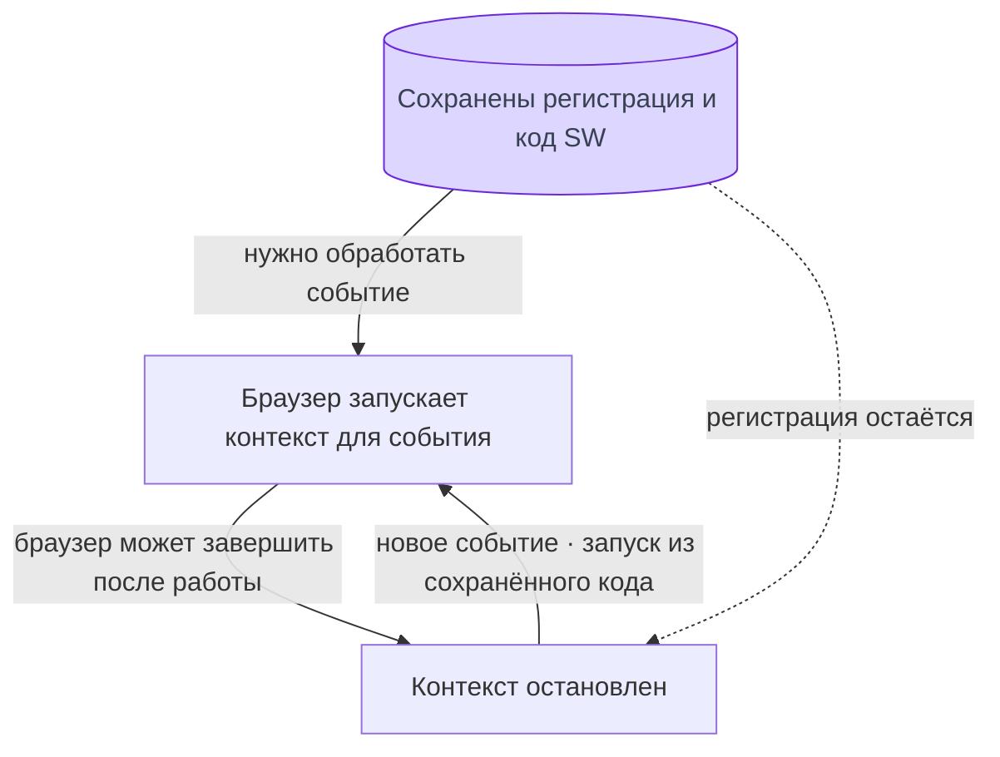
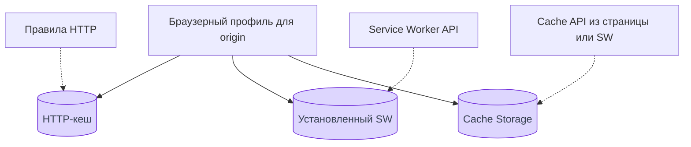
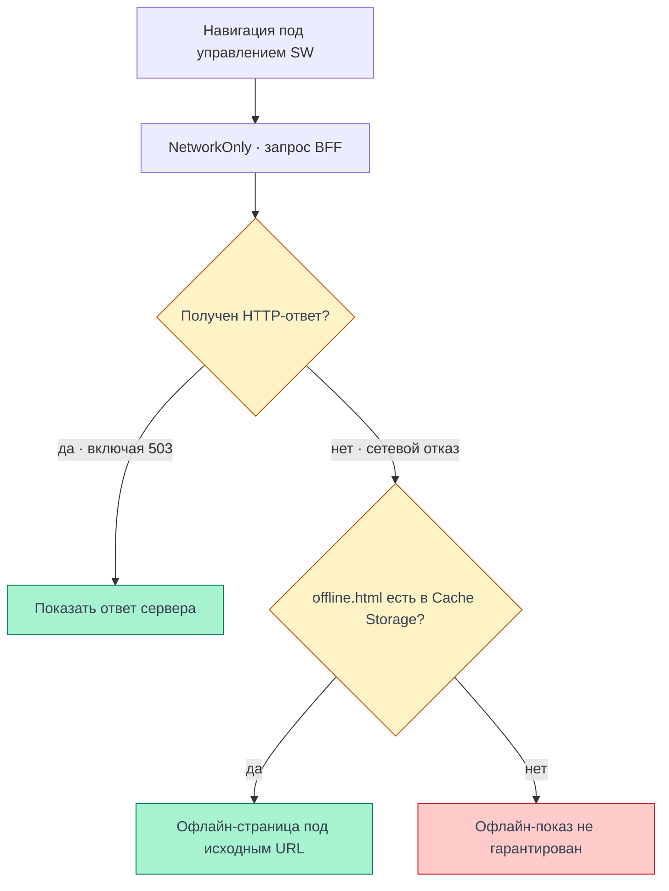

# Офлайн-режим

Как получаются файлы и подключается SW, разобрано на странице
[Сборка и регистрация SW](/documentation/offline/build-and-registration).

При повторном открытии Cellestial без сети браузер показывает заранее сохранённую неперсональную
офлайн-страницу. Личные данные и редактор без сервера недоступны. Здесь объясняется, где хранится
Service Worker (SW), чем отличаются три механизма хранения и что подтверждено на проде.

<DiagramSection>

## Где хранится Service Worker

После установки браузер сохраняет **регистрацию и код SW** во внутреннем хранилище браузерного
профиля. Регистрация связывает origin, scope и URL скрипта. Это не файл приложения в `localStorage`
и не запись, которую наш код добавляет в Cache Storage. Конкретное размещение файлов на диске —
внутреннее устройство браузера, а не API приложения.

Сохранённый SW и выполняющийся контекст — разные вещи. Браузер может остановить контекст между
событиями, а затем запустить его снова из сохранённого кода. Новое открытие вкладки не требует
переустановки SW с нуля. Переменные остановленного контекста при этом не становятся постоянным
хранилищем. [Хранение регистрации и время жизни контекста — Chromium](https://chromium.googlesource.com/chromium/src/+/main/docs/security/service-worker-security-faq.md).

<template #diagram>

</template>

SW нужен безопасный контекст: HTTPS или допустимый локальный адрес разработки. Origin и scope
определяют управляемые страницы. Установка PWA в отдельное окно и установка SW — самостоятельные
процессы: наличие значка установки ещё не доказывает готовность офлайн-режима.
[Условия регистрации — MDN](https://developer.mozilla.org/en-US/docs/Web/API/ServiceWorkerContainer/register).

</DiagramSection>

<DiagramSection>

## Три механизма хранения

| Механизм | Что хранит | Кто управляет | Где смотреть в DevTools |
| --- | --- | --- | --- |
| HTTP-кеш | Полученные по HTTP ресурсы и сведения об их свежести | Браузер по HTTP-правилам, включая `Cache-Control` | Network: источник ответа и заголовки |
| Установленный Service Worker | Регистрацию, scope и установленный код SW | Браузер через Service Worker API | Application → Service workers |
| Cache Storage | Именованные кеши с парами Request / Response | Страница или SW через Cache API; у нас — сгенерированный SW | Application → Cache storage |

<template #diagram>

</template>

В Cache Storage ключом служит запрос, а значением — сохранённый ответ с телом и заголовками.
Записи не обновляются и не удаляются по правилам HTTP-кеша автоматически. Даже
`Cache-Control: no-store` не заменяет явного запрета сохранять личный ответ через Cache API.
Браузер и пользователь могут удалить локальные данные; постоянную сохранность обещать нельзя.
[Cache API — MDN](https://developer.mozilla.org/en-US/docs/Web/API/Cache),
[HTTP-кеш — MDN](https://developer.mozilla.org/en-US/docs/Web/HTTP/Guides/Caching).

</DiagramSection>

## Disable cache и обновление SW

Флажок **Network → Disable cache** отключает использование обычного HTTP-кеша при открытых
DevTools. Он **не удаляет** установленный SW и записи Cache Storage. Поэтому отключённый HTTP-кеш
совместим с уже существующей регистрацией и сохранённой офлайн-страницей.
[Отключение HTTP-кеша — Chrome DevTools](https://developer.chrome.com/docs/devtools/network/reference).

Использование установленного SW и проверка новой версии — отдельные операции. Браузер проверяет
обновления, в том числе при навигации в scope. Если содержимое скрипта изменилось, начинается
установка новой версии. Отсутствие строки `sw.js` в конкретном списке Network само по себе
не доказывает ни отсутствие регистрации, ни отсутствие фоновых проверок.
[Обновления SW — Chrome](https://developer.chrome.com/docs/workbox/service-worker-lifecycle).

Для проверки последовательно:

1. Открой **Application → Service workers**: проверь URL, scope, активную версию и управление страницей.
2. В **Cache storage** отдельно проверь сохранённые ответы. Сам `sw.js` там искать не нужно.
3. Для отладки обновлений включи **Update on reload**. Это специальный режим жизненного цикла,
   который повторно получает и устанавливает SW при перезагрузках; после проверки выключи его.
4. При проверке офлайна отключай сеть также для запросов самого SW. Во время описанного ниже прогона
   сеть была отключена для страницы и контекста SW; отсутствие сети у одной страницы не считалось
   доказательством отказа запросов воркера.

**Unregister** удаляет регистрацию SW, а очистка **Cache storage** удаляет сохранённые ответы.
Это разные действия. Для полного сброса данных выбранного сайта есть **Clear storage**.
[Инструменты проверки PWA — Chrome DevTools](https://developer.chrome.com/docs/devtools/progressive-web-apps).

<DiagramSection>

## Как работает Cellestial

Клиент остаётся SPA с server bootstrap: BFF формирует HTML с начальными данными до первого рендера,
а JS/CSS приходят с CDN. Полный запуск редактора офлайн здесь не обещается. В коде проверенного
выпуска выбрана отдельная страница, которой не нужны сессия, bootstrap и файлы SPA.

BFF публично отдаёт `/sw.js`, `/offline.html` и манифест перед обработчиком персонального HTML:
[список файлов](https://github.com/Cringe-Driven-Development-Team/frontend/blob/e3b327f58f8ef929afe0403ed7c7487abba2c48d/apps/bff/src/public.ts#L7-L15),
[порядок маршрутов](https://github.com/Cringe-Driven-Development-Team/frontend/blob/e3b327f58f8ef929afe0403ed7c7487abba2c48d/apps/bff/src/app.ts#L47-L55).

| Ресурс | В Cache Storage | Поведение реализованного SW |
| --- | --- | --- |
| Персональный HTML BFF | Нет | Навигация через сеть; при сетевом отказе — неперсональная подстановка |
| RPC / API | Нет | Ответы не сохраняются, HTML офлайн-страницы вместо RPC не возвращается |
| `offline.html` | Да | Заранее сохраняется при установке SW |
| `manifest.webmanifest` | Да | Плагин добавляет публичный манифест в precache |
| JS/CSS и остальные ассеты SPA | Нет | Обычная загрузка с CDN; HTTP-кеш рассматривается отдельно |

Для навигации используется **NetworkOnly** с офлайн-подстановкой при отказе сети. Полученный
HTTP-ответ, включая `503`, остаётся ответом сервера: статус ошибки и сетевой отказ различаются.
Правила заданы в [конфигурации сборки SW](https://github.com/Cringe-Driven-Development-Team/frontend/blob/e3b327f58f8ef929afe0403ed7c7487abba2c48d/apps/client/vite/plugins.ts#L43-L62).

<template #diagram>

</template>

В уже открытой SPA отказ соединения показывает предупреждение поверх текущего экрана. По коду
выпуска его снимает только полностью полученный ответ BFF; событие `online` запускает проверку,
а переход к доступному BFF показывает краткий тост «Соединение восстановлено».
[Учёт состояния соединения](https://github.com/Cringe-Driven-Development-Team/frontend/blob/e3b327f58f8ef929afe0403ed7c7487abba2c48d/apps/client/src/stores/connection.ts#L16-L50).

</DiagramSection>

## Проверка на проде

**02.11.2026, 01:46 UTC+3**, Chrome на Ubuntu, чистый браузерный профиль, гостевой сценарий
на [cellestial.ru](https://cellestial.ru). SHA из HTML:
`e3b327f58f8ef929afe0403ed7c7487abba2c48d`.

| Сценарий | Наблюдение |
| --- | --- |
| Открытие с сетью | Форма входа отрисована; `/sw.js` активен, scope `/`, страница имеет controller |
| Проверка Cache Storage | Только `offline.html` и `manifest.webmanifest` с ревизиями precache |
| Манифест | Chrome не сообщил ошибок манифеста и критериев установки |
| Сеть отключена у страницы и SW, повторное открытие `/login` | Офлайн-страница под тем же URL; ноль скриптов и внешних ресурсов |
| Сеть восстановлена, нажато «Повторить» | Форма входа снова отрисована |

Отдельно **02.11.2026, 00:28 UTC+3**, на том же SHA: в графическом Chrome подтверждён нативный
диалог Install. Результат выбора — `accepted`; приложение открылось отдельным окном,
`display-mode: standalone` подтвердился, окно управлялось `https://cellestial.ru/sw.js`.
Временный профиль и созданные для проверки файлы интеграции с ОС удалены.

## Границы проверки

- Проверен гостевой сценарий Chrome на Ubuntu. Safari, iOS, Android и другие браузеры этим прогоном не подтверждены.
- Авторизованные операции, данные блокнотов и доступность Go API здесь не проверялись.
- Обновление между двумя продовыми выпусками и тост восстановления соединения этим гостевым
  прогоном не проверялись; выше их устройство описано по коду конкретного SHA.
- Первый визит без сети, удаление регистрации или кеша, незавершённая установка SW не гарантируют офлайн-страницу.
- Офлайн-страница не предоставляет личные данные и не ставит действия пользователя в очередь.

Учебный замысел и вопросы для самостоятельной реализации сохранены в
[треке второго модуля](/modules/2/tracks/offline).
