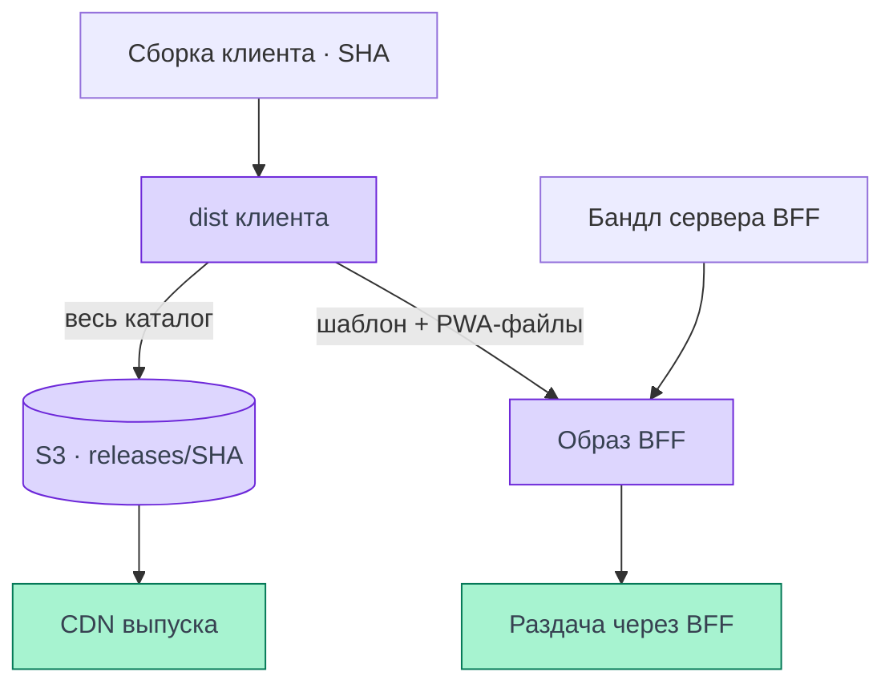
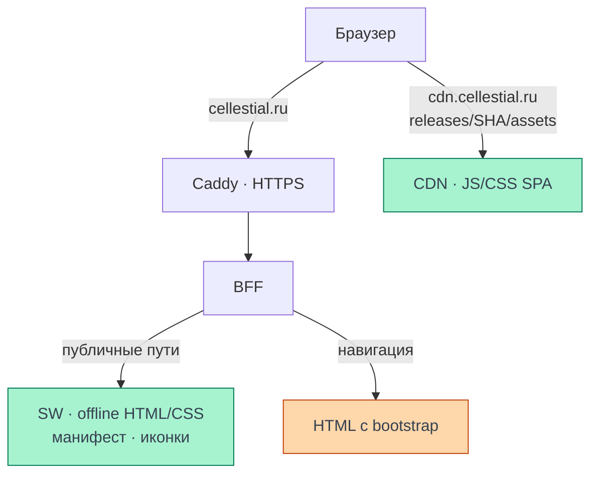

# Инфраструктура PWA

PWA-файлы Cellestial выпускаются вместе с клиентом и BFF. Браузер получает SW, офлайн-страницу,
её CSS, манифест и иконки с `cellestial.ru`, а JS/CSS основной SPA — с CDN своего выпуска.
Здесь показаны размещение, HTTP-раздача и путь CI/CD; механизм регистрации разобран в
[сборке и регистрации SW](/documentation/offline/build-and-registration), поведение без сети —
в [обзоре офлайн-режима](/documentation/offline/).

<DiagramSection>

## Где лежат файлы

У сборки клиента есть два пути публикации. Весь `apps/client/dist` попадает в S3-каталог
`releases/<sha>/`, который служит источником CDN. Шаблон `index.html` и выбранные PWA-файлы
также копируются в образ BFF вместе с серверным бандлом. Поэтому один файл может иметь копию
и в бакете, и внутри образа; место хранения ещё не определяет URL запроса браузера.

`index.html` сборки — неперсональный шаблон. BFF формирует из него HTML с bootstrap для
конкретного запроса. Публичная копия шаблона в бакете не становится кешем персонального HTML.

Пути подтверждают [загрузка dist в S3](https://github.com/Cringe-Driven-Development-Team/frontend/blob/007d8d4de7fa964947ffe1316c31726bbd386903/scripts/release/upload.ts#L38-L74)
и [состав образа BFF](https://github.com/Cringe-Driven-Development-Team/frontend/blob/007d8d4de7fa964947ffe1316c31726bbd386903/apps/bff/Dockerfile#L8-L12).
Общая инфраструктура описана в [архитектуре сервиса](/documentation/architecture/).

<template #diagram>

</template>

</DiagramSection>

<DiagramSection>

## Откуда их получает браузер

При доступной сети браузер обращается к двум публичным адресам. Caddy принимает HTTPS-запросы
`cellestial.ru` и передаёт их BFF. BFF отдаёт файлы из явного списка до обработчика HTML
с начальными данными пользователя. Релизные JS/CSS основной SPA браузер получает напрямую
с `cdn.cellestial.ru`.

В таблице пути `/...` относятся к `https://cellestial.ru`; строка CDN — к
`https://cdn.cellestial.ru`.

| Файл сборки | Публичный путь | Кто отвечает | Назначение |
| --- | --- | --- | --- |
| `sw.js` | `/sw.js` | Caddy → BFF | Скрипт зарегистрированного SW |
| `offline.html` | `/offline.html` | Caddy → BFF | Неперсональная подстановка при отказе навигации |
| `offline.css` | `/offline.css` | Caddy → BFF | Стили отдельной офлайн-страницы |
| `manifest.webmanifest` | `/manifest.webmanifest` | Caddy → BFF | Метаданные установки и запуска PWA |
| PNG-иконки | `/pwa-192.png`, `/pwa-512.png`, `/pwa-maskable-512.png`, `/apple-touch-icon.png` | Caddy → BFF | Иконки приложения |
| `assets/...` | `/releases/<sha>/assets/...` | CDN | JS/CSS основной SPA и её релизные ассеты |

Состав задаёт [PUBLIC_FILES](https://github.com/Cringe-Driven-Development-Team/frontend/blob/007d8d4de7fa964947ffe1316c31726bbd386903/apps/bff/src/public.ts#L7-L16),
порядок обработки — [публичные маршруты BFF](https://github.com/Cringe-Driven-Development-Team/frontend/blob/007d8d4de7fa964947ffe1316c31726bbd386903/apps/bff/src/app.ts#L47-L56).
Проксирование и HTTPS описаны в [шаблоне Caddy](https://github.com/Cringe-Driven-Development-Team/infra/blob/adf48242b0aa5d43ae9e59e6c088c7a4a0185387/ansible/roles/caddy/templates/Caddyfile.j2#L18-L44).
Это исследованная ревизия конфигурации infra; её фактическая выкладка этим чтением кода не подтверждается.

<template #diagram>

</template>

</DiagramSection>

## Origin, scope и заголовки

Для регистрации SW нужен безопасный контекст. Скрипт и scope должны иметь тот же origin,
что и регистрирующая страница. Поэтому наш адрес — `https://cellestial.ru/sw.js`, scope — `/`:
основной CDN-префикс клиента его не меняет. Расположение скрипта в корне позволяет этот scope
без расширяющего заголовка `Service-Worker-Allowed`.
[Правила регистрации и scope — MDN](https://developer.mozilla.org/en-US/docs/Web/API/ServiceWorkerContainer/register).

Раздача манифеста и иконок с origin — выбранное устройство проекта. У манифеста возможна
загрузка с другого origin при соблюдении CORS; запрет регистрации чужого SW нельзя переносить
на все PWA-файлы. [Манифест и CORS — W3C](https://www.w3.org/TR/appmanifest/).

Корректный `Content-Type` позволяет браузеру распознать JS, CSS, манифест и изображения.
На origin Caddy дополнительно задаёт `X-Content-Type-Options: nosniff`: браузер не должен
угадывать тип вместо объявленного. Файл `sw.js`, случайно обслуженный HTML-обработчиком,
не становится рабочим SW из-за успешного статуса 200.
[Заголовок в конфигурации Caddy](https://github.com/Cringe-Driven-Development-Team/infra/blob/adf48242b0aa5d43ae9e59e6c088c7a4a0185387/ansible/roles/caddy/templates/Caddyfile.j2#L19-L24).

HTTP-кеш и Cache Storage управляются разными правилами. Отсутствие `Cache-Control` не означает
`no-store` и не запрещает сохранение ответа SW. У нас список precache отдельно выбирает
`offline.html` и `offline.css`; плагин добавляет манифест. Личные HTML/RPC в этот комплект
не включены. [Настройки Workbox](https://github.com/Cringe-Driven-Development-Team/frontend/blob/007d8d4de7fa964947ffe1316c31726bbd386903/apps/client/vite/plugins.ts#L43-L62),
[HTTP-политика Cache-Control — MDN](https://developer.mozilla.org/en-US/docs/Web/HTTP/Reference/Headers/Cache-Control).

## Что наблюдается на проде

**04.11.2026, 17:46:43 UTC+3**: GET без авторизации на `cellestial.ru` и CDN выпуска.
SHA из HTML: `007d8d4de7fa964947ffe1316c31726bbd386903`. Проверены восемь публичных файлов
origin из списка BFF и реальные JS/CSS-чанки, указанные в HTML этого выпуска.

| Ресурс | HTTP | Content-Type | Cache-Control |
| --- | --- | --- | --- |
| `/sw.js` | 200 | `text/javascript;charset=utf-8` | Не задан |
| `/offline.html` | 200 | `text/html;charset=utf-8` | Не задан |
| `/offline.css` | 200 | `text/css;charset=utf-8` | Не задан |
| `/manifest.webmanifest` | 200 | `application/manifest+json` | Не задан |
| Все четыре PNG из таблицы выше | 200 каждый | `image/png` | Не задан |
| JS/CSS с CDN выпуска | 200 каждый | `text/javascript; charset=utf-8` / `text/css; charset=utf-8` | `max-age=86400` |

Во всех восьми ответах origin присутствовал `nosniff`, отсутствовал `Service-Worker-Allowed`.
CSP пришла как **Content-Security-Policy-Report-Only**; блокирующего `Content-Security-Policy`
не было. Report-Only позволяет обнаруживать нарушения, но не блокирует их по этой политике.
Успешные GET не доказывают готовность текущих правил к включению enforcement.
[Смысл Report-Only — MDN](https://developer.mozilla.org/en-US/docs/Web/HTTP/Reference/Headers/Content-Security-Policy-Report-Only),
[CSP в проекте](/documentation/security/csp).

Уровни HTTP-политики различаются: загрузчик записывает в S3 для файлов кроме `index.html`
метаданные `public, max-age=31536000, immutable`, а проверенные ответы CDN содержали
`max-age=86400`. Метаданные объекта не заменяют измерение заголовка на выходе CDN.
[Значения метаданных](https://github.com/Cringe-Driven-Development-Team/frontend/blob/007d8d4de7fa964947ffe1316c31726bbd386903/scripts/release/s3.ts#L13-L15),
[применение при загрузке](https://github.com/Cringe-Driven-Development-Team/frontend/blob/007d8d4de7fa964947ffe1316c31726bbd386903/scripts/release/upload.ts#L63-L74).

Полученный `offline.html` ссылался на `/offline.css`; в полученном CSS внешних `url(...)`
не было. Этот прогон подтверждает раздачу файлов и заголовки. Установка PWA, работа без сети,
авторизованные операции и обновление между выпусками здесь повторно не проверялись.
Прежнее свидетельство гостевого офлайн-сценария и установки сохранено в
[обзоре](/documentation/offline/) со своей датой и SHA.

## Как выпускается новая версия

После Check на push в `main` CI публикует файлы клиента в S3/CDN, публичный BFF-образ
в GHCR и GitHub Release с четырьмя Assets. HTML и публичные PWA-файлы входят в образ;
ссылки на JS/CSS ведут в неизменяемый каталог `releases/<SHA>/`.
[Состав выпуска и маршруты доставки](/documentation/frontend/releases/artifacts).

Ручной CD выбирает опубликованный Release, проверяет manifest, образ и CDN, затем
передаёт digest и SHA в Ansible из актуального `infra/main`. Переключение BFF возвращает
HTML и PWA-файлы выбранного выпуска; обновление уже установленного service worker
зависит от его жизненного цикла в браузере. Публикация файлов сама по себе не переключает BFF.
[Выкатка и проверка результата](/documentation/frontend/releases/deployment).

Этот процесс сверён с исходниками 09.11.2026:
[CI](https://github.com/Cringe-Driven-Development-Team/frontend/blob/319e691b79f81e09dcffabc04941831a5f4b5930/.github/workflows/ci.yml#L39-L147),
[CD](https://github.com/Cringe-Driven-Development-Team/frontend/blob/319e691b79f81e09dcffabc04941831a5f4b5930/.github/workflows/cd.yml#L43-L147),
[образ BFF](https://github.com/Cringe-Driven-Development-Team/frontend/blob/319e691b79f81e09dcffabc04941831a5f4b5930/apps/bff/Dockerfile#L7-L17),
[Ansible](https://github.com/Cringe-Driven-Development-Team/infra/blob/a59f8584386810b0b94f5fb23cb72c7ff906f6d7/ansible/deploy-bff.yml#L1-L43).
Новая выкатка и обновление установленной PWA здесь не проверялись; HTTP-наблюдения
выше сохраняют собственную дату и SHA. Схемы и практические команды — в
[разделе выкаток](/documentation/frontend/releases/).

## Как проверить раздачу

1. Зафиксировать дату, время и SHA из HTML, затем проверять CDN-ассеты именно этого SHA.
2. Получить публичные PWA-URL без сессии. Проверить статус и MIME-тип, особенно для SW:
   ответ HTML вместо JS указывает на ошибку маршрутизации даже при статусе 200.
3. Сравнить `Cache-Control` на origin и CDN с метаданными загрузчика. Отсутствие заголовка
   записать явно; отдельно проверить состав precache и содержимое Cache Storage.
4. Проверить origin и scope регистрации, а также фактический режим CSP. HTTP-заголовки,
   зарегистрированный SW и успешно установленная PWA подтверждаются отдельными проверками.
5. Для сценария без сети перейти к [проверке офлайн-режима](/documentation/offline/).
   После удаления локального кеша или при первом визите офлайн-страница не гарантируется.
