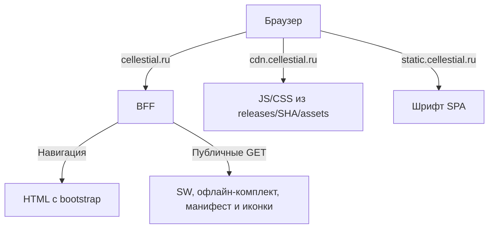

# Инфраструктура PWA

Браузер получает Service Worker, офлайн-комплект, манифест и иконки с `cellestial.ru`. JS/CSS приложения загружаются с `cdn.cellestial.ru`, обычный шрифт приложения — с `static.cellestial.ru`. У офлайн-страницы собственная копия шрифта на origin. [Маршруты публичных файлов](https://github.com/Cringe-Driven-Development-Team/frontend/blob/b1baf996fb6753d1a62eab6f874d03dca30faadc/apps/bff/src/public.ts#L3-L18), [URL релизных ассетов](https://github.com/Cringe-Driven-Development-Team/frontend/blob/b1baf996fb6753d1a62eab6f874d03dca30faadc/apps/client/vite.config.prod.ts#L6-L36), [шрифт приложения](https://github.com/Cringe-Driven-Development-Team/frontend/blob/b1baf996fb6753d1a62eab6f874d03dca30faadc/apps/client/index.html#L11-L17), [офлайн-шрифт](https://github.com/Cringe-Driven-Development-Team/frontend/blob/b1baf996fb6753d1a62eab6f874d03dca30faadc/apps/client/public/offline.css#L3-L8).

## Где лежат файлы

Сборка клиента формирует `apps/client/dist`. Загрузчик копирует весь каталог в S3 под `releases/<sha>/`. В образ BFF отдельно попадают серверный бандл, шаблон `index.html` и публичные файлы из таблицы ниже. Шаблон в образе используется для ответа HTML с bootstrap. [Загрузчик](https://github.com/Cringe-Driven-Development-Team/frontend/blob/b1baf996fb6753d1a62eab6f874d03dca30faadc/scripts/release/upload.ts#L31-L74), [состав образа BFF](https://github.com/Cringe-Driven-Development-Team/frontend/blob/b1baf996fb6753d1a62eab6f874d03dca30faadc/apps/bff/Dockerfile#L8-L13), [заполнение bootstrap](https://github.com/Cringe-Driven-Development-Team/frontend/blob/b1baf996fb6753d1a62eab6f874d03dca30faadc/apps/bff/src/html.ts#L22-L54).

## Откуда их получает браузер

<DiagramSection>

| Адрес | Путь | Назначение |
| --- | --- | --- |
| `cellestial.ru` | `/sw.js` | Скрипт Service Worker |
| `cellestial.ru` | `/offline.html`, `/offline.css`, `/onest-variable.woff2` | Офлайн-комплект |
| `cellestial.ru` | `/manifest.webmanifest` | Метаданные установки и запуска PWA |
| `cellestial.ru` | `/pwa-192.png`, `/pwa-512.png`, `/pwa-maskable-512.png`, `/apple-touch-icon.png`, `/favicon.png` | Иконки |
| `cdn.cellestial.ru` | `/releases/<sha>/assets/…` | JS/CSS и ассеты сборки SPA |
| `static.cellestial.ru` | `/fonts/onest-variable.woff2` | Шрифт обычной SPA |

Публичные файлы из списка BFF обслуживаются отдельными GET-маршрутами без сессии и запроса к Go. HTML SPA формируется отдельно. [Список файлов](https://github.com/Cringe-Driven-Development-Team/frontend/blob/b1baf996fb6753d1a62eab6f874d03dca30faadc/apps/bff/src/public.ts#L7-L18), [HTTP-маршруты и заголовки](https://github.com/Cringe-Driven-Development-Team/frontend/blob/b1baf996fb6753d1a62eab6f874d03dca30faadc/apps/bff/src/app.ts#L47-L66), [ссылки в HTML](https://github.com/Cringe-Driven-Development-Team/frontend/blob/b1baf996fb6753d1a62eab6f874d03dca30faadc/apps/client/index.html#L8-L17), [production-конфигурация Vite](https://github.com/Cringe-Driven-Development-Team/frontend/blob/b1baf996fb6753d1a62eab6f874d03dca30faadc/apps/client/vite.config.prod.ts#L13-L36).

<template #diagram>

</template>

</DiagramSection>

## Origin, scope и заголовки

`/sw.js` регистрируется на origin страницы с областью действия `/`. Путь скрипта в корне уже допускает этот scope, расширяющий заголовок `Service-Worker-Allowed` не нужен. Для регистрации браузер должен получить JavaScript с подходящим MIME-типом в безопасном контексте. [Код регистрации](https://github.com/Cringe-Driven-Development-Team/frontend/blob/b1baf996fb6753d1a62eab6f874d03dca30faadc/apps/client/src/main.tsx#L39-L45), [правила регистрации SW](https://developer.mozilla.org/en-US/docs/Web/API/ServiceWorkerContainer/register).

Политика CSP страницы разрешает загрузку SW и манифеста с origin. HTTP-кеш управляется заголовками ответа, а копии офлайн-комплекта в Cache Storage сохраняет обработчик установки SW. [CSP проекта](/documentation/security/csp), [обработчик установки](https://github.com/Cringe-Driven-Development-Team/frontend/blob/b1baf996fb6753d1a62eab6f874d03dca30faadc/apps/client/sw/sw.ts#L3-L19).

## Что наблюдается на проде

**28.11.2026, 01:54:10–01:54:12 UTC+3.** Выполнены GET без сессии по адресам из таблицы. SHA приложения `b1baf996fb6753d1a62eab6f874d03dca30faadc` взят из URL чанков в HTML `/login`.

| Ресурс | HTTP | Content-Type | Cache-Control |
| --- | --- | --- | --- |
| `/sw.js` | 200 | `text/javascript;charset=utf-8` | Не задан |
| `/offline.html` | 200 | `text/html;charset=utf-8` | Не задан |
| `/offline.css` | 200 | `text/css;charset=utf-8` | Не задан |
| `/onest-variable.woff2` на origin | 200 | `font/woff2` | Не задан |
| `/manifest.webmanifest` | 200 | `application/manifest+json` | Не задан |
| Пять PNG на origin | 200 каждый | `image/png` | Не задан |
| JS и CSS из HTML на CDN | 200 каждый | `text/javascript; charset=utf-8` и `text/css; charset=utf-8` | `max-age=86400` |
| Шрифт SPA на `static.cellestial.ru` | 200 | `font/woff2` | `max-age=86400` |

В ответе `/sw.js` отсутствовал `Service-Worker-Allowed`. Для файлов релиза загрузчик записывает в S3 `public, max-age=31536000, immutable`, для `index.html` — `no-cache`. Таблица фиксирует заголовки на публичном адресе. [Метаданные S3](https://github.com/Cringe-Driven-Development-Team/frontend/blob/b1baf996fb6753d1a62eab6f874d03dca30faadc/scripts/release/s3.ts#L4-L7), [применение при загрузке](https://github.com/Cringe-Driven-Development-Team/frontend/blob/b1baf996fb6753d1a62eab6f874d03dca30faadc/scripts/release/upload.ts#L61-L72).

## Как выпускается новая версия

Публикация создаёт CDN-каталог нового SHA и образ BFF. После выкатки BFF выдаёт шаблон, `/sw.js` и офлайн-комплект выбранного выпуска. Установка в браузере зависит от проверки обновления SW и загрузки файлов. [Артефакты выпуска](/documentation/frontend/releases/artifacts), [выкатка](/documentation/frontend/releases/deployment), [обновление SW](/documentation/offline/build-and-registration).

## Как проверить раздачу

1. Откройте `/login` с сетью в чистом контексте. Запишите дату, время и SHA из пути релизных JS/CSS в HTML.
2. Запросите файлы по трём адресам из таблицы. Запишите HTTP-статус, `Content-Type` и `Cache-Control`. Для `/sw.js` проверьте, что пришёл JavaScript.
3. Проверьте регистрацию, scope и Cache Storage по [инструкции запуска](/documentation/offline/build-and-registration). Повторите [гостевой сценарий без сети](/documentation/offline/).
