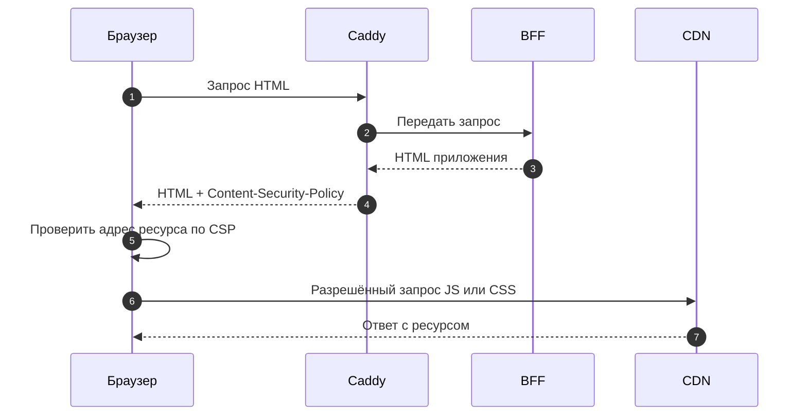
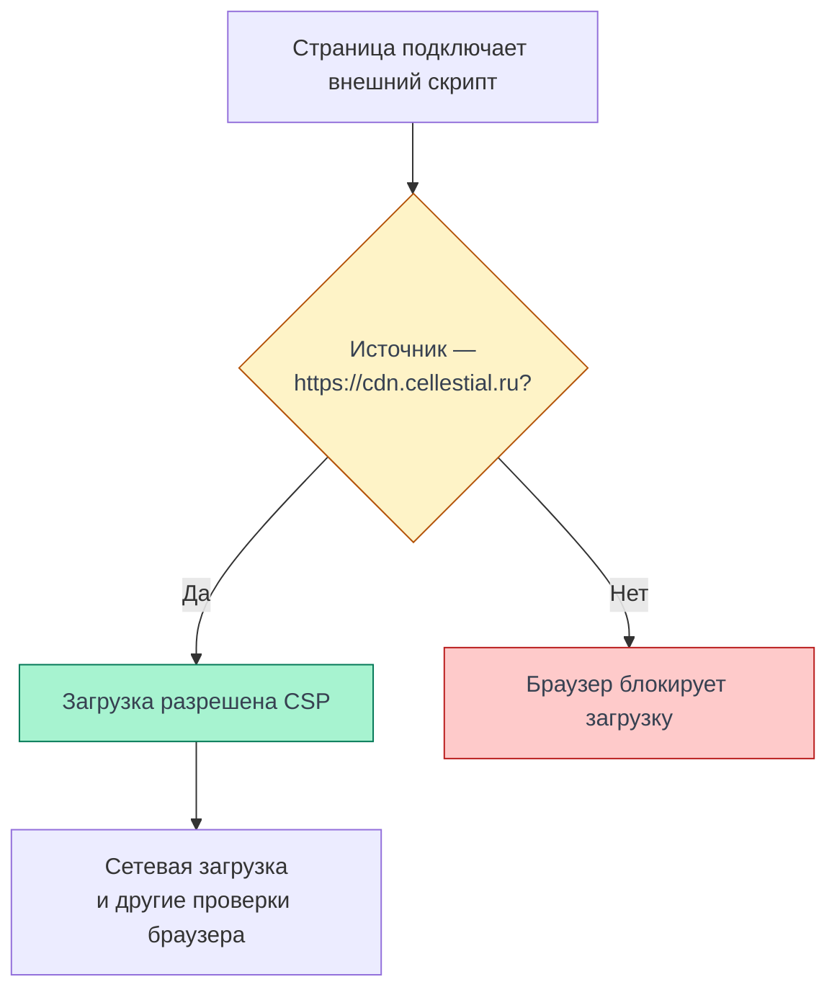

# CSP

CSP (Content Security Policy) ограничивает источники ресурсов и действия страницы
в браузере. В Cellestial Caddy передаёт политику в заголовке `Content-Security-Policy`:
браузер блокирует то, что она запрещает. Правила учитывают BFF на домене приложения,
CDN выпусков, статику, аватарки и файлы PWA.

Ниже описана конфигурация и отдельно приведены границы HTTP-проверки.
CSP дополняет [защиту от XSS](/documentation/security/xss), ограничивая последствия
внедрения кода в страницу.

<DiagramSection>

## Где задаётся политика

Политика принадлежит инфраструктуре: Ansible собирает её в `Caddyfile.j2`.
Caddy проксирует запросы к BFF и через `header_down` добавляет CSP в его ответы.
HTML формирует BFF, а применять ограничения будет браузер, получивший этот HTML.
JS и CSS браузер запрашивает напрямую с CDN каталога выпуска.

Домены берутся из `app_domain`, `frontend_cdn_domain`, `frontend_static_domain`
и `avatars_public_domain`. В конфигурации `caddy_csp_report_only: false`, поэтому
выбран блокирующий заголовок. Он добавляется на участке проксирования BFF;
это не общее правило для любого ответа Caddy, например собственного `/health` → 404.

<template #diagram>

</template>

[Сборка политики и добавление заголовка](https://github.com/Cringe-Driven-Development-Team/infra/blob/a59f8584386810b0b94f5fb23cb72c7ff906f6d7/ansible/roles/caddy/templates/Caddyfile.j2#L7-L47),
[домены и режим](https://github.com/Cringe-Driven-Development-Team/infra/blob/a59f8584386810b0b94f5fb23cb72c7ff906f6d7/ansible/inventory/group_vars/all/vars.yml#L10-L25),
[домен аватарок](https://github.com/Cringe-Driven-Development-Team/infra/blob/a59f8584386810b0b94f5fb23cb72c7ff906f6d7/ansible/inventory/group_vars/all/vars.yml#L65).

</DiagramSection>

## Действующие директивы

`'self'` означает origin защищаемого документа — для страницы приложения это
`https://cellestial.ru`, с учётом схемы, хоста и порта. Поддомены CDN, статики и аватарок
перечисляются отдельно. Источники внутри одной директивы — альтернативы:
достаточно совпадения с одним разрешённым источником.

| Директива | Значение | Зачем в Cellestial |
| --- | --- | --- |
| `default-src` | `'none'` | Запрещает загрузки, для которых нет разрешения в соответствующей fetch-директиве или её fallback. Например, `object-src` не задан, поэтому объекты запрещены |
| `script-src` | `https://cdn.cellestial.ru` | Разрешает JS клиента с CDN выпусков. Обычный скрипт с origin приложения этим правилом не разрешён |
| `style-src` | `'self'` `https://cdn.cellestial.ru` | Разрешает CSS приложения с CDN и стили офлайн-страницы с origin |
| `img-src` | `'self'` `https://cdn.cellestial.ru` `https://static.cellestial.ru` `https://avatars.cellestial.ru` `data:` | Разрешает изображения сборки, статику, аватарки, иконки PWA и встроенные SVG-иконки в CSS через `data:` |
| `font-src` | `'self'` `https://static.cellestial.ru` | Разрешает шрифты со статики и origin для офлайн-ресурсов |
| `connect-src` | `'self'` | Разрешает клиентские `fetch`/XHR к BFF на домене приложения; не управляет серверными запросами BFF → Go |
| `manifest-src` | `'self'` | Разрешает манифест PWA с origin приложения |
| `worker-src` | `'self'` | Разрешает загрузку скрипта Service Worker с origin приложения |
| `base-uri` | `'none'` | Запрещает менять базовый URL документа через `<base href>`, чтобы не перенаправить относительные адреса |
| `form-action` | `'self'` | Ограничивает адрес отправки HTML-форм origin приложения |
| `frame-ancestors` | `'none'` | Запрещает встраивать страницу Cellestial во фрейм, в том числе на том же origin |

Точные значения — из [конфигурации Caddy](https://github.com/Cringe-Driven-Development-Team/infra/blob/a59f8584386810b0b94f5fb23cb72c7ff906f6d7/ansible/roles/caddy/templates/Caddyfile.j2#L3-L20).
`default-src` служит запасным правилом для загрузок; `base-uri`, `form-action`
и `frame-ancestors` его не наследуют, поэтому заданы явно.
[Правила fallback](https://developer.mozilla.org/en-US/docs/Web/HTTP/Reference/Headers/Content-Security-Policy#fallbacks),
[base-uri](https://developer.mozilla.org/en-US/docs/Web/HTTP/Reference/Headers/Content-Security-Policy/base-uri),
[form-action](https://developer.mozilla.org/en-US/docs/Web/HTTP/Reference/Headers/Content-Security-Policy/form-action),
[frame-ancestors](https://developer.mozilla.org/en-US/docs/Web/HTTP/Reference/Headers/Content-Security-Policy/frame-ancestors).

Разрешение `data:` относится только к изображениям: оно не разрешает скрипты или шрифты
с таким URL. В политике нет `'unsafe-inline'`, nonce и хешей для встроенного кода:
исполняемые inline-скрипты, HTML-обработчики вроде `onclick`, теги `<style>` и
`style`-атрибуты в разметке не разрешены. Отсутствие `'unsafe-eval'` также запрещает
`eval()` и подобное выполнение строк как JavaScript.
[Ограничения скриптов](https://developer.mozilla.org/en-US/docs/Web/HTTP/Reference/Headers/Content-Security-Policy/script-src),
[ограничения стилей](https://developer.mozilla.org/en-US/docs/Web/HTTP/Reference/Headers/Content-Security-Policy/style-src).

`worker-src 'self'` — отдельное разрешение для запуска worker, поэтому ему не требуется
`'self'` в `script-src` страницы. Действия внутри worker регулируются политикой ответа
его собственного скрипта. Устройство файлов и регистрации описано в
[инфраструктуре PWA](/documentation/offline/infrastructure).
[Назначение worker-src](https://developer.mozilla.org/en-US/docs/Web/HTTP/Reference/Headers/Content-Security-Policy/worker-src),
[CSP внутри workers](https://developer.mozilla.org/en-US/docs/Web/HTTP/Reference/Headers/Content-Security-Policy#csp_in_workers).

<DiagramSection>

## Как браузер проверяет ресурс

Для внешнего скрипта браузер применяет `script-src`. URL на `https://cdn.cellestial.ru`
совпадает с разрешённым источником; посторонний HTTPS-домен — нет. Разрешение CSP
позволяет продолжить загрузку, но не гарантирует успешный HTTP-ответ или исполнение:
остаются сетевые ошибки и другие проверки браузера, например MIME и CORS для модулей.

<template #diagram>

</template>

Это иллюстрация действующего правила для внешнего скрипта. Для изображения браузер
проверит `img-src`, а для запроса к API — `connect-src`; список разрешённых адресов
у каждого типа свой.

</DiagramSection>

## Границы защиты

CSP доверяет разрешённым источникам, но не проверяет безопасность кода на CDN
и не санирует пользовательский Markdown или результаты вычислений. Для содержимого
блокнота остаются необходимыми безопасный DOM-вывод и изоляция HTML-результатов.
[XSS](/documentation/security/xss) и [результаты исполнения](/documentation/notebooks/results)
описывают эти механизмы и границы их проверки.

`frame-ancestors` отвечает за встраивание самой страницы Cellestial. Он не заменяет
`sandbox` у iframe с результатом вычисления и не разрешает содержимое такого iframe.
Работа HTML output под текущей политикой здесь не проверена.

`form-action` ограничивает отправку форм с нашей страницы. Он не останавливает
запрос с чужой страницы к нашему BFF: это задача [CSRF-защиты](/documentation/security/csrf).
CSP также не мешает уже разрешённому JavaScript обращаться к BFF от имени пользователя.

## Источники и проверка

Конфигурация сверена с `infra` на SHA `a59f8584386810b0b94f5fb23cb72c7ff906f6d7`.
Это версия исходников, а не установленный по этой проверке SHA выкатки.

**09.11.2026, 04:35 МСК (UTC+3):** GET без авторизации к `https://cellestial.ru/`
вернул HTTP 404, `Content-Type: text/plain` и `Content-Security-Policy` со всеми
значениями из таблицы. Проверка подтверждает передачу блокирующего заголовка
на этом ответе. HTML приложения не получен, SHA его релиза не определён.

Загрузка приложения, блокировки в браузере, авторизованные сценарии, HTML output
и совместимость PWA с этой политикой в данном прогоне не проверялись. Схемы объясняют
устройство по конфигурации; они не заменяют проверку пользовательского сценария.
