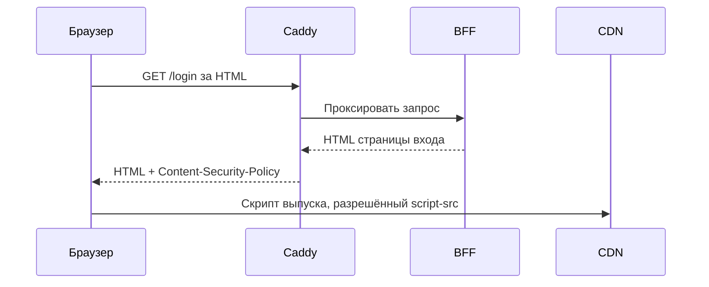
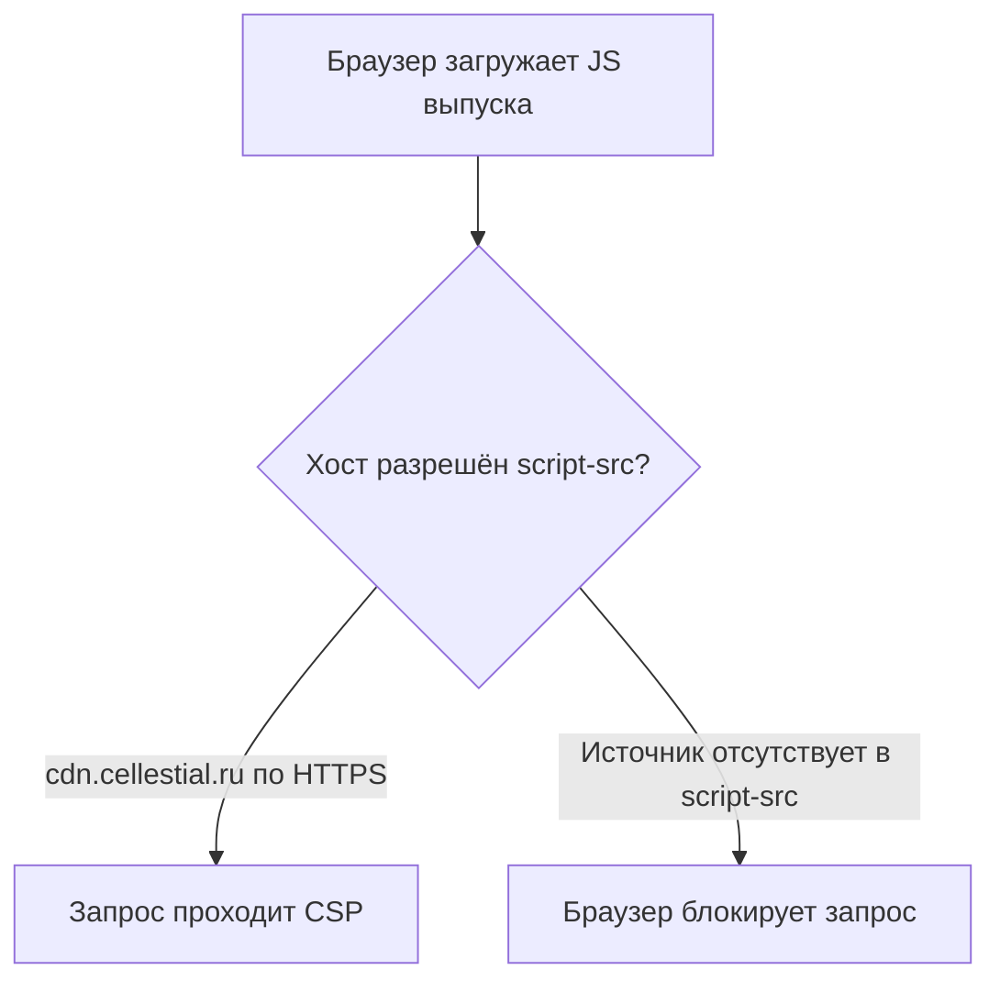

# CSP

Caddy добавляет блокирующий `Content-Security-Policy` к гостевому HTML Cellestial. Браузер применяет эту политику при загрузке ресурсов и встраивании документов. Скрипты разрешены с CDN выпусков, политика стилей допускает встроенный CSS для HTML-результатов ячеек. [Шаблон Caddy](https://github.com/Cringe-Driven-Development-Team/infra/blob/c0f873c292d82e7c6e76c166e926996f676ed175/ansible/roles/caddy/templates/Caddyfile.j2#L3-L25).

<DiagramSection>

## Где задаётся политика

Ansible подставляет домены и режим CSP в шаблон Caddy. При `caddy_csp_report_only: false` Caddy выставляет блокирующий заголовок через `header_down` на ответе от BFF. Обработчик Caddy для `/health` стоит отдельно от прокси. [Шаблон](https://github.com/Cringe-Driven-Development-Team/infra/blob/c0f873c292d82e7c6e76c166e926996f676ed175/ansible/roles/caddy/templates/Caddyfile.j2#L9-L57), [домены и режим](https://github.com/Cringe-Driven-Development-Team/infra/blob/c0f873c292d82e7c6e76c166e926996f676ed175/ansible/inventory/group_vars/all/vars.yml#L10-L25), [origin загрузки файлов и аватарок](https://github.com/Cringe-Driven-Development-Team/infra/blob/c0f873c292d82e7c6e76c166e926996f676ed175/ansible/inventory/group_vars/all/vars.yml#L62-L66).

<template #diagram>



</template>

</DiagramSection>

## Действующие директивы

Таблица отражает заголовок ответа `GET /login`. В нём `'self'` означает origin `https://cellestial.ru`. CDN, статика, аватарки и хранилище загрузок имеют отдельные origin.

| Директива | Источники | Что регулирует |
| --- | --- | --- |
| `default-src` | `'none'` | Запрещает загрузки, когда применяется это запасное правило |
| `script-src` | `https://cdn.cellestial.ru` | Подключает JS с CDN выпусков. Блокирует исполняемые inline-скрипты, обработчики событий в разметке и `eval()` |
| `style-src` | `* data: blob: 'unsafe-inline'` | Допускает внешние и встроенные стили, включая CSS HTML-результата ячейки |
| `img-src` | `'self'`<br>`https://cdn.cellestial.ru`<br>`https://static.cellestial.ru`<br>`https://avatars.cellestial.ru`<br>`data:` | Изображения приложения, CDN, статики и аватарок. `data:` используется для встроенных изображений |
| `font-src` | `'self' https://static.cellestial.ru` | Шрифты приложения и офлайн-страницы |
| `connect-src` | `'self'` и `private_files_upload_origin` | Запросы браузера к BFF и прямая загрузка файлов в хранилище |
| `manifest-src` | `'self'` | Манифест PWA |
| `worker-src` | `'self'` | Запуск Service Worker с origin приложения |
| `base-uri` | `'none'` | Запрещает менять базовый URL через `<base href>` |
| `form-action` | `'self'` | Ограничивает адрес отправки форм с этой страницы |
| `frame-src` | `'self'` | Ограничивает источники документов, которые эта страница загружает во фреймы |
| `frame-ancestors` | `'none'` | Запрещает встраивать саму страницу входа |

Для страниц `/embed/` шаблон выставляет `frame-ancestors 'self'`. Директивы `base-uri`, `form-action` и `frame-ancestors` заданы явно, потому что для них отсутствует запасное правило `default-src`. [Шаблон Caddy](https://github.com/Cringe-Driven-Development-Team/infra/blob/c0f873c292d82e7c6e76c166e926996f676ed175/ansible/roles/caddy/templates/Caddyfile.j2#L9-L25), [исключение для /embed/](https://github.com/Cringe-Driven-Development-Team/infra/blob/c0f873c292d82e7c6e76c166e926996f676ed175/ansible/roles/caddy/templates/Caddyfile.j2#L45-L57), [правила fallback](https://www.w3.org/TR/CSP3/#directive-fallback-list).

<DiagramSection>

## Как браузер проверяет ресурс

Разберись, какая директива относится к заблокированному запросу. Например, для JS выпуска из первого HTML проверь хост по `script-src`, для запроса браузера к API — по `connect-src`. При разрешённом источнике браузер продолжает загрузку и применяет остальные проверки ресурса. [Проверка загрузок в CSP](https://www.w3.org/TR/CSP3/#should-block-request).

<template #diagram>



</template>

</DiagramSection>

## Источники и проверка

1. Запроси гостевой HTML с заголовком `Accept: text/html`.

   ```bash
   curl -fsS -H 'Accept: text/html' -D headers.txt https://cellestial.ru/login -o login.html
   ```

2. Сверь `Content-Type` и `Content-Security-Policy` в `headers.txt`. Проверь, что `login.html` содержит `id="bootstrap"`. SHA выпуска указан в путях JS и CSS под `/releases/` на CDN.

28.11.2026 в 00:48:08 МСК (UTC+3) запрос вернул `200`, `Content-Type: text/html; charset=UTF-8` и блокирующий `Content-Security-Policy` из таблицы. HTML содержал гостевой bootstrap и ассеты выпуска `b1baf996fb6753d1a62eab6f874d03dca30faadc`.

Происхождение правил прослеживается до [шаблона Caddy из infra на `c0f873c292d82e7c6e76c166e926996f676ed175`](https://github.com/Cringe-Driven-Development-Team/infra/blob/c0f873c292d82e7c6e76c166e926996f676ed175/ansible/roles/caddy/templates/Caddyfile.j2#L9-L57). SHA выкатки infra по HTTP-ответу не определяется.

## Границы защиты

- HTML-результат получает пустой `sandbox` при создании iframe. Встроенный CSS разрешён наблюдаемой политикой, а ограничения скриптов и форм внутри документа задаёт также `sandbox`. Авторизованный рендер в блокноте описан по коду. [Обработчик HTML-результата](https://github.com/Cringe-Driven-Development-Team/frontend/blob/b1baf996fb6753d1a62eab6f874d03dca30faadc/apps/client/src/pages/NotebookPage/Output.tsx#L255-L270), [способы вывода](/documentation/security/xss#текст-в-интерфеисе).
- У Service Worker есть отдельный ответ на запрос скрипта. `worker-src` на странице определяет разрешение на запуск, а политику для действий внутри worker задаёт заголовок его ответа. [CSP в worker](https://developer.mozilla.org/en-US/docs/Web/HTTP/Reference/Headers/Content-Security-Policy#csp_in_workers), [инфраструктура PWA](/documentation/offline/infrastructure).
- `form-action` определяет адрес, на который может отправить форму эта страница. Условия приёма входящего запроса определяет [CSRF-защита BFF](/documentation/security/csrf#проверки-bff).
