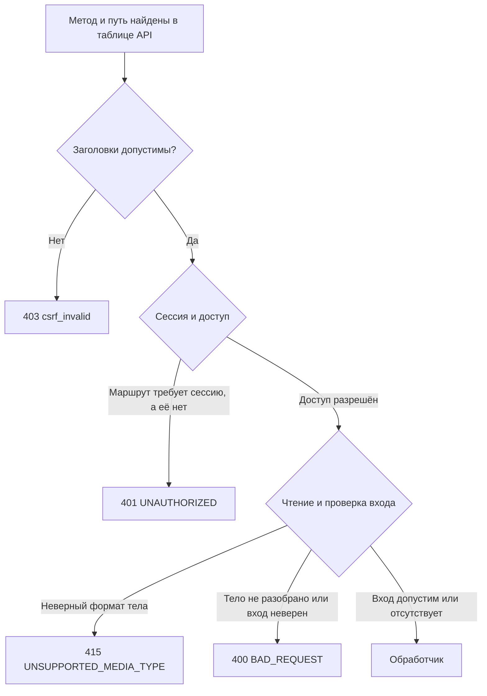

# CSRF

Для объявленного маршрута API BFF проверяет заголовки до чтения сессии и разбора входа. Каждый запрос API требует `X-CSRF: 1`. У POST дополнительно проверяются `Origin` и, если он прислан, `Sec-Fetch-Site`. [Проверка заголовков](https://github.com/Cringe-Driven-Development-Team/frontend/blob/b1baf996fb6753d1a62eab6f874d03dca30faadc/apps/bff/src/http.ts#L92-L108), [обработка маршрута](https://github.com/Cringe-Driven-Development-Team/frontend/blob/b1baf996fb6753d1a62eab6f874d03dca30faadc/apps/bff/src/http.ts#L174-L200).

## Cookie сессии

BFF хранит зашифрованную сессию в `__Host-Http-session` с атрибутами `Path=/; HttpOnly; Secure; SameSite=Lax` и без `Domain`. Cookie адресована хосту приложения и недоступна JavaScript. `Lax` допускает её при переходе по ссылке верхнего уровня методом GET. Штатный транспорт добавляет `X-CSRF: 1` и использует `credentials: 'same-origin'`. [Cookie](https://github.com/Cringe-Driven-Development-Team/frontend/blob/b1baf996fb6753d1a62eab6f874d03dca30faadc/apps/bff/src/session/cookies.ts#L1-L26), [шифрование](https://github.com/Cringe-Driven-Development-Team/frontend/blob/b1baf996fb6753d1a62eab6f874d03dca30faadc/apps/bff/src/session/crypto.ts#L16-L31), [транспорт](https://github.com/Cringe-Driven-Development-Team/frontend/blob/b1baf996fb6753d1a62eab6f874d03dca30faadc/apps/client/src/api/transport.ts#L1-L16), [правила браузера для cookie](https://developer.mozilla.org/en-US/docs/Web/HTTP/Reference/Headers/Set-Cookie#samesitesamesite-value).

## Проверки BFF

| Запрос | Условие приёма на этапе CSRF |
| --- | --- |
| API GET | `X-CSRF: 1`. Проверка не требует `Origin` и `Sec-Fetch-Site` |
| API POST | `X-CSRF: 1`, точное совпадение `Origin` с `APP_ORIGIN`, `Sec-Fetch-Site` отсутствует или равен `same-origin` |
| Переход на страницу | GET или HEAD с `Accept: text/html` вне API обрабатывается отдельной веткой HTML |

[Условия API](https://github.com/Cringe-Driven-Development-Team/frontend/blob/b1baf996fb6753d1a62eab6f874d03dca30faadc/apps/bff/src/http.ts#L92-L108), [маршрутизация HTML](https://github.com/Cringe-Driven-Development-Team/frontend/blob/b1baf996fb6753d1a62eab6f874d03dca30faadc/apps/bff/src/app.ts#L38-L59), [проверка APP_ORIGIN при запуске](https://github.com/Cringe-Driven-Development-Team/frontend/blob/b1baf996fb6753d1a62eab6f874d03dca30faadc/apps/bff/src/env.ts#L15-L29).

<DiagramSection>

Для маршрута из таблицы порядок один. Сначала CSRF, затем сессия и доступ, после этого чтение и проверка входа. Обработчик получает проверенный вход. Если маршрут принимает тело, несовпадение его формата с объявленным даёт `415` на этапе чтения. [Чтение входа](https://github.com/Cringe-Driven-Development-Team/frontend/blob/b1baf996fb6753d1a62eab6f874d03dca30faadc/apps/bff/src/http.ts#L131-L163), [порядок проверок](https://github.com/Cringe-Driven-Development-Team/frontend/blob/b1baf996fb6753d1a62eab6f874d03dca30faadc/apps/bff/src/http.ts#L174-L200).

<template #diagram>

</template>

</DiagramSection>

| Случай на объявленном маршруте | Ответ BFF |
| --- | --- |
| `GET /api/users/me` без `X-CSRF` | `403 FORBIDDEN` с `error.appCode: csrf_invalid` |
| `GET /api/users/me` с `X-CSRF: 1` в гостевой сессии | `401 UNAUTHORIZED` |
| `POST /api/auth/login` с допустимыми заголовками и неверными полями JSON | `400 BAD_REQUEST` с ошибками валидации |

[Защищённый профиль](https://github.com/Cringe-Driven-Development-Team/frontend/blob/b1baf996fb6753d1a62eab6f874d03dca30faadc/apps/bff/src/router/users.ts#L5-L12), [публичный вход](https://github.com/Cringe-Driven-Development-Team/frontend/blob/b1baf996fb6753d1a62eab6f874d03dca30faadc/apps/bff/src/router/auth.ts#L32-L39), [формат HTTP-ошибок](/documentation/frontend/requests#errors).

## Почему фиксированного заголовка достаточно для этой проверки {#почему-фиксированного-заголовка-достаточно-для-этои-проверки}

Защита опирается на правила браузера. HTML-форма не задаёт произвольные HTTP-заголовки, а для запроса JavaScript с `X-CSRF` на другой origin требуется CORS preflight. BFF не объявляет обработчик OPTIONS для API и не добавляет разрешающих заголовков CORS в обработчиках маршрутов. Для POST BFF отдельно требует origin приложения. [Запросы CORS](https://developer.mozilla.org/en-US/docs/Web/HTTP/Guides/CORS#preflighted_requests), [маршруты и запасной ответ](https://github.com/Cringe-Driven-Development-Team/frontend/blob/b1baf996fb6753d1a62eab6f874d03dca30faadc/apps/bff/src/app.ts#L38-L59), [ответы маршрута](https://github.com/Cringe-Driven-Development-Team/frontend/blob/b1baf996fb6753d1a62eab6f874d03dca30faadc/apps/bff/src/http.ts#L174-L200).

## Сценарии запросов и атак

### Запрос нашего клиента {#наш-клиент}

На защищённом `POST /api/users/update-login` BFF проверяет заголовки, сессию и JSON с новым логином. [Маршрут](https://github.com/Cringe-Driven-Development-Team/frontend/blob/b1baf996fb6753d1a62eab6f874d03dca30faadc/apps/bff/src/router/users.ts#L13-L19), [порядок обработки](https://github.com/Cringe-Driven-Development-Team/frontend/blob/b1baf996fb6753d1a62eab6f874d03dca30faadc/apps/bff/src/http.ts#L174-L200).

<Diagram name="security/csrf-client" />

### HTML-форма чужого сайта {#чужая-форма}

Форма без `X-CSRF` получает `403 csrf_invalid` на объявленном POST, включая запрос с типом тела, который маршрут принимает. [Условия CSRF](https://github.com/Cringe-Driven-Development-Team/frontend/blob/b1baf996fb6753d1a62eab6f874d03dca30faadc/apps/bff/src/http.ts#L92-L108), [порядок обработки](https://github.com/Cringe-Driven-Development-Team/frontend/blob/b1baf996fb6753d1a62eab6f874d03dca30faadc/apps/bff/src/http.ts#L174-L200).

<Diagram name="security/csrf-form" />

### Fetch с чужого сайта {#чужой-fetch}

Для запроса с нестандартным заголовком браузеру нужно разрешение preflight. Простой GET без `X-CSRF` на объявленный маршрут получает `403 csrf_invalid`, а чтение ответа с другого origin требует разрешения CORS. [CORS](https://developer.mozilla.org/en-US/docs/Web/HTTP/Guides/CORS), [условия CSRF](https://github.com/Cringe-Driven-Development-Team/frontend/blob/b1baf996fb6753d1a62eab6f874d03dca30faadc/apps/bff/src/http.ts#L92-L108), [ответы BFF](https://github.com/Cringe-Driven-Development-Team/frontend/blob/b1baf996fb6753d1a62eab6f874d03dca30faadc/apps/bff/src/app.ts#L38-L59).

<Diagram name="security/csrf-fetch" />

### Захваченный поддомен {#захваченный-поддомен}

HTTPS-поддомен может относиться к тому же сайту и иметь другой origin. Cookie адресована приложению, однако браузер может приложить её к same-site запросу, адресованному приложению. BFF требует на POST точный `Origin` приложения и отклоняет `Sec-Fetch-Site: same-site`. [Cookie](https://github.com/Cringe-Driven-Development-Team/frontend/blob/b1baf996fb6753d1a62eab6f874d03dca30faadc/apps/bff/src/session/cookies.ts#L1-L4), [CSRF](https://github.com/Cringe-Driven-Development-Team/frontend/blob/b1baf996fb6753d1a62eab6f874d03dca30faadc/apps/bff/src/http.ts#L92-L108).

<Diagram name="security/csrf-subdomain" />

### Переход по внешней ссылке {#внешняя-ссылка}

Переход на страницу попадает в обработчик HTML. BFF по сессии выбирает страницу, перенаправление и данные bootstrap. Последующий запрос API идёт через проверки своего маршрута. [HTTP-маршрутизация](https://github.com/Cringe-Driven-Development-Team/frontend/blob/b1baf996fb6753d1a62eab6f874d03dca30faadc/apps/bff/src/app.ts#L43-L59), [обработка HTML](https://github.com/Cringe-Driven-Development-Team/frontend/blob/b1baf996fb6753d1a62eab6f874d03dca30faadc/apps/bff/src/html.ts#L74-L137).

<Diagram name="security/csrf-navigation" />

### Login CSRF {#login-csrf}

Публичный `POST /api/auth/login` доступен без прежней сессии. CSRF-проверка защищает сам вход, который при успехе создаёт сессию. [Вход](https://github.com/Cringe-Driven-Development-Team/frontend/blob/b1baf996fb6753d1a62eab6f874d03dca30faadc/apps/bff/src/router/auth.ts#L8-L16), [маршрут](https://github.com/Cringe-Driven-Development-Team/frontend/blob/b1baf996fb6753d1a62eab6f874d03dca30faadc/apps/bff/src/router/auth.ts#L32-L39), [общие проверки](https://github.com/Cringe-Driven-Development-Team/frontend/blob/b1baf996fb6753d1a62eab6f874d03dca30faadc/apps/bff/src/http.ts#L174-L200).

<Diagram name="security/csrf-login" />

### XSS внутри нашего origin {#xss-внутри-origin}

Если посторонний код уже исполняется на origin приложения, браузер может приложить HttpOnly-cookie к его запросу. Доступ к операции всё равно зависит от сессии и входа. Снижение риска исполнения постороннего кода описано в [защите вывода от XSS](/documentation/security/xss).

<Diagram name="security/csrf-xss" />

## Граница BFF и Go

Браузер вызывает API BFF. Для защищённых вызовов к Go BFF передаёт `Authorization: Bearer`, а при настроенном сервисном ключе транспорт добавляет `X-BFF-Key`. [Граница API](https://github.com/Cringe-Driven-Development-Team/frontend/blob/b1baf996fb6753d1a62eab6f874d03dca30faadc/apps/bff/src/app.ts#L38-L59), [вызов с токеном](https://github.com/Cringe-Driven-Development-Team/frontend/blob/b1baf996fb6753d1a62eab6f874d03dca30faadc/apps/bff/src/session/session.ts#L109-L122), [транспорт Go](https://github.com/Cringe-Driven-Development-Team/frontend/blob/b1baf996fb6753d1a62eab6f874d03dca30faadc/apps/bff/src/go/fetch.ts#L13-L27).

## Источники и проверка

Условия и схемы сверены с кодом выложенного фронтенда. Версия выпуска подтверждена в [гостевом HTML](/documentation/security/csp#источники-и-проверка). Три ответа из таблицы проверены локальным HTTP-запросом к BFF на том же SHA 28.11.2026 в 00:51:47 МСК (UTC+3). Обработчик вернул `403 csrf_invalid`, `401 UNAUTHORIZED` и `400 BAD_REQUEST` с `validationErrors` ещё до вызова Go.
