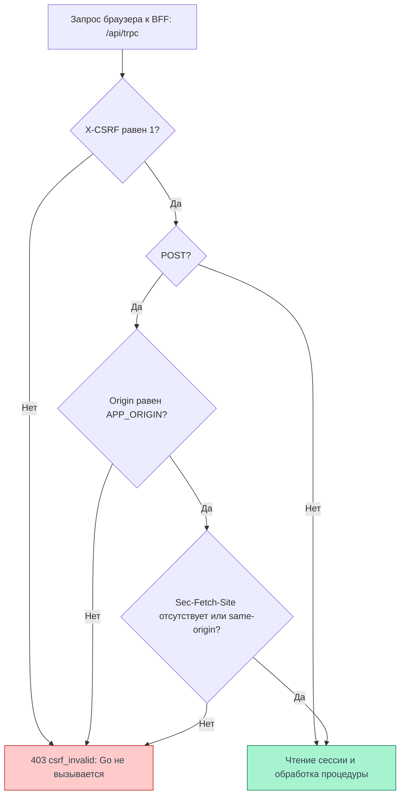

# CSRF

CSRF — запрос, который чужой сайт пытается выполнить от имени пользователя,
используя автоматически отправляемую браузером cookie. В Cellestial браузерные RPC
принимает BFF: он проверяет заголовок `X-CSRF: 1`, а для POST — также источник запроса.
Ни CSRF-токен из cookie, ни его получение отдельным запросом клиенту не нужны.

## Cookie сессии

BFF хранит сессию в cookie и шифрует её содержимое AES-256-GCM;
внутри находятся токены Go и сроки их действия.
JavaScript страницы не получает открытые токены и не читает cookie.

| Атрибут | Значение |
| --- | --- |
| Имя | `__Host-Http-session` |
| `HttpOnly` | да |
| `Secure` | да |
| `Path` | `/` |
| `SameSite` | `Lax` |
| `Domain` | не задаётся |

`HttpOnly` ограничивает чтение cookie, а `Secure` — её отправку по незащищённому соединению.
`SameSite=Lax` ограничивает отправку при обращении с другого сайта, но не заменяет проверку
источника: поддомены могут относиться к одному site, оставаясь разными origin.
Клиент вызывает `/api/trpc` через единый транспорт с `credentials: 'same-origin'`.

<DiagramSection>

## Проверки BFF

Схема показывает проверки в `createContext` для существующей процедуры с допустимым
HTTP-методом, после принятия формата запроса адаптером tRPC.
Неподдерживаемый `Content-Type` адаптер может отклонить с `415` ещё до этого этапа.
Проверки CSRF выполняются **до чтения сессии** и вызовов Go, в том числе для входа и регистрации.
Каждый RPC требует точного значения `X-CSRF: 1`. Для POST `Origin` обязан совпадать
с `APP_ORIGIN`; пустое значение, `null` и другой origin отклоняются.
`Sec-Fetch-Site` может отсутствовать; если он есть у POST, допускается только `same-origin`.
Значения `same-site`, `cross-site` и `none` не проходят.

Любой отказ этих проверок — HTTP `403`, tRPC `FORBIDDEN` и `appCode: csrf_invalid`.
Успешная проверка CSRF ещё не означает успешную авторизацию: защищённая процедура
без сессии вернёт `401`, а неверные входные данные могут дать `400`.

<template #diagram>

</template>

Для GET действует обязательная проверка `X-CSRF`. Проверки `Origin` и `Sec-Fetch-Site`
в этом контексте применяются только к POST.

</DiagramSection>

## Почему фиксированного заголовка достаточно для этой проверки

Значение `1` не является секретом. Защита опирается на ограничения браузера и проверку
источника: обычная HTML-форма чужого сайта не умеет добавить произвольный `X-CSRF`,
а cross-origin `fetch` с таким заголовком требует разрешающего CORS preflight.
BFF не открывает CORS-доступ чужим origin. Для POST дополнительно проверяется сам `Origin`.
Клиентский JavaScript не может произвольно подставить браузерные `Origin` и `Sec-Fetch-Site`.

Эти проверки защищают от запросов чужого сайта. Скрипт, уже исполняющийся внутри
нашего origin, может отправить правильный заголовок и запрос с cookie.
Поэтому защита от [XSS](/documentation/security/xss) нужна независимо от CSRF.

## Сценарии запросов и атак

Ниже — разбор действующего кода с учётом правил браузера. Серверные отказы проверены
локально; это не отчёт о выполнении всех атак на проде. Версии и границы проверки
приведены в [источниках](#источники-и-проверка).

### Запрос нашего клиента {#наш-клиент}

Код приложения вызывает `/api/trpc` со своего origin через единый клиент.
Для mutation он отправляет POST с JSON и `X-CSRF: 1`;
`credentials: 'same-origin'` разрешает браузеру приложить
имеющуюся cookie сессии. Для POST браузер указывает наш `Origin` и, если поддерживает
Fetch Metadata, `Sec-Fetch-Site: same-origin`.

<Diagram name="security/csrf-client" />

Такой запрос проходит CSRF-проверки BFF. Дальше проверяются входные данные и сессия:
защищённая процедура без неё остановится с `401`, а корректный разрешённый вызов
дойдёт до Go. Для входа прежняя сессия не требуется.
Код на <a href="#захваченный-поддомен">поддомене</a> не получает прав нашего origin;
скрипт при [XSS внутри приложения](#xss-внутри-origin) может повторить этот запрос.

### HTML-форма чужого сайта {#чужая-форма}

Атакующий управляет страницей с формой: выбирает адрес `action`, метод, поля
и `enctype`. Браузер может отправить её POST в `/api/trpc` без preflight.
При отправке с другого site cookie с явным `SameSite=Lax` не прикладывается.
Форма также не умеет установить обязательный `X-CSRF`.

<Diagram name="security/csrf-form" />

Место отказа зависит от формата тела. В локальной проверке `auth.login`
и `notebooks.create` дали одинаковые результаты:

| `Content-Type` формы | Где запрос останавливается |
| --- | --- |
| `application/x-www-form-urlencoded` | Адаптер tRPC: `415 UNSUPPORTED_MEDIA_TYPE`, до `createContext` |
| `text/plain` | Адаптер tRPC: `415 UNSUPPORTED_MEDIA_TYPE`, до `createContext` |
| `multipart/form-data` | Контекст BFF: `403 csrf_invalid` из-за отсутствия `X-CSRF` |

Во всех трёх случаях Go не вызывается. Если форму разместить на same-site
<a href="#захваченный-поддомен">поддомене</a>, cookie уже может сопровождать запрос,
но формат и отсутствие заголовка по-прежнему приводят к отказу.
При XSS атакующий может вместо формы использовать разрешённый same-origin `fetch`.

### Fetch с чужого сайта {#чужой-fetch}

Атакующий управляет URL, телом и разрешёнными для JavaScript заголовками запроса.
Простой cross-origin GET или POST с форматом обычной формы может уйти без preflight.
По умолчанию `fetch` использует `credentials: 'same-origin'` и не прикладывает cookie
к чужому origin. Даже `credentials: 'include'` не отменяет запрет `SameSite=Lax`
на cookie в cross-site `fetch`.

<Diagram name="security/csrf-fetch" />

Отсутствие CORS-разрешения не мешает отправке такого простого запроса: оно запрещает
скрипту читать ответ. Поэтому серверу всё равно нужна защита. GET `/api/trpc/users.me`
без `X-CSRF` получает `403`; POST с форматом формы останавливается так,
как описано [выше](#чужая-форма). До Go эти вызовы не доходят.

Попытка добавить `X-CSRF: 1` или отправить `Content-Type: application/json`
вызывает предварительный OPTIONS без cookie. В текущей конфигурации нет разрешающих
CORS-заголовков: браузер не отправляет основной запрос. Это отказ preflight,
а не выполненная mutation с ответом `403`. Режим `no-cors` не позволяет обойти
ограничение и добавить произвольный `X-CSRF`.

На same-site поддомене `include` может разрешить отправку cookie, но cross-origin
ограничения сохраняются. При XSS в нашем origin preflight для вызова нашего BFF
не нужен. Правила отправки и чтения ответа описаны в
[MDN CORS](https://developer.mozilla.org/en-US/docs/Web/HTTP/Guides/CORS),
[Request.credentials](https://developer.mozilla.org/en-US/docs/Web/API/Request/credentials)
и [Fetch Standard](https://fetch.spec.whatwg.org/#cors-preflight-fetch).

### Захваченный поддомен {#захваченный-поддомен}

Предположим, атакующий получил управление HTTPS-поддоменом. Это модель угрозы,
а не утверждение о произошедшем захвате. Например, `https://evil.example.com`
и `https://app.example.com` — один site, но разные origin: для same-site учитываются
схема и регистрируемый домен, для same-origin должны совпасть схема, хост и порт.
Определения: [site](https://developer.mozilla.org/en-US/docs/Glossary/Site)
и [origin](https://developer.mozilla.org/en-US/docs/Glossary/Origin).

<Diagram name="security/csrf-subdomain" />

Отсутствие `Domain` не позволяет отправить cookie приложения серверу поддомена.
Однако запрос **с поддомена к самому приложению** может нести эту cookie:
он остаётся same-site. Для cross-origin `fetch` дополнительно нужен
`credentials: 'include'`; режим `same-origin` cookie не приложит.

Форма всё ещё не ставит `X-CSRF`, а `fetch` с этим заголовком требует CORS-разрешения.
Поэтому описанные запросы останавливаются до Go. Даже если CORS в будущем ошибочно
разрешит такой origin, POST встретит отдельные проверки BFF: чужой `Origin`
и `Sec-Fetch-Site: same-site` не подходят. JavaScript не может подменить эти
[браузерные заголовки](https://developer.mozilla.org/en-US/docs/Glossary/Forbidden_request_header).
Управление поддоменом само по себе не даёт исполнения кода в origin приложения;
такое исполнение уже разбирается как [XSS](#xss-внутри-origin).

### Переход по внешней ссылке {#внешняя-ссылка}

Атакующий выбирает адрес ссылки, по которой жертва открывает приложение.
Для перехода верхнего уровня по HTTPS с методом GET браузер может приложить
имеющуюся `SameSite=Lax` cookie даже с другого site. Это предусмотренное
[правило Lax](https://developer.mozilla.org/en-US/docs/Web/HTTP/Reference/Headers/Set-Cookie#samesitesamesite-value),
а не обход защиты.

<Diagram name="security/csrf-navigation" />

GET HTML-страницы обрабатывается отдельно от `/api/trpc` и не требует `X-CSRF`.
При наличии сессии BFF может обратиться к Go за пользователем, данными блокнота
или обновлением токенов; для гостя без сессии эти вызовы не нужны.
Обновление токенов меняет состояние авторизации и может привести к `Set-Cookie`,
но открытие страницы не создаёт и не редактирует блокнот и не выполняет выход.

Если ссылка ведёт прямо на GET `/api/trpc/users.me`, отсутствие `X-CSRF` остановит запрос
с `403` до Go. Ссылка с поддомена не добавляет этот заголовок и не превращает GET
в mutation. XSS даёт другую возможность: отправить полноценный POST из приложения.

### Login CSRF {#login-csrf}

Здесь атакующий пытается войти в браузере жертвы **в свою учётную запись**:
он знает её логин и пароль и подставляет их в запрос входа. Прежняя сессия жертвы
для такой атаки не нужна. Если бы вход проходил без защиты, браузер получил бы
сессию атакующего; жертва могла бы принять её за свою и сохранить в этом аккаунте
данные, доступные атакующему. Это модель
[login CSRF из OWASP](https://cheatsheetseries.owasp.org/cheatsheets/Cross-Site_Request_Forgery_Prevention_Cheat_Sheet.html#possible-csrf-vulnerabilities-in-login-forms).

<Diagram name="security/csrf-login" />

`auth.login` — публичная процедура, но CSRF проверяется до её выполнения.
Форма с чужого сайта отправится без Lax-cookie и остановится на `415` или `403`
в зависимости от формата; JSON `fetch` с чужого origin не пройдёт preflight.
Go не получит запрос входа, новая сессия не будет создана. Отсутствие старой cookie
само по себе не было бы защитой: для входа она не требуется.

Захваченный поддомен не отменяет проверки формата, заголовка и origin.
При XSS внутри приложения атакующий уже может вызвать публичный вход
с правильными заголовками — это выходит за возможности защиты от CSRF.

### XSS внутри нашего origin {#xss-внутри-origin}

Предположим, атакующий добился исполнения JavaScript в странице приложения.
Он может вызвать наш `/api/trpc`, добавить `X-CSRF: 1` и использовать
`credentials: 'same-origin'`. Браузер приложит доступную cookie, а `Origin`
и `Sec-Fetch-Site` будут соответствовать приложению. CSRF-проверки пройдут.

<Diagram name="security/csrf-xss" />

`HttpOnly` не даст прочитать cookie из JavaScript, но не запретит такой запрос
и чтение его ответа. При действующей сессии, корректных данных и достаточных
правах выполнение может дойти до Go. Без сессии защищённая процедура по-прежнему
вернёт `401`; XSS не отменяет серверную авторизацию.

Это сильнее контроля над отдельным поддоменом: код уже работает в нужном origin.
Поэтому отдельно нужны [защита bootstrap и вывод текста без интерпретации HTML](/documentation/security/xss).
Подмена `Origin` в `curl` не воспроизводит браузерную атаку: такой клиент не получает
cookie из браузера жертвы, а JavaScript чужой страницы не управляет этими заголовками.

## Граница BFF и Go

Публичные запросы приложения поступают через Caddy в BFF. BFF принимает RPC на
`/api/trpc`; неизвестные `/api/*` не проксирует в Go. Браузер не вызывает Go напрямую.

Для серверного вызова BFF добавляет `X-BFF-Key`. Go проверяет этот ключ на API-маршрутах;
для защищённых операций использует `Authorization: Bearer` и проверяет сессию.
Browser cookie не служит способом авторизации Go. Проверка сервисного ключа
не заменяет браузерную CSRF-защиту: она относится к другому участку запроса.

## Источники и проверка

Исходники frontend — `007d8d4de7fa964947ffe1316c31726bbd386903`; этот SHA указан
в `meta[name=release]` HTML, полученного на проде 04.11.2026 около 01:17 МСК.
Повторное чтение гостевого `/login` 04.11.2026 около 14:33 UTC подтвердило тот же SHA;
это проверка версии HTML, а не повтор всех сценариев ниже.

- [Контекст BFF: порядок и условия проверок](https://github.com/Cringe-Driven-Development-Team/frontend/blob/007d8d4de7fa964947ffe1316c31726bbd386903/apps/bff/src/context.ts#L15-L31).
- [Атрибуты cookie](https://github.com/Cringe-Driven-Development-Team/frontend/blob/007d8d4de7fa964947ffe1316c31726bbd386903/apps/bff/src/session/cookies.ts#L1-L29) и [шифрование сессии](https://github.com/Cringe-Driven-Development-Team/frontend/blob/007d8d4de7fa964947ffe1316c31726bbd386903/apps/bff/src/session/crypto.ts#L21-L39).
- [Транспорт клиента](https://github.com/Cringe-Driven-Development-Team/frontend/blob/007d8d4de7fa964947ffe1316c31726bbd386903/apps/client/src/api/trpc.ts#L106-L122) и [маршруты BFF](https://github.com/Cringe-Driven-Development-Team/frontend/blob/007d8d4de7fa964947ffe1316c31726bbd386903/apps/bff/src/app.ts#L34-L55).
- [Публичный вход и создание сессии](https://github.com/Cringe-Driven-Development-Team/frontend/blob/007d8d4de7fa964947ffe1316c31726bbd386903/apps/bff/src/router/auth.ts#L14-L22) и [обработка HTML](https://github.com/Cringe-Driven-Development-Team/frontend/blob/007d8d4de7fa964947ffe1316c31726bbd386903/apps/bff/src/html.ts#L82-L127).
- Адаптер tRPC `11.19.0`: [выбор обработчика Content-Type](https://github.com/trpc/trpc/blob/fcc6bca0ece2762e393e6d8c8527bbaa17a878d2/packages/server/src/unstable-core-do-not-import/http/contentType.ts#L296-L319) и [отказ до создания контекста](https://github.com/trpc/trpc/blob/fcc6bca0ece2762e393e6d8c8527bbaa17a878d2/packages/server/src/unstable-core-do-not-import/http/resolveResponse.ts#L304-L321).
- [Публичный маршрут в Caddy](https://github.com/Cringe-Driven-Development-Team/infra/blob/adf48242b0aa5d43ae9e59e6c088c7a4a0185387/ansible/roles/caddy/templates/Caddyfile.j2#L18-L43) и [проверки S2S/Bearer в Go](https://github.com/Cringe-Driven-Development-Team/backend/blob/ac2c7d4aeaf1f084ac6cd3c1e76ea114ddd2907c/internal/transport/http/security/bff.go#L17-L75).

В Chrome через Obscura 04.11.2026 около 01:17 МСК гостевые GET `users.me` и POST `auth.login`
без заголовка дали `403 csrf_invalid`. С заголовком GET дошёл до `401`, а POST
с пустым JSON — до `400` с ошибками полей. Старый GET `/api/v1/users/me` вернул `404`.
Локально прошли [шесть тестов отказов CSRF](https://github.com/Cringe-Driven-Development-Team/frontend/blob/007d8d4de7fa964947ffe1316c31726bbd386903/apps/bff/test/bff.test.ts#L121-L147), включая чужой Origin и `same-site`.

04.11.2026 на указанном SHA frontend прошли все 44 теста `bff.test.ts` и 17 дополнительных
локальных проб через `createBff` с управляемыми ответами Go. Пробы подтвердили отказы
для форм из таблицы, JSON без `X-CSRF`, JSON с чужим Origin или `same-site`,
а также отсутствие CORS-разрешений у OPTIONS. В этих случаях вызовов Go не было,
в том числе при вручную приложенной тестовой cookie. Это проверка сервера;
условия отправки cookie браузером в сценариях выше следуют из браузерных правил.

Матрица запросов с чужого origin и авторизованные сценарии на проде этими прогонами
не проверены. SHA backend и infra выше подтверждают прочитанный код, а не версию
запущенного процесса; серверный участок BFF → Go в этом прогоне не проверялся.
