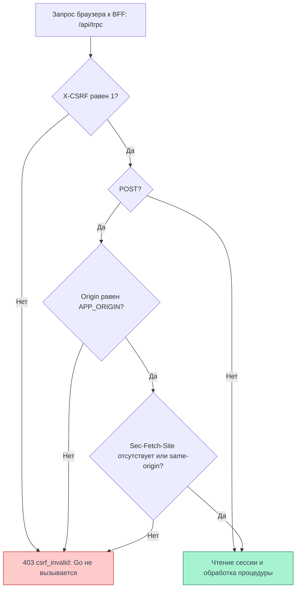

# CSRF

CSRF — запрос, который чужой сайт пытается выполнить от имени пользователя,
используя автоматически отправляемую браузером cookie. В Cellestial браузерные RPC
принимает BFF: он проверяет заголовок `X-CSRF: 1`, а для POST — также источник запроса.
Ни CSRF-токен из cookie, ни его получение отдельным запросом клиенту не нужны.

## Cookie сессии

Сессия находится в cookie `__Host-Http-session` с атрибутами `Path=/; HttpOnly; Secure; SameSite=Lax`,
без `Domain`. BFF шифрует её содержимое AES-256-GCM; внутри находятся токены Go и сроки их действия.
JavaScript страницы не получает открытые токены и не читает cookie.

`HttpOnly` ограничивает чтение cookie, а `Secure` — её отправку по незащищённому соединению.
`SameSite=Lax` ограничивает отправку при обращении с другого сайта, но не заменяет проверку
источника: поддомены могут относиться к одному site, оставаясь разными origin.
Клиент вызывает `/api/trpc` через единый транспорт с `credentials: 'same-origin'`.

<DiagramSection>

## Проверки BFF

Проверки выполняются **до чтения сессии** и вызовов Go, в том числе для входа и регистрации.
Каждый RPC требует точного значения `X-CSRF: 1`. Для POST `Origin` обязан совпадать
с `APP_ORIGIN`; пустое значение, `null` и другой origin отклоняются.
`Sec-Fetch-Site` может отсутствовать; если он есть у POST, допускается только `same-origin`.
Значения `same-site`, `cross-site` и `none` не проходят.

Любой отказ этих проверок — HTTP `403`, tRPC `FORBIDDEN` и `appCode: csrf_invalid`.
Успешная проверка CSRF ещё не означает успешную авторизацию: защищённая процедура
без сессии вернёт `401`, а неверные входные данные могут дать `400`.

<template #diagram>

</template>

Для GET действует обязательная проверка `X-CSRF`. Проверки `Origin` и `Sec-Fetch-Site`
в этом контексте применяются только к POST.

</DiagramSection>

## Почему фиксированного заголовка достаточно для этой проверки

Значение `1` не является секретом. Защита опирается на ограничения браузера и проверку
источника: обычная HTML-форма чужого сайта не умеет добавить произвольный `X-CSRF`,
а cross-origin `fetch` с таким заголовком требует разрешающего CORS preflight.
BFF не открывает CORS-доступ чужим origin. Для POST дополнительно проверяется сам `Origin`.
Клиентский JavaScript не может произвольно подставить браузерные `Origin` и `Sec-Fetch-Site`.

Эти проверки защищают от запросов чужого сайта. Скрипт, уже исполняющийся внутри
нашего origin, может отправить правильный заголовок и запрос с cookie.
Поэтому защита от [XSS](/documentation/security/xss) нужна независимо от CSRF.

## Граница BFF и Go

Публичные запросы приложения поступают через Caddy в BFF. BFF принимает RPC на
`/api/trpc`; неизвестные `/api/*` не проксирует в Go. Браузер не вызывает Go напрямую.

Для серверного вызова BFF добавляет `X-BFF-Key`. Go проверяет этот ключ на API-маршрутах;
для защищённых операций использует `Authorization: Bearer` и проверяет сессию.
Browser cookie не служит способом авторизации Go. Проверка сервисного ключа
не заменяет браузерную CSRF-защиту: она относится к другому участку запроса.

## Источники и проверка

Исходники frontend — `007d8d4de7fa964947ffe1316c31726bbd386903`; этот SHA указан
в `meta[name=release]` HTML, полученного на проде 04.11.2026 около 01:17 МСК.

- [Контекст BFF: порядок и условия проверок](https://github.com/Cringe-Driven-Development-Team/frontend/blob/007d8d4de7fa964947ffe1316c31726bbd386903/apps/bff/src/context.ts#L15-L31).
- [Атрибуты cookie](https://github.com/Cringe-Driven-Development-Team/frontend/blob/007d8d4de7fa964947ffe1316c31726bbd386903/apps/bff/src/session/cookies.ts#L1-L29) и [шифрование сессии](https://github.com/Cringe-Driven-Development-Team/frontend/blob/007d8d4de7fa964947ffe1316c31726bbd386903/apps/bff/src/session/crypto.ts#L21-L39).
- [Транспорт клиента](https://github.com/Cringe-Driven-Development-Team/frontend/blob/007d8d4de7fa964947ffe1316c31726bbd386903/apps/client/src/api/trpc.ts#L106-L122) и [маршруты BFF](https://github.com/Cringe-Driven-Development-Team/frontend/blob/007d8d4de7fa964947ffe1316c31726bbd386903/apps/bff/src/app.ts#L34-L55).
- [Публичный маршрут в Caddy](https://github.com/Cringe-Driven-Development-Team/infra/blob/adf48242b0aa5d43ae9e59e6c088c7a4a0185387/ansible/roles/caddy/templates/Caddyfile.j2#L18-L43) и [проверки S2S/Bearer в Go](https://github.com/Cringe-Driven-Development-Team/backend/blob/ac2c7d4aeaf1f084ac6cd3c1e76ea114ddd2907c/internal/transport/http/security/bff.go#L17-L75).

В Chrome через Obscura на указанную дату гостевые GET `users.me` и POST `auth.login`
без заголовка дали `403 csrf_invalid`. С заголовком GET дошёл до `401`, а POST
с пустым JSON — до `400` с ошибками полей. Старый GET `/api/v1/users/me` вернул `404`.
Локально прошли [шесть тестов отказов CSRF](https://github.com/Cringe-Driven-Development-Team/frontend/blob/007d8d4de7fa964947ffe1316c31726bbd386903/apps/bff/test/bff.test.ts#L121-L147), включая чужой Origin и `same-site`.

Матрица запросов с чужого origin и авторизованные сценарии на проде этим прогоном
не проверены. SHA backend и infra выше подтверждают прочитанный код, а не версию
запущенного процесса; серверный участок BFF → Go в этом прогоне не проверялся.
