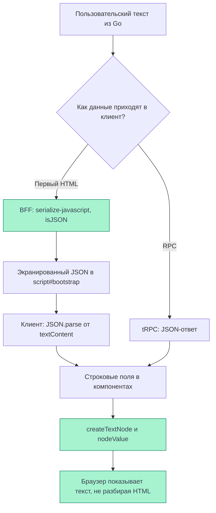

# XSS

XSS возникает, когда пользовательские данные интерпретируются браузером как код страницы.
В Cellestial защита нужна в двух местах: при встраивании данных в первый HTML и при
их отображении в интерфейсе. BFF безопасно сериализует bootstrap, а клиент выводит
проверенные ниже поля через текстовые DOM-узлы.

<DiagramSection>

## Два места вывода данных

Go хранит имя блокнота и исходник ячейки как данные и возвращает JSON. Сохранение строки
с HTML-тегами само по себе не является XSS. В блокноте исходный текст должен сохраняться:
удаление тегов могло бы испортить код или заметку пользователя.

В первый HTML данные пользователя, а при открытии своего блокнота — и его содержимое,
попадают через bootstrap. После SPA-запроса данные приходят через tRPC как JSON.
Оба пути заканчиваются отображением в компонентах клиента.

<template #diagram>

</template>

JSON не выполняет HTML-санацию. Безопасность определяется способом встраивания
в HTML и конкретным местом вывода в DOM.

</DiagramSection>

## Bootstrap внутри HTML

BFF размещает JSON в `` внутри содержимого такого элемента. Поэтому обычного `JSON.stringify`
для встраивания произвольных строк в этот контекст недостаточно.

`renderBootstrap` использует `serialize-javascript` с `isJSON: true`: опасные для
HTML-контекста символы сериализуются в escape-последовательности. Строка с `</script>`
не закрывает элемент и не создаёт новый скрипт. Клиент читает `textContent`, затем
вызывает `JSON.parse` и проверяет форму bootstrap. Код из строки не исполняется;
исходное значение восстанавливается после разбора JSON.

## Текст в интерфейсе

Клиент использует `@cdd-team/react` версии **1.7.0**. Его строковые JSX children
становятся узлами `document.createTextNode`; содержимое присваивается через `nodeValue`,
в том числе при обновлении. Такой путь не передаёт строку HTML-парсеру.

| Данные | Как выводятся |
| --- | --- |
| Исходник ячейки `cell.source` | Текст внутри `pre`, и для `code`, и для `markdown` |
| Название блокнота `notebook.name` | Текст; также значение свойства `title` |
| Логин пользователя | Текст в меню профиля; первая буква в аватаре |

Например, строка `` в ячейке отображается как текст:
элемент `img` из неё не создаётся. Markdown сейчас также показывается текстом,
без преобразования в HTML.

## Границы защиты

Текстовый вывод не является универсальной санацией HTML и URL. Версия рендерера 1.7.0
присваивает обычные props свойствам DOM либо передаёт их в `setAttribute`; она не проверяет
протокол произвольного `href` или `src`. Передача недоверенного HTML в `innerHTML`
требовала бы отдельной защиты. В просмотренном клиенте пользовательские поля не выводятся
через `innerHTML`; прямые `src` относятся к импортированным SVG.

При добавлении HTML-представления Markdown, результатов выполнения или пользовательских
ссылок безопасность этих новых мест вывода нужно проверять отдельно. Свойства более новой
версии библиотеки нельзя приписывать установленной 1.7.0.

`HttpOnly` не даёт JavaScript прочитать cookie сессии, но уже исполняющийся на странице
вредоносный код может отправлять запросы от имени пользователя. Проверки
[CSRF](/documentation/security/csrf) также не останавливают такой код внутри нашего origin.
[CSP](/documentation/security/csp) блокирует загрузки и выполнение кода, запрещённые
политикой. Она дополняет безопасный вывод данных; источники и границы проверки
действующей политики приведены на её странице.

## Источники и проверка

Frontend — `007d8d4de7fa964947ffe1316c31726bbd386903`, тот же SHA был в HTML прода
04.11.2026 около 01:17 МСК. Рендерер проверен на release SHA установленной версии 1.7.0,
а не на текущей main библиотеки.

- [Сериализация bootstrap](https://github.com/Cringe-Driven-Development-Team/frontend/blob/007d8d4de7fa964947ffe1316c31726bbd386903/apps/bff/src/html.ts#L20-L48) и [чтение в клиенте](https://github.com/Cringe-Driven-Development-Team/frontend/blob/007d8d4de7fa964947ffe1316c31726bbd386903/apps/client/src/bootstrap.ts#L24-L38).
- [Текстовые children](https://github.com/Cringe-Driven-Development-Team/frontend-packages/blob/741569068c1c0f0ad24061a9efcc8dca2f19d04e/packages/react/src/children.ts#L28-L52), [создание DOM-узла](https://github.com/Cringe-Driven-Development-Team/frontend-packages/blob/741569068c1c0f0ad24061a9efcc8dca2f19d04e/packages/react/src/patch-dom.ts#L7-L19) и [присваивание свойств](https://github.com/Cringe-Driven-Development-Team/frontend-packages/blob/741569068c1c0f0ad24061a9efcc8dca2f19d04e/packages/react/src/patch-dom.ts#L158-L168).
- [Ячейка](https://github.com/Cringe-Driven-Development-Team/frontend/blob/007d8d4de7fa964947ffe1316c31726bbd386903/apps/client/src/components/Cell/Cell.tsx#L17-L31), [карточка блокнота](https://github.com/Cringe-Driven-Development-Team/frontend/blob/007d8d4de7fa964947ffe1316c31726bbd386903/apps/client/src/components/NotebookCard/NotebookCard.tsx#L42-L74), [меню профиля](https://github.com/Cringe-Driven-Development-Team/frontend/blob/007d8d4de7fa964947ffe1316c31726bbd386903/apps/client/src/components/ProfileMenu/ProfileMenu.tsx#L70-L76).
- [Тест сохранения пользовательских строк в Go](https://github.com/Cringe-Driven-Development-Team/backend/blob/ac2c7d4aeaf1f084ac6cd3c1e76ea114ddd2907c/internal/notebook/delivery/http/input_security_test.go#L15-L76).

Локальный [тест bootstrap](https://github.com/Cringe-Driven-Development-Team/frontend/blob/007d8d4de7fa964947ffe1316c31726bbd386903/apps/bff/test/bff.test.ts#L450-L466)
прошёл: строка с `</script>` не увеличила число элементов script и восстановилась
после JSON-разбора без изменений. В браузере на проде проверена только гостевая страница.
Авторизованные XSS-сценарии с сохранением и открытием
пользовательского содержимого на проде не проверены; описание этих путей основано на коде.
