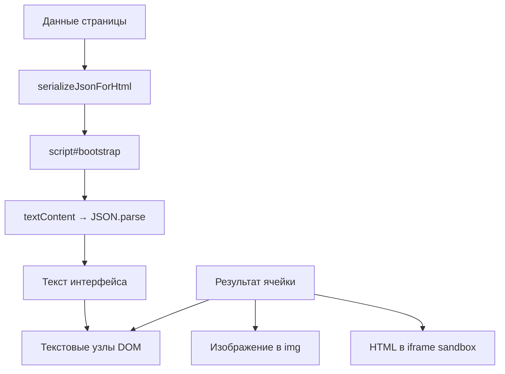

# XSS

Данные первого HTML BFF сериализует для контейнера `script#bootstrap` с типом `application/json`. Клиент разбирает их как JSON. Текст интерфейса выводится текстовыми узлами, а HTML-результат ячейки открывается в изолированном iframe. [Выдача HTML](https://github.com/Cringe-Driven-Development-Team/frontend/blob/b1baf996fb6753d1a62eab6f874d03dca30faadc/apps/bff/src/html.ts#L21-L50), [чтение bootstrap](https://github.com/Cringe-Driven-Development-Team/frontend/blob/b1baf996fb6753d1a62eab6f874d03dca30faadc/apps/client/src/bootstrap.ts#L17-L38), [вывод ячейки](https://github.com/Cringe-Driven-Development-Team/frontend/blob/b1baf996fb6753d1a62eab6f874d03dca30faadc/apps/client/src/pages/NotebookPage/Output.tsx#L178-L215).

<DiagramSection>

## Два места вывода данных

Проверь контекст данных при выдаче первого HTML и при создании DOM в браузере. У вывода вычислений способ отображения зависит от формата.

<template #diagram>

</template>

</DiagramSection>

## Bootstrap внутри HTML

1. BFF вызывает `serializeJsonForHtml` из `@cdd-team/serialize-javascript`. Функция сериализует данные в JSON и заменяет `<`, `>`, `&`, U+2028 и U+2029 на JSON-последовательности. Так данные остаются внутри контейнера скрипта. [Сериализатор](https://github.com/Cringe-Driven-Development-Team/frontend-packages/blob/872ffb6e01c13473867adfa6247e4e2d192f1c1b/packages/serialize-javascript/src/index.ts#L1-L27).
2. BFF помещает результат в `script#bootstrap` с `type="application/json"`. [HTML-обработчик](https://github.com/Cringe-Driven-Development-Team/frontend/blob/b1baf996fb6753d1a62eab6f874d03dca30faadc/apps/bff/src/html.ts#L21-L50).
3. Клиент проверяет элемент и его тип, вызывает `JSON.parse` над `textContent` и проверяет структуру данных. Ошибка bootstrap прерывает запуск приложения. [Разбор bootstrap](https://github.com/Cringe-Driven-Development-Team/frontend/blob/b1baf996fb6753d1a62eab6f874d03dca30faadc/apps/client/src/bootstrap.ts#L3-L64), [запуск клиента](https://github.com/Cringe-Driven-Development-Team/frontend/blob/b1baf996fb6753d1a62eab6f874d03dca30faadc/apps/client/src/main.tsx#L1-L29).

## Текст в интерфейсе

Передавай пользовательские строки как текст JSX. Командный React создаёт для них DOM-узлы через `createTextNode` и обновляет `nodeValue`. Для пользовательских строк избегай `innerHTML`: браузер разбирает его содержимое как разметку. [Представление строк](https://github.com/Cringe-Driven-Development-Team/frontend-packages/blob/872ffb6e01c13473867adfa6247e4e2d192f1c1b/packages/react/src/children.ts#L49-L62), [создание DOM](https://github.com/Cringe-Driven-Development-Team/frontend-packages/blob/872ffb6e01c13473867adfa6247e4e2d192f1c1b/packages/react/src/patch-dom.ts#L8-L20), [обновление свойств узла](https://github.com/Cringe-Driven-Development-Team/frontend-packages/blob/872ffb6e01c13473867adfa6247e4e2d192f1c1b/packages/react/src/patch-dom.ts#L61-L84).

| Формат результата ячейки | Как выводится |
| --- | --- |
| Стандартный вывод и ошибки | Строки в `pre`, ANSI-оформление задаёт классы элементов `span` |
| PNG и SVG | Изображение в `img` |
| HTML | Документ в `iframe` с `sandbox=""`, установленным перед `srcdoc` |

Пустой `sandbox` блокирует скрипты и формы, а документ получает изолированный origin. `srcdoc` наследует CSP страницы. Политика гостевого HTML допускает встроенные стили, а отображение авторизованного результата зависит также от формата результата и ограничений iframe. [Выбор способа отображения](https://github.com/Cringe-Driven-Development-Team/frontend/blob/b1baf996fb6753d1a62eab6f874d03dca30faadc/apps/client/src/pages/NotebookPage/Output.tsx#L178-L215), [ANSI и iframe](https://github.com/Cringe-Driven-Development-Team/frontend/blob/b1baf996fb6753d1a62eab6f874d03dca30faadc/apps/client/src/pages/NotebookPage/Output.tsx#L236-L270), [правила sandbox](https://html.spec.whatwg.org/multipage/iframe-embed-object.html#attr-iframe-sandbox), [CSP](/documentation/security/csp).

## Границы защиты

Экранирование bootstrap сохраняет данные в нужном контексте. Выбор узла и атрибутов определяет, как браузер обработает эти данные при последующем выводе. Например, ссылку и её назначение проверяй отдельно от текста ссылки. `HttpOnly` закрывает чтение cookie из JavaScript, но браузер может приложить её к запросу уже исполняющегося кода. [Cookie](https://github.com/Cringe-Driven-Development-Team/frontend/blob/b1baf996fb6753d1a62eab6f874d03dca30faadc/apps/bff/src/session/cookies.ts#L1-L4), [запрос внутри origin](/documentation/security/csrf#xss-внутри-origin).

## Источники и проверка

Сериализация, разбор bootstrap и виды вывода сверены по коду выложенного фронтенда и закреплённой версии пакетов. Гостевой ответ с bootstrap и CSP проверен по HTTP. Авторизованный рендер HTML-результата описан по исходнику. [Наблюдение на проде](/documentation/security/csp#источники-и-проверка), [зависимости клиента](https://github.com/Cringe-Driven-Development-Team/frontend/blob/b1baf996fb6753d1a62eab6f874d03dca30faadc/apps/client/package.json#L12-L26), [зависимости BFF](https://github.com/Cringe-Driven-Development-Team/frontend/blob/b1baf996fb6753d1a62eab6f874d03dca30faadc/apps/bff/package.json#L16-L20).
