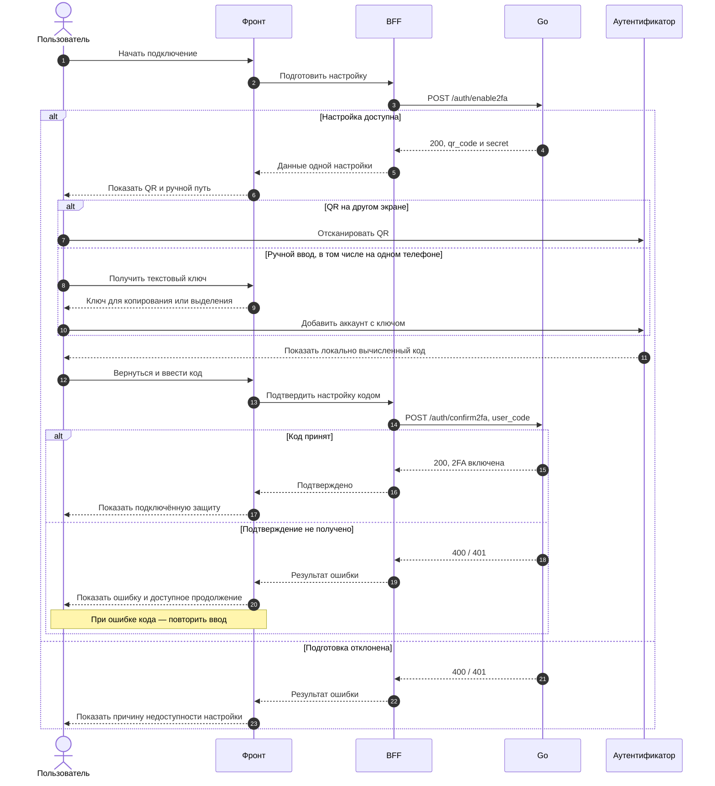
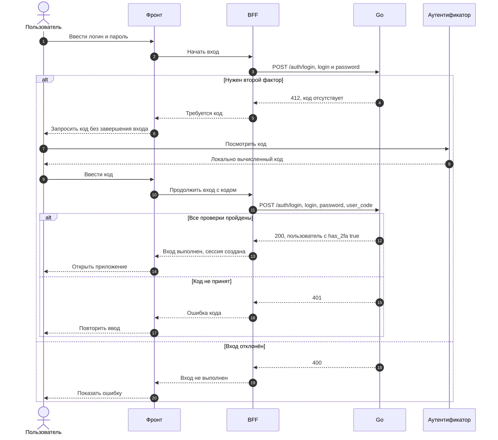
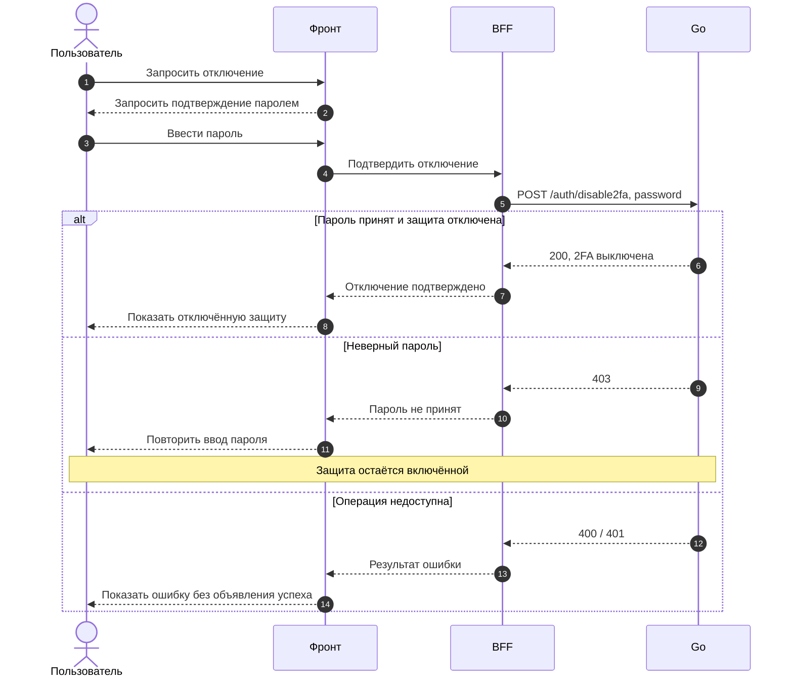

Эта страница описывает пользовательские сценарии 2FA и ответственность фронта и BFF.
Общая модель — в [обзоре 2FA](./2fa), согласованные операции API и гарантии сервера —
в [подтреке бэка](./2fa-back).

::: info Целевое поведение на 04.11.2026
Это требования к учебной работе по [frontend#47](https://github.com/Cringe-Driven-Development-Team/frontend/issues/47).
Наличие описания и макетов не подтверждает готовность реализации или проверку с реальными аутентификаторами.
:::

<DiagramSection>

## Подключение

Авторизованный пользователь начинает настройку в профиле. Интерфейс предлагает QR-код
и ручной ключ как два способа добавить одну настройку в приложение-аутентификатор.
Ручной путь доступен и на телефоне, и на десктопе; раскрытие ключа не создаёт новую настройку.

На одном телефоне пользователь проходит такой путь:

1. Раскрывает ключ и копирует его. Копируется только ключ; при ошибке копирования
   он остаётся доступным для ручного выделения и копирования.
2. Открывает аутентификатор и добавляет аккаунт вручную: название — Cellestial,
   при необходимости — текущий логин и тип ключа «По времени (TOTP)».
3. Возвращается в Cellestial и переходит к подтверждению кодом из приложения.

Обычное переключение приложений должно позволять продолжить с текущего шага.
Сохранность открытой страницы при её выгрузке операционной системой не гарантируется;
повторное получение незавершённой настройки сохраняет прежний ключ.

Ключ настройки и шестизначный код подтверждения должны быть различимы. Код передаётся
строкой с сохранением ведущих нулей. Только успешное подтверждение включает 2FA:
показ QR, копирование, переход к вводу кода и закрытие окна этого не делают.
Ошибка позволяет повторить ввод без механического сброса всего сценария.

<template #diagram>

</template>

Аутентификатор вычисляет код локально. QR, ключ и код переносит пользователь;
сетевого обращения BFF или Go к приложению-аутентификатору нет.

</DiagramSection>

<DiagramSection>

## Вход

Пользователь сначала вводит логин и пароль. Если подключена 2FA, интерфейс запрашивает
код из аутентификатора и завершает вход только после его успешной проверки сервером.
До этого полноценной авторизованной сессии нет. При неверном коде пользователь остаётся
на шаге второго фактора и может повторить ввод.

Схема показывает вход с подключённой 2FA. Без неё успешная проверка логина и пароля
завершает вход без запроса кода. Неверные логин или пароль не открывают шаг второго фактора.

<template #diagram>

</template>

</DiagramSection>

<DiagramSection>

## Отключение

Авторизованный пользователь запрашивает отключение и подтверждает действие паролем.
До успешного ответа интерфейс не показывает защиту отключённой. Неверный пароль оставляет
2FA включённой и позволяет повторить попытку; после успеха следующий вход не требует кода.
Аутентификатор в этом сценарии не участвует.

<template #diagram>

</template>

</DiagramSection>

## Ответственность фронта и BFF

- Фронт ведёт пользователя через подготовку, подтверждение, вход и отключение;
  показывает ожидание, успех, ошибку и доступный повтор. Состояние защиты отражает
  подтверждённый результат сервера.
- BFF служит посредником между фронтом и Go: передаёт данные согласованных операций
  и корректно возвращает результат. При подготовке передаёт оба поля `qr_code` и `secret`;
  ключ не требуется извлекать из картинки QR.
- Фронт и BFF бережно обращаются с ключом, QR и кодами: не раскрывают их в журналах,
  аналитике, кэшах или сохранённых данных; после закрытия или завершения настройки
  её конфиденциальные данные больше не доступны в интерфейсе.
- Go отвечает за проверку кода и пароля и изменение состояния защиты. Ограничения
  интерфейса не заменяют серверные гарантии.

Согласованные параметры и HTTP-статусы приведены в [операциях бэка](./2fa-back#операции-api).
По уточнению от 04.11.2026 ограничения попыток ввода TOTP-кода и пароля не требуются;
соответствующее требование [backend#23](https://github.com/Cringe-Driven-Development-Team/backend/issues/23) не применяется.
В частности, `401` при подтверждении означает как неверный код, так и отсутствие авторизации:
различение причин нужно сверить с API при реализации BFF. Эта страница не задаёт формат
ошибок и имена процедур между браузером и BFF. Общие правила сессии — в [контракте BFF](./bff/contract).

## Макеты

Ориентир — [Release в Figma](https://www.figma.com/design/7iaVDGiwzQk2vZIB5ogVlq/Cellestial?node-id=90-14161).
Ключевые экраны для каждого сценария:

| Сценарий | Десктоп | Телефон |
| --- | --- | --- |
| Подключение через QR | [QR](https://www.figma.com/design/7iaVDGiwzQk2vZIB5ogVlq/Cellestial?node-id=496-16027) | [QR](https://www.figma.com/design/7iaVDGiwzQk2vZIB5ogVlq/Cellestial?node-id=496-20591) |
| Ручной ключ | [Ключ](https://www.figma.com/design/7iaVDGiwzQk2vZIB5ogVlq/Cellestial?node-id=593-18950) | [Ключ](https://www.figma.com/design/7iaVDGiwzQk2vZIB5ogVlq/Cellestial?node-id=593-19748) |
| Подтверждение подключения | [Код](https://www.figma.com/design/7iaVDGiwzQk2vZIB5ogVlq/Cellestial?node-id=513-23067) | [Код](https://www.figma.com/design/7iaVDGiwzQk2vZIB5ogVlq/Cellestial?node-id=513-23853) |
| Вход со вторым фактором | [Вход](https://www.figma.com/design/7iaVDGiwzQk2vZIB5ogVlq/Cellestial?node-id=496-18648) | [Вход](https://www.figma.com/design/7iaVDGiwzQk2vZIB5ogVlq/Cellestial?node-id=496-21601) |
| Отключение | [Пароль](https://www.figma.com/design/7iaVDGiwzQk2vZIB5ogVlq/Cellestial?node-id=496-16853) | [Пароль](https://www.figma.com/design/7iaVDGiwzQk2vZIB5ogVlq/Cellestial?node-id=496-21003) |

Макеты показывают ожидаемые экраны. Работу переходов, копирования и переключения приложений
нужно проверить в реализации.

## Что проверить

- [ ] QR и ручной ключ подключают одну настройку; ручной путь доступен на телефоне и десктопе.
- [ ] На одном телефоне можно получить ключ, добавить аккаунт в аутентификаторе,
  вернуться и подтвердить код. При ошибке копирования работает ручное выделение.
- [ ] Обычное переключение приложений сохраняет текущий шаг; повторное открытие
  незавершённой настройки не меняет ключ.
- [ ] Подключение подтверждается только успешной проверкой кода, включая код с ведущим нулём.
  Закрытие настройки и ошибки не включают защиту; доступен повтор без сброса сценария.
- [ ] При подключённой 2FA вход завершается только после проверки кода; неверные данные
  не создают сессию.
- [ ] Отключение требует верного пароля; ошибка сохраняет защиту и позволяет повторить ввод.
- [ ] Интерфейс различает ожидание, успех и ошибку; BFF корректно передаёт данные настройки
  и результаты операций, конфиденциальные данные не раскрываются.
- [ ] После готовности обеих сторон пройдена [общая проверка](./2fa) через QR и вручную
  на одном телефоне с реальным API, Яндекс Ключом и Google Authenticator.

До общей проверки фронт и BFF можно разрабатывать и проверять локально по согласованному
контракту; временный порядок выкладки сторон не блокирует эту работу.
