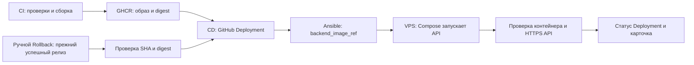

::: info План второго модуля
Здесь описан целевой поток из [backend#42](https://github.com/Cringe-Driven-Development-Team/backend/issues/42)
и [infra#69](https://github.com/Cringe-Driven-Development-Team/infra/issues/69).
Он ещё не внедрён целиком; ссылки на текущий код отдельно помечены как исходное состояние.
:::

## Путь образа

CI проверяет коммит, публикует образ Go API в GHCR и передаёт digest в CD.
Обычная выкатка и ручной откат проходят через один контракт Ansible:
`backend_image_ref` указывает на точный образ, который должен работать на VPS.

Git SHA называет исходный коммит, тег `sha-<полный SHA>` помогает человеку найти
образ, а digest `@sha256:…` закрепляет его содержимое. Поэтому в Ansible передаётся
ссылка по digest. Статус `success` появляется только после проверки запущенного
образа и публичного API.

## Документы

| Подраздел | Что объясняет |
| --- | --- |
| [Выкатка](./backend-cicd/release) | Путь от push в `main` до проверенного production |
| [Откат](./backend-cicd/rollback) | Выбор прежнего образа и результат ручного workflow |
| [GitHub Deployments](./backend-cicd/deployments) | Где хранится подтверждённая история релизов |
| [Ansible и VPS](./backend-cicd/ansible) | Как выбранный digest становится запущенным API |

Откат образа не откатывает схему и данные PostgreSQL. Автоматический откат в
этот план не входит.
