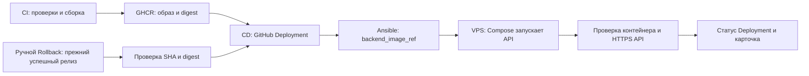

::: info План второго модуля
Здесь описан целевой поток из [backend#42](https://github.com/Cringe-Driven-Development-Team/backend/issues/42)
и [infra#69](https://github.com/Cringe-Driven-Development-Team/infra/issues/69).
Он ещё не внедрён целиком; ссылки на текущий код отдельно помечены как исходное состояние.
:::

<DiagramSection>

## Путь образа

CI проверяет коммит, публикует образ Go API в GHCR и передаёт digest в CD.
Обычная выкатка и ручной откат проходят через один контракт Ansible:
`backend_image_ref` указывает на точный образ, который должен работать на VPS.

<template #diagram>

</template>

| Термин | Что означает в этом плане |
| --- | --- |
| Git SHA | Исходный коммит, из которого CI собрал образ |
| Тег `sha-<полный SHA>` | Читаемое имя образа в GHCR; может быть перезаписано |
| Digest `@sha256:…` | Неизменяемая ссылка на содержимое образа; передаётся в Ansible |
| GitHub Deployment | Запись попытки выкатки или отката и подтверждённого результата |
| Статус `success` | Проверены запущенный образ, `healthy` контейнера и публичный API |

Наличие CI или схемы потока не подтверждает готовность: целевой результат надо
проверить после реализации обеих задач.

</DiagramSection>

## Документы

| Подраздел | Что объясняет |
| --- | --- |
| [Выкатка](./backend-cicd/release) | Путь от push в `main` до проверенного production |
| [Откат](./backend-cicd/rollback) | Выбор прежнего образа и результат ручного workflow |
| [GitHub Deployments](./backend-cicd/deployments) | Где хранится подтверждённая история релизов |
| [Ansible и VPS](./backend-cicd/ansible) | Как выбранный digest становится запущенным API |

Откат образа не откатывает схему и данные PostgreSQL. Автоматический откат в
этот план не входит.
