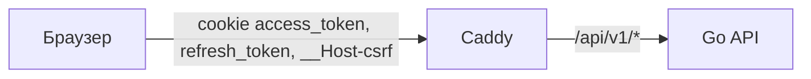
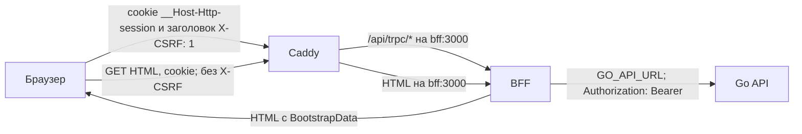
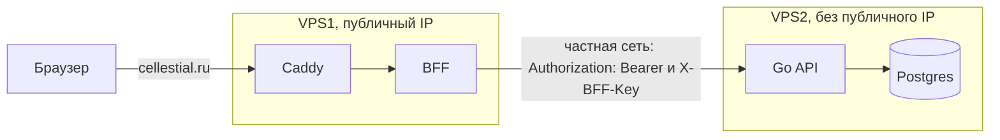

Подзадачи трека, включая «tRPC (server)» — роутер tRPC в BFF, делает Денис; Валентин — изменения на стороне Go (см. [«Go API»](#go-api)).
Клиент к Go и zod-схемы из контракта Go — подтрек [«Orval»](./bff-orval). Подключение официального
`@trpc/client` — подтрек [«tRPC (client)»](./trpc-client); сервер использует официальный `@trpc/server`
и `zod`. Собственные клиент и сервер tRPC появятся в [модуле №3](/modules/3/tracks/trpc).

Браузер получает HTML с пользователем из BFF (Backend for Frontend), затем вызывает процедуры tRPC;
BFF ходит в Go API общим клиентом с единой обработкой сессии и refresh.
Токены остаются на сервере и в браузер не попадают: у пользователя только зашифрованная cookie сессии.
Страница описывает целевое состояние трека; остальные — [Контракт](./bff/contract) (роутер tRPC, клиент к
Go от Orval и официальный клиент tRPC), [Авторизация и CSRF](./bff/auth) (сессия, refresh и защита от CSRF по
сценариям), [Сервис BFF](./bff/service) (каркас, переменные, health check, образ и запуск),
[Серверный bootstrap](./bff/bootstrap) (пользователь в HTML и старт клиента),
[Выкатка](./bff/release) (образ и ассеты одного выпуска, GitHub Deployments, Ansible) и
[Откат](./bff/rollback) (выбор прежнего образа и проверка результата).

## Как устроен контракт

<Diagram name="modules/2/bff-contract" />

Слева — то, что делается до выкатки, на ноуте или в CI. Orval — генератор кода, а не сервис: команда
`bun run sync` запускает его, и он пишет файлы в репозиторий. В проде его нет. Справа — то, что работает в
проде. Между ними — сгенерированные файлы: они попадают в сборку BFF и Go.

- **Генерация.** Контракт Go ведётся в Apidog: Go забирает его через `make generate`, монорепа — через
  `bun run sync` в `spec/openapi.json`. Orval строит по нему клиент к Go для BFF и zod-схемы операций в пакет
  `@cdd/schemas`.
- **BFF.** Процедуры роутера проверяют вход схемами из `@cdd/schemas` на настоящем `zod` и ходят в Go
  клиентом от Orval.
- **Клиент.** Официальный `@trpc/client` берёт типы процедур из `import type AppRouter`; начальные данные HTML — из `import type BootstrapData`. Кода BFF в бандле нет.
  Формы проверяют поля своими правилами, как сейчас, а ошибку входа от BFF (`zodError`) раскладывают по полям.
  Подробности — [«Контракт»](./bff/contract).

В [модуле №3](/modules/3/) появляются свои [клиент и сервер tRPC](/modules/3/tracks/trpc),
[Zod](/modules/3/tracks/zod) и [React Hook Form](/modules/3/tracks/react-hook-form): общие схемы
`@cdd/schemas` проверяют поля на BFF и в браузере ещё до запроса.

## Карта задач

Последовательность работ:
[#44 монорепа](https://github.com/Cringe-Driven-Development-Team/frontend/issues/44) →
[#45 Orval](https://github.com/Cringe-Driven-Development-Team/frontend/issues/45) →
[#2 сервер](https://github.com/Cringe-Driven-Development-Team/frontend/issues/2) →
[#46 клиент](https://github.com/Cringe-Driven-Development-Team/frontend/issues/46) →
[#5 интерфейс](https://github.com/Cringe-Driven-Development-Team/frontend/issues/5) →
[#4 выпуск](https://github.com/Cringe-Driven-Development-Team/frontend/issues/4).

Серверный tRPC и каркас BFF делает Денис; Валентин меняет контракт и реализацию Go. Orval генерирует
клиент к Go и схемы; официальный клиент tRPC подключается в #46; #5 переводит интерфейс на процедуры
и bootstrap. CI/CD можно готовить параллельно после определения артефактов, но интеграционная приёмка
BFF требует согласованного Go.

Изменения контракта и реализации Go — [backend#41](https://github.com/Cringe-Driven-Development-Team/backend/issues/41).
Первый production-этап — [infra#58](https://github.com/Cringe-Driven-Development-Team/infra/issues/58): BFF и Caddy
на действующей VPS. После проверки этого этапа [infra#59](https://github.com/Cringe-Driven-Development-Team/infra/issues/59)
развёртывает Go API и новый PostgreSQL на приватной VPS2; backend#41 — её sub-issue.

## Монорепа фронта

<Diagram name="modules/2/frontend-monorepo" />

[frontend#44](https://github.com/Cringe-Driven-Development-Team/frontend/issues/44) делает репозиторий фронта
монорепой на bun workspaces и Turborepo из трёх workspace: `apps/client`, `apps/bff` и `packages/schemas`
(`@cdd/schemas`). Собственные React/Zustand — пакеты `@cdd-team/*` из npm
(монорепа [`frontend-packages`](https://github.com/Cringe-Driven-Development-Team/frontend-packages));
`@trpc/client`, `@trpc/server` и `zod` — официальные внешние зависимости. Клиент берёт у BFF
только типы (`import type AppRouter` и `BootstrapData`), а Turborepo сначала собирает зависимости (`^build`) и повторный запуск
без изменений берёт из кеша. Vite собирает клиент и HTML, Bun build — BFF. Упаковка общего образа
с HTML выполняется после обеих сборок вне `bff#build`, чтобы не создать цикл с клиентом.
[Выпуск и откат](./bff/bootstrap#выпуск-и-откат) связывают HTML и BFF одним SHA; ассеты идут в CDN.
Подробный поток — на страницах [выкатки](./bff/release) и [отката](./bff/rollback).
Генерация клиента к Go и схем — в [«Как устроен контракт»](#как-устроен-контракт).

## Было и стало

Сейчас токены кладёт в cookie сам Go API, а браузер получает их напрямую:

После переезда между Caddy и Go появляется BFF:

Клиент вызывает процедуры tRPC на `/api/trpc`, данные те же; BFF ходит в Go по `GO_API_URL`
(на одной VPS — `http://api:8080/api/v1`) с `Authorization: Bearer`. До infra PR #71
маршрутизация была такой:
[`Caddyfile.j2`](https://github.com/Cringe-Driven-Development-Team/infra/blob/2f97437/ansible/roles/caddy/templates/Caddyfile.j2#L7)
(`reverse_proxy api:8080`); на одной VPS `api` не публикует порты и виден только из сети `app` — см.
[`compose.yml.j2`](https://github.com/Cringe-Driven-Development-Team/infra/blob/2f97437/ansible/roles/app/templates/compose.yml.j2#L18).

## Cookie до и после

| Cookie | `Path` | `HttpOnly` | `SameSite` | Кто читает |
|---|---|---|---|---|
| `access_token` (сейчас) | `/api/v1` | да | `Lax` | Go API |
| `refresh_token` (сейчас) | `/api/v1/auth` | да | `Lax` | Go API |
| `__Host-csrf` (сейчас) | `/` | **нет** | `Lax` | фронт читает из `document.cookie`, Go сверяет |
| `__Host-Http-session` (после) | `/` | да | `Lax` | только BFF; в браузере JavaScript её не видит |

Подробности про нынешние cookie — в разделе [CSRF](/security/csrf/). `__Host-Http-session` —
`Secure`, без `Domain`, срок `Max-Age` равен `refresh_expires_in`.

## Почему BFF

RFC 10017 «OAuth 2.0 for Browser-Based Applications» (BCP 212) перечисляет архитектуры браузерных
приложений ([§6](https://www.rfc-editor.org/rfc/rfc10017#section-6)) и ставит BFF первой:

> The patterns in this section are presented in decreasing order of security.

Про BFF отдельно
([§6.1.4.3](https://www.rfc-editor.org/rfc/rfc10017#section-6.1.4.3)):

> This architecture is strongly recommended for business applications, sensitive applications, and applications that handle personal data.

У нас личные данные пользователей, так что рекомендация подходит. Практический выигрыш: access и
refresh не доходят до браузера, а значит, XSS на странице не может их украсть. Но XSS всё равно может
слать запросы через BFF от имени пользователя: это сценарий «Proxying Requests via the User's Browser»
в [RFC 10017 §6.1.4.1](https://www.rfc-editor.org/rfc/rfc10017#section-6.1.4.1). BFF убирает кражу
токенов, но не последствия XSS.

## Что меняется

### Фронт

Клиент создаётся в
[`src/api/client.ts`](https://github.com/frontend-park-mail-ru/2026_2_Cringe_Driven_Development/blob/344ad0b/src/api/client.ts#L29)
с `baseUrl: '/api/v1'` и `credentials: 'include'`. Его заменяет официальный `@trpc/client`
(см. [«Клиент»](./bff/contract#клиент)): типы процедур и HTML — `import type { AppRouter, BootstrapData }` из BFF, на каждый
вызов `X-CSRF: 1`, cookie он не читает. Refresh на `401` и повтор после `403` уходят; `UNAUTHORIZED`
означает гостя и форму входа. До первого рендера клиент читает JSON из HTML в свой стор сессии,
без стартового `users.me`; процедура остаётся для явного обновления. Некорректный bootstrap — ошибка
запуска. Задача frontend#34 становится не нужна.

### BFF

Новый сервис на Hono с официальным `@trpc/server` и роутером tRPC на `/api/trpc` (см. [«Роутер»](./bff/contract#роутер)); каркас,
переменные окружения, логи, образ и запуск — [«Сервис BFF»](./bff/service).
`createContext` сначала проверяет `X-CSRF`, `Origin` и `Sec-Fetch-Site`, затем вызывает общий слой
сессии. Его же использует HTML-хендлер; `authedProcedure` требует сессию, а refresh общий для HTML/RPC. Вызовы Go — fetch-клиент от Orval, вход
процедур — zod-схемы от Orval из контракта Go. Работает без своего хранилища сессий. Гонка backend#12
решается внутри BFF, пока он один экземпляр — см. сценарий [«Параллельные RPC»](./bff/auth#параллельные-rpc).

### Go API

`Authenticate` сейчас читает access из cookie
[`access_token`](https://github.com/go-park-mail-ru/2026_2_Cringe_Driven_Development/blob/4094350/internal/middleware/authenticate.go#L19),
хотя контракт уже говорит про `Authorization: Bearer`. После переезда он читает `Authorization: Bearer`,
токены отдаются в JSON, а middleware CSRF и CORS, код cookie и переменные `CSRF_SECRET`,
`COOKIE_SECURE`, `CORS_ALLOWED_ORIGINS` удаляются.
Работа на стороне Go — [backend#41](https://github.com/Cringe-Driven-Development-Team/backend/issues/41).

### Infra

В compose добавлен сервис `bff` с `SESSION_KEY` и `APP_ORIGIN`, а Caddy направляет `/api/trpc/*` на
`bff:3000`, как и HTML. Корневой HTML из S3 заменяется шаблоном из образа BFF; ассеты
остаются в CDN. API, public и внутренний `/health` обрабатываются до HTML fallback.
Развёртывание BFF и переключение Caddy подготовлены в
[infra PR #71](https://github.com/Cringe-Driven-Development-Team/infra/pull/71) по
[infra#58](https://github.com/Cringe-Driven-Development-Team/infra/issues/58);
Go и новая БД на VPS2 — [infra#59](https://github.com/Cringe-Driven-Development-Team/infra/issues/59).

## Переключение

MVP использует один экземпляр BFF; короткое окно недоступности при выпуске допустимо.
Порядок переключения:

1. Загрузить ассеты клиента в неизменяемый CDN-каталог своего SHA.
2. Подготовить образ BFF с HTML того же SHA после обеих сборок. Упаковка выполняется вне
   `bff#build`; отдельного promote клиента после playbook нет.
3. После проверки образа и ассетов создать GitHub Deployment для выбранного SHA и вызвать
   `deploy-bff.yml` с digest BFF. Go выкатывается своим playbook; BFF и Caddy переключаются через
   entrypoint BFF. Подробности — на странице [выкатки](./bff/release).
4. Проверить фактически запущенный образ, внутренний `/health`, гостевой HTML, вход и защищённый RPC,
   доступность ассетов своего SHA. Лишь после этого поставить Deployment `success`. Готовность BFF
   предполагает проверенные конфигурацию и шаблон; завершение запросов ограничено конечным сроком —
   подробнее на странице сервиса.
5. [Откат](./bff/rollback) при сбое запускается вручную: он возвращает предыдущий успешный образ
   вместе с HTML и сохранёнными CDN-ассетами. Совместимость Go и миграций БД проверяется отдельно.

Ответы BFF на `auth.login`, `auth.register` и `auth.logout` стирают три старые cookie с их
`Path`: `access_token` (`/api/v1`), `refresh_token` (`/api/v1/auth`) и `__Host-csrf` (`/`). Каждый
пользователь один раз входит заново — см. сценарий
[«Первый вход после переезда»](./bff/auth#первыи-вход-после-переезда).
Обычный релиз с прежним `SESSION_KEY` сессию не сбрасывает. Публикацию и выпуск автоматизирует
[frontend#4](https://github.com/Cringe-Driven-Development-Team/frontend/issues/4).

### Канарейка — следующий этап

Сначала новая версия получает небольшой стабильный сегмент пользователей; доля растёт после
проверки ошибок и задержек. При ухудшении нужен возврат трафика на прежнюю версию.
Это отдельное развитие после MVP, со следующими предпосылками:

- HTML и RPC одного пользователя направляются согласованно в выбранную версию.
- Cookie читаются обеими версиями, а refresh безопасен между экземплярами. Текущий in-memory
  single-flight хранит результат 10 секунд в одном BFF и не создаёт общей блокировки между процессами.
- API совместим с открытыми вкладками: совместный образ HTML/BFF не обновляет уже загруженный JavaScript.
- Изменения Go/БД допускают совместную работу версий и безопасный откат.

Один graceful reload Caddy этих условий не обеспечивает. Сегментация трафика и общий механизм refresh
проектируются отдельно; в MVP новые сервисы и распределённые блокировки не добавляются.

## Две VPS

Целевая схема для двух машин. Сейчас стек Pulumi — одна VPS, а двухсерверная схема (gateway и backend)
заморожена в варианте `bff` документации
([`pulumi/README.md`](https://github.com/Cringe-Driven-Development-Team/infra/blob/2f97437/pulumi/README.md#L8)).

- **VPS1:** Caddy и BFF, публичный (floating) IP, домен `cellestial.ru`. **VPS2:** Go API и Postgres, без
  публичного IP, доступна только через частную сеть Selectel.
- **Домен один.** Публичного `api.cellestial.ru` нет: по схеме BFF браузер говорит только с BFF, а
  приложение живёт на одном origin с ним. RFC 10017
  ([§6.1.3.3.2](https://www.rfc-editor.org/rfc/rfc10017#section-6.1.3.3.2)) прямо допускает такую схему:

  > It is also possible to deploy the browser-based application on the same origin as the BFF.

  Отдельный публичный `api.*` нужен только другим клиентам, например мобильному приложению или
  партнёрам, и для них это `Authorization: Bearer` или OAuth, а не cookie.
- **BFF → Go** идёт на приватный адрес VPS2. Файрвол VPS2 (security group) пускает порт API и SSH
  только с VPS1; порт Postgres наружу не открыт вообще.
- **Адрес Go** BFF берёт из переменной `GO_API_URL`: на одной VPS это `http://api:8080/api/v1`, на двух —
  `http://<приватный адрес VPS2>:8080/api/v1`. На VPS2 compose публикует порт API только на приватном
  интерфейсе.
### S2S-ключ

- **Назначение.** На двух VPS BFF передаёт `X-BFF-Key: <BFF_API_KEY>`. Ключ подтверждает знание
  общего секрета сервисами, а Bearer — сессию пользователя.
- **Проверка.** Go проверяет ключ раньше Bearer, сравнивая значение за постоянное время
  (`crypto/subtle.ConstantTimeCompare`; для ключа фиксированной длины этого достаточно).
  Без ключа или с неверным ключом отвечает `403` с кодом `s2s_forbidden`, не `401`.
- **Отказ.** BFF считает `s2s_forbidden` инфраструктурной ошибкой: RPC получает `BAD_GATEWAY`
  (HTTP `502`), HTML — страницу `503`; BFF пишет в лог, refresh не делает и сессию не трогает.
  Иначе попытка refresh с тем же неверным ключом тоже была бы отклонена и привела бы к потере сессии.
- **Хранение.** `BFF_API_KEY` лежит в `.env` обеих машин; в браузер и логи ключ не попадает.
- **Ротация.** На время переключения Go принимает старый и новый ключ. Сначала разрешается новый,
  затем BFF переводится на него; после переключения старый удаляется.

### mTLS — следующий этап

mTLS — TLS с взаимной проверкой сертификатов BFF и Go: шифрует канал и подтверждает идентичность
обеих сторон. `X-BFF-Key` подтверждает знание секрета, но не шифрует HTTP.
Для mTLS нужны выдача сертификатов, настройка доверия и правила ротации; это не входит в MVP.
HTTP внутри частной сети — принятый риск MVP: изоляция сети Selectel ограничивает доступ,
но не является шифрованием. mTLS закрыл бы риск передачи данных открытым текстом.

### Перенос Go и Postgres

[infra#58](https://github.com/Cringe-Driven-Development-Team/infra/issues/58) добавляет BFF в Compose/Caddy
текущей VPS. После проверки этого этапа [infra#59](https://github.com/Cringe-Driven-Development-Team/infra/issues/59)
развёртывает Go и новый PostgreSQL на приватной VPS2 и настраивает доступ к ней. Данные и состояние
миграций со старой VPS не копируются: Go создаёт схему в пустой БД при первом старте. Старые тома
на VPS1 сохраняются. При откате к ним записи, созданные на VPS2 после переключения, автоматически
не попадут. Проверка S2S-ключа и серверный контракт Go —
[backend#41](https://github.com/Cringe-Driven-Development-Team/backend/issues/41),
sub-issue infra#59. PR бэка вливается раньше PR infra#59; переключение на VPS2 выполняется после подготовки обеих сторон.

- **Ansible** ходит на VPS2 по SSH только через VPS1 как jump host (`ProxyJump`): публичного адреса у
  VPS2 нет. Динамический inventory группирует хосты по `metadata.role`
  ([`openstack.yml`](https://github.com/Cringe-Driven-Development-Team/infra/blob/2f97437/ansible/inventory/openstack.yml#L17)),
  так что у второй машины будет своя роль. Файрвол VPS2 должен разрешать API и SSH только с VPS1.
- **Уже есть в Pulumi:** `private-network`, `private-subnet` и `router`
  ([`index.ts`](https://github.com/Cringe-Driven-Development-Team/infra/blob/2f97437/pulumi/index.ts#L181-L201)),
  инстанс `gateway` на порту частной подсети с floating IP
  ([`index.ts`](https://github.com/Cringe-Driven-Development-Team/infra/blob/2f97437/pulumi/index.ts#L250-L280)).
  Ресурсы backend-сервера удалены, и возвращать их под прежним именем нельзя до проверки стейта
  ([`README`](https://github.com/Cringe-Driven-Development-Team/infra/blob/2f97437/pulumi/README.md#L287)).
- **Нужно добавить:** инстанс и порт VPS2 под новым именем, security group и `ProxyJump` в inventory.
  Сейчас sshd запрещает `AllowTcpForwarding`, и в роли отмечено, что jump-хост не нужен
  ([`ssh_hardening`](https://github.com/Cringe-Driven-Development-Team/infra/blob/2f97437/ansible/roles/ssh_hardening/tasks/main.yml#L14-L16)),
  так что для jump host на VPS1 это придётся изменить.

## Ограничения

- Смена `SESSION_KEY` разлогинивает всех: старые cookie больше не расшифровываются.
- На одной VPS Go API закрыт только сетью compose, без S2S-ключа: из этой сети любой сервис может
  позвать его напрямую. На двух VPS есть ключ `X-BFF-Key` и файрвол, см. [«Две VPS»](#две-vps).
- BFF работает одним экземпляром: объединение одновременных refresh держится в его памяти. Второй
  экземпляр потребует общую блокировку refresh (Redis) или льготное окно из [backend#12](https://github.com/Cringe-Driven-Development-Team/backend/issues/12).

## tRPC

После начального HTML с bootstrap вызовы клиента к BFF идут через tRPC, клиент переключается разом: проект учебный, реальных
пользователей нет. Девять процедур названы по ресурсам Go (`auth.*`, `users.me`, `notebooks.*`,
`cells.*`); если экрану нужно больше одного вызова Go, для него заводится процедура `views.*`. Клиент
tRPC в модуле №2 официальный, типы он берёт из `AppRouter`. В модуле №3 его заменяют
[собственные клиент и сервер](/modules/3/tracks/trpc). Подробности — [«Контракт»](./bff/contract).
