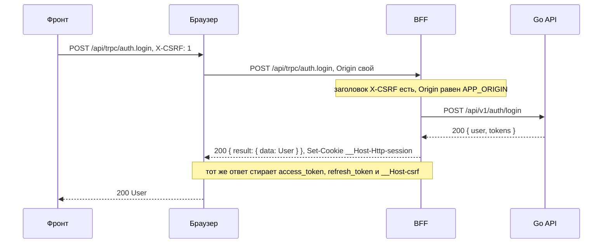
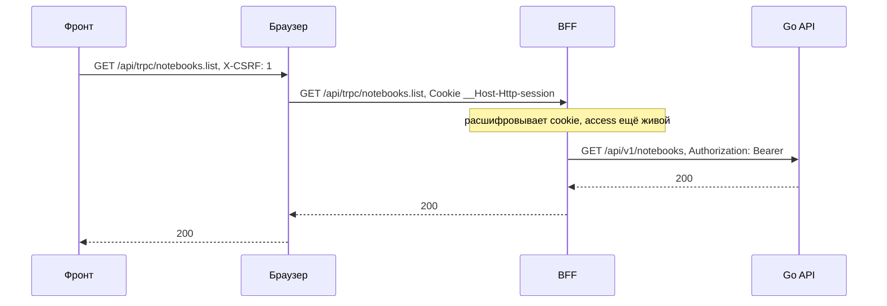
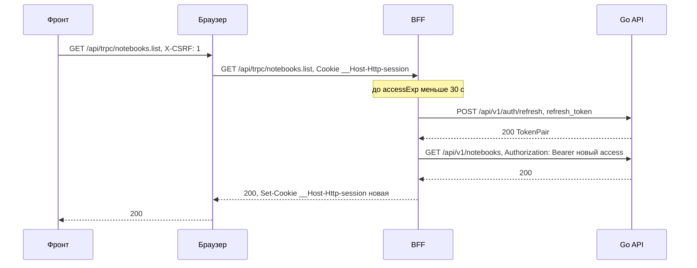
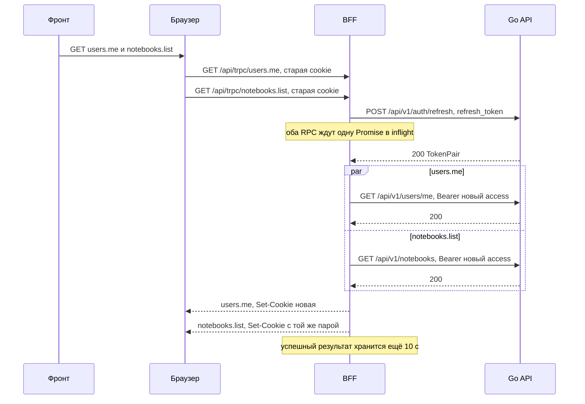
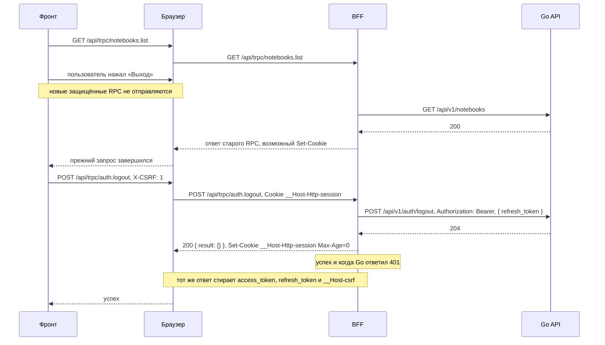
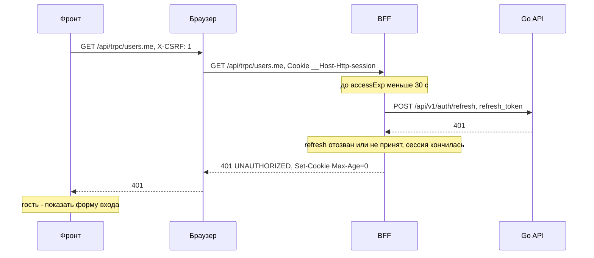
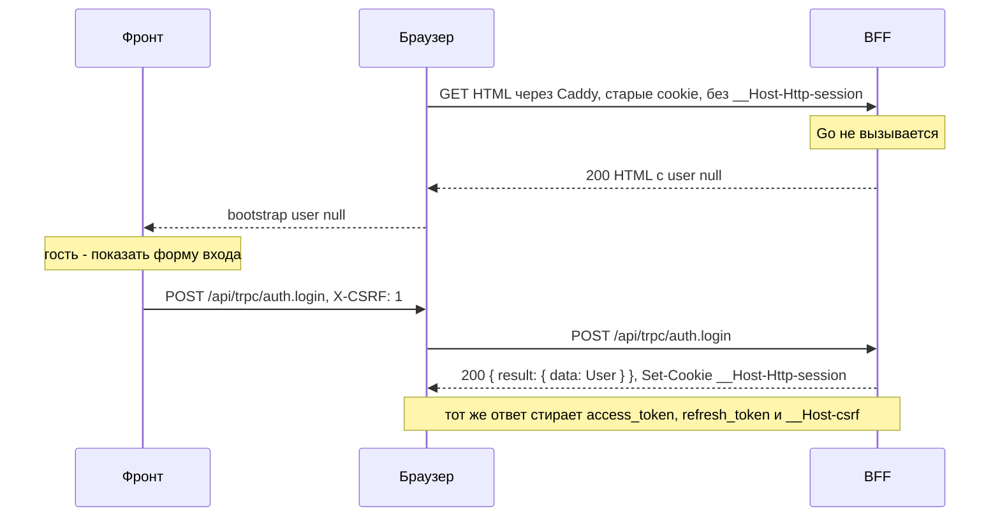

# Сценарии авторизации BFF

::: info Статус плана
Проект: проверить после внедрения. Ниже описано целевое поведение сессии;
пометки у сценариев сохраняют эту границу проверки.
:::

Семь сценариев показывают вход, запросы и завершение сессии по шагам.
Правила — [cookie сессии](./auth#cookie-сессии),
[обработка вызова](./auth#как-bff-обрабатывает-вызов) и [CSRF](./auth#csrf).
Общая картина — [обзор трека](../bff).

## Сценарии

Участники: `F` — код фронта, `B` — браузер, `P` — BFF, `A` — Go API.

<DiagramSection>

### Вход

Фронт шлёт логин с заголовком `X-CSRF: 1`. BFF проверяет заголовок и `Origin`, вызывает Go и
получает токены в JSON. Токены остаются в BFF: браузеру уходят `User` и новая cookie, а три старые
cookie стираются.

<template #diagram>

</template>

*Проект: проверить после внедрения.*

</DiagramSection>

<DiagramSection>

### Запрос данных

BFF расшифровывает cookie и подставляет access токен как `Authorization: Bearer`. Фронт про токены
ничего не знает.

<template #diagram>

</template>

*Проект: проверить после внедрения.*

</DiagramSection>

<DiagramSection>

### Access истёк

Если до `accessExp` меньше 30 с, BFF обновляет токены сам, а потом выполняет исходный запрос.
Фронт делает один запрос и не замечает refresh; новая cookie приходит с обычным ответом.

<template #diagram>

</template>

*Проект: проверить после внедрения.*

</DiagramSection>

<DiagramSection>

### Параллельные RPC

`users.me` и `notebooks.list` отправлены из одной вкладки разными HTTP-запросами со старой cookie,
у которой access почти истёк. Go получает один вызов refresh, а оба RPC используют новую пару.
После refresh вызовы данных в Go независимы: они могут выполняться параллельно и завершаться
в любом порядке.

<template #diagram>

</template>

*Проект: проверить после внедрения.*

</DiagramSection>

<DiagramSection>

### Выход

Клиент сначала дожидается остальных защищённых HTTP-запросов или подтверждает их отмену, а новые
не отправляет. Иначе ответ старого RPC может прийти после успешного выхода и восстановить cookie.
Это правило действует для разных RPC, даже если они не попали в один батч.

После проверки CSRF процедура `auth.logout` (при истёкшем access — после refresh) вызывает Go с Bearer и `refresh_token` в теле, стирает cookie
и отвечает успехом. Даже если Go вернул `401` (токен уже недействителен), клиент получает успех: сессии
больше нет в любом случае. Без cookie сессии Go не вызывается, а ответ тот же; три старые cookie
стираются всегда.

<template #diagram>

</template>

*Проект: проверить после внедрения.*

</DiagramSection>

<DiagramSection>

### Сессия кончилась

Refresh-токен отозван или не принят Go. Go отвечает `401`, BFF стирает cookie и отвечает
`UNAUTHORIZED`; фронт показывает форму входа. Если refresh просто истёк, браузер уже удалил
cookie (`Max-Age` = `refresh_expires_in`), и `authedProcedure` отвечает `UNAUTHORIZED`, не обращаясь в Go.

<template #diagram>

</template>

*Проект: проверить после внедрения.*

</DiagramSection>

<DiagramSection>

### Первый вход после переезда

У пользователя в браузере старые cookie `access_token`, `refresh_token` и `__Host-csrf`, а новой
`__Host-Http-session` нет. HTML содержит `user: null` без вызова Go; клиент показывает форму входа.
Пользователь входит заново, и ответ входа ставит новую cookie и стирает три старые.

<template #diagram>

</template>

*Проект: проверить после внедрения.*

</DiagramSection>
