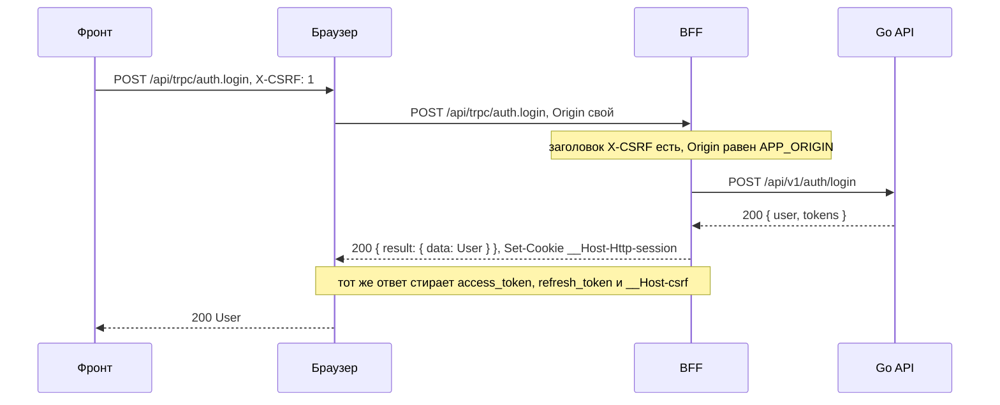
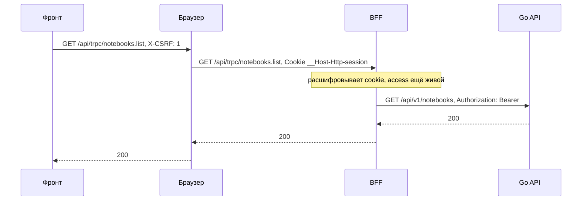
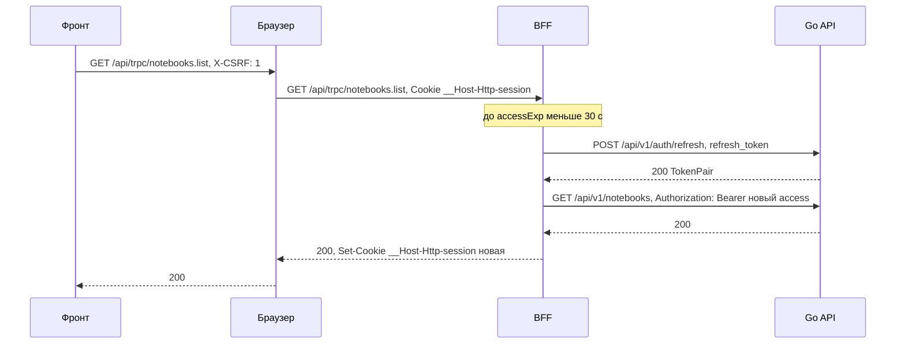
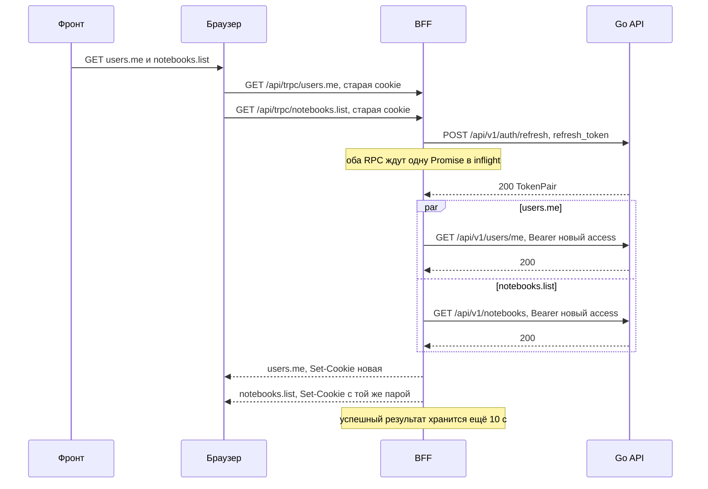
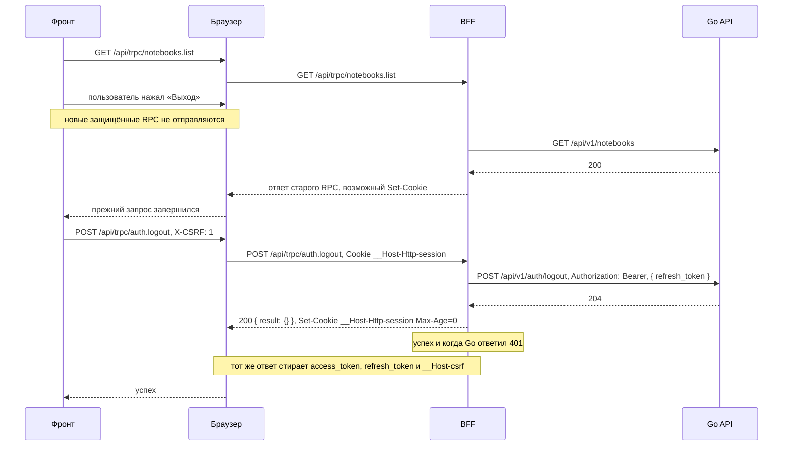
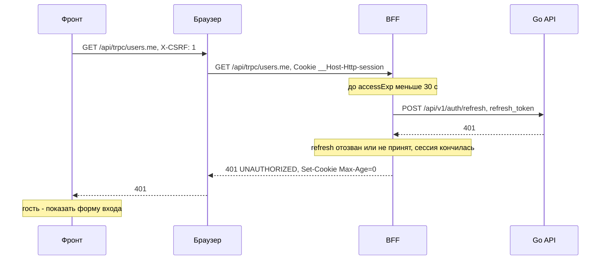
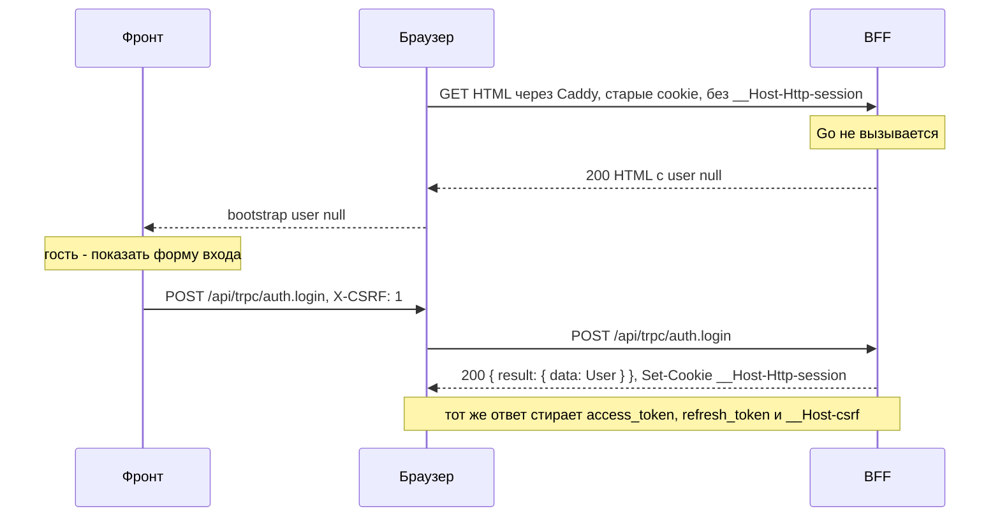

# Миграция на BFF: авторизация и CSRF

Как BFF будет хранить сессию и обновлять токены: три схемы CSRF и семь сценариев сессии по шагам.
Общая картина — [«Обзор»](../bff), формат ручек — [«Контракт»](./contract). Как защита устроена сейчас —
в разделе [CSRF](/security/csrf/).

## Cookie сессии

BFF держит всю сессию в одной cookie `__Host-Http-session`. Токены Go API лежат внутри неё в
зашифрованном виде, а в браузер не попадает ничего, что JavaScript мог бы прочитать.

| Атрибут | Значение |
|---|---|
| Имя | `__Host-Http-session` |
| `HttpOnly` | да |
| `Secure` | да |
| `Path` | `/` |
| `SameSite` | `Lax` |
| `Domain` | не задаётся |
| `Max-Age` | `refresh_expires_in` из ответа Go |

Значение — `base64url(iv ‖ шифротекст ‖ тег)`: AES-256-GCM, ключ `SESSION_KEY` (32 байта), имя cookie
служит AAD (дополнительные аутентифицируемые данные). `iv` — 12 случайных байт из CSPRNG
(`crypto.getRandomValues`), новые при каждом шифровании; повтор IV с тем же `SESSION_KEY` ломает GCM.
Ошибка расшифровки или тега — сессии нет, и процедуры с сессией отвечают `UNAUTHORIZED`. Внутри — JSON:

```json
{ "access": "…", "refresh": "…", "accessExp": 1760000000, "refreshExp": 1762600000 }
```

*Пример формы; значения токенов и ключа на страницах не приводятся.*

Что говорит RFC 10017. Атрибуты и префикс
([§6.1.3.2](https://www.rfc-editor.org/rfc/rfc10017#section-6.1.3.2)):

> The BFF MUST enable the Secure flag for its cookies.

> The BFF MUST enable the HttpOnly flag for its cookies.

> The BFF SHOULD enable the SameSite=Strict flag for its cookies.

Здесь сознательно выбрано `Lax` вместо рекомендации `Strict`. Для обычной GET-навигации верхнего
уровня поведение такое:

| Начало навигации | `Strict` | `Lax` |
| --- | --- | --- |
| Прямой ввод адреса или закладка | cookie отправляется | cookie отправляется |
| Ссылка с другого сайта, например GitHub | cookie не отправляется в первоначальном запросе | cookie отправляется |

Условия cookie (хост, HTTPS, срок действия) считаются выполненными; это обычный переход,
а не произвольная цепочка редиректов. Хотя конечный URL одинаков, браузер учитывает инициатор
навигации. При `Strict` cookie не удалена: первый HTML после внешней ссылки гостевой, но следующий
same-site запрос может отправить cookie, если приложение предусмотрело восстановление сессии.
У нас нет стартового `users.me` из браузера: `Lax` нужен, чтобы пользователь сразу появился
в первом HTML. Остальные атрибуты и шифрование сохраняются.

Цена `Lax`: внешний GET верхнего уровня может прийти с cookie, поэтому GET не меняет предметные
данные и не выполняет logout. POST/RPC по-прежнему защищены `X-CSRF`, Origin и Fetch Metadata;
подробнее — ниже в разделе CSRF.

> The BFF SHOULD start the name of its cookie with a prefix indicating the cookie was set via HTTP, for example, by using the __Host-Http- prefix defined in [COOKIES].

Шифрование там же:

> the BFF SHOULD encrypt its cookie contents.

Сессия в самой cookie допустима
([§6.1.2.3](https://www.rfc-editor.org/rfc/rfc10017#section-6.1.2.3)): раз cookie нужна только для
получения токенов, управление и отзыв следуют из access и refresh.

> It suffices to revoke the user's access token and/or refresh token to prevent ongoing access to protected resources, without the need to explicitly invalidate the cookie-based session.

Для сессий BFF не нужны Redis и память процесса: токены и сроки находятся в зашифрованной cookie,
а отзыв refresh-токена выполняет Go. В памяти BFF есть только краткий кэш одновременных refresh,
описанный ниже; он не хранит действующие сессии и исчезает при перезапуске. Деплой с тем же
`SESSION_KEY` не разлогинивает пользователей, новых сервисов не появляется. Смена `SESSION_KEY`
разлогинивает всех.

## Как BFF обрабатывает вызов

Каждый вызов к `/api/trpc` — query, mutation или батч — проходит один путь, включая `auth.login`,
`auth.register` и `auth.logout`:

1. `createContext` проверяет CSRF (раздел «CSRF» ниже). Не прошли — `FORBIDDEN` с `appCode: csrf_invalid`
   (HTTP `403`): роутер не вызывается, в Go ничего не уходит.
2. `createContext` вызывает общий слой сессии: тот расшифровывает cookie `__Host-Http-session`
   в `ctx.session`; cookie нет или она не расшифровывается — `null`.
3. Все процедуры, кроме `auth.*`, построены на `authedProcedure`: без сессии — `UNAUTHORIZED` (HTTP `401`).
   Несуществующая процедура — `NOT_FOUND` от tRPC (см. [«Контракт»](./contract#какие-вызовы-bff-принимает)).
4. Если до `accessExp` меньше 30 с, `authedProcedure` обновляет токены через refresh до вызова Go.
5. Процедура вызывает Go через `ctx.go` (`GO_API_URL`, на одной VPS `http://api:8080/api/v1`) с
   `Authorization: Bearer`. На двух VPS к нему добавляется `X-BFF-Key`, см. [«Две VPS»](../bff#две-vps).
6. `403 s2s_forbidden` от Go (ключ не принят) — инфраструктурная ошибка: `BAD_GATEWAY` (HTTP `502`),
   запись в лог, refresh не делать, сессию не трогать.
7. Если Go ответил `401`, обновить токены и повторить вызов один раз.
8. Ответить результатом процедуры; если токены сменились, BFF дописывает новую cookie в `resHeaders`.
   Остальные ошибки Go переводятся по таблице [«Ошибки»](./contract#ошибки).

Исключение — `auth.logout`. Он построен на `optionalSessionProcedure`: если сессия есть, вызывает Go тем же
клиентом `ctx.go` — с refresh до вызова и одним повтором после `401`, чтобы refresh-токен отозвался и при
истёкшем access; ошибки Go он не пробрасывает. `auth.logout` никогда не отвечает `UNAUTHORIZED`: после
проверки CSRF он всегда успешен. Без cookie сессии Go не
вызывается; cookie сессии и три старые cookie (`access_token` с `Path=/api/v1`, `refresh_token` с
`Path=/api/v1/auth`, `__Host-csrf` с `Path=/`) стираются в любом случае.

В Go уходят только аргументы процедуры, собранные сгенерированным клиентом, и `X-Request-ID`; `Cookie` и
`X-CSRF` не уходят. `Authorization` и (на двух VPS) `X-BFF-Key` ставит сам BFF, поэтому клиент не может
подсунуть свой `X-BFF-Key`.
Ответ Go в браузер не уходит, только результат процедуры: cookie выставляет только BFF.

Go [расходует старый refresh-токен при обновлении](https://github.com/Cringe-Driven-Development-Team/backend/blob/38d4bda92a25ae228cbbe1cd09185057fc171a09/internal/user/usecase/user.go#L73-L88).
Если два HTTP-запроса tRPC из одной вкладки отправлены с одной старой cookie, отдельный refresh для
каждого дал бы второму `401`. BFF [объединяет их через `inflight`](https://github.com/Cringe-Driven-Development-Team/frontend/blob/c198724f58da18f8bd1861eb942b4f58264299b0/apps/bff/src/session/refresh.ts#L49-L67):
ключ — SHA-256 refresh-токена, вызов Go один, оба запроса продолжаются с одной новой парой токенов.
Успешный результат хранится ещё 10 секунд для запросов, которые уже были отправлены со старой cookie,
но дошли позже; ошибочный результат удаляется сразу. Если Go отвергает refresh (`401`), BFF стирает
cookie (`Max-Age=0`) и отвечает `UNAUTHORIZED` на RPC. Этот кэш работает в одном экземпляре BFF и не
служит для отзыва сессий.

Обычные защищённые RPC клиент отправляет параллельно. Перед выходом нужен другой порядок: если
`auth.logout` удалит cookie, а задержанный RPC после refresh завершится с `Set-Cookie`, браузер снова
получит cookie сессии. Дедупликация одинаковых query не поможет, когда одновременно идут, например,
`users.me` и `notebooks.list`. В [задаче клиента #5](https://github.com/Cringe-Driven-Development-Team/frontend/issues/5)
предусмотрено: остановить новые защищённые запросы, дождаться завершения либо подтверждённой отмены
всех уже отправленных HTTP-запросов (включая разные RPC и батчи), затем отправить `auth.logout` и
не возвращать прежние персональные данные в интерфейс. BFF [вызывает logout в Go и стирает cookie](https://github.com/Cringe-Driven-Development-Team/frontend/blob/c198724f58da18f8bd1861eb942b4f58264299b0/apps/bff/src/router/auth.ts#L20-L25),
но не ведёт отдельный реестр `revoked`. Такой порядок охватывает одну вкладку нашего клиента;
синхронизация вкладок и самостоятельных HTTP-клиентов не входит в MVP.

Чтение сессии, клиент Go и политика refresh — общий слой для RPC и HTML. В `createContext`
CSRF остаётся первым; HTML-хендлер вызывает слой после маршрутизации, без внутреннего HTTP-вызова
собственного tRPC. Одновременный HTML/RPC использует то же объединение refresh, без новой гонки.
Запросы ограничены конечным таймаутом общего клиента Go.

Для [HTML-запроса](./bootstrap#html-запрос) нет cookie или она недействительна — гостевой HTML
с `user: null`, недействительная cookie удаляется; без cookie Go не вызывается. Отклонённый refresh
и повторный `401` тоже дают гостя. Сеть, таймаут, `5xx`, `403 s2s_forbidden` и другие неожиданные
ответы дают HTML `503`, без запуска приложения и без удаления сессии. Если refresh успешен,
новая cookie сохраняется даже при последующем сбое `users/me` и HTML 503: старый refresh уже
отозван. Любая новая или удаляемая cookie записывается до тела HTML-ответа. У RPC сохраняются
конверты и `BAD_GATEWAY` для инфраструктурных ошибок.

## CSRF

Три правила, все на стороне BFF. Проверки идут первыми из проверок BFF, в `createContext`, раньше расшифровки
cookie, и для каждого вызова, включая вход, регистрацию и выход:

1. Каждый вызов к `/api/trpc` без `X-CSRF: 1` получает `403 csrf_invalid` и в Go не уходит. Чужой
   origin не может поставить такой заголовок без preflight, а CORS BFF не разрешает никому: клиент
   живёт на том же origin.
2. Для `POST` (mutation и батч мутаций): `Origin` равен `APP_ORIGIN`, а `Sec-Fetch-Site`, если он
   есть, равен `same-origin`; иначе `403 csrf_invalid`.
3. `SameSite=Lax`: cookie не уходит с межсайтовыми fetch и POST, но передаётся на GET-навигации
   верхнего уровня, чтобы пользователь был в первом HTML. Внешний GET HTML разрешён без `X-CSRF`
   и с `Sec-Fetch-Site: cross-site`; он не меняет предметные данные и не выполняет logout.

Первое правило — прямой путь из RFC
([§6.1.3.3.2](https://www.rfc-editor.org/rfc/rfc10017#section-6.1.3.3.2)):

> When this mechanism is used, the BFF MUST ensure that every incoming request carries this static header.

Подписанный Double Submit, как в нынешней реализации, RFC не ставит выше
([§6.1.3.3.3](https://www.rfc-editor.org/rfc/rfc10017#section-6.1.3.3.3)):

> Note that this mechanism is not necessarily recommended over the CORS approach.

Фронту больше не нужно читать cookie, повторять запрос после `403` и обновлять токены на `401`:
`401` означает гостя и форму входа.

### Запрос нашего клиента

Код нашего tRPC-клиента отправляет защищённую mutation `POST /api/trpc/notebooks.create` с JSON-телом,
постоянным заголовком `X-CSRF: 1` и `credentials: same-origin`. Браузер сам прикладывает cookie
`__Host-Http-session`; JavaScript её не читает. Для POST браузер также задаёт `Origin` и Fetch Metadata:
это сведения браузера о запросе, а не доверенные поля из JSON-тела.

<Diagram name="modules/2/bff-csrf-client" />

`X-CSRF: 1` — не секрет и не случайный токен. Отдельного получения CSRF-токена нет: чужому origin
для отправки такого заголовка нужно разрешение CORS, которого BFF не выдаёт.

BFF в `createContext` сначала проверяет `X-CSRF: 1`, точное равенство `Origin` и `APP_ORIGIN`,
а также `Sec-Fetch-Site: same-origin`, если заголовок есть. Только после этого читает сессию
и вызывает Go. Успешная CSRF-проверка не доказывает наличие действительной сессии: защищённая
процедура требует её отдельно, а login/register не требуют уже существующей сессии.
Проверка CSRF обязательна и для login/register/logout.

### Атака с чужого сайта

HTML-форма не умеет ставить `X-CSRF`. Тело с `application/x-www-form-urlencoded` или `text/plain`
адаптер tRPC отклоняет как `415 UNSUPPORTED_MEDIA_TYPE` до `createContext`. Форма с
`multipart/form-data` доходит до CSRF-проверки и получает `403 csrf_invalid` из-за отсутствия
заголовка. В Go запрос не уходит ни в том, ни в другом случае.

Cross-origin `fetch` с `X-CSRF: 1` и JSON вызывает preflight `OPTIONS`. BFF не выдаёт разрешающие
CORS-заголовки, поэтому браузер не отправляет основной запрос. Это отказ preflight в браузере,
а не `403` на выполненную mutation. `SameSite=Lax` дополнительно не отправляет сессионную cookie
на cross-site fetch и POST; защита не полагается только на этот атрибут.

<Diagram name="modules/2/bff-csrf-foreign" />

#### Запрос с поддомена

Поддомен (скажем, захваченный) может быть same-site, но остаётся другим origin. `SameSite=Lax`
не исключает отправку cookie на наш сайт: он один этот случай не закрывает
([§6.1.3.3.1](https://www.rfc-editor.org/rfc/rfc10017#section-6.1.3.3.1)):

> As a result, a subdomain-takeover attack against b.example.com can enable CSRF attacks against the BFF of a.example.com.

Обычную форму с поддомена tRPC отклонит `415` ещё до `createContext`, а форма с `multipart/form-data`
не может поставить `X-CSRF` и получит `403 csrf_invalid`. Для fetch с заголовком по-прежнему нужен
CORS. Точные POST-проверки `Origin` и `Sec-Fetch-Site` обязательны: origin поддомена не равен
`APP_ORIGIN`, а `Sec-Fetch-Site: same-site` не равен `same-origin`. Они остаются второй линией
при ошибке в проверке заголовка или настройке CORS.

### Переход по внешней ссылке

Пользователь переходит с GitHub или Telegram в обычном браузере с сохранённой сессией.
Это GET HTML верхнего уровня через Caddy в BFF; cookie `Lax` передаётся. Такой запрос не требует
`X-CSRF` и допускает `Sec-Fetch-Site: cross-site`.

<Diagram name="modules/2/bff-csrf-navigation" />

HTML-хендлер использует общий слой сессии и refresh. При действительной сессии общий Go-клиент
получает пользователя; без сессии Go для определения пользователя не вызывается.
HTML содержит BootstrapData — только пользователя или `user: null`; стор инициализируется
до первого рендера, без стартового `users.me` из браузера. Подробные правила ошибок, HTML `503`,
записи cookie до тела ответа и безопасной сериализации — в [«Данные в первом HTML»](./bootstrap).

GET HTML не меняет предметные данные и не выполняет logout. Последующие RPC снова проходят
обычные CSRF-проверки: разрешённый внешний переход не отменяет защиту API.
Встроенный браузер другого приложения со своим хранилищем cookie может оставаться гостем.

## Сценарии

Участники: `F` — код фронта, `B` — браузер, `P` — BFF, `A` — Go API.

### Вход

Фронт шлёт логин с заголовком `X-CSRF: 1`. BFF проверяет заголовок и `Origin`, вызывает Go и
получает токены в JSON. Токены остаются в BFF: браузеру уходят `User` и новая cookie, а три старые
cookie стираются.



*Проект: проверить после внедрения.*

### Запрос данных

BFF расшифровывает cookie и подставляет access токен как `Authorization: Bearer`. Фронт про токены
ничего не знает.



*Проект: проверить после внедрения.*

### Access истёк

Если до `accessExp` меньше 30 с, BFF обновляет токены сам, а потом выполняет исходный запрос.
Фронт делает один запрос и не замечает refresh; новая cookie приходит с обычным ответом.



*Проект: проверить после внедрения.*

<a id="две-вкладки"></a>

### Параллельные RPC

`users.me` и `notebooks.list` отправлены из одной вкладки разными HTTP-запросами со старой cookie,
у которой access почти истёк. Go получает один вызов refresh, а оба RPC используют новую пару.
После refresh вызовы данных в Go независимы: они могут выполняться параллельно и завершаться
в любом порядке.



*Проект: проверить после внедрения.*

### Выход

Клиент сначала дожидается остальных защищённых HTTP-запросов или подтверждает их отмену, а новые
не отправляет. Иначе ответ старого RPC может прийти после успешного выхода и восстановить cookie.
Это правило действует для разных RPC, даже если они не попали в один батч.

После проверки CSRF процедура `auth.logout` (при истёкшем access — после refresh) вызывает Go с Bearer и `refresh_token` в теле, стирает cookie
и отвечает успехом. Даже если Go вернул `401` (токен уже недействителен), клиент получает успех: сессии
больше нет в любом случае. Без cookie сессии Go не вызывается, а ответ тот же; три старые cookie
стираются всегда.



*Проект: проверить после внедрения.*

### Сессия кончилась

Refresh-токен отозван или не принят Go. Go отвечает `401`, BFF стирает cookie и отвечает
`UNAUTHORIZED`; фронт показывает форму входа. Если refresh просто истёк, браузер уже удалил
cookie (`Max-Age` = `refresh_expires_in`), и `authedProcedure` отвечает `UNAUTHORIZED`, не обращаясь в Go.



*Проект: проверить после внедрения.*

### Первый вход после переезда

У пользователя в браузере старые cookie `access_token`, `refresh_token` и `__Host-csrf`, а новой
`__Host-Http-session` нет. HTML содержит `user: null` без вызова Go; клиент показывает форму входа.
Пользователь входит заново, и ответ входа ставит новую cookie и стирает три старые.



*Проект: проверить после внедрения.*
