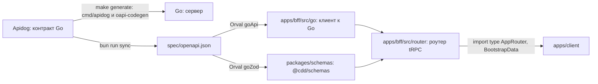

# Миграция на BFF: контракт

Для API между клиентом и BFF контракт — роутер tRPC: процедуры описаны кодом в BFF, фронт получает их типы
импортом `@cdd/bff` из монорепы фронта. Между BFF и Go контракт остаётся spec-first: Go описан в Apidog, а клиент к нему и
схемы входа генерирует Orval. Схемы лежат в пакете `@cdd/schemas`, их берёт роутер BFF.

<DiagramSection>

## Источники правды

Схема показывает, откуда Go, BFF и браузер получают контракт и типы.

<template #diagram>



</template>

| Граница | Источник правды и получение типов |
| --- | --- |
| Go ↔ BFF | Контракт Go ведётся в Apidog. Go забирает его сам: `make generate` в бэкенде запускает [`go run ./cmd/apidog`](https://github.com/go-park-mail-ru/2026_2_Cringe_Driven_Development/blob/4094350/Makefile#L31) и затем `oapi-codegen`. Монорепа выгружает тот же контракт в `spec/openapi.json`, и Orval строит по нему клиент к Go для BFF и zod-схемы операций в пакет `@cdd/schemas`. |
| Клиент ↔ BFF | Контракт — роутер tRPC в `apps/bff/src/router/`. Клиент делает `import type { AppRouter } from '@cdd/bff'`: в бандл не попадает ни строчки кода BFF. |
| HTML → клиент | Второй контракт — `BootstrapData = { user: CurrentUser \| null }`, экспортируемый BFF через `import type`. `CurrentUser` выводится из результата `users.me`, без ручной копии DTO. Это данные HTML, не новая процедура tRPC. |

В HTML только пользователь; токенов, сроков, cookie, ключей и служебных ответов Go нет.
[Подробности bootstrap](./bootstrap#контракт).

```ts [apps/bff/src/bootstrap-types.ts]
// apps/bff/src/bootstrap-types.ts — пример определения и экспорта из пакета @cdd/bff
import type { inferRouterOutputs } from '@trpc/server';
import type { AppRouter } from './router';

type CurrentUser = inferRouterOutputs<AppRouter>['users']['me'];
export type BootstrapData = { user: CurrentUser | null };
```

- **Apidog описывает только Go.** Публичного OpenAPI у BFF нет: overlay, публичный контракт и их проверки
  в CI больше не нужны.
- **Валидация.** Вход процедур проверяют zod-схемы, сгенерированные из контракта Go: правило поля
  описано один раз, в Apidog. Формы клиента в модуле №2 этих схем не используют — см. [«Клиент»](./client#клиент).
  Выход не проверяется во время работы — типы ответа берутся из Orval, а Go — наш сервис.

</DiagramSection>

## Что меняется в контракте Go

Go становится серверным API для BFF, поэтому его контракт в Apidog меняется:

- `TokenPair`: `access_token`, `access_expires_in` (секунды), `refresh_token`, `refresh_expires_in`
  (секунды);
- `/auth/register` → `201 { user: User, tokens: TokenPair }`, `/auth/login` → `200` того же вида;
- `/auth/refresh`: тело `{ refresh_token }` → `200 TokenPair`;
- `/auth/logout`: тело `{ refresh_token }`, `bearerAuth` → `204`;
- у ручек данных остаётся `bearerAuth`; `Set-Cookie`, параметр cookie `refresh_token` и заголовок
  `X-CSRF-Token` уходят.

Контракт уже требует `bearerAuth` у ручек данных, а бэк читает access только из cookie
[`access_token`](https://github.com/go-park-mail-ru/2026_2_Cringe_Driven_Development/blob/4094350/internal/middleware/authenticate.go#L19),
заголовок `Authorization` он не смотрит. После переезда код и контракт сходятся.

## Команды

Команда Bun выполняет два шага подряд:

```sh [Bun]
bun run sync
```

1. `apidog` выгружает контракт Go из Apidog в `spec/openapi.json`;
2. `orval` генерирует по нему клиент к Go и zod-схемы (см. ниже).

`spec/openapi.json` коммитится: по диффу видно, что поменялось в контракте Go. Собственный генератор
клиента `openapi-cdd` больше не нужен: клиент берёт типы из роутера, а не из OpenAPI.

## Генерация Orval

`orval.config.ts` в корне монорепы — две цели, обе читают контракт Go:

```ts [orval.config.ts]
import { defineConfig } from 'orval';

export default defineConfig({
  // BFF → Go: fetch-клиент по операциям контракта
  goApi: {
    input: { target: 'spec/openapi.json' },
    output: {
      target: 'apps/bff/src/go/client.ts',
      client: 'fetch',
      baseUrl: 'http://api:8080/api/v1', // на двух VPS мутатор берёт адрес из GO_API_URL
      override: { mutator: { path: 'apps/bff/src/go/fetch.ts', name: 'bearerFetch' } }, // Authorization: Bearer <access>; на двух VPS ещё X-BFF-Key
    },
  },
  // zod-схемы операций — пакет @cdd/schemas: вход процедур BFF
  goZod: {
    input: { target: 'spec/openapi.json' },
    output: {
      target: 'packages/schemas/src/zod.ts',
      client: 'zod',
    },
  },
});
```

*Пример; точные пути, имена функций и схем — по выгрузке.* Схемы Orval называет по операциям, например
`CreateCellBody` — тело `POST /notebooks/{id}/cells`.

## Роутер

Роутер лежит в `apps/bff/src/router/`, по файлу на ресурс; `index.ts` собирает их в `appRouter`.
Процедуры названы по ресурсам Go:

| Процедура | Тип | Go | Вход |
| --- | --- | --- | --- |
| `auth.register` | mutation | `POST /auth/register` | тело регистрации |
| `auth.login` | mutation | `POST /auth/login` | тело входа |
| `auth.logout` | mutation | `POST /auth/logout` | — |
| `users.me` | query | `GET /users/me` | — |
| `notebooks.list` | query | `GET /notebooks` | — |
| `notebooks.get` | query | `GET /notebooks/{id}` | `{ id }` |
| `notebooks.create` | mutation | `POST /notebooks` | тело создания |
| `cells.create` | mutation | `POST /notebooks/{id}/cells` | `{ notebookId, …тело }` |
| `cells.delete` | mutation | `DELETE /notebooks/{id}/cells/{index}` | `{ notebookId, index }` |

`users.me` остаётся для явного обновления пользователя. При старте клиент читает `BootstrapData`
из HTML, отдельного вызова нет.

Процедуры обновления токенов нет: refresh делает сам BFF (см.
[«Access истёк»](./auth-scenarios#access-истек)). `auth.login` и `auth.register` построены на `publicProcedure`, `auth.logout` — на
`optionalSessionProcedure`: если сессия есть, она даёт `ctx.go`, но без сессии не отвечает `UNAUTHORIZED`.
Остальные — на `authedProcedure`: она требует сессию и даёт процедуре `ctx.go` — клиент Go с уже свежим
access. Как устроены `createContext` и обе процедуры — в [«Авторизации и CSRF»](./auth).

```ts [apps/bff/src/router/cells.ts]
// apps/bff/src/router/cells.ts
import { z } from 'zod';
import { authedProcedure, router } from '../trpc';
import { CreateCellBody } from '@cdd/schemas';

export const cells = router({
  create: authedProcedure
    .input(z.object({ notebookId: z.number().int() }).extend(CreateCellBody.shape))
    .mutation(({ ctx, input: { notebookId, ...body } }) => ctx.go.createCell(notebookId, body)),
  delete: authedProcedure
    .input(z.object({ notebookId: z.number().int(), index: z.number().int() }))
    .mutation(({ ctx, input }) => ctx.go.deleteCell(input.notebookId, input.index)),
});
```

```ts [apps/bff/src/router/index.ts]
// apps/bff/src/router/index.ts
export const appRouter = router({ auth, users, notebooks, cells });
export type AppRouter = typeof appRouter;
```

*Пример; имена схем и методов клиента Go — по выгрузке Orval.*

## Как добавить процедуру {#как-добавить-процедуру}

Новая процедура проходит согласование, подключение к Go и проверку через официальный клиент.
Шесть шагов и связанный пример — [Как добавить процедуру](./procedures#как-добавить-процедуру).

## Процедуры экранов {#процедуры-экранов}

Роутер `views` собирает несколько ответов Go для одного экрана; `views.notebook` остаётся будущим примером.
Условия и исходный пример — [Процедуры экранов](./procedures#процедуры-экранов).

## Ошибки

Go отвечает на ошибку телом `Error { code, message }`. BFF переводит её в ошибку tRPC:

| Ответ Go | Ошибка tRPC | Что ещё |
| --- | --- | --- |
| `400` | `BAD_REQUEST` | |
| `401` после неудачного refresh | `UNAUTHORIZED` | cookie сессии стирается |
| `403` | `FORBIDDEN` | |
| `404` | `NOT_FOUND` | |
| `409` | `CONFLICT` | |
| `403 s2s_forbidden`, `5xx`, сеть | `BAD_GATEWAY` | запись в лог, сессия не трогается |

`errorFormatter` роутера добавляет в `data`:

- `appCode` — код приложения: `Error.code` от Go или код BFF (`csrf_invalid`). Клиент показывает
  сообщения по `appCode`, а не по тексту `message`;
- `zodError` — `error.flatten()`, если вход не прошёл схему (`BAD_REQUEST`).

`stack` в прод не уходит.

```json
{
  "error": {
    "message": "Блокнот не найден",
    "code": -32004,
    "data": { "code": "NOT_FOUND", "httpStatus": 404, "path": "notebooks.get", "appCode": "notebook_not_found" }
  }
}
```

*Пример; коды приложения — из контракта Go.*

## Клиент {#клиент}

Официальный `@trpc/client` получает типы через `import type AppRouter` и работает с `/api/trpc`.
Настройка, обработка ошибок и границы MVP — [Клиент](./client#клиент).

## Какие вызовы BFF принимает {#какие-вызовы-bff-принимает}

BFF вызывает только заданные в коде операции Go; неизвестная процедура не передаётся в Go.
Допустимые запросы и пример отказа — [Какие вызовы BFF принимает](./client#какие-вызовы-bff-принимает).
